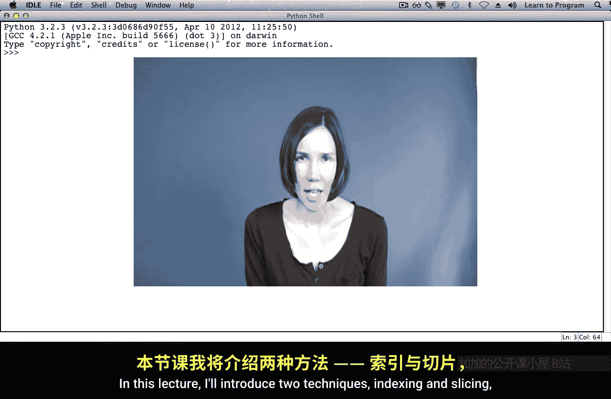
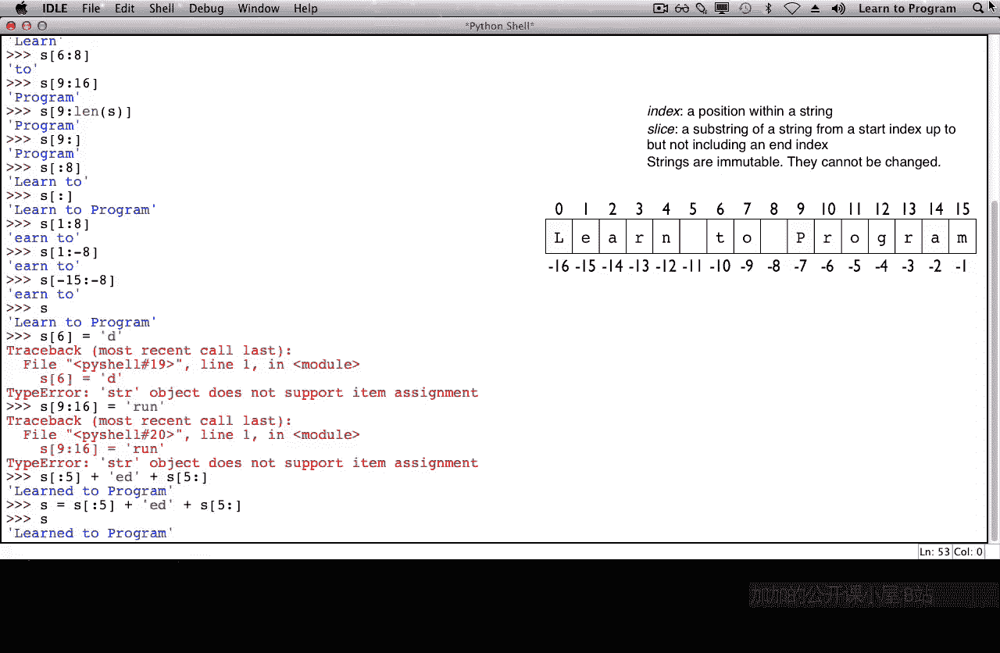

# 023：字符串索引与切片 📚


在本节课中，我们将学习如何从字符串中提取部分内容。我们将重点介绍两种核心技术：**索引**和**切片**。通过它们，你可以轻松获取字符串中的特定字符或子串。

---



## 字符串索引 🔢

在Python中，字符串中的每个字符都有一个**索引**，代表它在字符串中的位置。我们以一个示例字符串 `"Learn to program"` 来演示。

字符串索引从 **0** 开始计数，而不是1。例如：
*   索引 `0` 对应字符 `'L'`。
*   索引 `1` 对应字符 `'e'`。
*   索引 `2` 对应字符 `'a'`。

我们也可以使用**负索引**从字符串的末尾开始计数：
*   索引 `-1` 对应最后一个字符 `'m'`。
*   索引 `-2` 对应倒数第二个字符 `'a'`。
*   索引 `-3` 对应倒数第三个字符 `'r'`。

使用索引，我们可以提取字符串中的单个字符，语法如下：
```python
s = "Learn to program"
character = s[index]
```

---

## 字符串切片 ✂️

上一节我们介绍了如何使用索引获取单个字符。本节中我们来看看如何一次性获取多个字符，这需要使用**切片**操作。

切片允许我们提取字符串的一部分（子串）。其基本语法是：
```python
substring = s[start_index:end_index]
```
这里，`start_index` 是起始索引（包含），`end_index` 是结束索引（不包含）。切片将返回从 `start_index` 到 `end_index-1` 的所有字符。

以下是使用示例字符串 `s = "Learn to program"` 的一些切片示例：

*   `s[0:5]` 返回 `"Learn"`（索引0到4）。
*   `s[6:8]` 返回 `"to"`（索引6到7）。
*   `s[9:16]` 返回 `"program"`（索引9到15）。

切片操作非常灵活，可以省略起始或结束索引：
*   省略起始索引（`[:end_index]`）表示从字符串开头开始切片。
*   省略结束索引（`[start_index:]`）表示切片到字符串末尾。
*   两者都省略（`[:]`）会返回整个字符串的副本。

例如：
*   `s[9:]` 和 `s[9:len(s)]` 都返回 `"program"`。
*   `s[:8]` 返回 `"Learn to "`。
*   `s[:]` 返回 `"Learn to program"`。

负索引同样可以用于切片：
*   `s[1:8]`、`s[1:-8]` 和 `s[-15:-8]` 这三个表达式是等价的，都返回 `"earn to"`。

---

## 字符串的不可变性 🔒

需要牢记的一个重要概念是：**字符串在Python中是不可变的**。这意味着索引和切片操作**不会**修改原始字符串，它们只是基于原字符串创建新的字符串。

以下尝试修改字符串的操作都会导致错误：
```python
s[6] = 'D'  # 错误！不能通过索引修改字符
s[9:16] = 'code'  # 错误！不能通过切片修改子串
```

那么，如果我们想将字符串 `s` 从 `"Learn to program"` 改为 `"Learned to program"` 该怎么办呢？方法不是修改原字符串，而是创建一个新的字符串并让变量指向它。

以下是实现方法：
```python
s = "Learn to program"
# 组合新字符串：取"Learn" + "ed" + " to program"
new_s = s[:5] + "ed" + s[5:]
print(new_s)  # 输出：Learned to program
# 现在可以让变量s指向这个新字符串
s = new_s
```

这个过程是：我们利用原字符串的切片（`s[:5]` 和 `s[5:]`）与字符串 `"ed"` 进行拼接（使用 `+` 运算符），从而生成了一个全新的字符串 `"Learned to program"`，最后让变量 `s` 引用这个新字符串。

---

## 总结 📝

本节课中我们一起学习了处理字符串的两个核心技巧：
1.  **索引**：使用 `s[index]` 获取字符串中特定位置的单个字符。索引可以从头（从0开始）或从尾（使用负索引）计数。
2.  **切片**：使用 `s[start:end]` 获取字符串的一部分（子串）。切片范围包含起始索引，但不包含结束索引。可以灵活地省略起始或结束索引。
3.  **字符串的不可变性**：所有针对字符串的索引和切片操作都不会改变原字符串，而是返回新的字符串。要“修改”一个字符串，需要创建新的字符串并重新赋值给变量。



掌握索引和切片是进行文本处理和数据操作的基础，希望你通过练习能熟练运用它们。