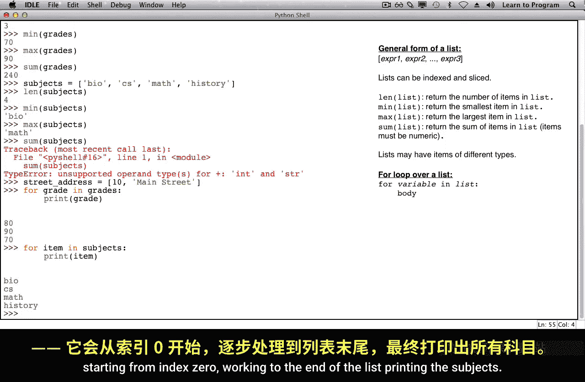

# 029：列表类型入门 📚


在本节课中，我们将要学习Python中一个非常重要的数据类型——**列表**。列表用于存储一系列有序的数据项，例如学生成绩或书名。我们将了解如何创建列表、访问其中的元素，以及使用一些内置函数和循环来处理列表。

---


## 列表的创建与索引

列表使用方括号 `[]` 创建，其中的元素用逗号分隔。列表中的每个元素都有一个位置索引，索引从 **0** 开始计数。

例如，我们创建一个包含三个整数的成绩列表：
```python
grades = [80, 90, 70]
```
在这个列表中：
*   `grades[0]` 指的是整数 `80`。
*   `grades[1]` 指的是整数 `90`。
*   `grades[2]` 指的是整数 `70`。

## 列表切片

与字符串类似，我们可以使用切片操作来获取列表的一部分。切片语法为 `list[start:end]`，其中 `start` 是起始索引（包含），`end` 是结束索引（不包含）。

以下是几个切片示例：
```python
grades[1:2]  # 结果是 [90]，包含索引1，不包含索引2
grades[0:2]  # 结果是 [80, 90]
```
列表切片的规则与字符串切片完全相同。

## 成员检查与内置函数

我们可以使用 `in` 操作符来检查一个元素是否存在于列表中。
```python
80 in grades   # 结果为 True，因为80在列表中
60 in grades   # 结果为 False，因为60不在列表中
```
Python的许多内置函数也可以应用于列表。

以下是几个常用函数：
*   `len(list)`：返回列表的长度（元素个数）。
*   `min(list)`：返回列表中的最小值。
*   `max(list)`：返回列表中的最大值。
*   `sum(list)`：对列表中的所有数值元素求和。

让我们将这些函数应用于 `grades` 列表：
```python
len(grades)  # 结果为 3
min(grades)  # 结果为 70
max(grades)  # 结果为 90
sum(grades)  # 结果为 240 (80+90+70)
```

## 不同类型的列表

列表不仅可以包含数字，还可以包含字符串或其他任何类型的数据。

例如，我们创建一个学科名称的字符串列表：
```python
subjects = [‘chemistry‘, ‘physics‘, ‘math‘, ‘bio‘]
```
`len`、`min`、`max` 函数同样适用于字符串列表，它们会基于字典顺序进行比较。
```python
len(subjects)  # 结果为 4
min(subjects)  # 结果为 ‘bio‘ (按字母顺序最早)
max(subjects)  # 结果为 ‘math‘ (按字母顺序最晚)
```
需要注意的是，`sum` 函数不能用于字符串列表，尝试这样做会导致 `TypeError`。

## 混合类型列表

一个列表甚至可以同时包含不同类型的数据。

例如，创建一个表示街道地址的列表：
```python
street_address = [1600, ‘Pennsylvania Avenue‘]
```
这个列表包含了一个整数（门牌号）和一个字符串（街道名）。

## 遍历列表

我们经常需要逐个处理列表中的每个元素，这时可以使用 `for` 循环。

以下是遍历 `grades` 列表的示例：
```python
for grade in grades:
    print(grade)
```
循环会依次将列表中的每个元素（80, 90, 70）赋值给变量 `grade` 并执行打印操作。变量名 `grade` 可以替换为任何其他有效的名称，如 `item` 或 `element`。

同样地，我们可以遍历 `subjects` 列表：
```python
for subject in subjects:
    print(subject)
```
循环会从索引0开始，依次处理列表中的每个元素，直到列表末尾。

---



本节课中，我们一起学习了Python列表的基础知识。我们了解了如何创建列表、通过索引和切片访问元素、使用 `in` 操作符和 `len`、`min`、`max`、`sum` 等内置函数，以及如何使用 `for` 循环来遍历列表中的所有元素。列表是组织和管理数据集合的强大工具，是后续学习更复杂数据结构的基础。