# 030：列表方法 📚

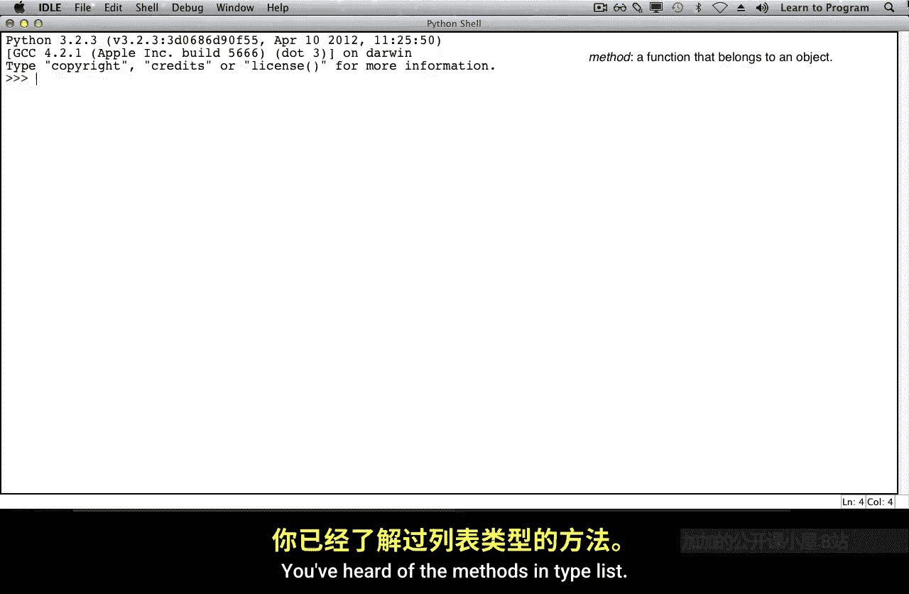

在本节课中，我们将学习Python列表的各种方法。列表是Python中一种非常灵活的数据结构，而方法则是与特定对象（如列表）关联的函数。我们将通过一个收集并管理个人喜爱颜色的示例，逐一介绍列表的常用方法，包括如何添加、删除、查找和排序列表中的元素。

---

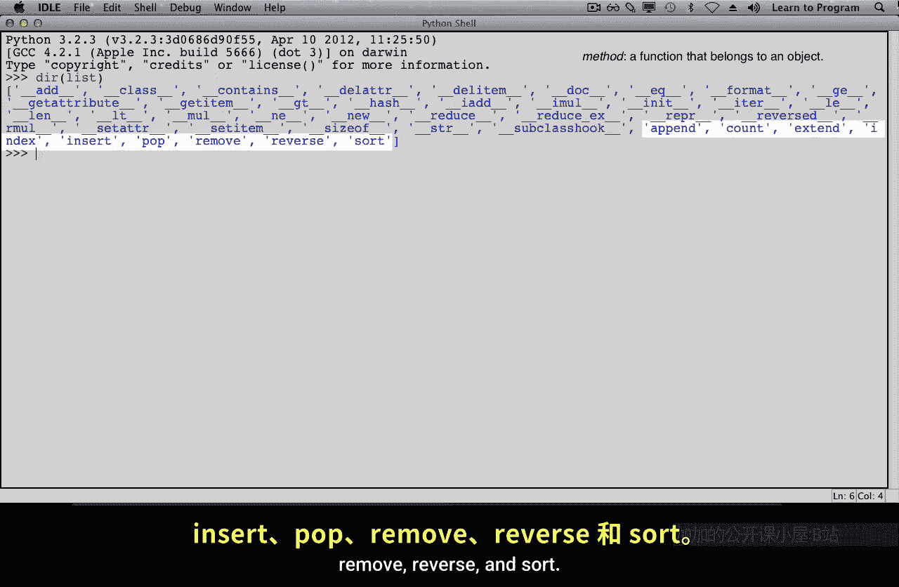

## 什么是列表方法？🤔

上一节我们介绍了列表的基本概念。本节中，我们来看看列表的“方法”。一个方法是存在于对象内部的函数。对于列表类型，它内置了多种方法。

以下是列表类型的主要方法（忽略那些以下划线开头的方法）：
*   `append`
*   `count`
*   `extend`
*   `index`
*   `insert`
*   `pop`
*   `remove`
*   `reverse`
*   `sort`

这些方法中，有些会修改列表本身，有些则只是返回信息。

---

## 构建初始列表 🏗️

我们将通过一个示例来演示这些方法。目标是跟踪一个人最喜欢的颜色。首先，我们需要一个循环来收集用户输入的所有颜色，但我们必须先询问第一个颜色。

以下是初始设置：
```python
colors = []
prompt = "请输入你最喜欢的颜色之一，按回车键结束："
```

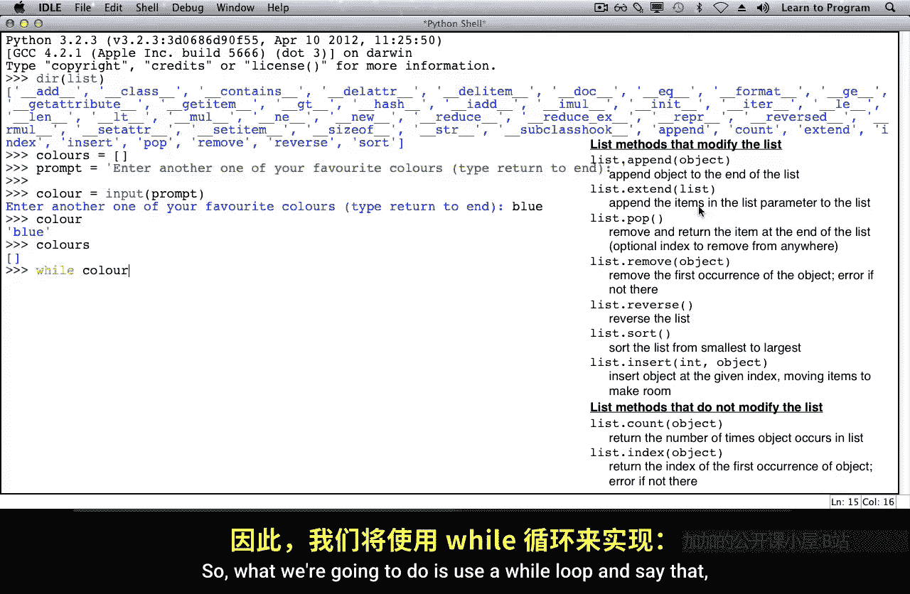

我们通过调用`input`函数并传入提示语来要求用户输入第一个颜色。
```python
color = input(prompt)
```
假设用户输入了“blue”。此时，变量`color`指向字符串“blue”，而变量`colors`仍然指向一个空列表`[]`。

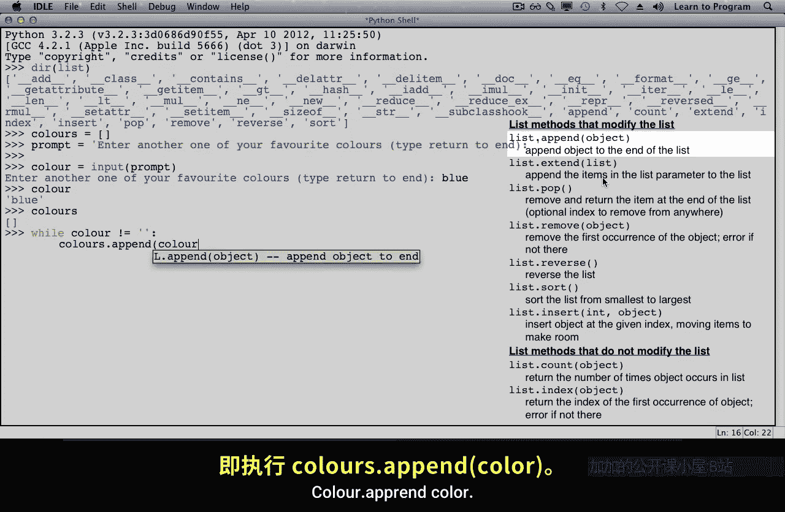

为了累积用户输入的信息，我们将使用一个`while`循环。只要`color`不是空字符串（即用户没有直接按回车），我们就执行循环。

```python
while color != "":
    colors.append(color)
    color = input(prompt)
```

在循环体内，我们首先将当前颜色`color`**追加**到列表`colors`中。然后，为下一次循环迭代做准备，再次询问用户输入另一个颜色。

假设我们依次输入了“yellow”和“brown”，然后按回车键结束循环。此时，检查`colors`变量，会发现它包含了字符串：`[‘blue‘， ‘yellow‘， ‘brown‘]`。

---

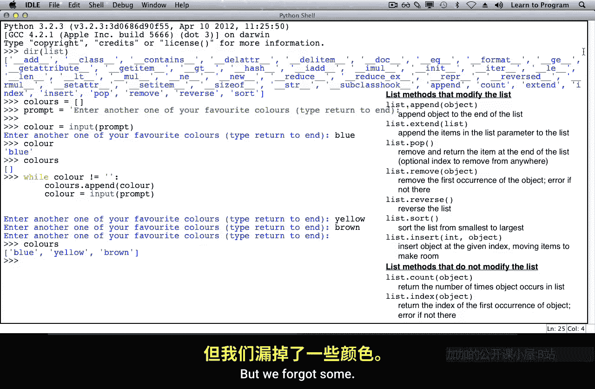

## 修改列表：添加与删除元素 🔧

上一节我们创建了一个基础的颜色列表。本节中，我们来看看如何修改它。

### 使用 `extend` 方法添加多个元素

我们发现忘记了一些颜色。可以使用`extend`方法，通过传入一个我们忘记的颜色列表来扩展`colors`列表。

```python
colors.extend(["hot pink"， "neon green"])
```
现在，检查`colors`，会看到：`[‘blue‘， ‘yellow‘， ‘brown‘， ‘hot pink‘， ‘neon green‘]`。

**注意**：`extend`方法期望接收一个列表作为参数。如果直接传入多个字符串，如`colors.extend("auburn"， "teal"， "magenta")`，会导致`TypeError`。

### 使用 `pop` 方法移除元素

我们不太喜欢“neon green”了。可以调用`colors.pop()`来移除它。`pop`方法默认移除列表中的最后一个元素。

```python
colors.pop()
```
检查`colors`，现在列表是：`[‘blue‘， ‘yellow‘， ‘brown‘， ‘hot pink‘]`。“neon green”已不在其中。

需要指出的是，`colors.pop()`不仅移除了最后一个元素，还**返回**了被移除的元素。因此你可以在赋值语句中使用它。像`colors.pop()`这样既返回信息又对数据（如列表）产生影响的函数，被称为具有**副作用**。

我们也不喜欢“brown”了，但这次我们想移除列表中特定位置的元素。可以使用`pop`方法的可选参数来指定要移除元素的索引。“brown”在索引2的位置（列表索引从0开始）。

```python
colors.pop(2)
```
这将移除并返回索引2处的元素（即“brown”）。现在`colors`变为：`[‘blue‘， ‘yellow‘， ‘hot pink‘]`。

**总结一下**：
*   `colors.pop()` 移除列表中的最后一个项目。
*   `colors.pop(index)` 移除给定索引处的项目。

### 使用 `remove` 方法按值移除元素

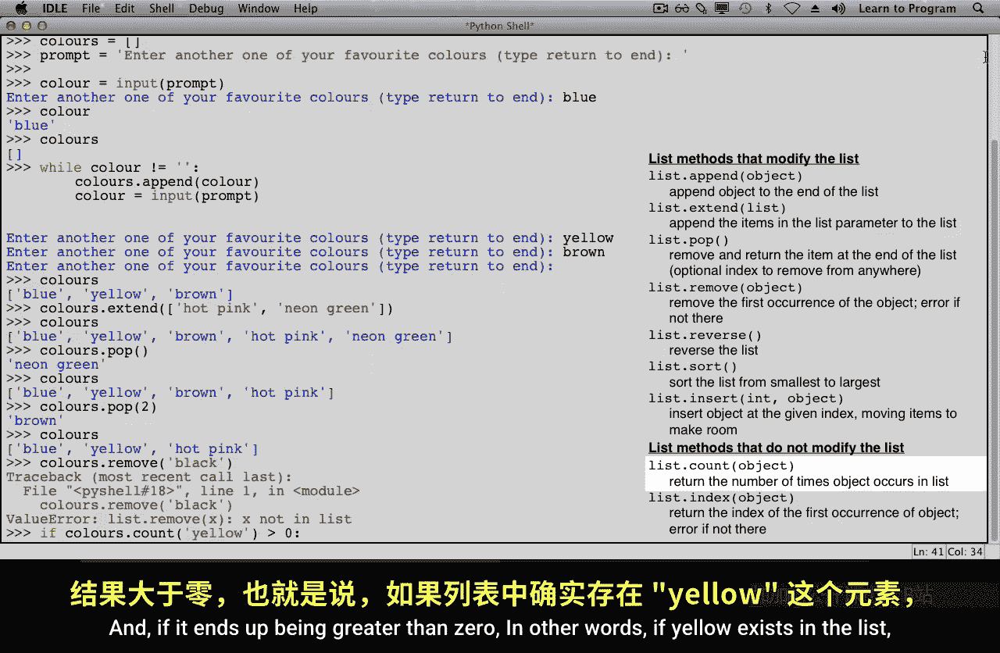

`remove`方法接收一个要移除的**对象**（值），而不是索引。它会移除列表中该对象的**第一个**匹配项。

```python
colors.remove("yellow")
```
现在`colors`只剩下：`[‘blue‘， ‘hot pink‘]`。

但是，如果我们尝试移除一个不在列表中的元素（例如“black”），`remove`方法会引发一个`ValueError`。

```python
colors.remove("black")  # 这会引发 ValueError
```
因此，在调用可能引发错误的方法或函数之前，最好先进行检查。我们可以先使用`count`方法计算某个值在列表中出现的次数。

```python
if colors.count("yellow") > 0:
    colors.remove("yellow")
```
更标准的做法是使用`in`关键字进行检查：
```python
if "yellow" in colors:
    colors.remove("yellow")
```
如果“yellow”不在列表中，`if`语句的条件会评估为`False`，我们就不会调用`colors.remove`，从而避免了错误。

---

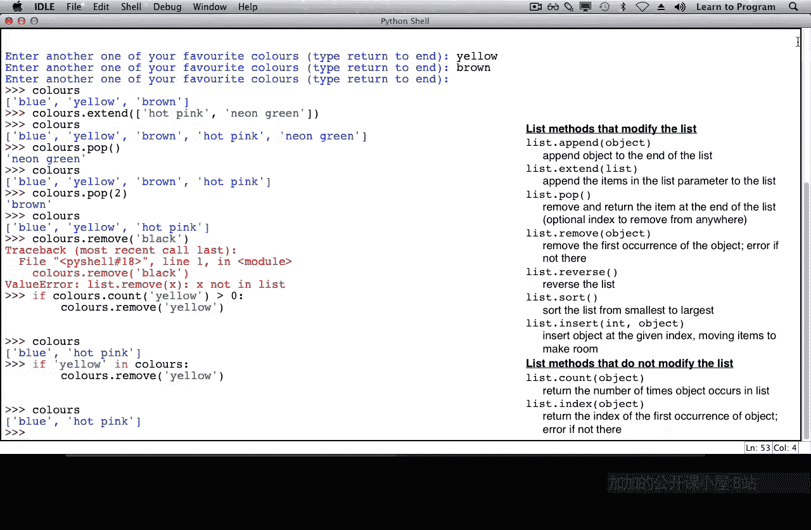

## 组织列表：排序与反转 🔄

上一节我们学习了如何增删列表元素。本节中，我们来看看如何重新组织列表的顺序。

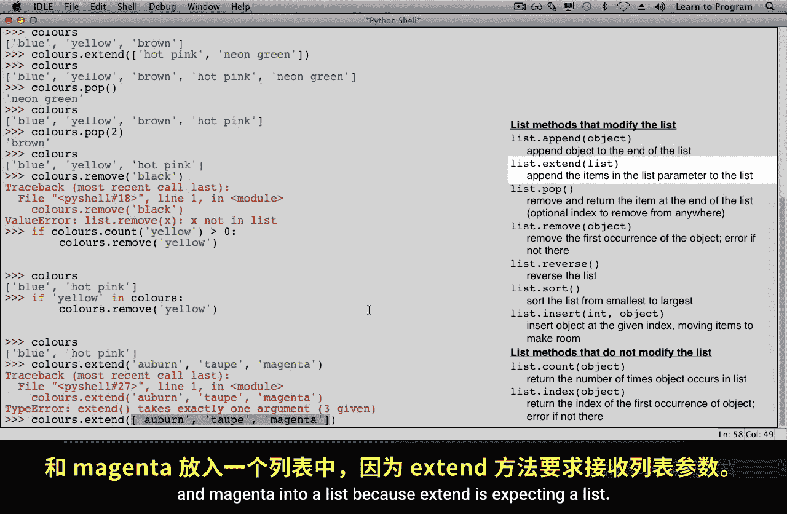

首先，让我们用`extend`方法正确地添加一些新颜色。
```python
colors.extend(["auburn"， "teal"， "magenta"])
```
现在`colors`是：`[‘blue‘， ‘hot pink‘， ‘auburn‘， ‘teal‘， ‘magenta‘]`。

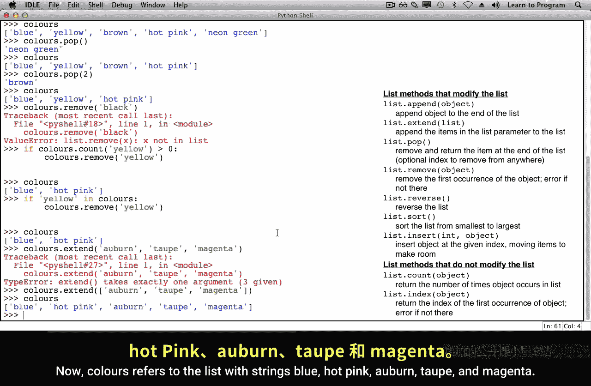

### 使用 `sort` 方法排序

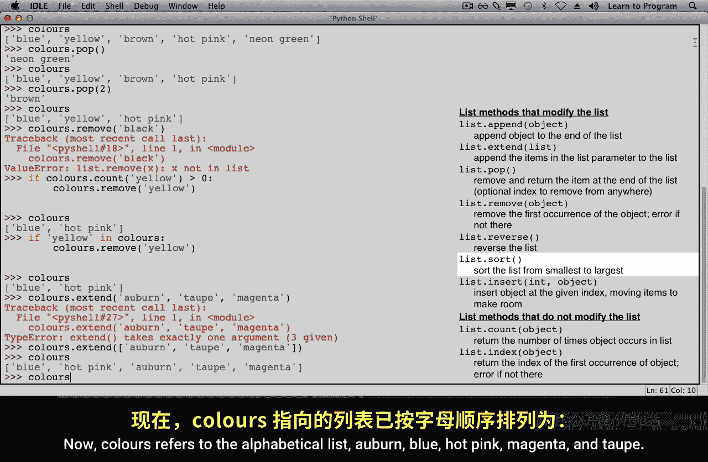

我们可以调用`colors.sort()`对列表进行**原地排序**（按字母顺序）。
```python
colors.sort()
```
排序后，`colors`变为：`[‘auburn‘， ‘blue‘， ‘hot pink‘， ‘magenta‘， ‘teal‘]`。

### 使用 `reverse` 方法反转

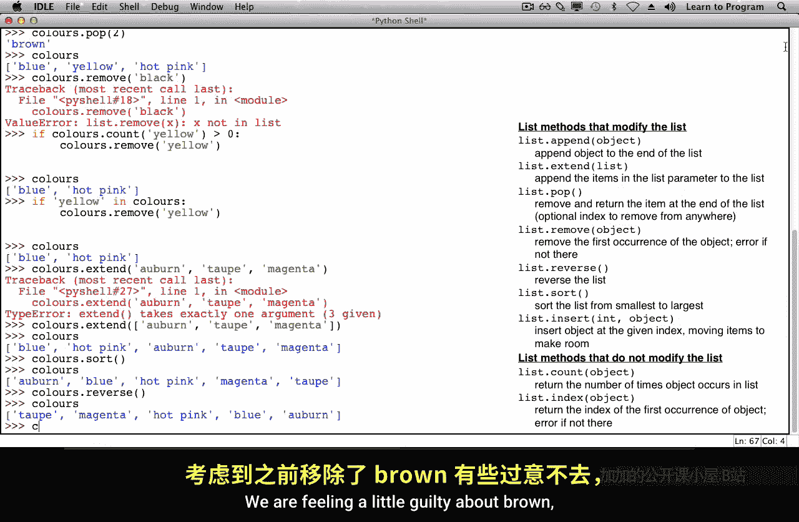

我们可以调用`colors.reverse()`来反转列表的顺序。
```python
colors.reverse()
```
反转后，`colors`变为：`[‘teal‘， ‘magenta‘， ‘hot pink‘， ‘blue‘， ‘auburn‘]`。

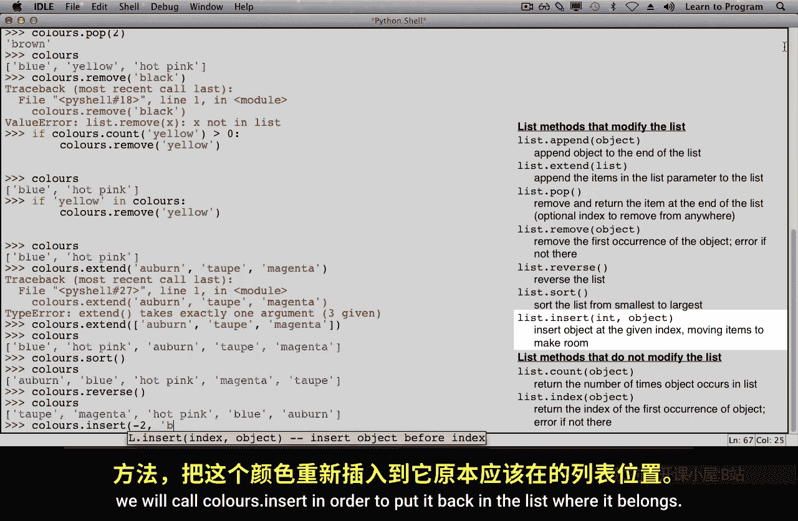

---

## 精确控制：插入与查找元素 🎯

### 使用 `insert` 方法插入元素

我们对移除“brown”感到有些愧疚，想把它放回列表中它应该在的位置。可以使用`insert`方法在特定索引处插入一个元素。

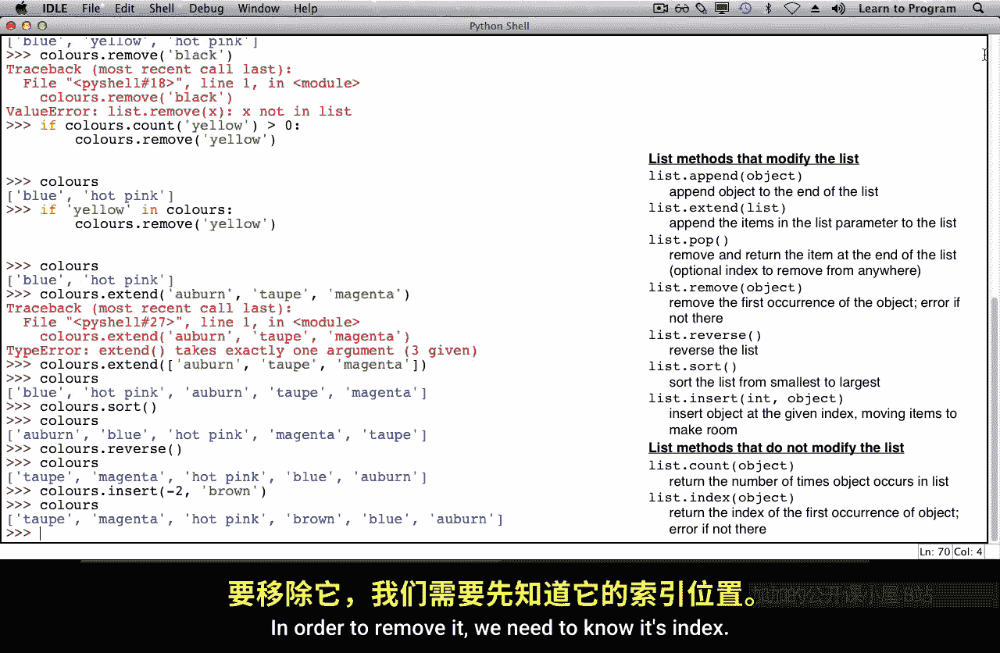

我们想在倒数第二个位置（索引-2）插入“brown”。
```python
colors.insert(-2， "brown")
```
`insert`方法不会替换原索引处的元素，而是将该位置及之后的元素向后移动，为新元素腾出空间。现在`colors`是：`[‘teal‘， ‘magenta‘， ‘hot pink‘， ‘brown‘， ‘blue‘， ‘auburn‘]`。

### 使用 `index` 方法查找元素索引

现在，我们觉得“hot pink”对于现在的我们来说有点太鲜艳了，想移除它。为了移除，我们需要知道它的索引。可以使用`index`方法来查找。

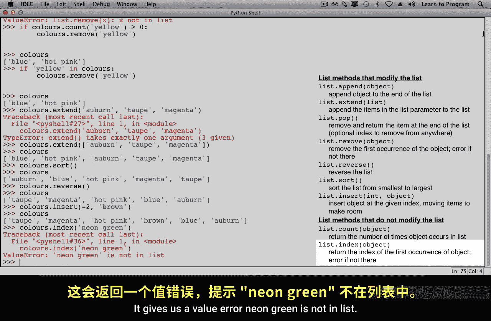

但是，和`remove`方法一样，如果查找的元素不在列表中，`index`方法也会引发`ValueError`。
```python
colors.index("neon green")  # 会引发 ValueError，因为我们已没有"neon green"
```
为了防止错误发生，我们在调用`index`之前先进行检查。
```python
if "hot pink" in colors:
    where = colors.index("hot pink")
    colors.pop(where)
```
首先检查“hot pink”是否在列表中。如果在，则获取它的索引并赋值给变量`where`，然后使用`colors.pop(where)`将其移除。

最终，我们剩下的颜色列表是：`[‘teal‘， ‘magenta‘， ‘brown‘， ‘blue‘， ‘auburn‘]`。

---

## 总结 📝

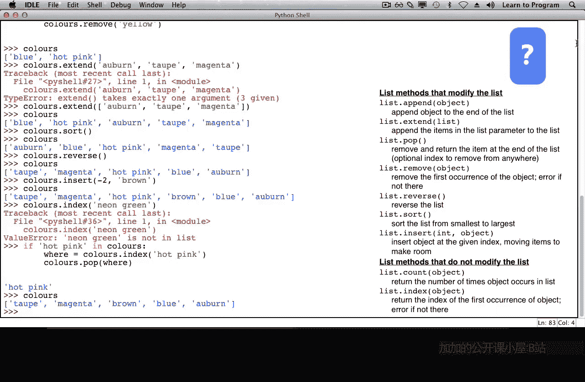

本节课中，我们一起学习了Python列表的核心方法。我们通过管理一个颜色列表的完整流程，实践了如何使用`append`和`extend`添加元素，使用`pop`和`remove`删除元素，使用`sort`和`reverse`调整顺序，以及使用`insert`在指定位置插入元素。同时，我们强调了在使用`remove`和`index`等方法前，使用`in`关键字或`count`方法进行检查的重要性，以避免程序因值错误而崩溃。掌握这些方法，你就能有效地操作和管理列表数据了。