**编程基础：05：可变性与别名** 🧠


在本节课中，我们将学习可变对象的概念，以及别名现象如何影响程序行为。理解这些概念对于掌握Python中数据如何被修改至关重要。

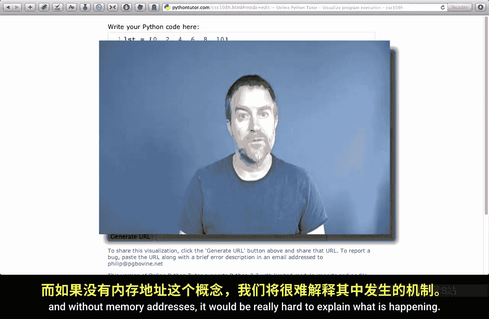

---

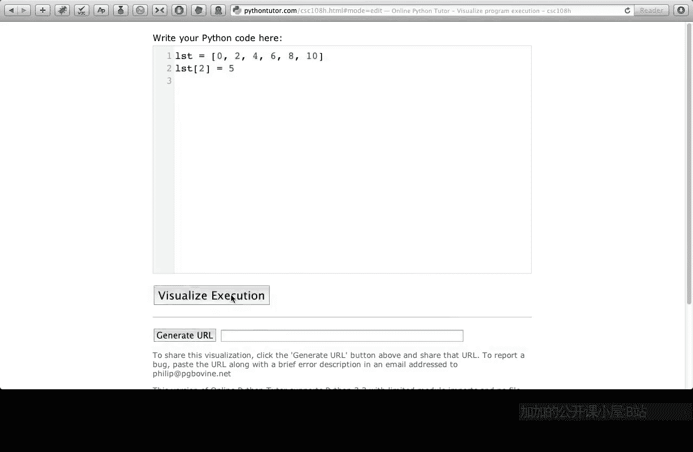

### 内存地址的作用

之前我们介绍的内存地址即将变得非常有用。事实证明，你可以修改某些对象的内容。如果没有内存地址，将很难解释其中发生的变化。

---

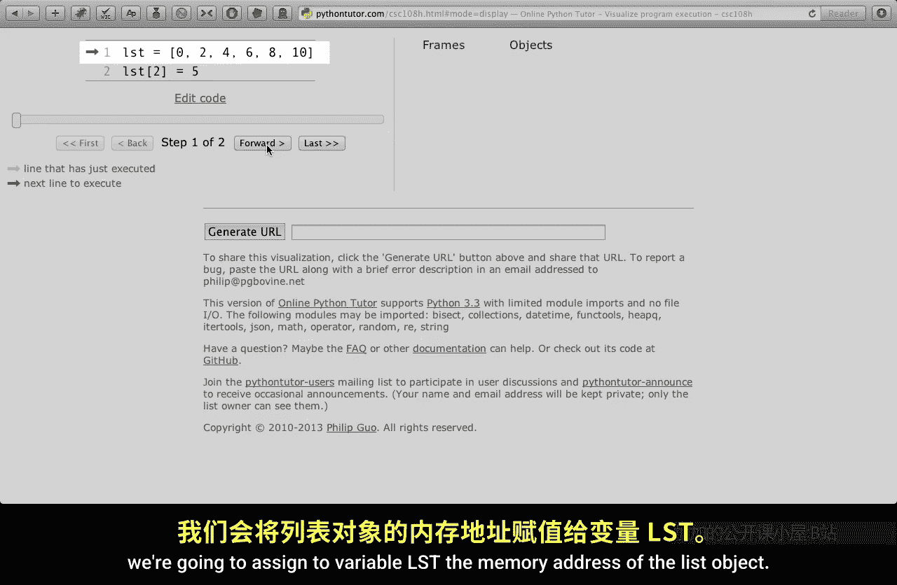

### 列表对象的可变性

上一节我们提到了内存地址，本节中我们来看看列表对象如何被修改。

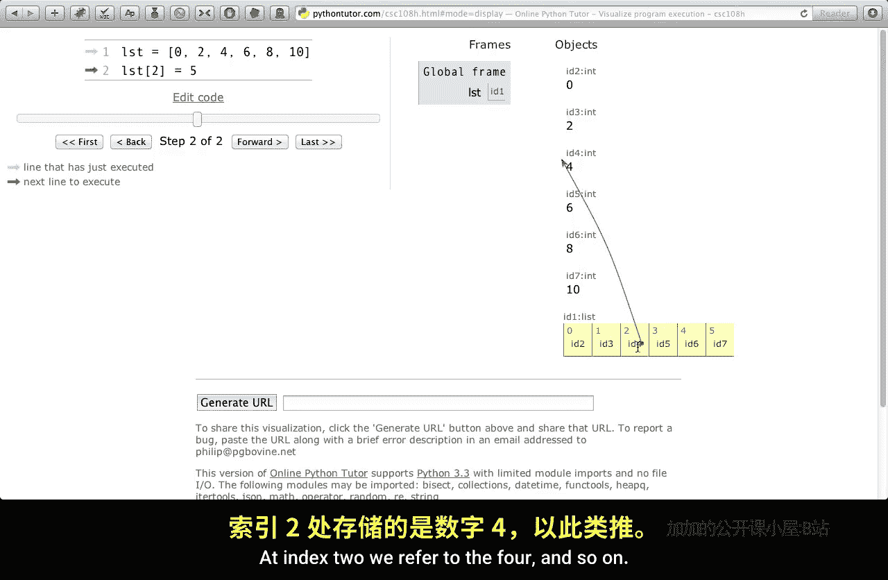

在代码的第一行是一个赋值语句。我们计算右侧的表达式，这会创建一个列表对象以及六个整数：0, 2, 4, 6, 8, 10。创建这个列表结构后，我们将列表对象的内存地址赋值给变量 `lst`。

```python
lst = [0, 2, 4, 6, 8, 10]
```

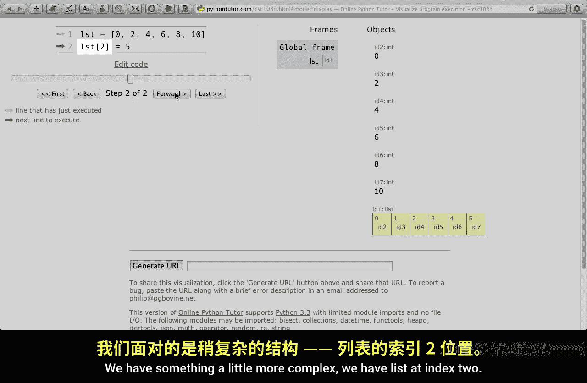

因此，`lst` 包含内存地址 `ID1`，它指向列表对象。在索引0处是内存地址 `ID2`，它指向整数对象 `0`。索引1指向 `2`，索引2指向 `4`，依此类推。

---

### 修改列表元素

在第二行是另一个赋值语句。左侧不仅仅是一个变量，而是更复杂的结构：`lst[2]`。

```python
lst[2] = 5
```

我们实际上要修改那个内存位置。执行该赋值语句后，`lst[2]` 将不再指向整数 `4`，而是指向整数 `5`。我们正在修改堆中的一个对象。

执行后，我们看到在内存地址 `ID8` 处有一个新对象，`lst[2]` 现在指向这个新对象。

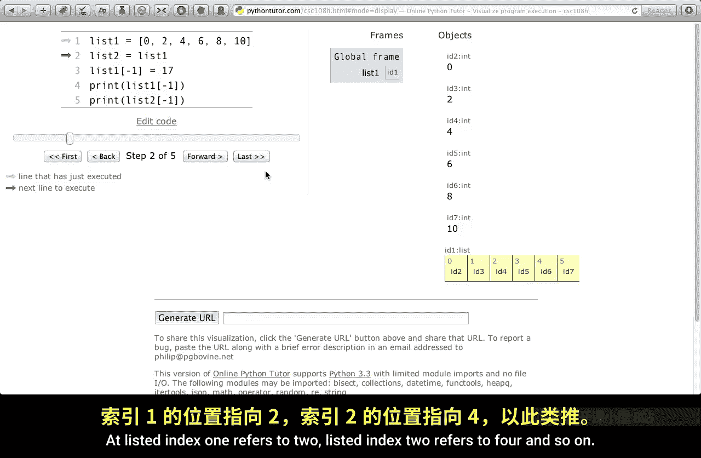

---

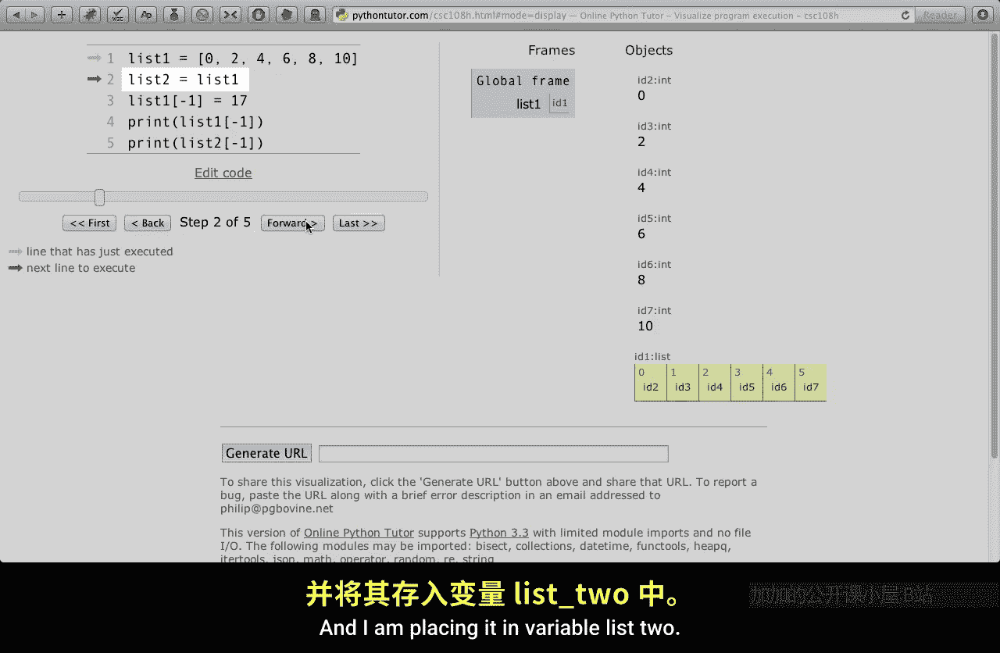

### 别名的概念

让我们编辑代码，看看其他情况。我们将用一些其他代码替换这段代码。

第一行，我们知道会发生什么。`list1` 指向一个列表。`list1[0]` 指向 `0`，`list1[1]` 指向 `2`，`list1[2]` 指向 `4`，等等。

在第二行，我做了一件相当有趣的事情。我将变量 `list1` 中的内存地址，放入了变量 `list2` 中。

```python
list1 = [0, 2, 4, 6, 8, 10]
list2 = list1
```

唯一改变的是模块内存的内容。现在，`list1` 和 `list2` 都指向同一个列表对象。

这被称为**别名**：当两个变量包含相同的内存地址时，就发生了别名现象。

---

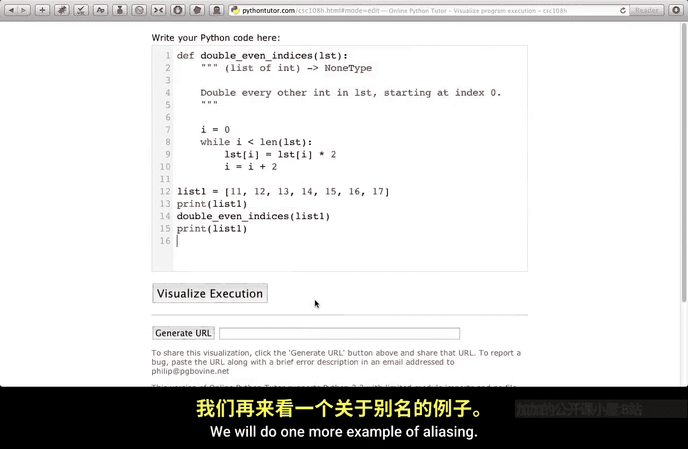

### 通过别名观察修改

目前一切顺利。我们现在要做的是，将 `list1` 指向的对象的最后一个元素赋值为 `17`。

```python
list1[-1] = 17
```

列表中索引5处的元素将改变。我们将失去对 `10` 的引用，取而代之的是索引5处的元素将指向整数 `17`。

有趣的是，`list2` 也观察到了这个变化。`list2` 包含列表对象的内存地址。我们通过 `list1` 改变了那个对象，但 `list2` 也随之改变。

因此，当我们打印 `list1[-1]` 时，得到 `17`。当我们打印 `list2[-1]` 时，也会得到完全相同的结果。

---

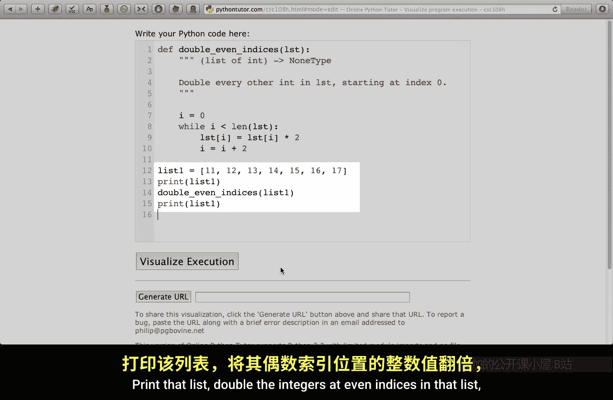

### 函数中的别名示例

我们将再看一个别名的例子。这里有一个函数 `double_even_indices`，它接受一个整数列表作为参数，不返回任何内容（或者说返回 `None`）。

```python
def double_even_indices(lst):
    """将列表中索引为0, 2, 4...的整数值加倍。"""
    i = 0
    while i < len(lst):
        lst[i] = lst[i] * 2
        i = i + 2
```

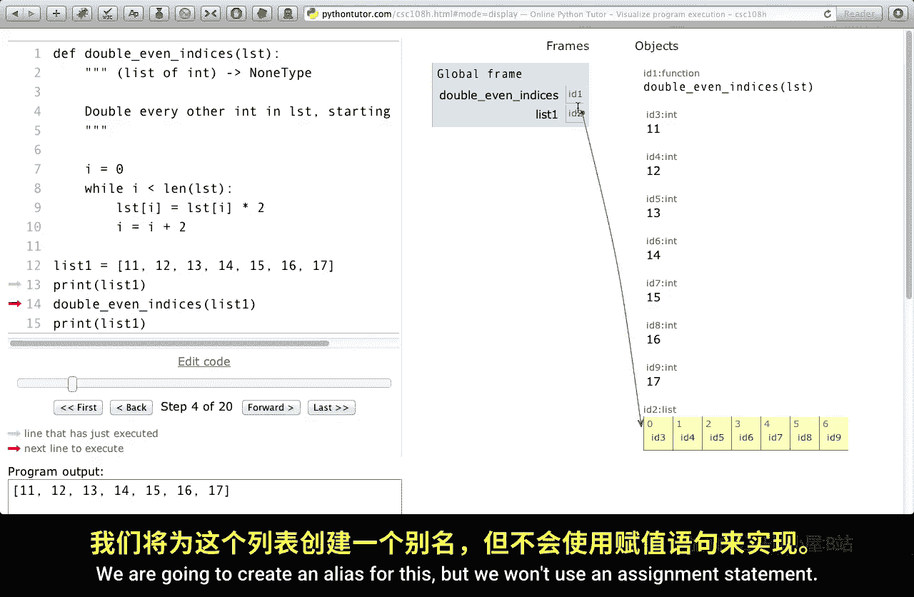

文档字符串说明：从索引0开始，将列表中每隔一个的整数值加倍。因此，索引0, 2, 4, 6, 8...处的值将被加倍。

我们将 `i` 初始化为0，`i` 将是下一个要加倍的元素的索引。只要还有剩余元素（即 `i` 小于列表长度），循环就会继续。在循环内，我们查看索引 `i` 处的值，将其加倍，然后将新值的引用存储回列表的索引 `i` 处。接着，我们将 `i` 加2，以跳到下一个偶数索引。

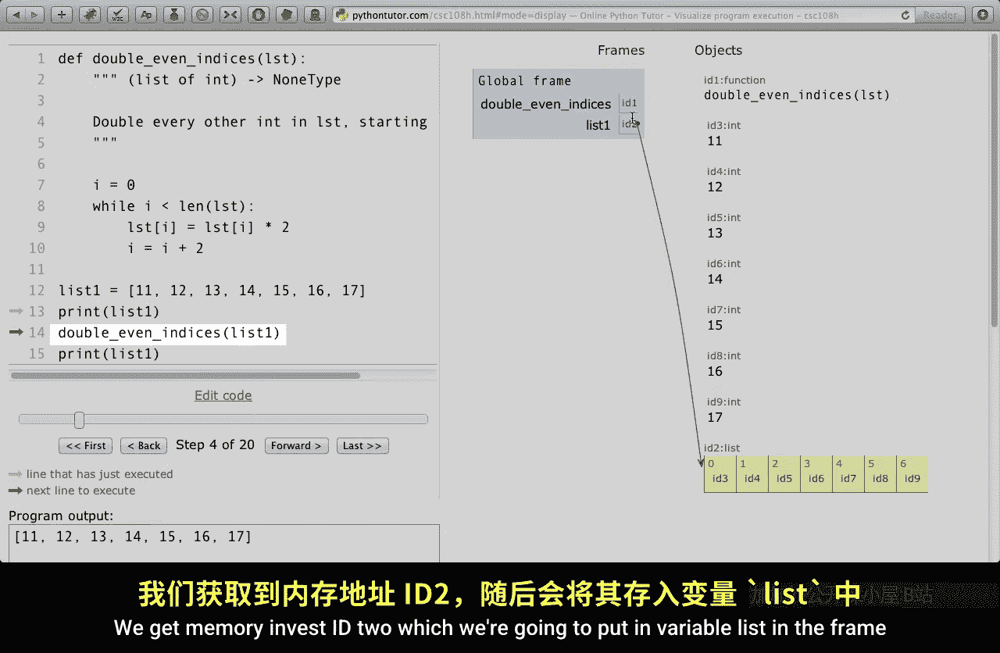

我们的主程序将创建一个列表，赋值给变量 `list1`，打印该列表，调用函数处理该列表中偶数索引的整数，然后再次打印列表。

```python
list1 = [11, 12, 13, 14, 15, 16, 17]
print(list1)
double_even_indices(list1)
print(list1)
```

我们定义函数，创建列表结构，并打印列表。注意，变量 `list1` 包含内存地址 `ID2`，而 `ID2` 是我们的列表对象的内存地址。

我们将为此创建一个别名，但不是通过赋值语句，而是通过函数调用。我们计算参数，得到内存地址 `ID2`，这个地址将被放入函数 `double_even_indices` 创建的新帧中的变量 `lst` 里。

现在，在函数 `double_even_indices` 中，变量 `lst` 指向那个列表对象。变量 `list1` 也指向同一个列表对象。这意味着我们对那个列表对象所做的任何更改，两个变量都能看到。

我们开始执行函数。`i` 从索引0开始。列表长度是7，所以0小于7。我们将索引0处的值（11）乘以2得到22，然后让 `lst[0]` 指向这个新的22。接着 `i` 加2变为2。

2小于7，我们对索引2处的值（13）执行相同操作，将其加倍为26，并让 `lst[2]` 指向26。`i` 加2变为4。

4小于7，我们再次操作，将索引4处的15替换为30。`i` 加2变为6。

6小于7，我们将索引6处的17加倍为34，并让 `lst[6]` 指向34。`i` 加2变为8。

现在 `i` 为8，这使得循环条件 `i < len(lst)` 为假。一旦循环条件为假，循环终止，我们退出循环。

函数 `double_even_indices` 末尾没有其他语句，因此它将返回 `None`。记住，如果函数中没有 `return` 语句，函数将返回 `NoneType` 类型的值 `None`。

回到主模块，我们刚刚调用了 `double_even_indices`，现在继续执行第15行（即第二个 `print(list1)`）。

`list1` 现在指向的列表对象在索引0处是22，然后是12, 26, 14, 30, 16, 34。尽管我们在函数体内从未提及 `list1`，但 `list1` 现在指向一个已被修改的对象。因此，我们的输出包含了新的值。

---

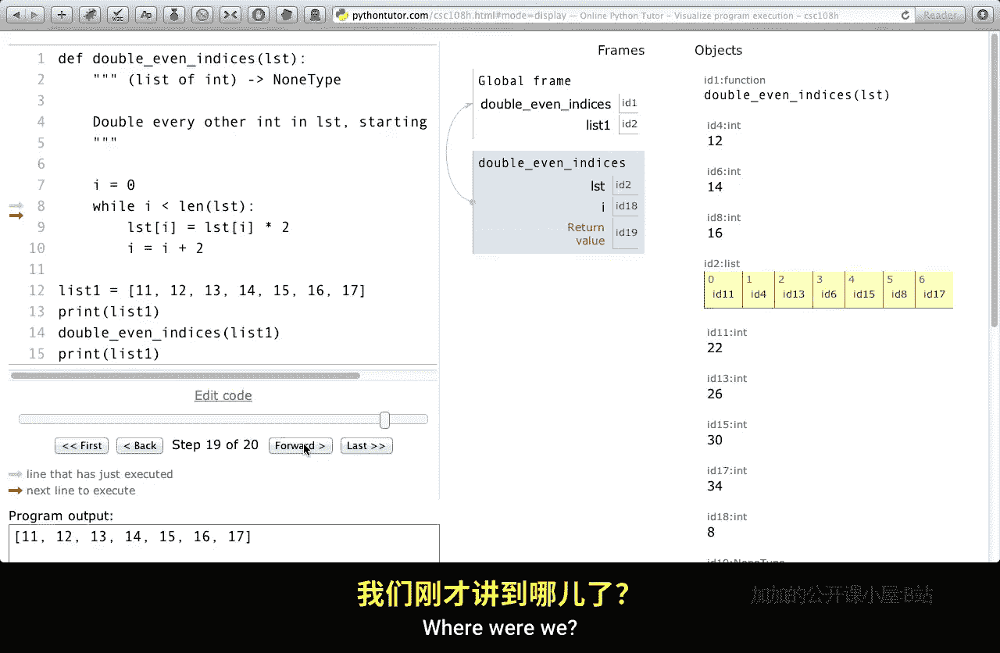

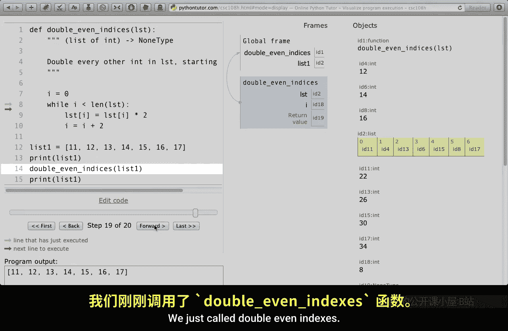

### 可变性与文档字符串

由于别名的存在，你需要记住哪些类型是可变的，哪些是不可变的。到目前为止，**列表**是唯一可变的类型，其他类型都是不可变的。

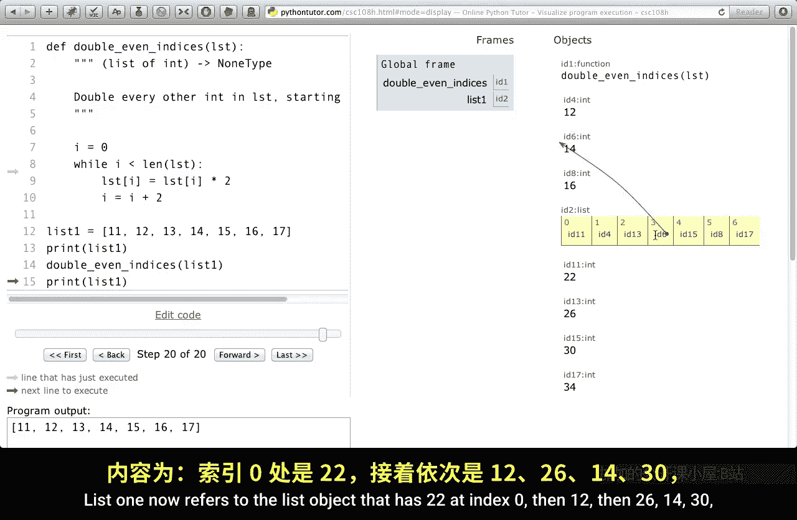

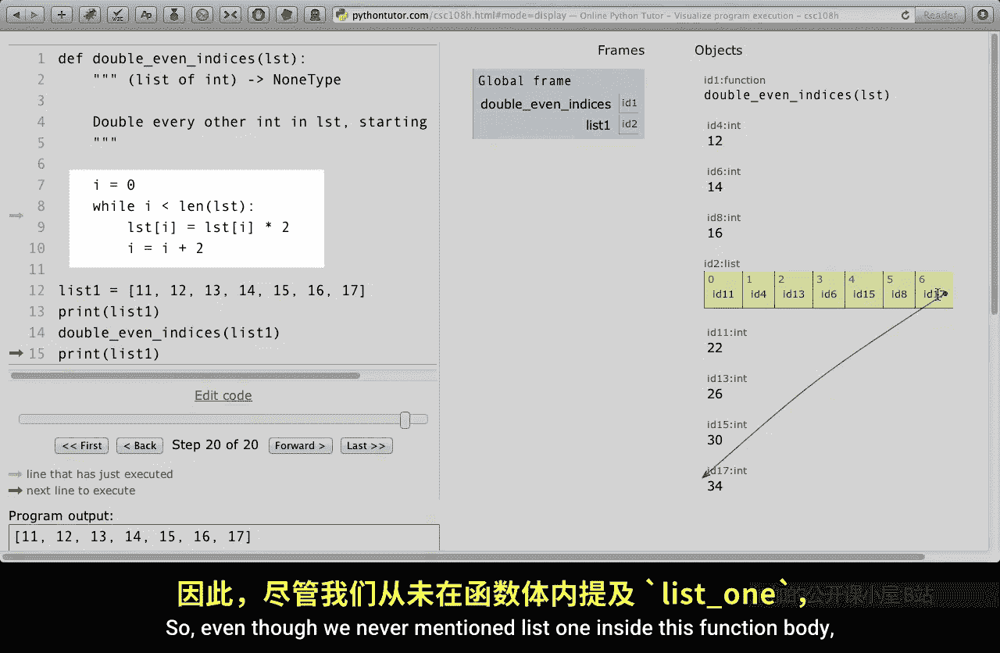

此外，在为可变类型编写文档字符串时需要格外小心。你需要明确说明函数内部的代码是否会修改参数。

---

### 总结

本节课中，我们一起学习了：
1.  **可变对象**：列表等对象的内容可以被修改。
2.  **别名**：当多个变量引用同一个对象时，通过任何一个变量修改对象，其他变量也会看到变化。
3.  **函数中的别名**：将可变对象传递给函数时，函数内部对参数的修改会影响原始对象。
4.  **注意事项**：需要清楚哪些类型是可变的，并在文档中明确函数是否会修改其参数。

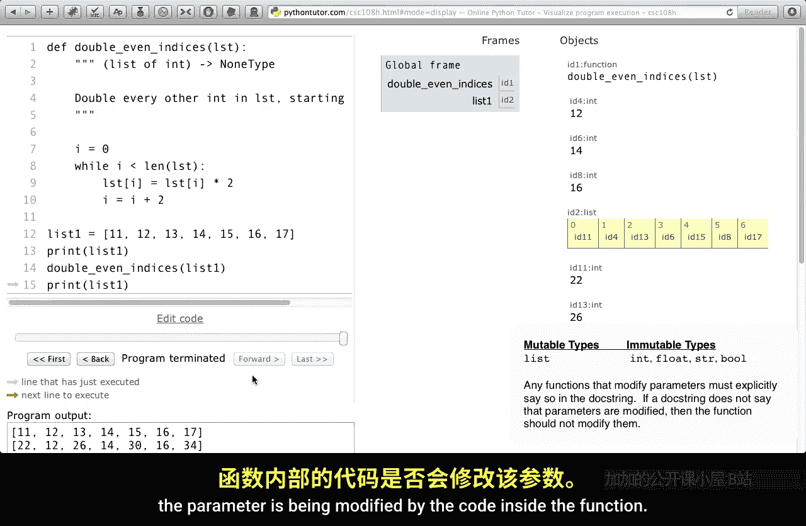

理解可变性和别名是避免程序中意外副作用的关键。