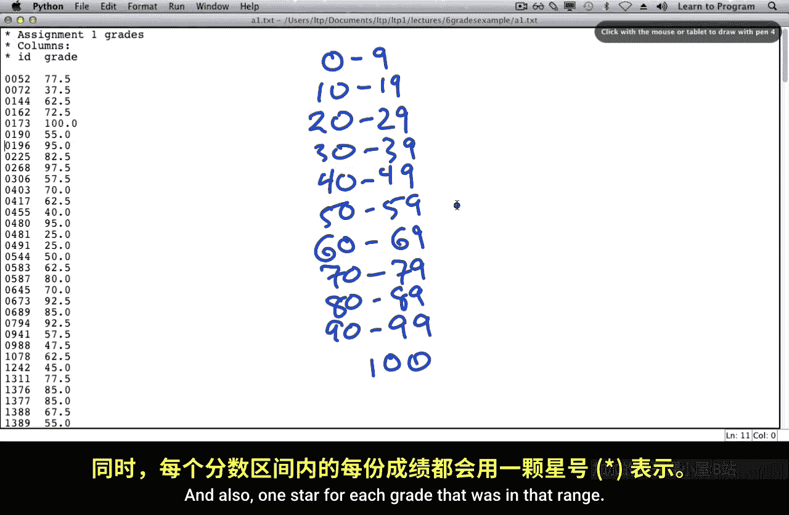
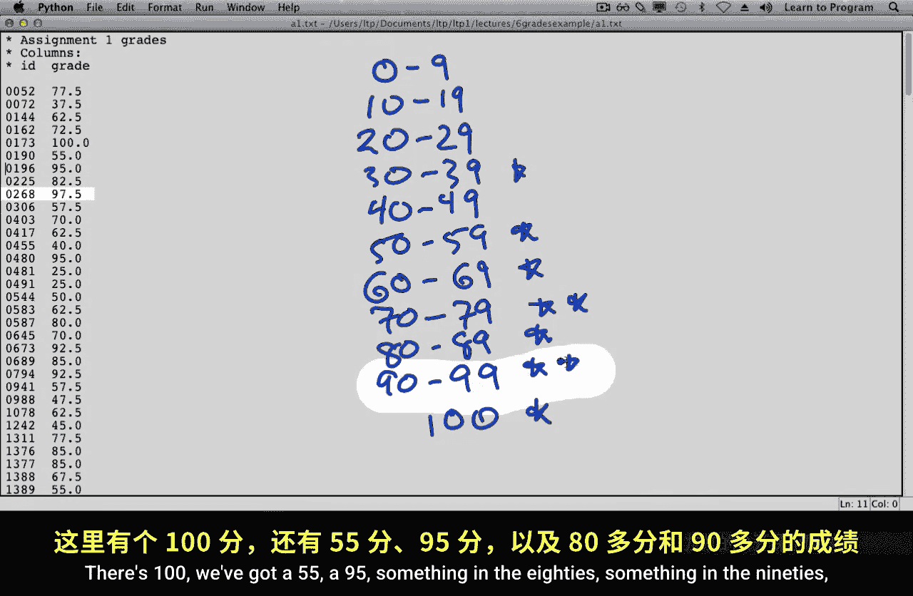
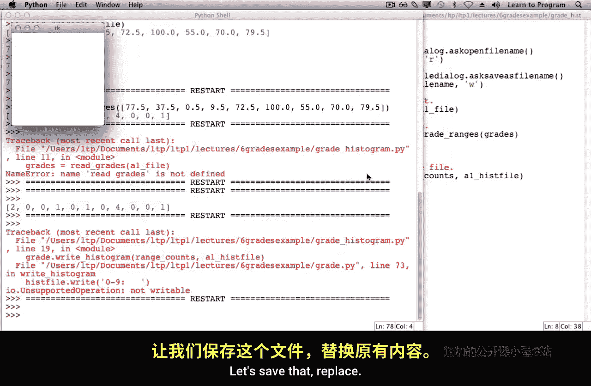
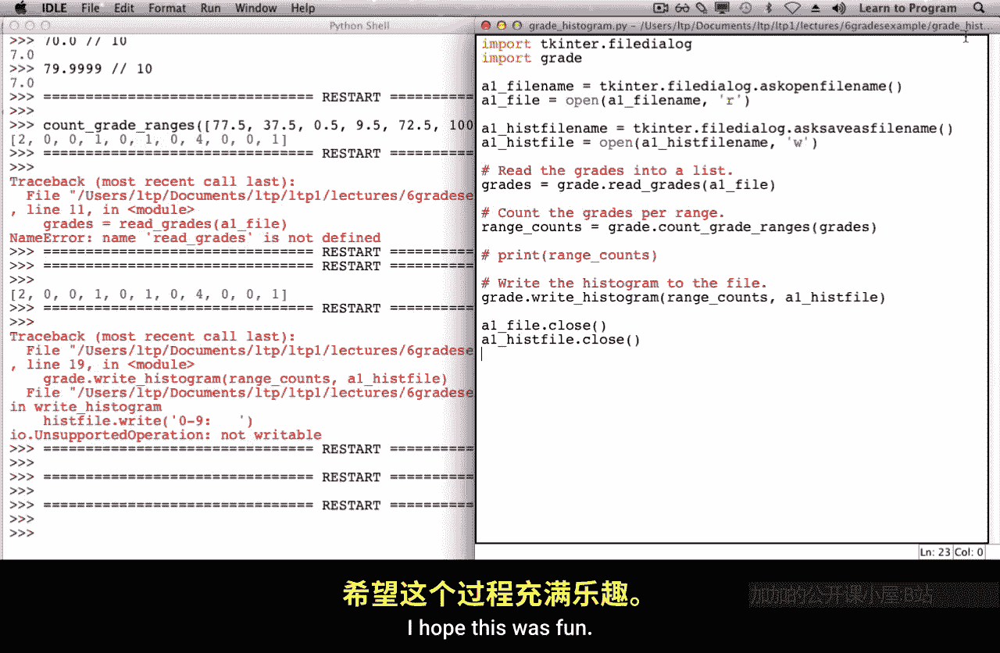

# 039：开发一个程序 🚀


在本节课中，我们将学习如何从头开始开发一个完整的程序。我们将通过一个具体案例——分析学生成绩分布并生成直方图——来了解程序设计的完整思考过程。本节课不会引入新的Python工具，但会展示如何将已知知识组合起来解决实际问题。





## 概述 📋

我们的目标是编写一个程序，读取一个包含学生成绩的文件，统计不同分数段（如0-9分、10-19分等）的人数，并将结果以直方图（用星号`*`表示）的形式输出到一个新文件中。

## 第一步：理解问题与数据格式

首先，我们需要明确输入文件的格式和期望的输出。

输入文件 `a1.txt` 的格式如下：
*   文件开头有一个标题行。
*   接着是一个空行。
*   之后是每行一个学生的学号和成绩（浮点数）。

例如：
```
Assignment 1 Grades

12345678 77.5
23456789 37.5
34567890 62.5
```

我们希望生成的输出文件 `a1_hist.txt` 内容类似这样：
```
0 - 9:
10 - 19:
20 - 29: *
30 - 39: **
...
100: *
```
其中，每个星号代表一个落在该分数段内的成绩。

## 第二步：高层设计（自顶向下设计）

面对一个复杂任务时，将其分解为几个独立的步骤是很好的方法。这个过程称为**自顶向下设计**。

对于本程序，我们可以将其分解为三个主要步骤：
1.  **读取成绩**：将文件中的成绩读入一个列表。
2.  **统计分布**：计算每个分数段（0-9, 10-19, ..., 100）中有多少个成绩。
3.  **写入直方图**：将统计结果按照指定格式写入新的文件。

这些步骤相对独立，我们可以分别实现和测试它们。

## 第三步：实现步骤一 - 读取成绩

上一节我们介绍了程序的整体框架，本节中我们来实现第一个核心功能：从文件中读取成绩。

我们将创建一个函数 `read_grades` 来完成这个任务。它的输入是一个已打开用于读取的文件对象，输出是一个浮点数列表。

**核心代码**：
```python
def read_grades(file):
    """ (file open for reading) -> list of float

    读取文件并返回成绩列表。
    前置条件：文件格式正确，包含标题、空行，然后是学号和成绩。
    """
    # 跳过标题行，直到遇到空行
    line = file.readline()
    while line != '\n':
        line = file.readline()

    grades = []  # 初始化累加器列表
    line = file.readline()
    while line != '':  # 尚未到达文件末尾
        # 找到行中最后一个空格（分隔学号和成绩）
        last_space_index = line.rfind(' ')
        # 提取空格后的部分（即成绩字符串），并转换为浮点数
        grade = float(line[last_space_index + 1:])
        grades.append(grade)
        line = file.readline()
    return grades
```
**实现要点**：
*   使用 `while` 循环跳过文件开头的标题部分。
*   使用另一个 `while` 循环读取剩余的所有行。
*   在每行中，使用 `str.rfind(‘ ’)` 找到最后一个空格的位置，然后通过切片 `line[last_space_index + 1:]` 提取成绩字符串。
*   使用 `float()` 将字符串转换为浮点数，并添加到累加器列表 `grades` 中。

## 第四步：实现步骤二 - 统计成绩分布

现在我们已经将成绩读入了列表，接下来需要统计每个分数段的数量。

我们将创建函数 `count_grade_ranges`。它的输入是成绩列表，输出是一个包含11个整数的列表，分别对应0-9, 10-19, ..., 90-99, 100这11个分数段的数量。

**核心概念与公式**：
如何确定一个成绩 `grade`（如77.5）属于哪个分数段？我们可以利用整数除法。
*   `grade // 10` 的结果是7（因为 `77.5 // 10 = 7.0`，转换为 `int` 后是7）。
*   这个结果（7）正好可以作为我们统计列表的索引，对应70-79这个分数段。
*   特殊处理满分100分：当 `grade == 100` 时，`grade // 10` 结果是10，对应索引10。

**核心代码**：
```python
def count_grade_ranges(grades):
    """ (list of float) -> list of int

    返回一个长度为11的列表，索引i处的元素表示成绩在[i*10, i*10+9]区间内的数量（i从0到9），索引10表示成绩为100的数量。
    """
    # 初始化一个包含11个0的列表
    range_counts = [0] * 11
    for grade in grades:
        # 确定该成绩所属分数段的索引
        which_range = int(grade // 10)
        # 特殊情况：100分属于索引10
        if which_range == 10:
            which_range = 10
        # 增加对应分数段的计数
        range_counts[which_range] += 1
    return range_counts
```

## 第五步：实现步骤三 - 写入直方图文件

最后一步是将统计结果格式化为直方图并写入文件。

我们将创建函数 `write_histogram`。它的输入是分数段统计列表和一个已打开用于写入的文件对象。

以下是该函数需要完成的任务列表：
*   写入第一行 “0 - 9:” 以及对应数量的星号。
*   循环写入第1到第9个分数段（10-19 到 90-99）的行。
*   写入最后一行 “100:” 以及对应数量的星号。
*   注意对齐格式，`0-9` 和 `100` 前面需要额外添加空格以使冒号对齐。

**核心代码**：
```python
def write_histogram(range_counts, file):
    """ (list of int, file open for writing) -> None

    将分数段统计列表以直方图格式写入文件。
    """
    # 写入 0-9 分数段
    file.write(' 0 - 9: ' + '*' * range_counts[0] + '\n')
    # 写入 10-19 到 90-99 分数段
    for i in range(1, 10):
        low = i * 10
        high = i * 10 + 9
        file.write(str(low) + ' - ' + str(high) + ': ' + '*' * range_counts[i] + '\n')
    # 写入 100 分数段
    file.write('100: ' + '*' * range_counts[10] + '\n')
```

## 第六步：整合主程序并测试

现在，我们将所有函数整合到一个主程序中，并使用文件对话框让用户选择输入和输出文件。

**核心代码**：
```python
import tkinter.filedialog
import grade_functions  # 假设上述函数保存在此模块中

# 1. 让用户选择输入文件
input_filename = tkinter.filedialog.askopenfilename()
input_file = open(input_filename, 'r')

# 2. 读取成绩
grades = grade_functions.read_grades(input_file)
input_file.close()

# 3. 统计分数段
range_counts = grade_functions.count_grade_ranges(grades)

# 4. 让用户选择输出文件并写入直方图
output_filename = tkinter.filedialog.asksaveasfilename()
output_file = open(output_filename, 'w')
grade_functions.write_histogram(range_counts, output_file)
output_file.close()  # 重要：关闭文件以确保数据写入磁盘
```
**测试要点**：
*   在开发过程中，应频繁运行和测试代码，即使它还不完整。例如，在打开文件后立即打印几行内容，可以快速发现文件路径或格式错误。
*   分别测试每个函数，确保其行为符合预期，然后再将它们组合起来。
*   注意文件操作后要调用 `.close()` 方法，否则数据可能不会立即写入磁盘。




## 总结 🎉


本节课中，我们一起完成了一个完整程序的开发流程：
1.  **明确需求**：理解输入输出格式。
2.  **高层设计**：使用自顶向下设计将问题分解为“读取”、“统计”、“写入”三个步骤。
3.  **逐步实现**：
    *   实现了 `read_grades` 函数，使用循环和字符串处理读取数据。
    *   实现了 `count_grade_ranges` 函数，利用整数除法 `//` 和列表索引进行统计。
    *   实现了 `write_histogram` 函数，格式化字符串并写入文件。
4.  **整合测试**：将函数整合到主程序，通过文件对话框与用户交互，并强调了频繁测试和关闭文件的重要性。



这个案例展示了程序设计的核心思维：分解问题、设计数据表示、实现独立模块、逐步测试验证。希望这个过程能帮助你理解如何将想法转化为可运行的代码。