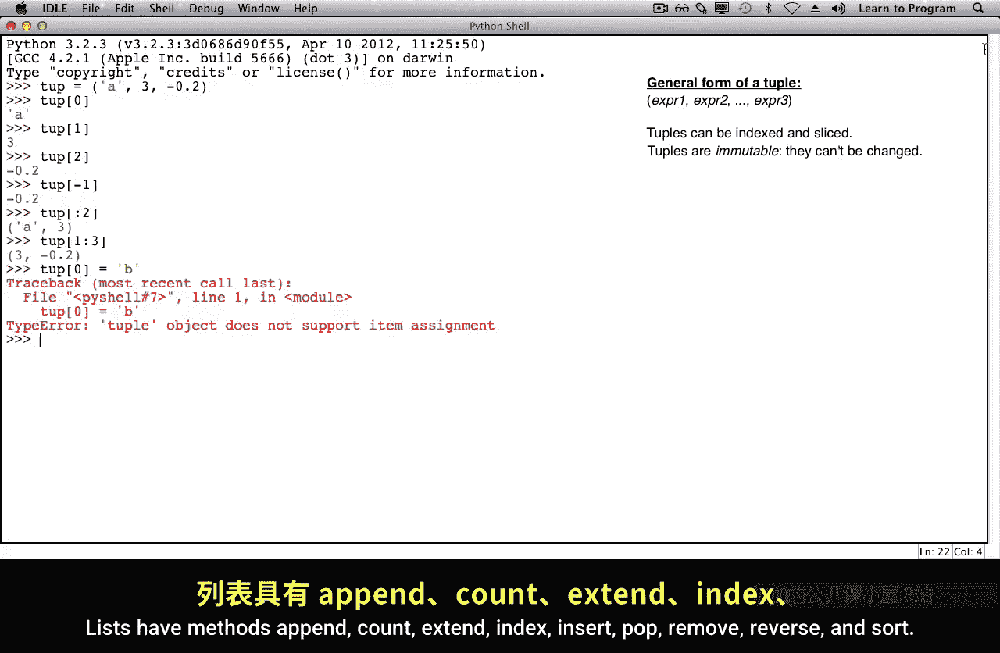
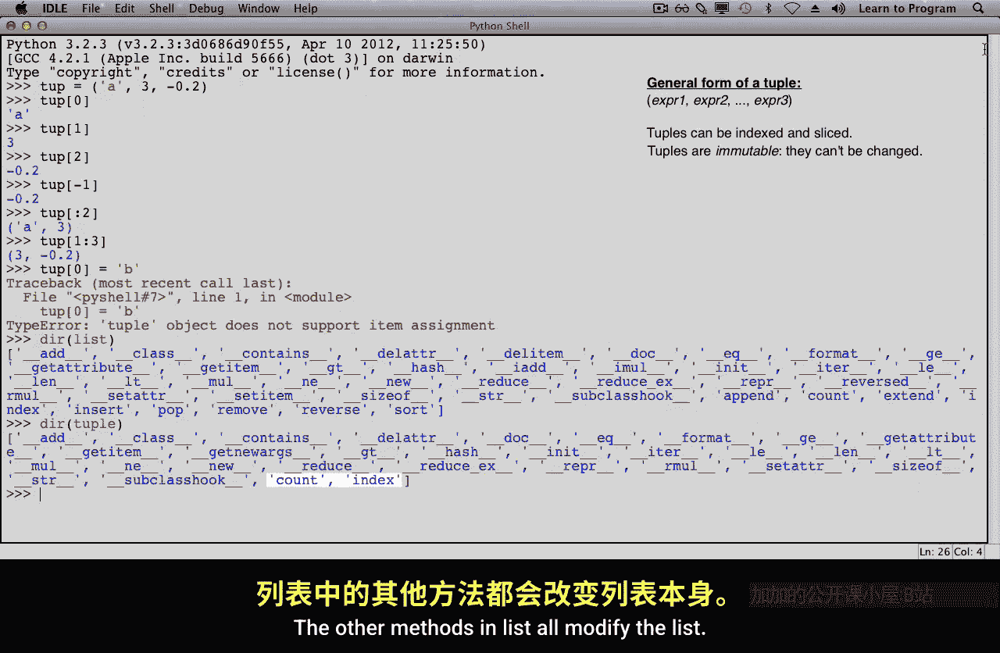
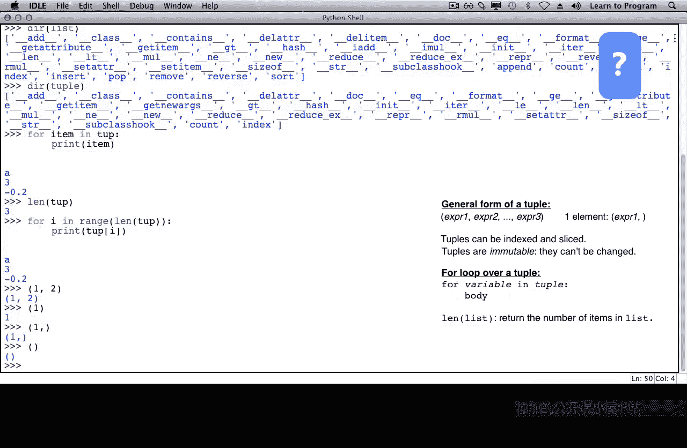

# 040：元组 🧱


在本节课中，我们将要学习一种新的序列类型——元组。我们将了解元组与列表的相似之处，以及它们之间最关键的区别：可变性。

## 概述


上一节我们介绍了可变的列表。本节中我们来看看另一种序列类型：元组。元组是不可变的序列。

## 元组的基本操作

元组与列表使用相同的索引和切片表示法。


以下代码创建了一个包含三个元素的元组，并将其赋值给变量 `tup`：
```python
tup = (3, 4, -0.2)
```
我们可以像访问列表一样访问元组的元素：
```python
tup[0]  # 返回 3
tup[1]  # 返回 4
tup[2]  # 返回 -0.2
tup[-1] # 返回 -0.2
```
切片元组会生成一个新的元组：
```python
tup[:2]  # 返回 (3, 4)
tup[1:3] # 返回 (4, -0.2)
```

## 元组的不可变性

元组与列表最核心的区别在于其不可变性。这意味着元组一旦创建，其内容就不能被修改。


尝试修改元组会导致类型错误：
```python
tup[0] = 5  # 会引发 TypeError: 'tuple' object does not support item assignment
```
错误信息明确指出：元组对象不支持元素赋值。



## 元组与列表的方法对比

由于元组不可变，它支持的方法比列表少得多。




以下是列表和元组支持的方法对比：
*   **列表方法**：`append`, `count`, `extend`, `index`, `insert`, `pop`, `remove`, `reverse`, `sort`。
*   **元组方法**：`count`, `index`。

列表的其他方法（如 `append`, `sort`）都会修改列表本身，因此不适用于不可变的元组。

## 元组的创建与迭代

元组在许多操作上与列表类似。


我们可以遍历元组中的元素：
```python
for item in tup:
    print(item)
```
`len()` 函数同样适用于元组：
```python
len(tup)  # 返回 3
```
我们也可以遍历元组的索引：
```python
for i in range(len(tup)):
    print(tup[i])
```

### 创建元组的注意事项

创建元组的基本方法是将一个由逗号分隔的值列表放在圆括号 `()` 中。
```python
my_tuple = (1, 2, 3)
```
创建只包含一个元素的元组需要特别注意。如果只在括号中放一个值，Python会将其解释为普通的数学表达式括号。
```python
not_a_tuple = (5)   # 这只是一个整数 5
```
要创建单元素元组，必须在值后面加上一个逗号：
```python
single_element_tuple = (5,)  # 这是一个元组，包含元素 5
```
创建空元组则不需要这个逗号：
```python
empty_tuple = ()  # 这是一个空元组
```

## 总结



本节课中我们一起学习了元组。我们了解到元组是一种不可变的序列，使用圆括号 `()` 创建。它与列表共享索引、切片和迭代等操作，但因其不可变性，不支持任何会修改自身内容的方法。记住创建单元素元组时需要在值后加逗号 `(value,)`。元组适用于存储不应被程序意外修改的数据集合。