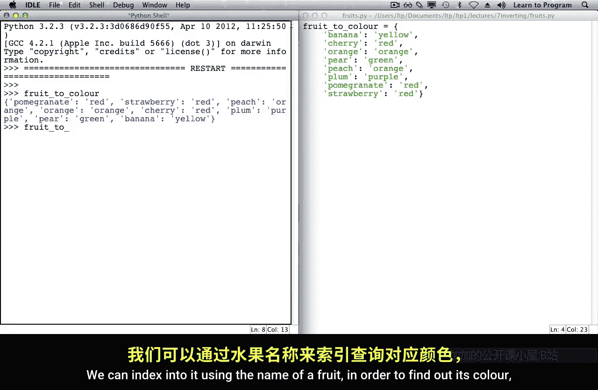
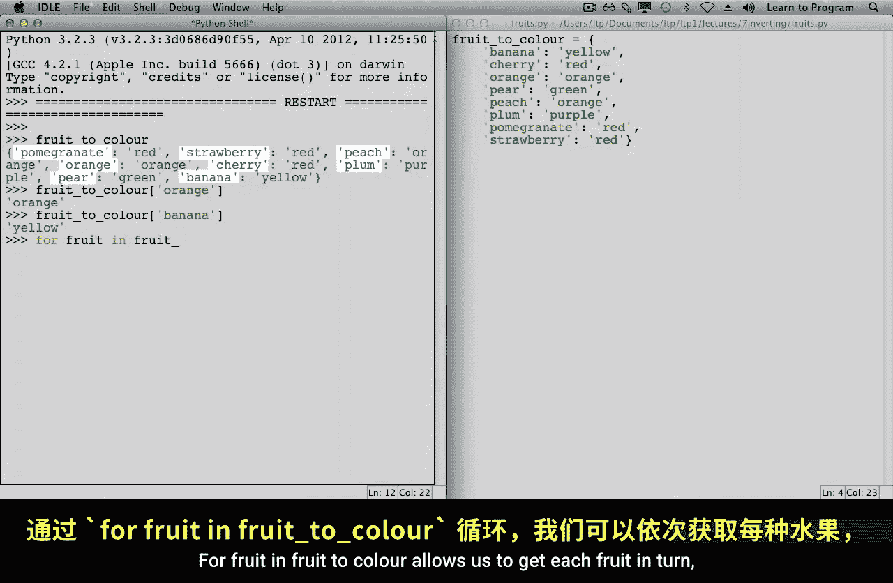
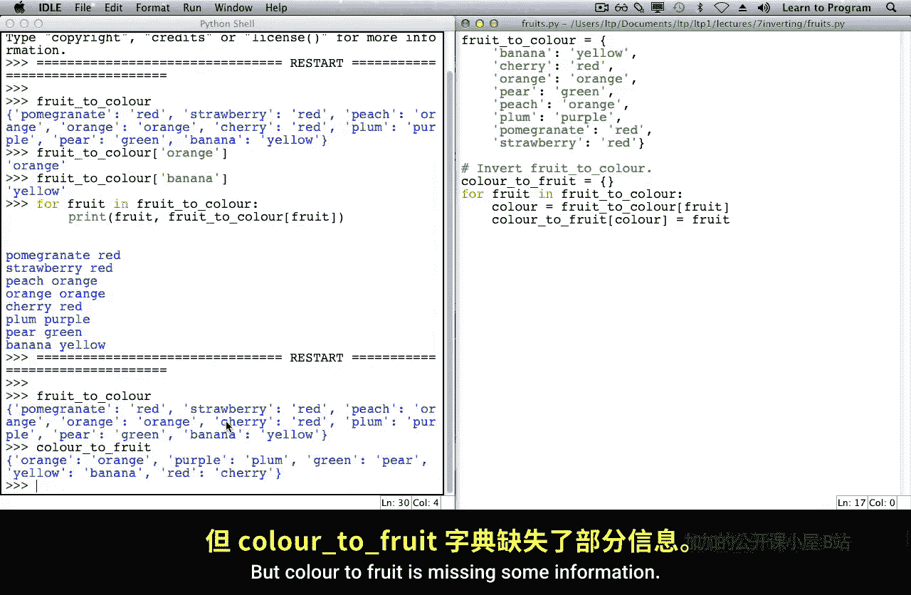
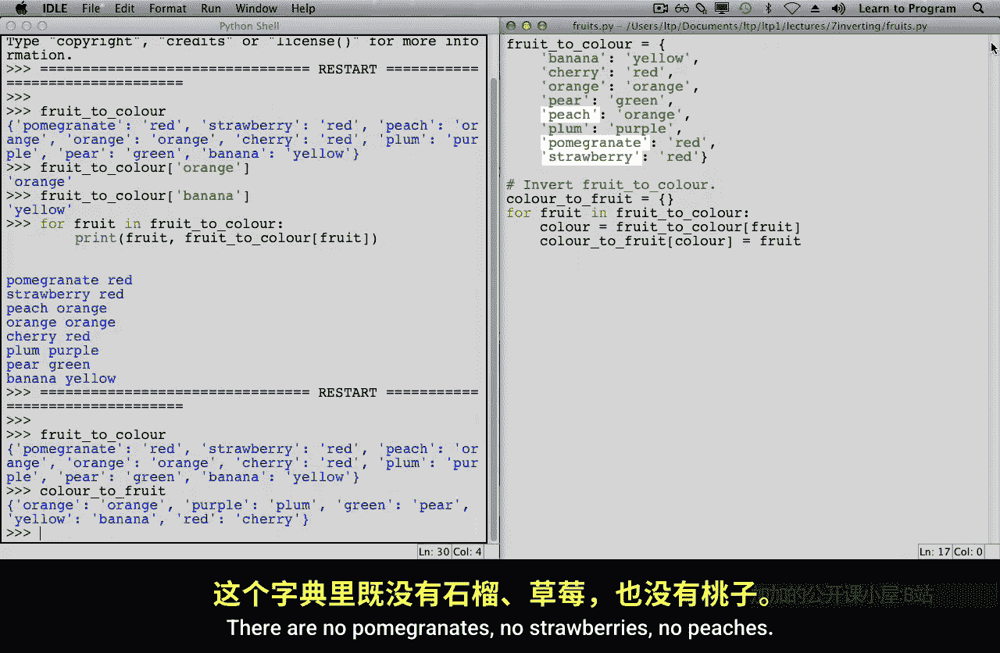
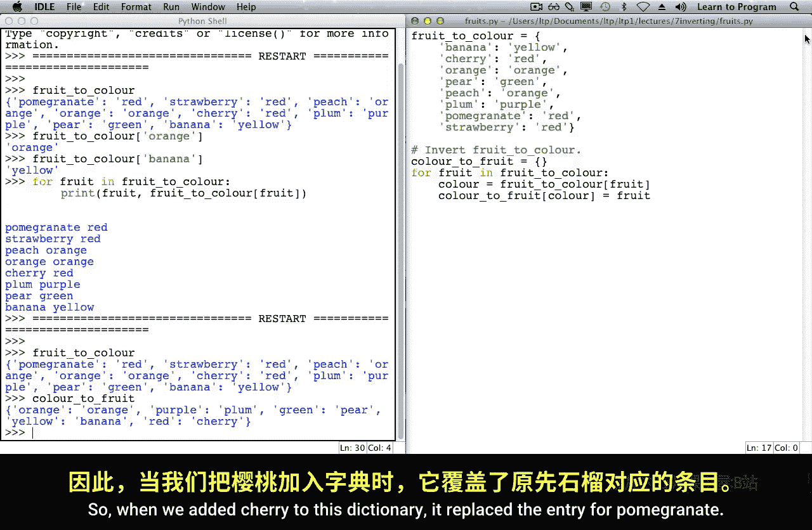
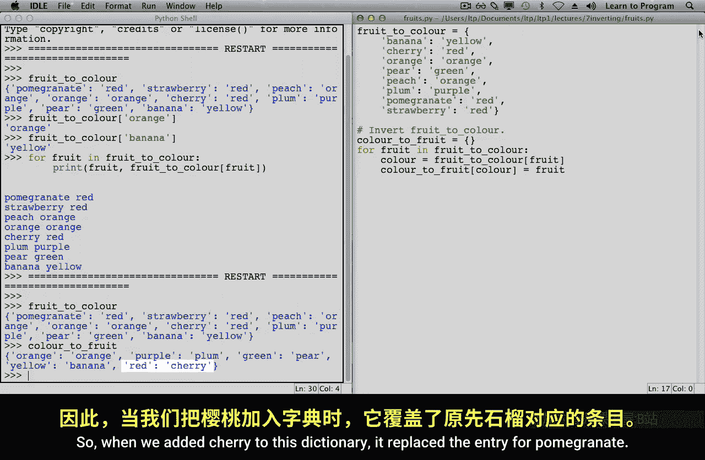
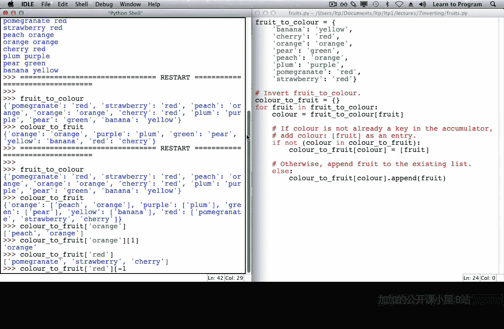

# 042：反转字典 🔄


在本节课中，我们将学习如何使用字典作为累加器，并解决一个特定的问题：反转一个字典。我们将从一个简单的字典反转开始，逐步深入到处理更复杂的情况，即当多个键映射到同一个值时。


---

## 使用字典作为累加器

上一节我们介绍了字典的基本操作。本节中，我们来看看如何将字典用作一个累加器，来构建新的数据结构。

我们首先创建一个将水果映射到颜色的字典。



```python
fruit_to_color = {
    'banana': 'yellow',
    'cherry': 'red',
    'orange': 'orange',
    'peach': 'orange',
    'pomegranate': 'red',
    'strawberry': 'red'
}
```

这个字典的条目没有按键或值排序。我们可以通过水果名称来索引它，以查找其颜色。

例如：
*   `fruit_to_color['orange']` 的结果是 `'orange'`。
*   `fruit_to_color['banana']` 的结果是 `'yellow'`。



我们也可以遍历这个字典的键。

```python
for fruit in fruit_to_color:
    color = fruit_to_color[fruit]
    print(fruit, color)
```

这段代码允许我们依次获取每个水果，并使用该水果作为字典的索引来查找对应的颜色值。

---

## 反转字典的问题

现在，我们进入今天要探讨的核心问题：将这个字典“里外翻转”或反转。我们想构建一个新的字典，将颜色映射到水果。



以下是实现此目标的一种方法：



```python
color_to_fruit = {}
for fruit in fruit_to_color:
    color = fruit_to_color[fruit]
    color_to_fruit[color] = fruit
```

变量 `color_to_fruit` 是我们的累加器。运行这段代码后，我们检查 `fruit_to_color` 和 `color_to_fruit`。

然而，`color_to_fruit` 丢失了一些信息。字典中没有石榴、草莓和桃子。





问题在于，与这三个缺失水果相关的颜色，每个都对应着多个水果。例如，石榴是红色的，但樱桃也是红色的。当我们添加樱桃到新字典时，它覆盖了石榴的条目。

---

## 改进的反转方案

因此，我们不能简单地直接反转，需要更谨慎一些。我们将构建一个字典，将每种颜色映射到具有该颜色的水果**列表**。

以下是实现该算法的逻辑：
1.  如果颜色还不是累加器字典中的键，我们就添加一个条目，将该颜色映射到一个只包含当前水果的列表。
2.  否则，如果颜色已经是键，这意味着它已经有一个该颜色的水果列表。我们需要将当前水果追加到那个现有列表中。

以下是表达该算法的代码：

```python
color_to_fruit = {}
for fruit in fruit_to_color:
    color = fruit_to_color[fruit]
    if color not in color_to_fruit:
        color_to_fruit[color] = [fruit]
    else:
        color_to_fruit[color].append(fruit)
```

让我们看看效果如何。`fruit_to_color` 保持不变。现在的 `color_to_fruit` 如下：

```python
{
    'yellow': ['banana'],
    'red': ['cherry', 'pomegranate', 'strawberry'],
    'orange': ['orange', 'peach']
}
```

它的键是字符串，值是字符串列表。

*   **如何找到橙色的水果？**
    我们使用字符串 `'orange'` 索引到字典中，这会返回一个列表 `['orange', 'peach']`。然后我们可以使用常规的列表索引方式（例如 `color_to_fruit['orange'][0]`）来获取 `'orange'`。

*   **如何找到樱桃？**
    我们使用 `'red'` 索引到字典中，樱桃是返回列表 `['cherry', 'pomegranate', 'strawberry']` 中的第一个元素（索引 0）。

---

## 总结



本节课中，我们一起学习了如何反转字典。我们从简单的键值对调开始，发现了当原字典中多个键对应相同值时会导致信息丢失的问题。为了解决这个问题，我们引入了使用列表作为值的改进方案，从而完整地保留了所有映射关系。这个例子展示了如何根据具体需求，灵活地使用字典和列表来构建复杂的数据结构。