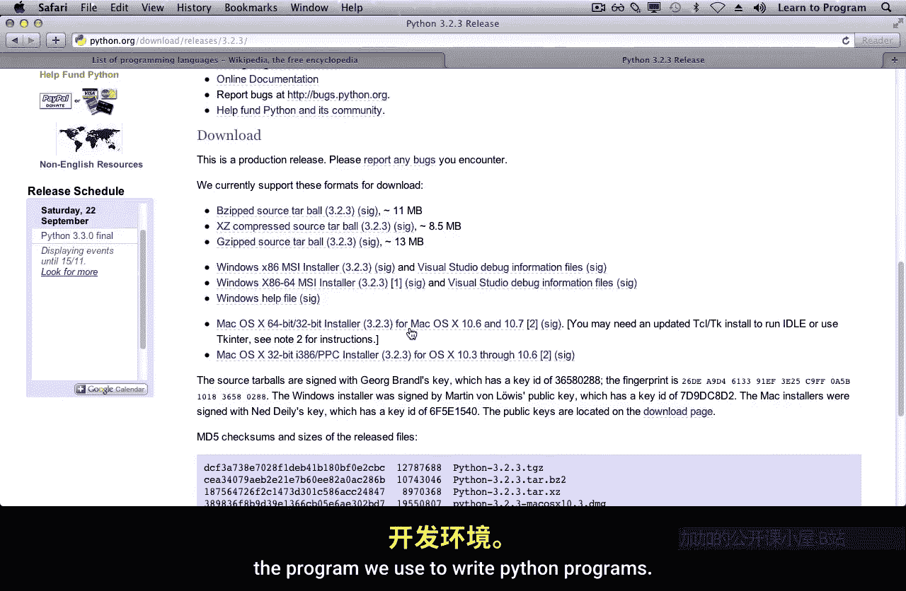
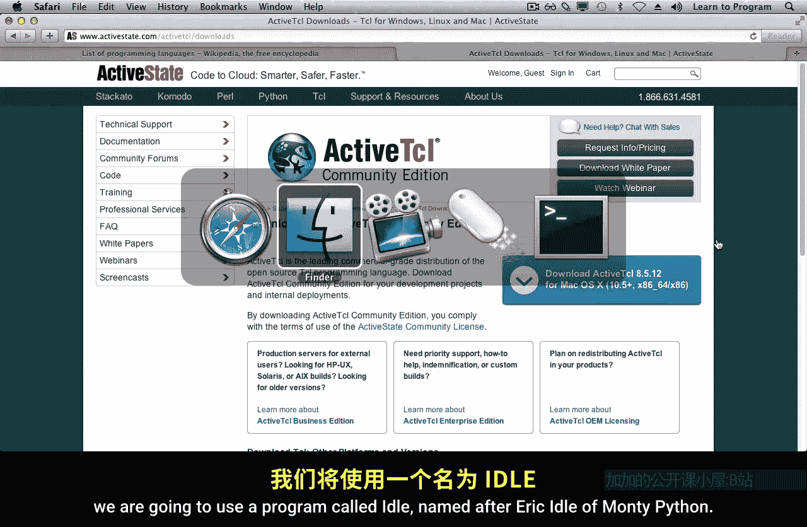
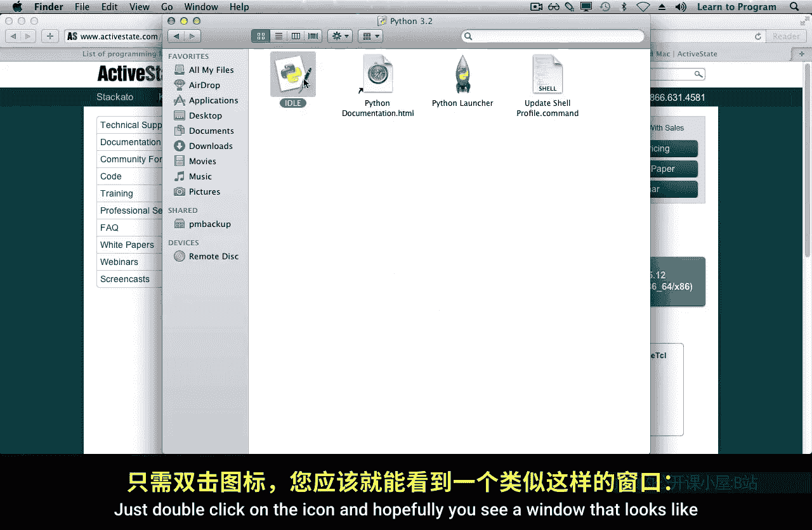
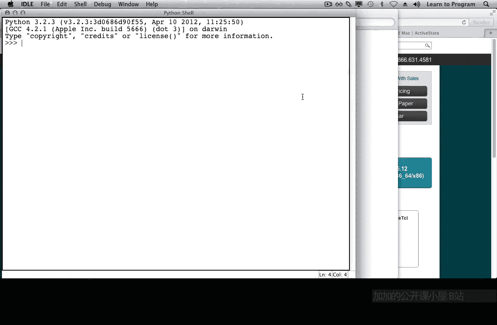

# 特伦托大学【中英⚡学习编程：基础知识｜Learn to Program： The Fundamentals】 p02 P2 05_安装Python -BV1kQ11B5EWa_p2-

This video shows you how to download Python and also talks a bit about what a program is。

 Programs are everywhere on your computer and on the Internet。 Every time you use a web browser。

 play a computer game or write a text message on your cell phone。 you're using a program。

Even your operating system， such as OS 10 or Linux or Windows， is a program。

A program is just a set of instructions。We say programs are run or executed。

Programs such as your operating system run on hardware。cellell phone or your laptop or a tablet。

 the programs can also be run by other programs。This is what happens when you play a game in a web browser。

 your web browser knows how to run programs written in a programming language called JavaScript。

This webp page on Wikipedia lists all the programming languages that anyone one has ever bothered to enter here。

 and there were hundreds of them。You've probably heard of some of the programming languages。

 We've heard of a lot of them， but certainly nowhere near all of them。

 and we doubt that anybody knows all the programming languages listed here。

So Python is a programming language， one of many。In order to run Python programs。

 you need to download a program that understands that language。

 much like your browser understands JavaScript。In order to work through this course。

 you will need to download this program from Python。 org。 There are two main versions of Python。

 Python 2 and Python 3。 We're going to use Python 3。 So go ahead and click on Quick links。

 and this is the download page for Python 3， the current version。If you use Linux。

 you can use your package manager to install Python 3 if you use Windows， this link is appropriate。

If you use OS10 one of the recent versions， at least， then this is the appropriate link to click。

If you use a Mac， you may need to install something called Pickickle TK in order to run the program we use to write Python programs。

Let's just scroll down to the bottom here if you're a Mac user。

 click on this link and then scroll down and download Act TCL 8。5。

12 or whatever the newest version is。You're going to have to。Go to the Act State website。

And then just click this big blue download button in order to get that。To write our Python programs。

 we're going to use a program calledIdL named after Eric IL of Mon Python。

Itddle comes with Python。Just double click on the icon。

And hopefully。You see a window that looks like this。

