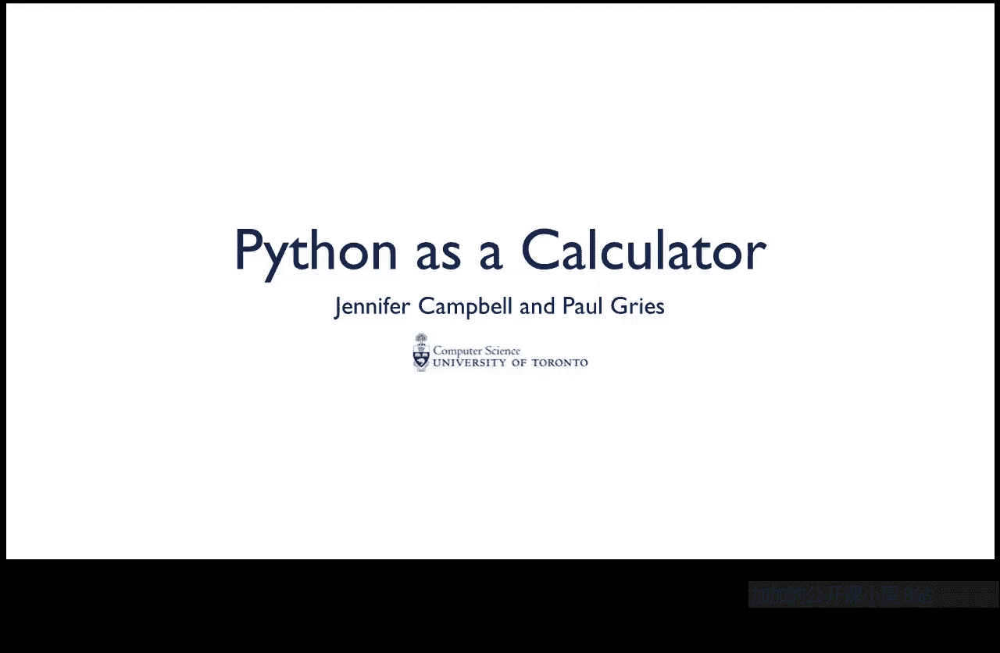
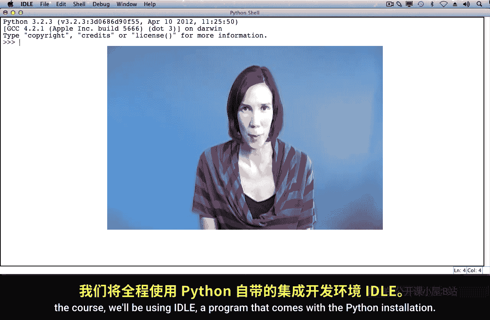
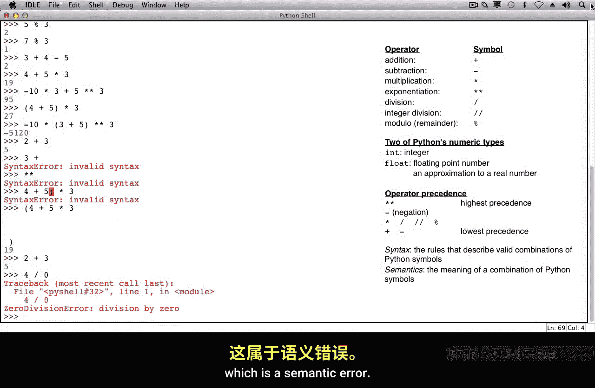

# 特伦托大学【中英⚡学习编程：基础知识｜Learn to Program： The Fundamentals】 p03 P3 01_Python 作为计算器 -BV1kQ11B5EWa_p3-

Hello， in this lecture we'll begin to program。We refer to this lecture as Python as a calculator because we're going to focus on mathematical expressions。

In this lecture and throughout the course we'll be usingIDL。

 a program that comes with the Python installation。

Let's switch over to Ile now and start programming。

 This is idle and the window that we're currently looking at is called the She。

This is where we can try out Python instructions and explore Python's features。This symbol。

 the three arrow symbols， is called the prompt。Next to the prompt。

 we will type Python instructions and when we hit En， Python will evaluate those instructions。

For example， let's type the instruction 2+3 and ask Python to evaluate it。

It's important to note that nothing happened until I hit the enter key。

Let's look at another expression，6， subtract2。And。Again， nothing happens until I hit enter。

At that point， Python evaluates the expression。Another expression could be seven times three。So far。

 we've seen three operators， addition， subtraction and multiplication。

Another operation is exponentiation。And we read this expression as two to the power of five。Next。

 let's take four and divide it by two。When Python evaluates expression。

 the result that we get looks a little bit different from what we've seen so far。

The expression evaluates to give us 2。0 as opposed to just two。

What we're seeing here is that Python has multiple types。And two of its numeric types are type int。

 which stands for integer and float， which stands for floating point number。

This division operation gives us a floating point result。

Let's explore a few more examples of division。5ive divided by two gives 2。5。

And we would expect that two divided by3 would give 0。66666 with6 as repeating。That is what it gives。

 although instead of an infinite number of sixes。We're limited by the number of significant digits available。

 so Python has a limited amount of memory to work with。And the number that we get。

 the result of definingiding two by3， is an approximation to the real number。

Floating point numbers are approximations to real numbers。

Another example would be to divide five by three。And we can see that the result is an approximate result with 1。

66666， and the last digit is actually a seven。Similarly， seven divided by3 gives 2。33333。

 and the last digit is a five。S and divided by 3 is floating point division。

And since floating point numbers are approximations to real numbers。

 there's some imprecision and that's what we're seeing here。

Python has a second type of division called integer division。

So we'll divide four by two using integer division。And when Python evaluates this expression。

 it will evaluate to give an int as opposed to a flow。

When we divide two by three using integer division。We also get an end zero。

 So the way to think about this result is that if we were to rewrite this。

We could rewrite two and third。As zero。And two thirds。

 And what we're getting back is this whole number part of the result。

So let's consider5 dividedta I3 using integer division。And again， the result is one whole number。

So we could rewrite five over three。As one and two third， and we're getting the one。

Dividing 7 by3 using integer division。We get two。So this would be rewritten as two。And a third。

We're only getting part of the result when we do this， part of the result of the division。

 the other part we can get using a different operator called the remainder operator or the mod operator。

We use a percentage sign to signify that operation。

So four mod2 is the way we read this expression and the result is zero。

 there's no remainder for the division4 divided by2。When we divide two by three。

The remainder in this case is two。And when we divide five by three， the remainder is two。So again。

 as a review。We can think of five divided by three， rewriting that as one and two third。

When we do five， divided by three， we get this hole number one。 When we do five mod3， we get this2。

The numerator of the fractional part of the result。So when going to do seven mod three。We get a one。

Because that expression could be rewritten as two and a third。We got that one。

Now that we've worked with these operators separately， let's combine them into expressions。

We'll add three。To four and subtract five。And the operations are performed or applied from left to right。

 three is added to four， and then five is subtracted from that result。Next。

 let's add four to five and multiply by three。In this case。

 the order of operations dictates that multiplication should be applied first， followed by addition。

5ive is multiplied by three and then that result is added to four。

The next expression will use a negative number。So this minus sign that we used for subtraction is also used with a single number。

In order to mean negation。We'll take negative 10， multiply it by three。Add five。

And take that to the power of three。The order of operations will apply as follows。5。

Will first be taken to power of three because exponentiation has the highest precedence。

Then over here， the negative assign applies to the 1 first。And the result。

 negative 1 is multiplied by three。Finally， these values are combined using the addition。

Just like in regular math， we can override operator precedes using parentheses。

I can have the expression 4 plus 5 evaluate first before multiplying the result with three。Similarly。

 I can decide that I would like the addition to happen。First， in the second expression we looked at。

By using parentheses to it evaluate first。Up to this point。

 every instruction that we gave to Python yielded a result。For example。

 when we ask Python to evaluate the expression，2 plus3。It gave us the result five。

That's because the expression 2+ 3 follows the syntax of the Python language syntax is the rules that specify which combinations of symbols are legal。

 and 2+ 3 is a valid expression in Python。The expression 3+ or the combination of symbols 3+ is not valid and text。

 so when I ask Python to evaluate this expression， we get an error。

This is our first syntax error and we'll see many more throughout the course。

So Python does not understand what to do with that combination of symbols。

 and it can't give us back a result， so instead it gives us an error。Another。

combinationbin of symbols that will result in a syntax error would be to just use the exponentiation operator on its own without providing any operas。

We can also write an expression like the one we just saw。

 only instead of having an open opening and closing parentthees。

 we just included a closing parenthesis。That will give us a syntax error。

If we include an opening parentheesis but no closing。

 then we end up with a different situation when I hit En。

 nothing happens or it looks like nothing happens。That's because Python allows instructions to span multiple lines。

 and when we hit enter is waiting actually for the closing parenthesis until I give that closing parenthesis。

And hit enter， then the expression is evaluated。In addition to syntax errors。

 we'll also encounter semantic errors。Semantic errors occur when the meaning of a particular expression is invalid。

So， for example。The syntax of 2+3 is valid， that is a valid combination of symbols。

And the meaning of the semantics of that expression is that two is added to three， so this is fine。4。

 divided by0 is valid syntactically。 We are able to use this combination of symbols。 However。

 the meaning of this expression is invalid。 It's not possible to divide a number by 0。

And so we get a zero division error， which is a semantic error。

