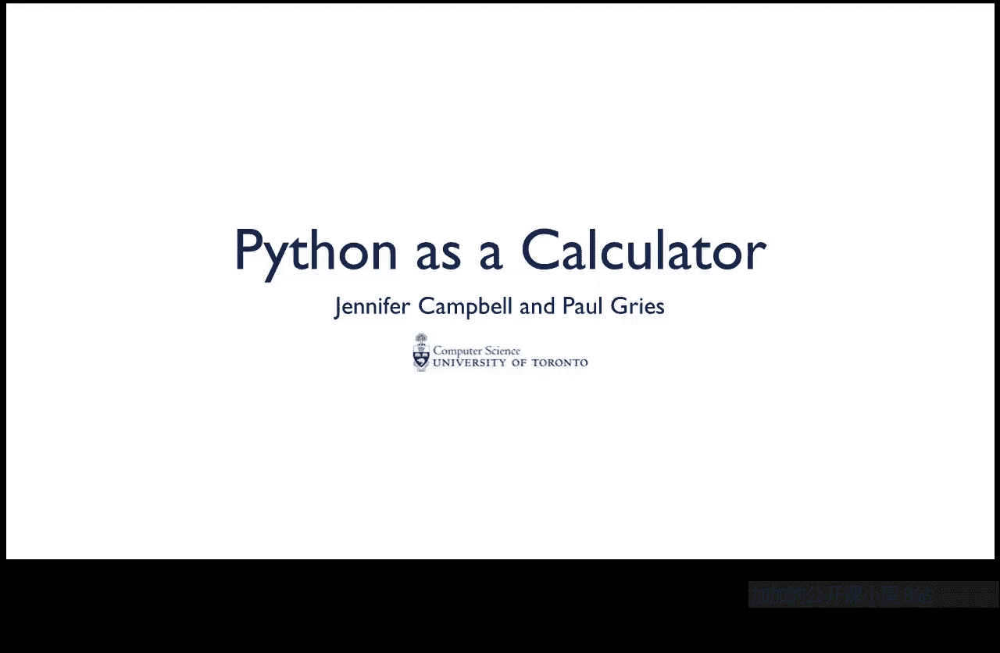
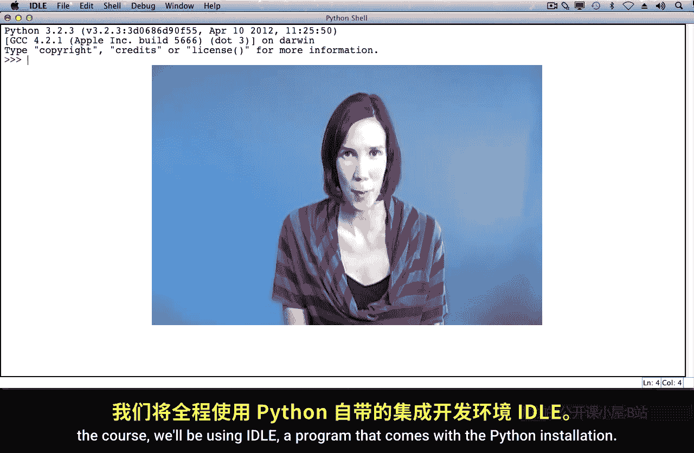
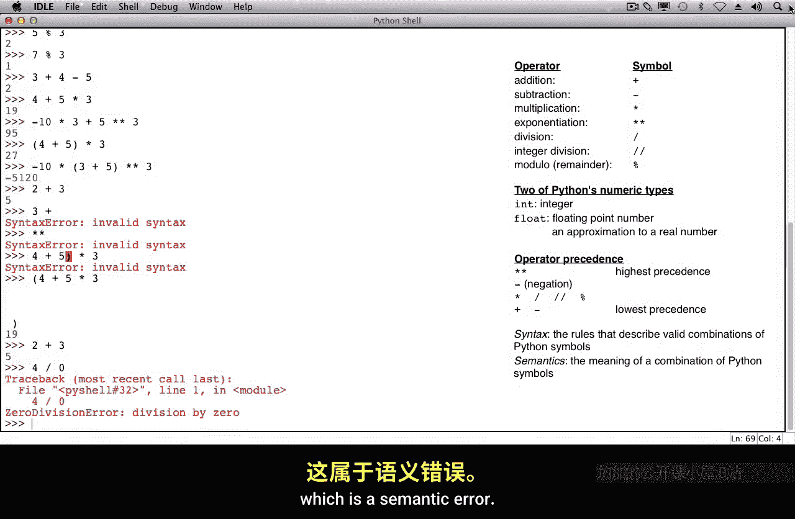

# 学习编程：基础知识｜P3：Python 作为计算器 🧮

在本节课中，我们将开始学习编程。我们将这节课称为“Python 作为计算器”，因为我们将重点学习数学表达式。在本节课以及整个课程中，我们将使用 **IDLE**，这是一个随 Python 安装包一同提供的程序。

## 启动 IDLE 与 Shell 窗口

现在，让我们切换到 IDLE 并开始编程。我们看到的这个窗口叫做 **Shell**。在这里，我们可以尝试 Python 指令并探索 Python 的功能。`>>>` 这个符号被称为 **提示符**。在提示符旁边，我们将输入 Python 指令，当我们按下回车键时，Python 就会执行这些指令。

例如，让我们输入指令 `2 + 3` 并让 Python 执行它。需要注意的是，在我按下回车键之前，什么都不会发生。

让我们看另一个表达式：`6 - 2`。同样，直到我按下回车键，Python 才会执行这个表达式。另一个表达式可以是 `7 * 3`。

到目前为止，我们已经看到了三个运算符：加法、减法和乘法。

## 更多数学运算符

另一个运算是 **幂运算**。我们将 `2 ** 5` 这个表达式读作“2 的 5 次方”。

接下来，让我们计算 `4 / 2`。当 Python 执行这个表达式时，我们得到的结果看起来与之前略有不同。表达式的结果是 `2.0`，而不仅仅是 `2`。

这里我们看到，Python 有多种数据类型。其中两种数值类型是 **int**（代表整数）和 **float**（代表浮点数）。这个除法运算给了我们一个浮点数结果。

让我们探索更多除法的例子。`5 / 2` 得到 `2.5`。我们预期 `2 / 3` 会得到 `0.66666...`（6 无限循环）。它确实给出了这个结果，只不过不是无限个 6，而是受限于可用的有效数字位数。Python 可用的内存有限，因此我们得到的数字 `2 / 3` 的结果是真实数值的一个近似值。

**浮点数是对实数的近似。**

另一个例子是 `5 / 3`。我们可以看到结果是一个近似值 `1.66666`，最后一位实际上是 7。同样，`7 / 3` 得到 `2.33333`，最后一位是 5。`/` 运算符执行的是浮点数除法。由于浮点数是实数的近似值，存在一些不精确性，这就是我们在这里看到的情况。

## 整数除法与取余运算

Python 有第二种除法，称为 **整数除法**。我们使用 `//` 运算符。让我们用整数除法计算 `4 // 2`。当 Python 执行这个表达式时，结果将是一个 `int` 类型，而不是 `float`。

当我们用整数除法计算 `2 // 3` 时，我们也得到一个整数 `0`。理解这个结果的方式是，我们可以将 `2 / 3` 重写为 `0 + 2/3`，而我们得到的是结果的整数部分。

让我们考虑 `5 // 3`。结果同样是整数 `1`。我们可以将 `5 / 3` 重写为 `1 + 2/3`，而我们得到了 `1`。

用整数除法计算 `7 // 3`，我们得到 `2`。这可以重写为 `2 + 1/3`。

当我们进行整数除法时，只得到了除法结果的一部分。另一部分我们可以使用一个不同的运算符来获取，这个运算符叫做 **取余运算符** 或 **模运算符**。我们使用百分号 `%` 来表示这个操作。

`4 % 2` 的读法是“4 模 2”，结果是 `0`，因为 `4` 除以 `2` 没有余数。

`2 % 3` 的余数是 `2`。`5 % 3` 的余数是 `2`。再回顾一下，我们可以将 `5 / 3` 重写为 `1 + 2/3`。当我们计算 `5 // 3` 时，我们得到整数部分 `1`。当我们计算 `5 % 3` 时，我们得到分数部分的分子 `2`。

计算 `7 % 3`，我们得到 `1`，因为该表达式可以重写为 `2 + 1/3`，我们得到了那个 `1`。

## 组合表达式与运算顺序

现在我们已经分别使用了这些运算符，让我们将它们组合成表达式。

`3 + 4 - 5`：运算是从左到右执行的，`3` 加 `4`，然后从结果中减去 `5`。

`4 + 5 * 3`：在这种情况下，运算顺序规定乘法应先于加法执行。`5` 乘以 `3`，然后将结果与 `4` 相加。

下一个表达式将使用负数。我们用于减法的负号 `-` 也可以与单个数字一起使用，表示取负。`-10 * 3 + 5 ** 3`。运算顺序将如下应用：
1.  首先计算 `5 ** 3`，因为幂运算的优先级最高。
2.  然后，这里的负号首先应用于 `10`。
3.  结果 `-10` 乘以 `3`。
4.  最后，使用加法将这些值组合起来。

就像在常规数学中一样，我们可以使用括号来覆盖运算符的优先级。我可以让表达式 `(4 + 5)` 先计算，然后再将结果乘以 `3`。同样，我可以通过使用括号让第二个表达式中的加法先发生。

## 语法错误与语义错误

到目前为止，我们给 Python 的每条指令都产生了一个结果。例如，当我们要求 Python 执行表达式 `2 + 3` 时，它给了我们结果 `5`。这是因为表达式 `2 + 3` 遵循 Python 语言的语法。**语法** 是规定哪些符号组合是合法的规则，而 `2 + 3` 在 Python 中是一个有效的表达式。

符号组合 `3 +` 在语法上是无效的。因此，当我要求 Python 执行这个表达式时，我们得到一个错误。这是我们的第一个 **语法错误**，在整个课程中我们会看到更多。

Python 不理解如何处理那个符号组合，它无法返回结果，所以它给出了一个错误。

另一个会导致语法错误的符号组合是单独使用幂运算符而不提供任何操作数 `**`。

我们也可以写一个像我们刚才看到的表达式，只是没有左括号，只包含一个右括号 `)`。这会产生语法错误。

如果我们包含一个左括号 `(` 但没有右括号，那么当我们按下回车键时，会出现不同的情况——看起来什么也没发生。这是因为 Python 允许指令跨越多行，当我按下回车键时，它实际上在等待右括号。直到我给出那个右括号并按下回车键，表达式才会被执行。

除了语法错误，我们还会遇到 **语义错误**。当特定表达式的含义无效时，就会发生语义错误。

例如，`2 + 3` 的语法是有效的，这是一个合法的符号组合。该表达式的语义是 `2` 加上 `3`，所以这没问题。

`4 / 0` 在语法上是有效的。我们可以使用这个符号组合。然而，这个表达式的含义是无效的。不可能将一个数除以 `0`。因此，我们得到一个 **零除错误**，这是一个语义错误。

## 总结

在本节课中，我们一起学习了如何将 Python 用作计算器。我们介绍了基本的数学运算符（`+`, `-`, `*`, `/`, `//`, `%`, `**`），理解了整数和浮点数的区别，并掌握了运算顺序的规则。我们还初步认识了 **IDLE** 的 **Shell** 环境，并了解了两种常见的错误类型：**语法错误**（无效的符号组合）和 **语义错误**（表达式含义无效，如除以零）。通过使用括号，我们可以控制表达式的计算顺序。这些基础知识是后续所有编程学习的基石。