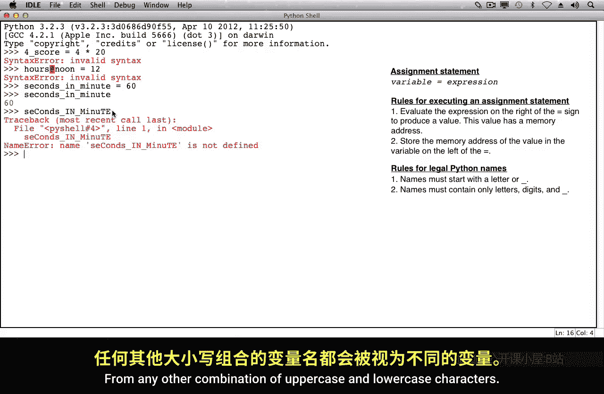
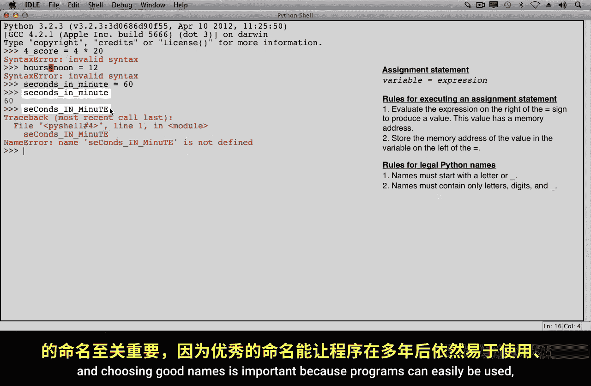
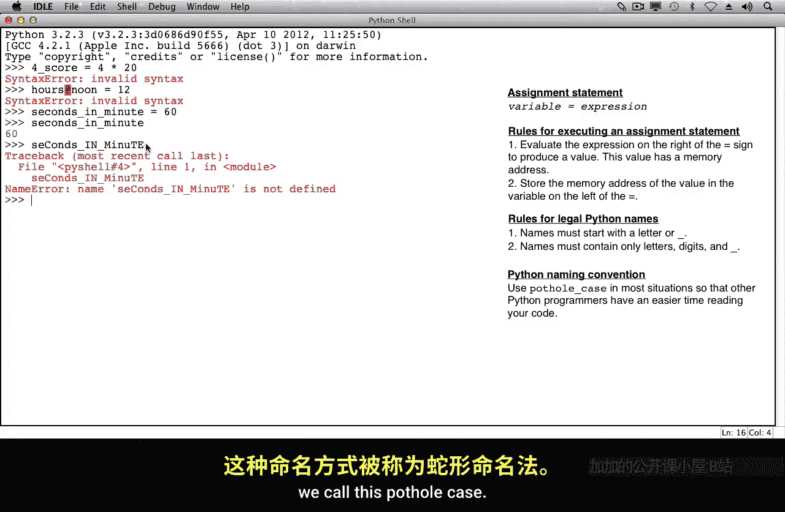

# 特伦托大学【中英⚡学习编程：基础知识｜Learn to Program： The Fundamentals】 p05 P5 01_变量 -BV1kQ11B5EWa_p5-

Hey， everyone， you've seen how to evaluate expressions in Python In this lecture。

 we're going to show you how to remember the results of those expressions so that you can use those values later。

We're going to explore this idea by calculating the areas of some triangles as a reminder。

If I happen to know the height of the triangle。And I happen to know the length of the base。

 then the area of the triangle。Is。The length of the base。Times the height。Divided by two。

So for example， if the heights 12。And the length of the base is 20， then the area is 20。Times 12。

Over to。Let's go explore that in Python。You already know how to enter that expression。

And get it evaluated in Python。 But since we've decided to calculate the values of a couple of triangles。

 we're actually going to show you how to introduce the words base and height to represent values。

 This is done with assignment statements。Here is an example。

What this does is it evaluates the 20 and associates that value with variable a base is called variable because its value can vary as we'll see。

We'll do something similar for a variable that we'll call height。And then。

These two names can be used as if their values were there on the in the Python shell。

So basis value is 20。Height is associated with the value 12。

Notice that the equal symbol has a very different meaning in programming than in mathematics。

Because computer programs get rather complicated。We're going to introduce a notation for describing variables and their values what we're going to do is。

Draw variable base with a box next to it， and what happens in Python is 20 doesn't go in that box。

 instead， 20， like every other value in Python lives at a particular memory address。

So I am going to pick an arbitrary memory address that I'm going to mark with an X just to make it look different from other numbers and let's say that at memory address x3。

 the value 20 appears。The assignment statement takes that x3。And puts it in the box。

Associated with base， so base containss X3。 and in some sense， what that means is it points。

To memory address x3 where the value 20 lives similarly。Theres a variable height。

 and Python keeps track of its value in that little box and its value as a memory address。

 I'm going to pick。X7 these are arbitrary Python is in charge of that choice and so。

I don't need to worry about exactly what the memory address is as long as I know that this relationship between variables and their values exists。

Getting back to our programming problem， we can actually use base and height and in expression。

If I do base times height divided by 2， I end up with the same result as if I attack 20 times 12 divided by2。

We can also assign the result of that last expression to a variable。I'll call it area。

And let's check its value。What we're going to do now is we're going to give base and height new values using assignment statements again。

So let's assign the value 2。5 to variable base。What this does in my picture is it gets me a new value 2。

5 at a particular memory address， perhaps。X4， and it replaces the assignment statement。

 replaces this x3。With the value x4 so that base no longer points to the 20 instead。

Base is associated with the 2。5。Similarly。I can assign the height。What this is going to do。

 of course， is。Put 7 at a particular memory address， perhaps X1。

 And the assignment statement is going to take that X1， and is going to put it in variable height。

Breaking this connection so that height now refers to the7。Using control P。

I am going to move back up to my old calculation of area。 And as we're just about to see。

 this new area is 8。75， which is indeed what you get。 If you take 2。5。

 multiply it by 7 and divide by 2。Every assignment statement has the form variable is assigned signed expression。

Here are the rules for executing an assignment statement。

 and you should do your best to memorize these because this is going to come up over and over in the course。

Step one， evaluate the expression on the right hand side。

The value of this expression has a memory address。Store that memory address in the variable on the left hand side。

Every programming language has a set of rules for what a legal name is in Python。

 variableable names must start with a letter or the underscore character and can contain letters。

 numbers and underscores。 Both uppercase and lower case letters are allowed。

Badly formed variable names cause syntax errors。 So， for example。

 if we try to start a variable name with a number。You're told we can't。Similarly。If we include。

A non alphabetic， non underscore， non numeric character。In a variable name。Python will complain。

Python is also case sensitive， so seconds in。Minute is。A perfectly valid variable length。

But it's different。From。Any other combination of uppercase and lowercase characters like that？

The first one， seconds and minute is， of course， more readable than the second one with those capital letters and choosing good names is important because programs can easily be used read and improved on for years。

Every programming language has a set of conventions for how to choose a name。

 much like websites have a particular style and layout。In Python。

 most variable names use only lower case letters with underscores to separate words。

 We call this pothole case。

