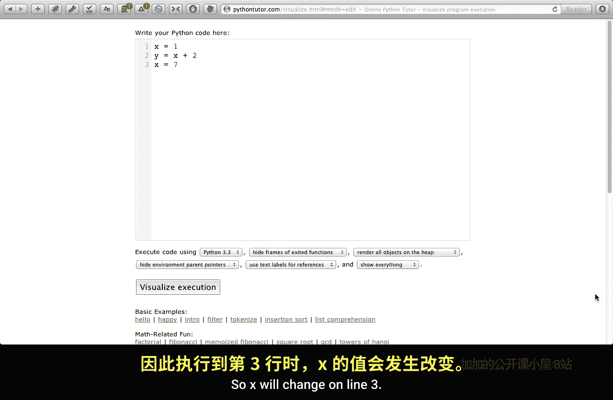
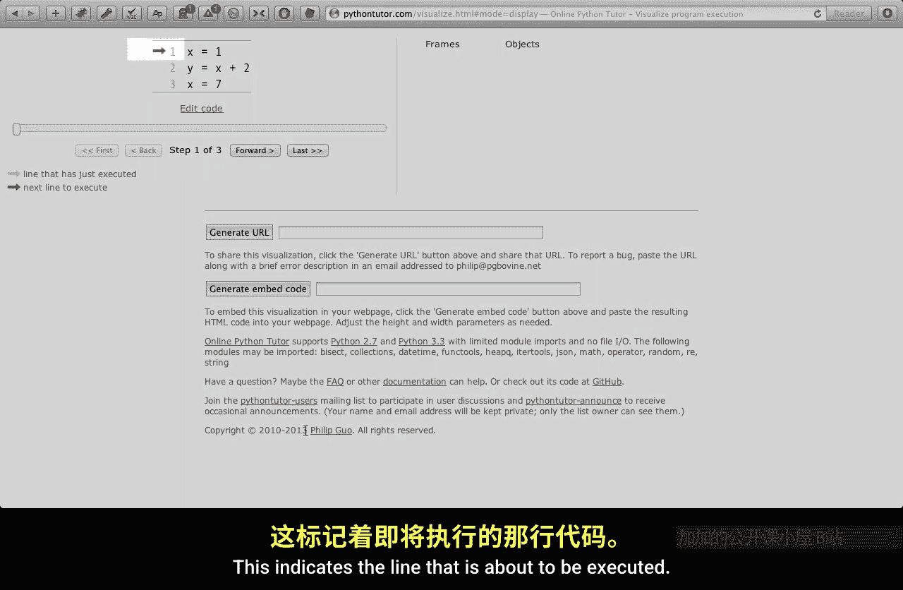
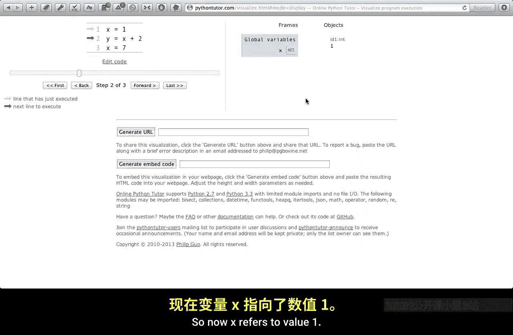
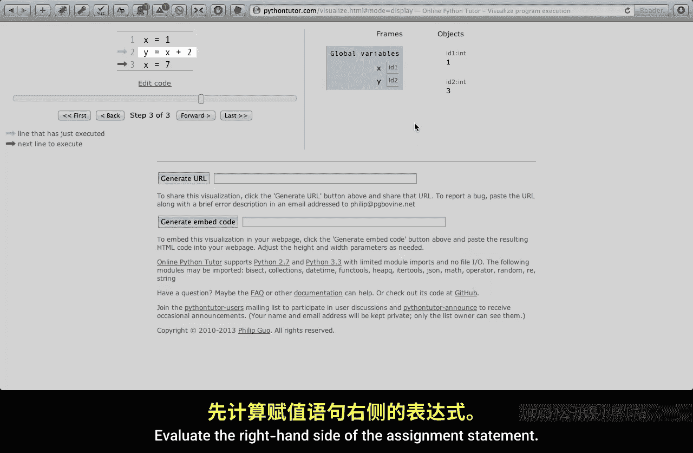
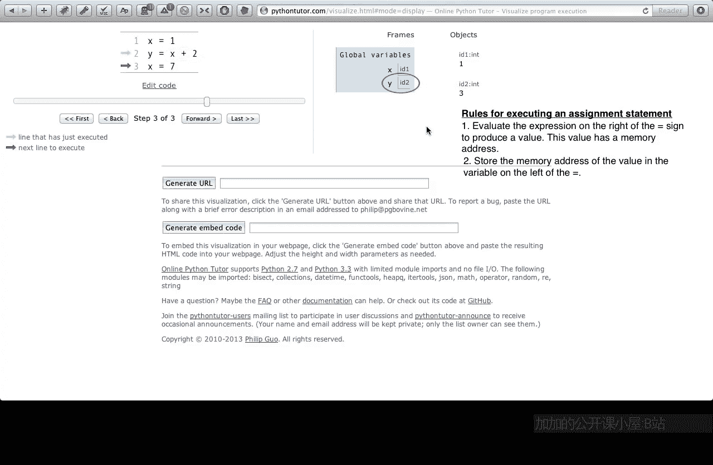
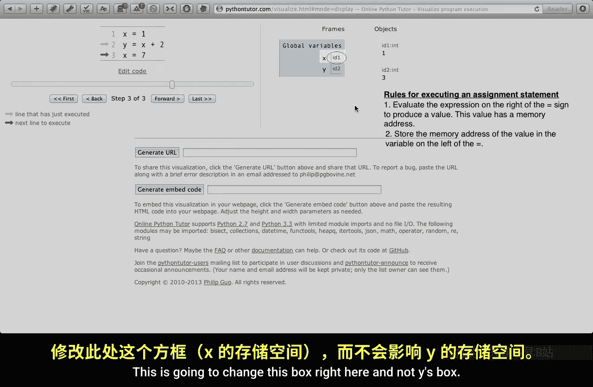
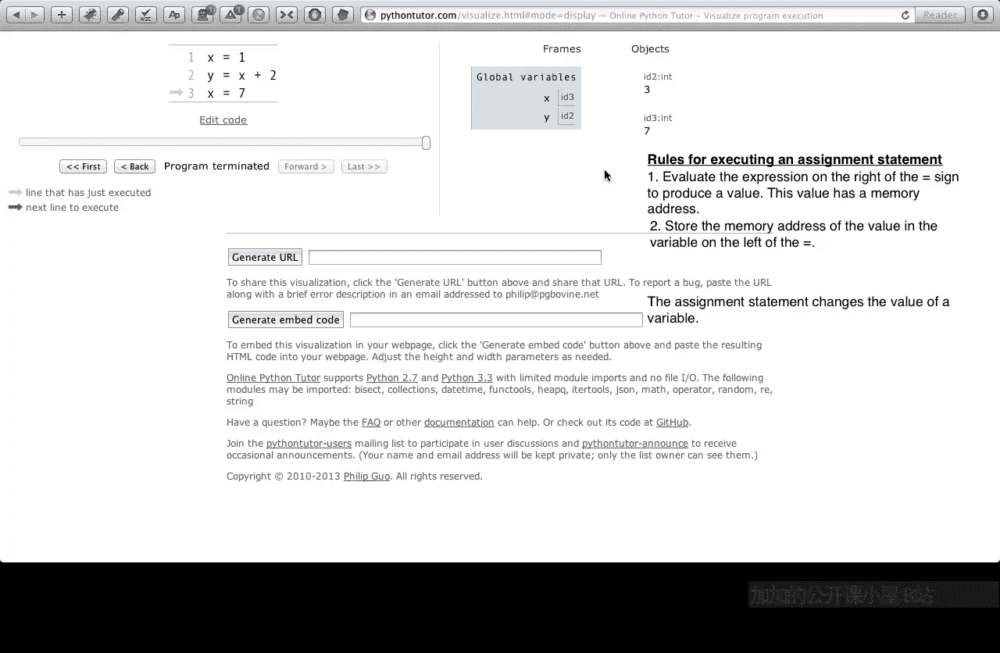

# 特伦托大学【中英⚡学习编程：基础知识｜Learn to Program： The Fundamentals】 p06 P6 03_可视化赋值语句 -BV1kQ11B5EWa_p6-

You've seen variables and assignment statements。 What we're going to do now is explore a tool called a visualizer that will allow you to see the state of computer memory as a program executes。

In the text box are three assignment statements。 The first assignment statement assigns the value 1 to X。

 The second assignment statement evaluates the expression X plus 2 and assigns to Y。 the result。

 The third statement evaluates 7 and assigns it to variable X again。 So X will change on line 3。

Let's watch that happen。This indicates the line that is about to be executed， As you can see。

 we haven't done any execution yet， and so there are no variables created yet。

When I click forward， we're going to take the one and assign it to X and as we saw in the variables lecture。

 we're going to end up with the value one inside an object in computer memory and variable X is going to contain the memory address of that value。

 So when I hover over this box there。 we see that there's an arrow that points to this chunk of computer memory。

 So now x refers to value1。

I'm about to execute line 2， and that is going to evaluate what x plus 2 is。 Well。

 we know that 1 plus 2 is 3， so we should see the value 3 get created and stored somewhere in computer memory。

 And after we execute line 2， we should see a variable Y containing the memory address of that value。

So I'll click forward here。And indeed， we see that happen。When I hover over why。

 I see that there is a link between why and。See value three。

We also told you that the assignment statement was quite different from equality。

 we are not saying that y is always equal to x plus2。

Remember the two steps evaluate the right hand side of the assignment statement that gives you back a memory address。

 Take that memory address and store it in variable Y。

。

We're about to demonstrate that here because we're going to assign to x the value 7。

This is going to change this box right here and not wise box， so when I click forward。

We see that y still refers to value 3。Even though x now refers to value 7。

So the assignment statement changes the value of a variable。

It's not stating that y is always equal to x plus 2。

 It's only doing it for this particular snapshot in time。

