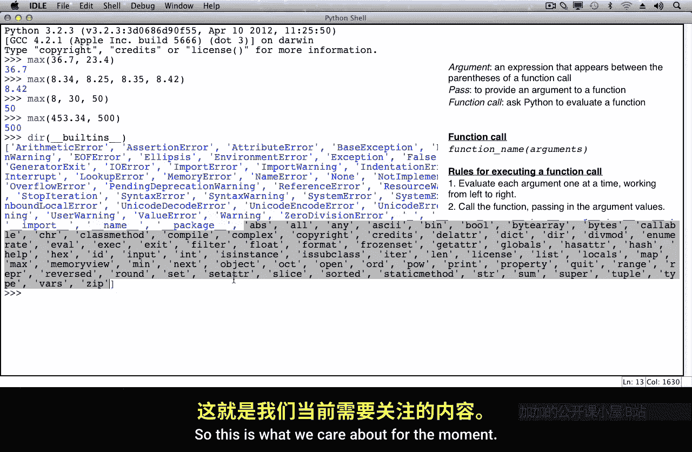
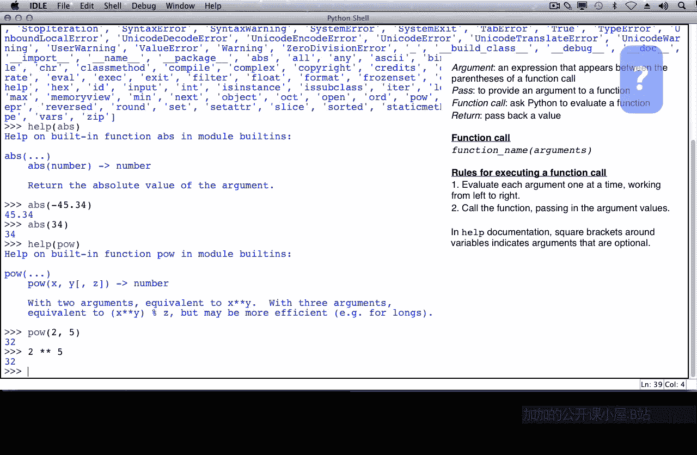

# 特伦托大学【中英⚡学习编程：基础知识｜Learn to Program： The Fundamentals】 p07 P7 05_内置函数 -BV1kQ11B5EWa_p7-

We've seen that Python has several mathematical operators， like multiplication and subtraction。

 and we know that the mathematical operation， multiplication is associated with an asterisk symbol。

 There are lots of other operations that we might want to do with or without math and not enough meaningful symbols to go around。

So， for example， we may want to figure out which of several numbers is the largest one。

 And there's no symbol associated with that operation。 Instead。

 Python has a set of built in functions that allow us allows us to perform these operations。

 So we'll take a look at those now。

So let's start with that example I mentioned， which is to find out which of several numbers is the largest。

The Python built in function that we'll use for that is the max function。

 so the name of the function is max。 I use an open parentheesis and notice the yellow pop up box that's idol's help that is intended to remind professional Python programmers what the function does。

 and you probably won't understand it yet and that to be expected。And then， I provide。

The arguments to the function。 So in this case， I'm going to provide two arguments。

 past two arguments to the function。The argument of its values are 36。7 and 23。4。

 so this is a function call。With arguments 36。7 and 23。4， when I hit En。

 Python will evaluate that function call and tell me that 36。7 is the bigger of the two numbers。

The form of a function call is the name of the function， an open parenthesis。

 a comma separated list of expressions known as arguments and a closing parenthesis。

 When a function is called， Python first evaluates the arguments， then calls the function。Yeah。

In addition to calling Max with two arguments， we have the option of calling it with several。

 so in this case we will call it with four arguments。We can also call it not only with floats。

 but with int。 so this time I'm going to pass three int arguments to the function。And finally。

 it's possible to pass in arguments of two different types。

 so we'll pass in a float argument along with an ink argument this time。

How did I even know that Max existed and how did I know what arguments to provide and what values it would give back？

We can find out which built in functions are available by using another built in function named D。

 So I'm going to call D now。And I'm asking for。A lististing of the built in functions when I hit enter。

There we go， we've got a huge long list， kind of an overwhelming list， actually。

The good news for the moment is that we are going to completely ignore all of this。

 and we are only going to focus on those names that have lowercase letters， entirely lowercase。😊。

So this is what we care about for the moment。

We can see that Max appears in the list。And we're going to， for the moment。

 explore another function named abs。 The built in function help can be used to find out more about abs。

 We'll call help passing abs as the argument to the function， and we get back a description of abs。

From this description， we can see that Abbs takes one argument， a number。And that it will。

 according to this symbol， which means return， also return a number。

So it's going to return the absolute value of the argument。Let's give it a try。 When we call abs。

 we need to pass a numeric argument， so I will pass a floatat。And similarly， I could cause an end。

You can see that when we pass a float argument， we get a floating point result。

 and when we pass an int， we get an int result。We'll now use help to learn more about one of the other built in functions named PoO。

What pass power is the argument to help and get the description？

And we can see from this description that PAO has two arguments。

The third argument is inside square brackets， indicating that is an optional argument。

 so Z is optional。That means that when we call PAO。

 we need to call it with at least two or possibly three arguments。Poowwell then return a number。

Let's call Po with two arguments， two and five。This gives 32。And actually。

 this is equivalent to the using the exponentiation operator to calculate to the power of five。

