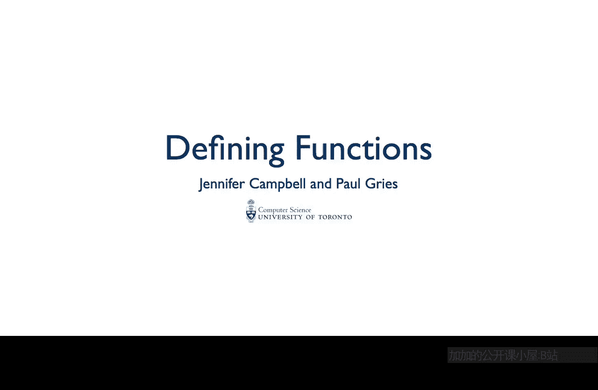
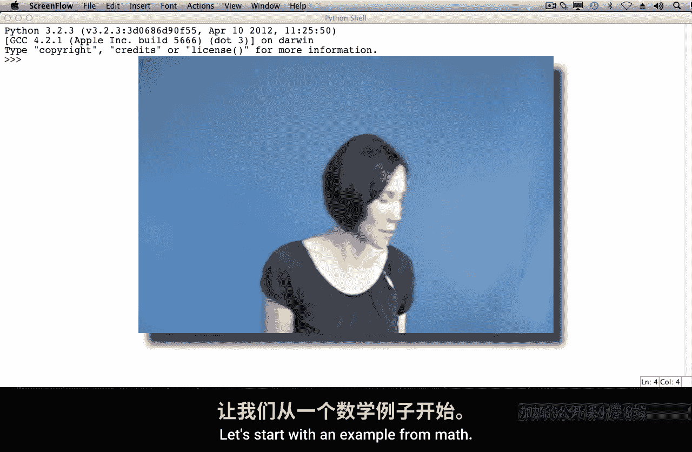
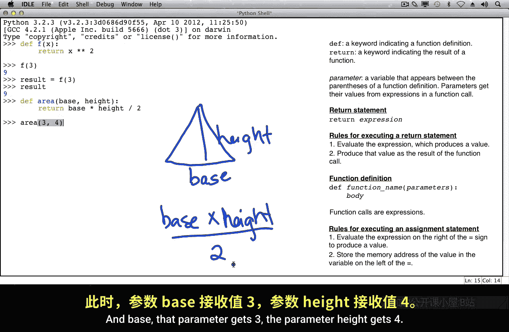
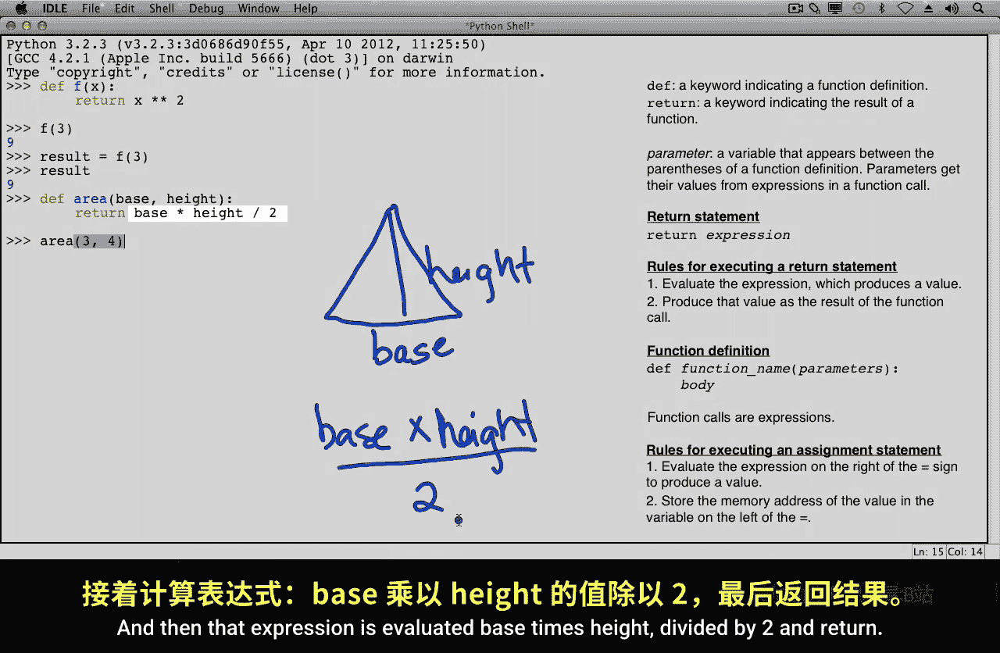
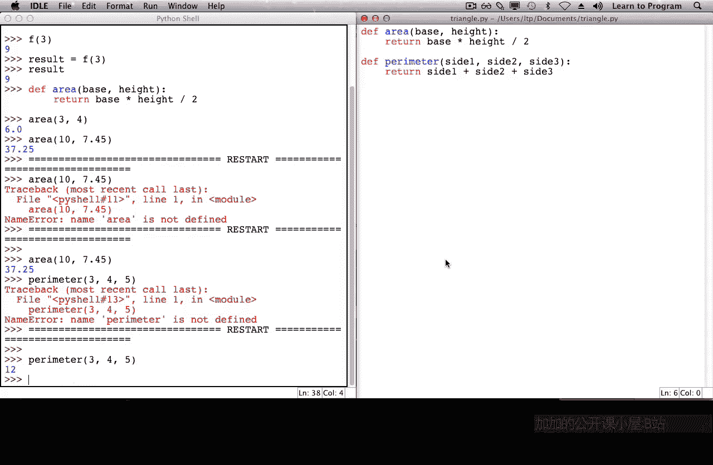

# 特伦托大学【中英⚡学习编程：基础知识｜Learn to Program： The Fundamentals】 p08 P8 07_定义函数 -BV1kQ11B5EWa_p8-

Hi there。 In addition to using Python's built in functions。

 we can also define our own and that's what this lecture is all about。

 Let's start with an example from Moth。

Function S of x。Takes X， and squares it。Here's how the function looks in Python。Yes。

Death indicates a Python that we're defining a function。F is the name of the function。

X is called the parameter of the function。 It's a variable whose value will be supplied when the function is called。

This colon indicates to Python that we're about to type what happens when the function is called。

And the word return。Indicates that we're passing back a value。

The general form of a return statement is the word return followed by an expression。

And the rules for executing your statement are first。

 evaluate the expression producing a memory address， and second。

 pass back that memory address to the caller。The general form of a function definition is the word deaf。

 followed by the name of the function。And then zero or more parameters separated as commas。

Next comes the body of the function， which is one or more statements。

 often ending with a return statement。 Notice that the body is indented。Let's call the function F。

We'll pass in an argument3。When the function is called。

The parameterimeter X is assigned the memory address of the value of 3。

We can think of this actually like an assignment statement。Where X gets three。

I'll hit En so the function call is executed。And the result of the function call is that the value9 is returned。

Function calls are actually expressions， so we can use a variable to store the result。

Let's create a variable result that gets the result of calling F of 3。

Recall the rules of executing an assignment statement。

 which are that first the expression on the right hand side is evaluated， producing a memory address。

 and second， the memory address is stored in the variable。

Result gets the memory address of the call to F of3， so in other words， result gets nine。

Let's define another function。Recall from the variables lecture how to calculate the area of a triangle。

Do the base， multiply it by the height。And then divide by two。

We'll now write a function to calculate the area of a triangle。 We start with the word death。

And next comes the function name， Let's use the name area。

After the function name come the parameters to the function。 In this case。

 we will have two parameters， the base and the height。We end this line with a corn。

And then we write the body of the function。We are going to return the base multiplied by the height divided by two。

Let's call the function。 We'll execute area passing in two arguments，3 and4。

And face that parameter gets three， the parameter height gets4。

And then that expression is evaluated basetime height divided by  two and returned。

So 6。0 is returned by the function。Let's call it one more time passing in an int and afloat this time。

The expanded rules for executing a function call are to first evaluate the arguments to produce memory addresses。

Next， stores those memory addresses in the corresponding parameters。

And then execute the body of the function。 Now let's restart the Python shell。

 go to the shell menu and click restart。And we've just lost all the work that we did in this shell。

 including the area function definition。If we try to call area。

 we get a name error because area is not defined。Yeah。Most Python programs are saved in files。

 let's create a new file and save our function definition area in it。IGo to file new window。

Place our function definition in there。And we'll save this file as Triangle dot pi。

 All of our Python programs will be saved in dot pi files。

Just resize the windows so that we can see the shell on the left hand side and our triangle dot pie file on the right hand side。

Now that we have our area function definition in triangle up high， we can run this file。

So we click run and run module。That makes the area function definition available in the shell。

 So now when we call area from the shell。It knows what area is and is able to execute that function。

We can define more than one function in the triangled up P file。

 let's add another function definition。We will define a function to calculate the perimeter of a triangle。

We'll pass insides one， two， and three。And the function will return to sum of those sides。

At this point I've saved triangle that pie， and if I go back to the shell and execute the function。

What we'll see is an error。That's because at this point。

 although the function is saved in triangle dot pi， we have not run triangle dot pi。

 and so the shell does not know what perimeter is。Before executing a function in the shell。

 we need to run that module， I've hit the command to run the module。

 and now I can call perimeter and it executes。

