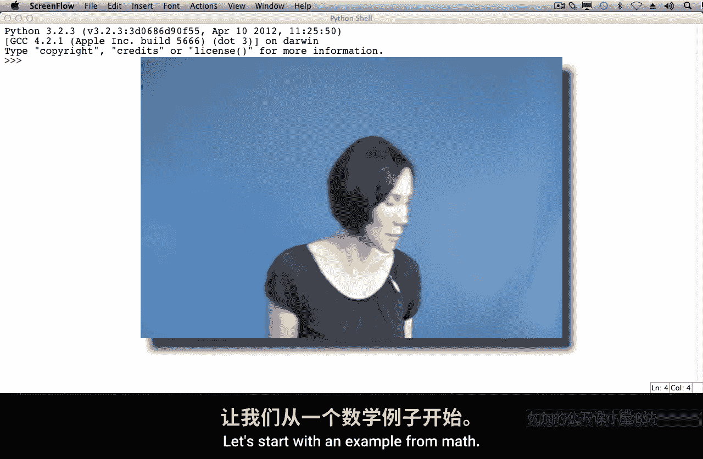
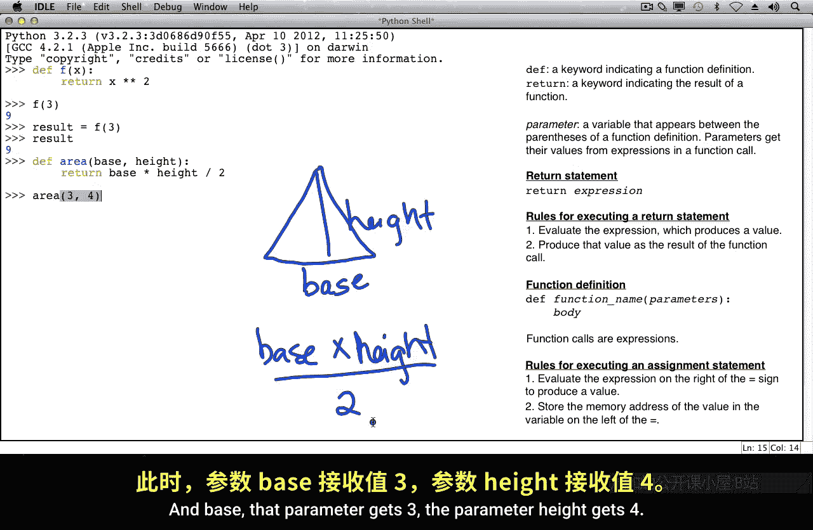
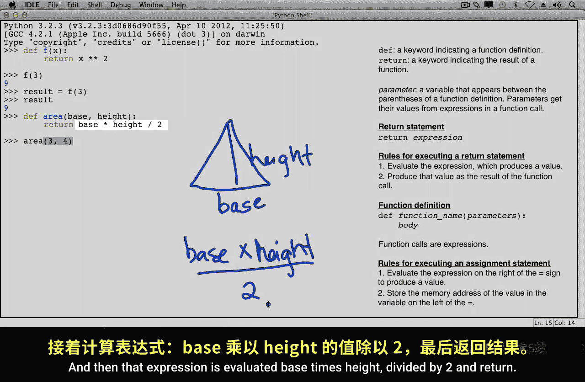
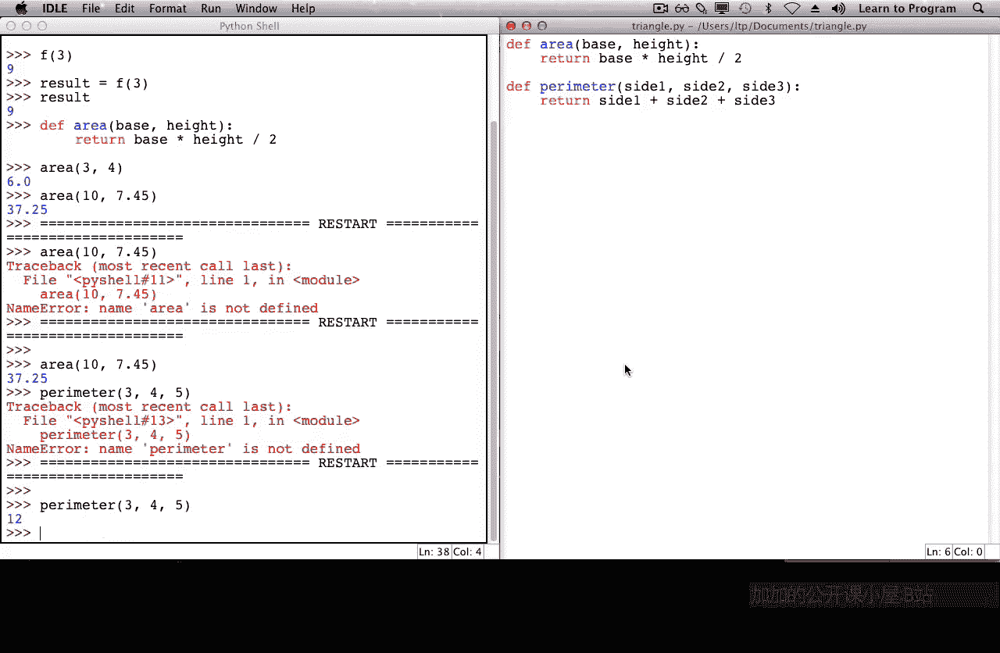

# 学习编程：基础知识｜P8：07_定义函数 🧑‍💻


在本节课中，我们将学习如何定义自己的函数。除了使用Python内置的函数，我们还可以创建自定义函数来执行特定任务。



## 函数定义基础

上一节我们介绍了使用内置函数，本节中我们来看看如何创建自己的函数。让我们从一个简单的数学例子开始。

函数 `S(x)` 接受参数 `x` 并计算其平方值。以下是该函数在Python中的表示：

```python
def f(x):
    return x * x
```

`def` 关键字向Python表明我们正在定义一个函数。`f` 是函数名。`x` 被称为函数的**参数**，它是一个变量，其值将在函数被调用时提供。冒号表示接下来是函数被调用时要执行的代码。`return` 关键字表示我们将传回一个值。

**return语句**的一般形式是关键字 `return` 后跟一个表达式。执行return语句的规则是：首先，计算表达式以产生一个内存地址；其次，将该内存地址传回给调用者。

**函数定义**的一般形式是：关键字 `def`，后跟函数名，然后是零个或多个由逗号分隔的参数。接下来是函数体，它由一个或多个语句组成，通常以return语句结束。请注意，函数体是缩进的。

## 调用函数

让我们调用函数 `f`，并传入参数 `3`。

```python
f(3)
```

当函数被调用时，参数 `x` 被赋值为 `3` 的内存地址。我们可以将其想象成一个赋值语句：`x = 3`。执行函数调用后，函数返回结果 `9`。

函数调用实际上是表达式，因此我们可以使用变量来存储结果。

```python
result = f(3)
```

回忆一下执行赋值语句的规则：首先，计算右侧的表达式以产生一个内存地址；其次，将该内存地址存储在变量中。因此，`result` 获得了调用 `f(3)` 的结果，即 `9`。

## 编写实用函数：计算三角形面积

现在让我们定义一个更实用的函数。回忆变量课程中计算三角形面积的方法：底乘以高，然后除以二。

我们将编写一个函数来计算三角形的面积。

```python
def area(base, height):
    return base * height / 2
```

我们以关键字 `def` 开始。接下来是函数名，这里使用 `area`。函数名后是函数的参数，本例中有两个参数：`base` 和 `height`。我们以冒号结束这一行，然后编写函数体。函数将返回 `base * height / 2` 的结果。

让我们调用这个函数。我们将执行 `area` 并传入两个参数：`3` 和 `4`。

```python
area(3, 4)
```



参数 `base` 获得值 `3`，参数 `height` 获得值 `4`。然后计算表达式 `base * height / 2` 并返回结果 `6.0`。



我们可以再次调用它，这次传入一个整数和一个浮点数。

```python
area(5, 2.5)
```

执行函数调用的扩展规则是：
1.  计算参数以产生内存地址。
2.  将这些内存地址存储在相应的参数中。
3.  执行函数体。

## 将函数保存在文件中

如果我们重启Python shell（通过Shell菜单点击Restart），则会丢失在shell中完成的所有工作，包括 `area` 函数的定义。此时尝试调用 `area` 会导致NameError，因为 `area` 未定义。

大多数Python程序都保存在文件中。让我们创建一个新文件并将函数定义 `area` 保存在其中。

转到 File -> New Window。将我们的函数定义放入其中。我们将此文件保存为 `triangle.py`。我们所有的Python程序都将保存在 `.py` 文件中。

调整窗口大小，以便在左侧看到shell，在右侧看到我们的 `triangle.py` 文件。

现在我们的 `area` 函数定义在 `triangle.py` 中，我们可以运行这个文件。点击 Run -> Run Module。这使得 `area` 函数定义在shell中可用。现在当我们在shell中调用 `area` 时，它知道 `area` 是什么并能够执行该函数。

## 在文件中定义多个函数

我们可以在 `triangle.py` 文件中定义多个函数。让我们添加另一个函数定义。

我们将定义一个计算三角形周长的函数。我们将传入三条边：`side1`, `side2`, `side3`。函数将返回这些边的总和。

```python
def perimeter(side1, side2, side3):
    return side1 + side2 + side3
```

此时我已保存 `triangle.py`。如果我返回shell并尝试执行 `perimeter` 函数，将会看到一个错误。这是因为虽然函数已保存在 `triangle.py` 中，但我们尚未运行 `triangle.py`，因此shell不知道 `perimeter` 是什么。

在shell中执行函数之前，我们需要运行该模块。运行模块后，我就可以调用 `perimeter` 并执行它了。

---



本节课中我们一起学习了如何定义自定义函数，包括函数定义的结构、参数的使用、return语句的作用，以及如何将函数保存在 `.py` 文件中并通过运行模块使其在交互式环境中可用。我们还学习了在一个文件中定义多个函数的方法。