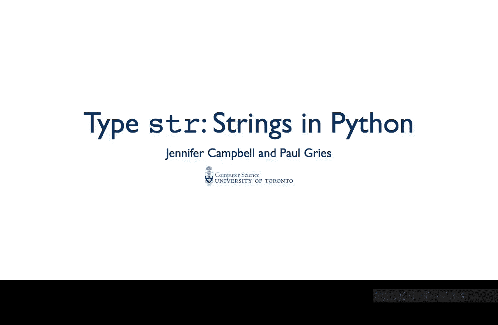
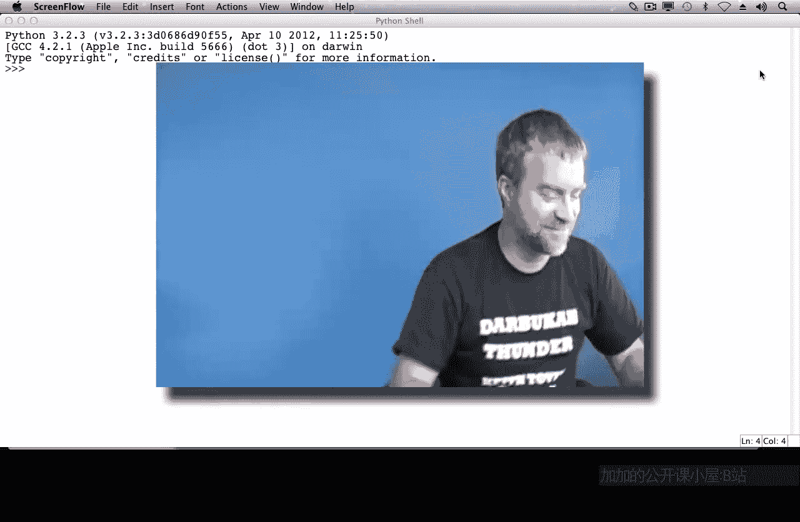
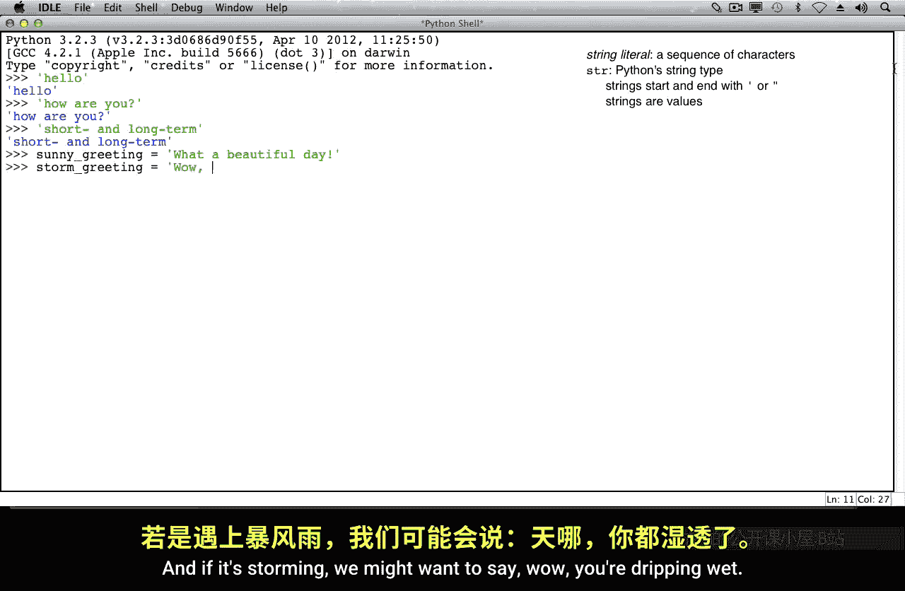
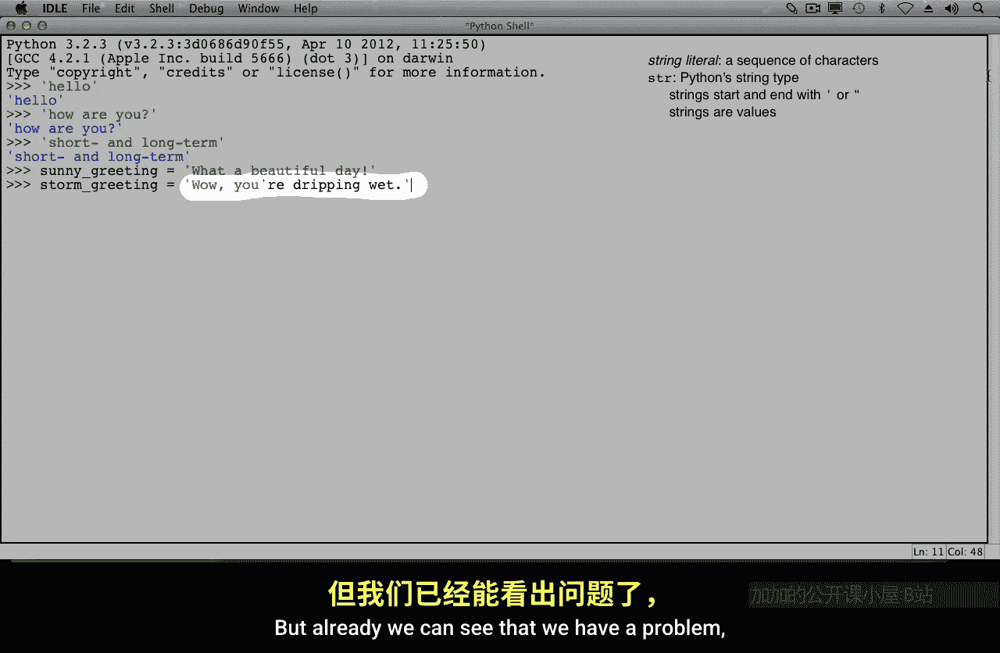
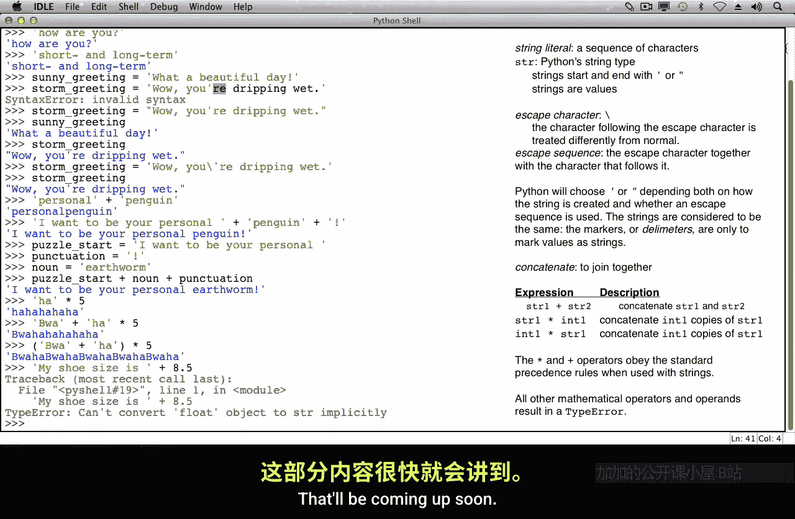

# 特伦托大学【中英⚡学习编程：基础知识｜Learn to Program： The Fundamentals】 p09 P9 01_类型-字符串 -BV1kQ11B5EWa_p9-

Ernest Hemingway wrote， all my life， I've looked at words as though I were seeing them for the first time。

Words are everywhere in programming from Google searches to bioinformatics。

 where DNA is sometimes represented as a string of A's， Ts， C's and G's。

To simple things like message dialogues， right now。

 we're going to explore Python's string representation and how we can manipulate these values。

。A string literal is a sequence of characters In Python。 This type is called Stern。

 Strings start an end with a single or double quote。Such as hello or。How are you？

We can include punctuation， as we've just seen， or hyphenened。

Strings are values and can be used in an assignment statement。

It's a sunny day we like decide to say to somebody， what a beautiful day。And if it's stormy。

We might want to say。Well。

Dripping wet。 but already， we can。See that we have a problem because it goes from green to black at that second hyphen。

And indeed， we have a syntax ever。The problem， of course。

 is that we're trying to use a single quote inside a single quoted string。And Python， of course。

 doesn't really know what we're doing。Because of this， Python allows you to use double quotes。

 And now a sunny greeting。It's that in a storm greeting it is all wet。We have another choice。

Instead of using the double quotes on this string， we are elect to use what's called the escape character。

 an escape sequence。If we use a back slash， you'll notice first that the string is termed all green。

 And when they hit return， what we're going to see is that this string is going to appear。

 but we're not going to see the back slash。 Furthermore。

 the single quote markers on the beginning and end of the string will be。turn点 to。Double quotes。

We can concatenate strings， using operator， plus。Notice that we have to put in our own spaces。

With this， we can write a version of madlibs where we ask a friend for a noun。

 Let's say they pick earthworm。 So we're going to have the start of a puzzle。And we would like to。

End this， let's say， with an exclamation mark and the noun they pick is。Now， let's add them together。

嗯。We can build up a repeated string using the multiplication operator。And as with regular math。

 multiplication is precedence over addition。We can override this， using parentheses。We can't。

 however， add a string to an int or a float。And convert float object to stir implicitly， sends。

Little dangerous notice that it's a type error。You'll see in a later lecture how to combine strings and numbers。

 That'll be coming up soon。

We can't multiply strings either。Even if that string has a number inside it。

Can multiply sequence by non int of type stir。Other operators won't work。

Teer unsupported operaand types for minus stir and stir。 You can't use two strings together with。

Subtraction。Can't divide either unsupported operaand types for division for。Raising to a power。

Notice that every one of these is a type error。