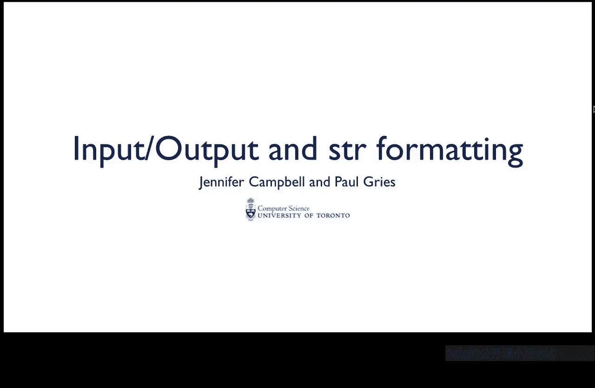
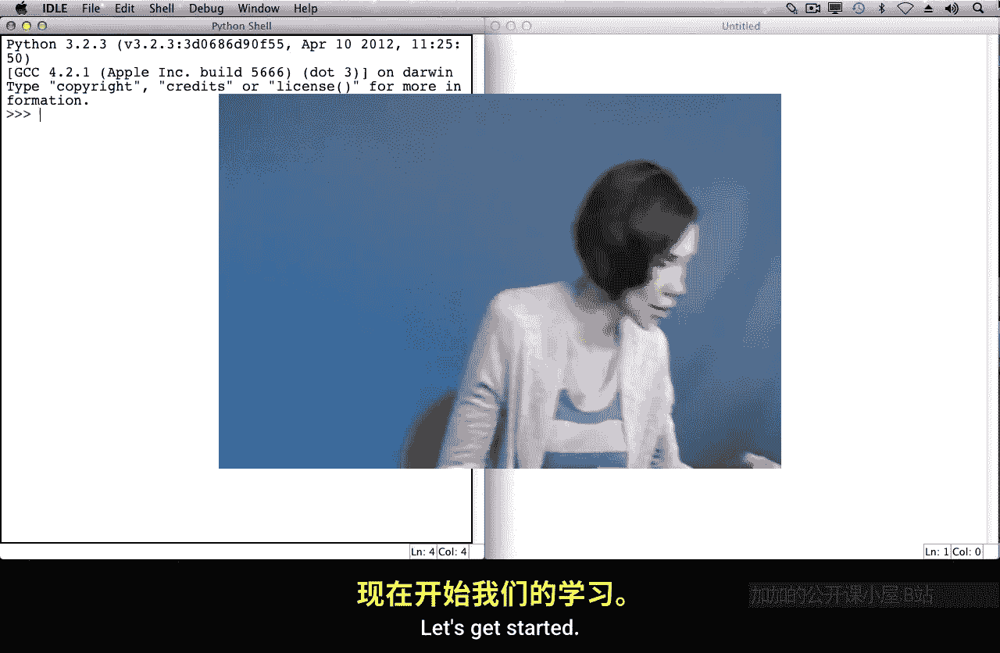
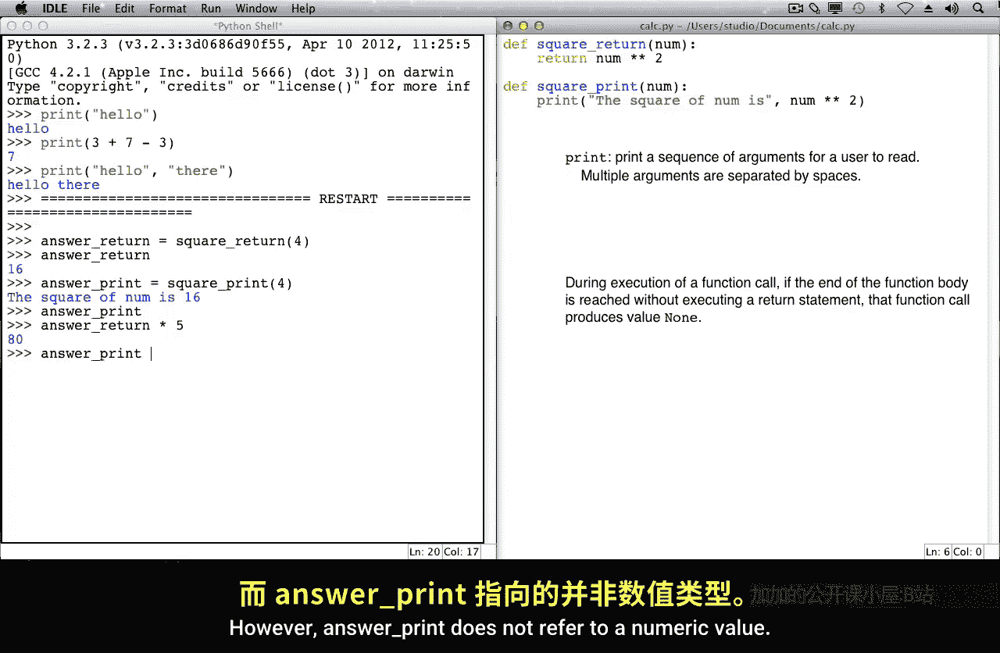
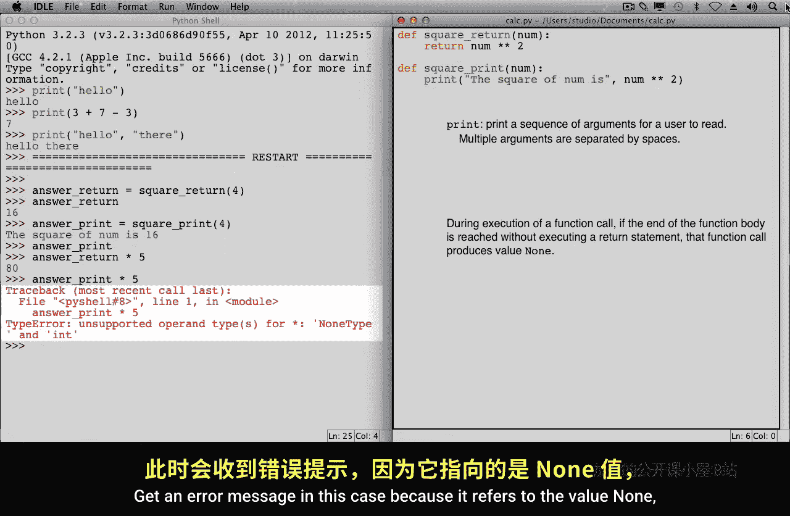
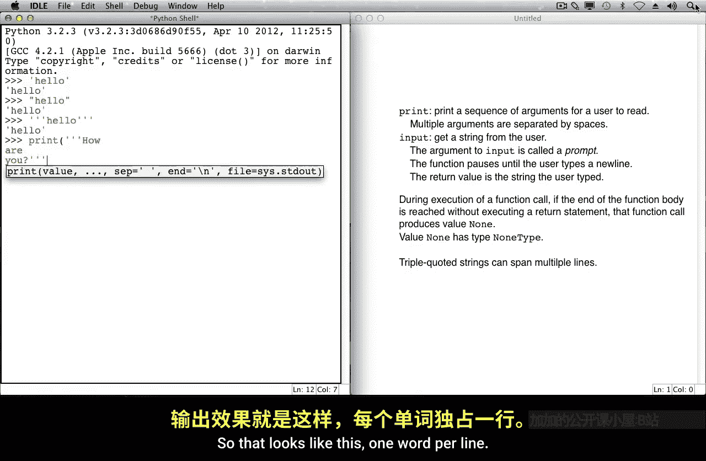
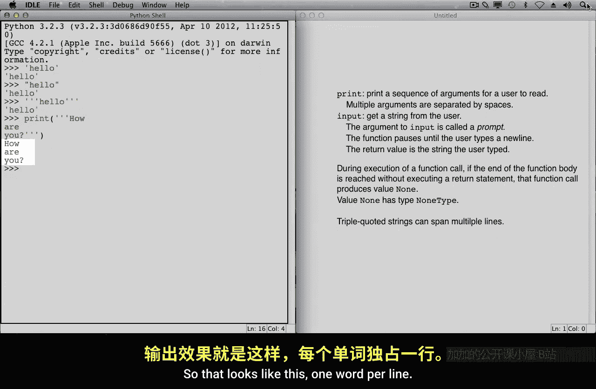
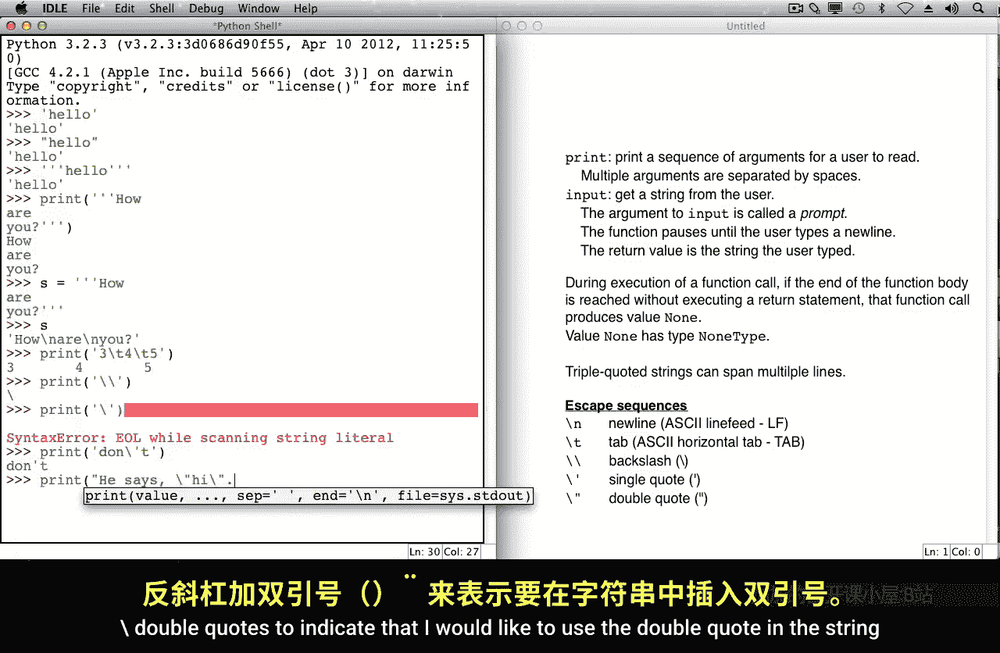

# 特伦托大学【中英⚡学习编程：基础知识｜Learn to Program： The Fundamentals】 p10 P10 03_输入输出与字符串格式化 -BV1kQ11B5EWa_p10-

Hello， in this lecture， we're going to do some more work with strings and do some string formatting。

We're also going to write some interactive programs where we display messages to the user and get input from the user。

Let's get started。

We'll call Python's builtil in function print， passing a single argument to the function call in this case。

 we'll pass this string Ho， and Ho will be displayed to the screen。Notice that when Ho is displayed。

 it's displayed without the quotation marks。 The quotes are only for Python's internal string representation。

 and they're not seen by the user。Let's call printnt again。

 passing a mathematical expression as an argument to the function。In this case。

 the expression is 3 plus 7-3， and that expression will first be evaluated and then printed to the screen。

We'll call print a third time， passing in two arguments this time， two strings， hello and there。

And when the strings are displayed， they're displayed with a space between them by default。 So hello。

 space there is what's printed to the screen。Now we will define two functions。

 We'll define the functions in a file named CalC dot Pi that I've already created and saved。

Both functions will calculate the square of a number。 One function will return that result。

 and the other will print it。We begin the function definition with the wordde。

 and the name of this function is square return。It will take a single parameter。

 I'm calling this numb， and the job of this function is to return numb to the power of two。

The second function， its name will be square print。 it also has a single parameter， nu。

And it's also going to calculate the square of none。 But rather than returning that value。

 this function will print it。In a moment， we will call these two functions from the shell。

 I'd like the output of the call to print to look different from the value returned by square print。

To do this， I'm adding a string to the list of arguments for the print function call so that it will display the square of nu is before the squared number。

The next step is to run the module， we'll go to the run menu and choose Run moduleule。

 and now we have access to the two functions in the shell。

We're going to call these two functions and we will store the results of calling those functions in a variable。

So the variable answer return will get the result of calling the function square return。

We're going to pass an argument to square return， and I'm picking the value4。

 I could pick any value here， but I'm using for just as an example function call。

It's now time to run the function。 When this function executes。

 we want to watch to see whether anything is printed。

And we can see when we execute it now that we immediately get the prompt。

 So nothing was printed to the screen by square return。 Next。

 we want to check the value of the answer return variable。

 and we can see that answer return refers to the value 16。

 So square return returned the memory address of 16。

 and that memory address was stored and the answer return variable。

Now it's time to call the function square print， we'll also pass the value4 as the argument we could have picked anything。

And we see this time that something is displayed to the screen， the square of nu is 16。Next。

 we'll examine the contents of the variable An print。And this time， we don't see anything。

When a function does not have a return statement that gets executed， Python will return none。

 and that's what happens in this case。Because answer of return refers to a numeric value。

 we're able to use it in a mathematical expression。Such as multiplying it by 5。 However。

 answer print does not refer to numeric value。 We get an error message in this case because it refers to the value。

 none。

Whi is of type， nu type。We now know how to use Python's built in function print to display messages to users The next step is to use Python's built in function input to get information from the user。

We'll call input passing a single string as an argument to it。In this case。

 we're going to ask the user what is your name？When the function executes。

 that string will be printed to the screen， and we will wait for the user to type some input at the prompt。

So notice that the cursor is flashing， waiting for us to type something。

I will now type my name as the user of this program， I say my name is John， and when I hit Enter。

 the function completes its execution。The string that I typed J EN is returned as a string for the function。

 We see that there are single quotes around it， indicating that the value is type string。

We'll call the function input a second time this time， though。

 we will store the result returned by input in a variable named name。When we execute the function。

 the user types their name， and that value is returned as a string。

So the memory address of the value is stored in the name variable。

And when we examine the contents of name， we see that it refers to the string gen We will now use input to prompt the user to enter their location。

 the string， what is your location gets printed， and I enter my location。Toronto。

That value is returned by the function， so location refers to the value to and name refers to gen。

Let's now use the two variables， name and location to display a message back to the user。

 We're going to call print， passing in three arguments。 The first is the name。

 The second will be a string saying lives in， and the third is the location。

So the way we interpret this call to print is that first we'll use the value that name refers to。

Joining that with a space between it and the string lives in。And next。

 we'll use a space and the value that location refers to to print Jen lives in Toronto。Earlier。

 I mentioned that name and location both refer to strings， in fact， all values。

 the type of all values returned by input will be type string。Let's call input again。

Asking how many cups of coffee I've had today。When I enter a value as the user， I enter two。

 and this value is returned by the input function as a string。

 so we can see that numb coffee refers to the string to， not to the int2。

You've already seen that we can use single quotes and double quotes to represent strings。

 and now I want to show you a third string format， which is triple quoted strings。

Triplequi strings are able to span multiple lines。For example。

 let's print a triple coded string with how on the first line。

A on the second and you on the third line。

Yeah。So that looks like this， one word per line。

I'm going to use the same string only rather than printing it， I'll store it in a variable。

And when we examine the contents of variable， S。It looks a lot different from what we input it。

First of all， it doesn't have triple quotes anymore， it has single quotes。And secondly。

 in the places where I had hit the enter key or the return key， we see this backlash n in two places。

That character is called the new line character， and it's a special character in Python。

The backslash symbol is the escape character， and this combination of backslash andN is the escape sequence new line。

There are several other special characters， for example， let's print the numbers three。

 four and five separated by tabs。So we use three， and then for the tab symbol。

 we use escape sequence backslash T。Four， back slash T and five。So three， tab four， tab five。

And that's what it looks like。In addition to new line and tab。

 there are several other escape sequences。A couple that will be useful for us are the escape sequence backslash backslash。

 which we use whenever we want to print a single backslash or include a single backslash in a string。

That's because the backslash character is the escape character， and when we use it on its own。

 we get an error message。Because it expects that something follows it。

Another useful sequence is the single quote sequence for when we want to include a single quote within our string。

 for example。If I want to say， don't。And then I use backslash quote for the place where I'd like the single quote to occur。

And similarly， when I want to use quotation marks， double quotation marks in a string。

 I can use this G sequence backslash double quotes。So imagine that we want to do this。Say， he says。

And I use backslash。Double quotes to indicate that I would like to use the double quote in the string。

