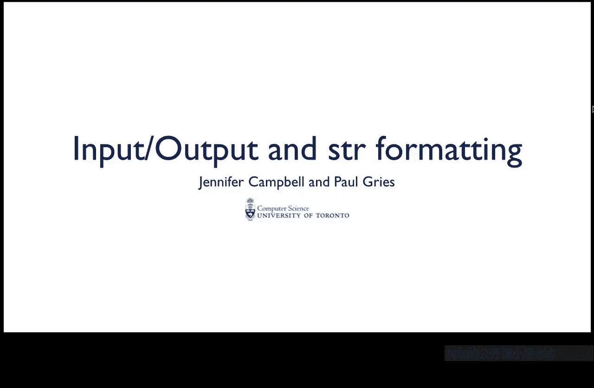
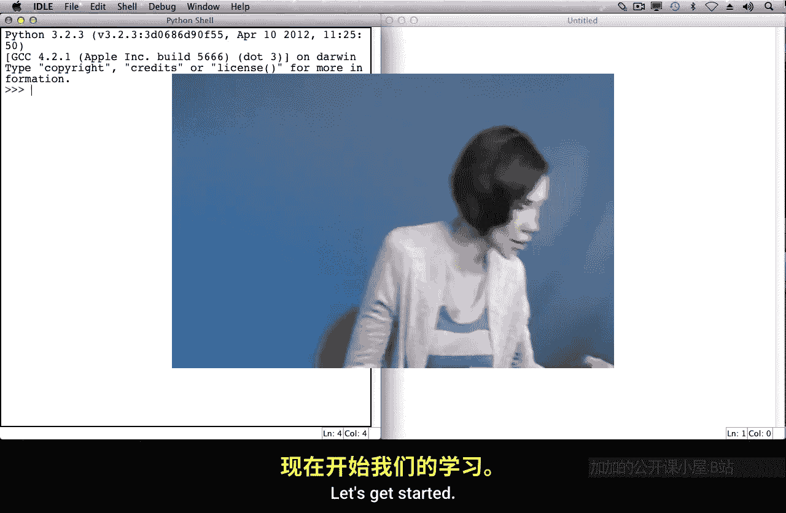
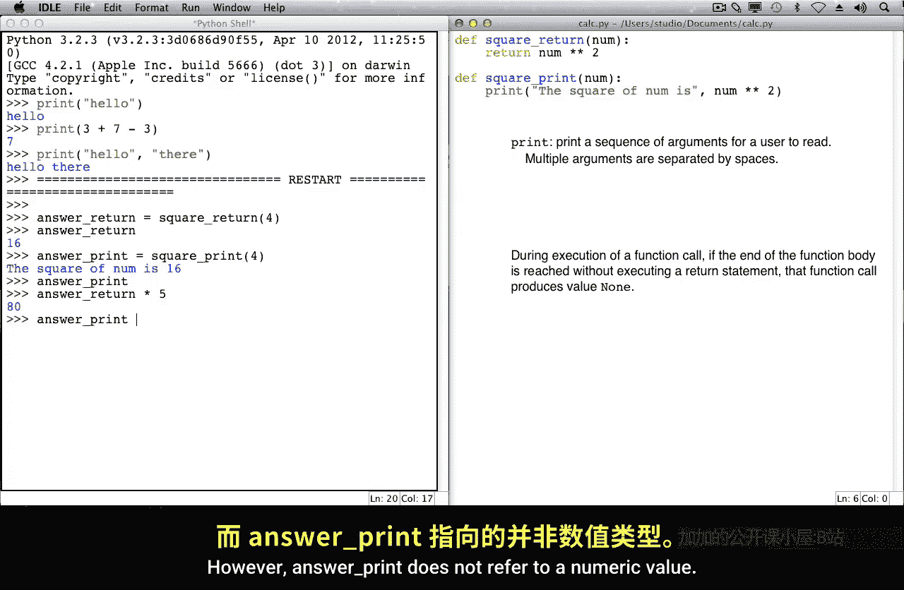
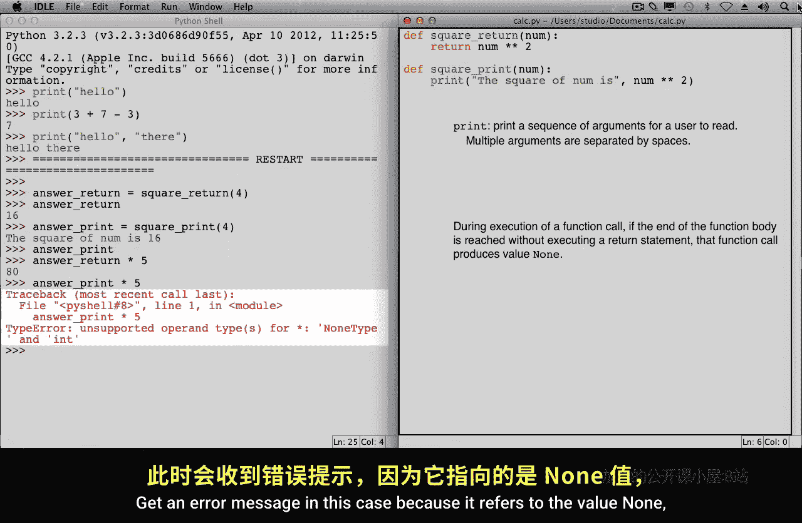
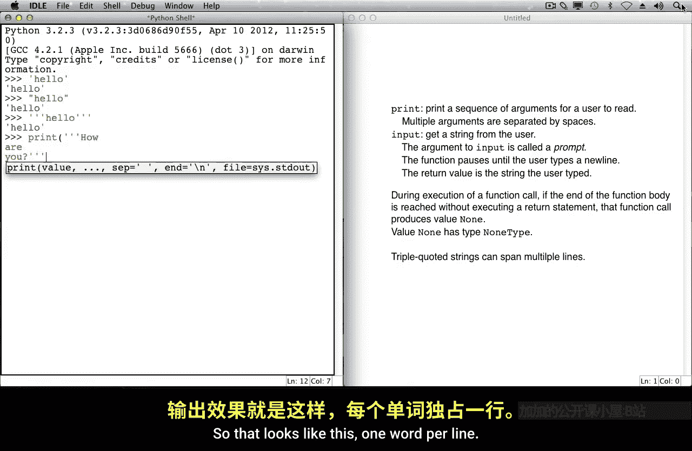
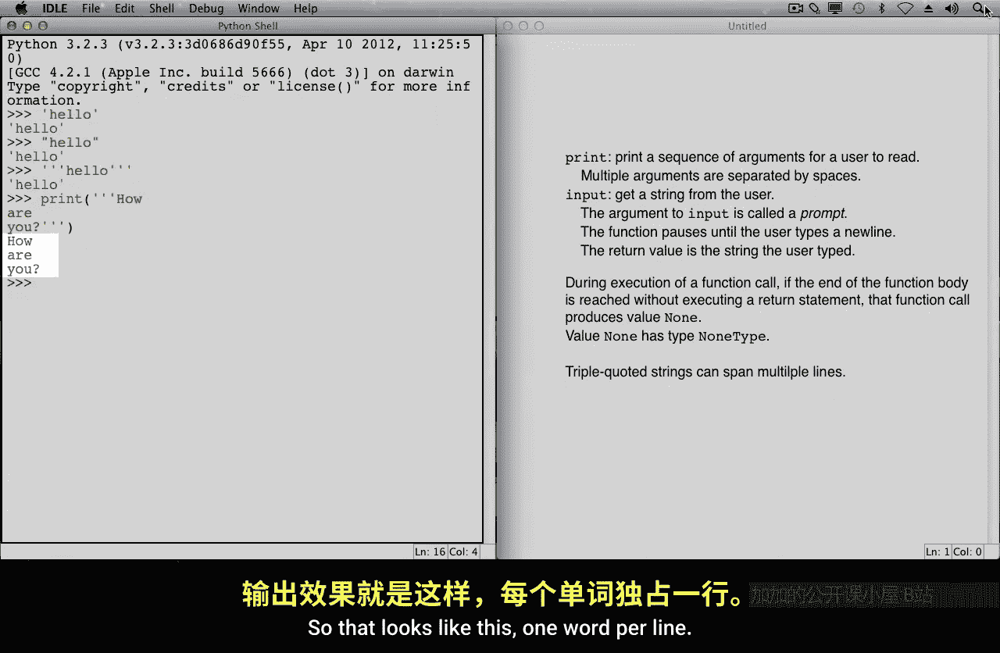
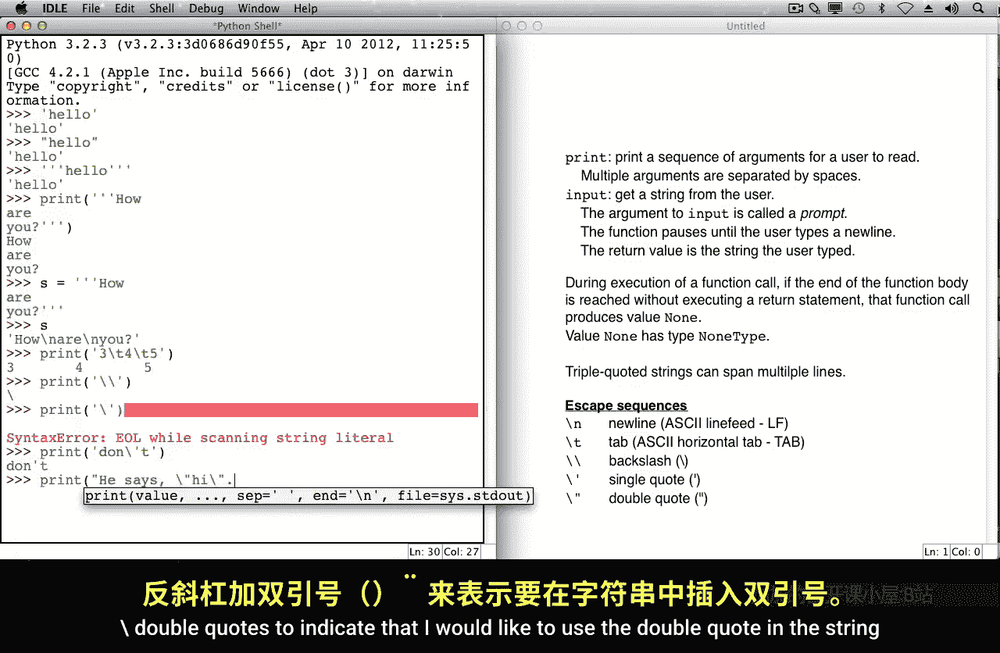

# 学习编程：基础知识：P10：输入输出与字符串格式化 📝





在本节课中，我们将深入学习字符串的更多操作，特别是字符串格式化。同时，我们将编写一些交互式程序，学习如何向用户显示信息以及如何从用户那里获取输入。

## 使用 `print` 函数输出信息

上一节我们介绍了函数的基本概念，本节中我们来看看如何使用 `print` 函数向屏幕输出信息。

我们调用Python内置的 `print` 函数，并向其传递一个参数。例如，传递字符串 `"Ho"`。`"Ho"` 将被显示在屏幕上。请注意，显示时没有引号。引号仅用于Python内部的字符串表示，用户是看不到的。

再次调用 `print`，这次传递一个数学表达式作为参数。例如，表达式 `3 + 7 - 3`。这个表达式会先被求值，然后将结果打印到屏幕上。

第三次调用 `print`，这次传递两个参数：两个字符串 `"hello"` 和 `"there"`。当字符串被显示时，默认情况下它们之间会有一个空格。因此，屏幕上打印的是 `"hello there"`。

## 定义并比较两个函数

接下来，我们将在名为 `calc.py` 的文件中定义两个函数。这两个函数都用于计算一个数的平方，但一个函数返回结果，另一个函数打印结果。

我们以关键字 `def` 开始函数定义。第一个函数名为 `square_return`。它接受一个参数 `numb`。这个函数的功能是返回 `numb` 的平方。其核心公式为：
```
return numb ** 2
```

第二个函数名为 `square_print`。它也接受一个参数 `nu`。它同样计算 `nu` 的平方，但不是返回值，而是打印它。为了让打印输出与 `square_return` 的返回值有所区别，我们在 `print` 函数的参数列表中添加了一个字符串前缀。其核心代码为：
```
print('The square of nu is', nu ** 2)
```

运行模块后，我们可以在Shell中调用这两个函数。

调用 `square_return(4)` 并将结果存储在变量 `answer_return` 中。执行时，屏幕上没有打印任何内容。检查 `answer_return` 变量，它指向值 `16`。因此，`square_return` 返回了 `16` 的内存地址。

调用 `square_print(4)`。这次，屏幕上显示 `"The square of nu is 16"`。检查存储结果的变量 `answer_print`，我们发现它没有值。当一个函数没有执行 `return` 语句时，Python会返回 `None`，`answer_print` 就指向 `None`。

因为 `answer_return` 指向一个数值，我们可以在数学表达式中使用它，例如 `answer_return * 5`。然而，`answer_print` 指向 `None`，尝试进行数学运算会导致错误。





## 使用 `input` 函数获取用户输入

我们已经知道如何使用 `print` 向用户显示信息。下一步是使用Python内置的 `input` 函数从用户那里获取信息。

我们调用 `input` 函数，并向其传递一个字符串参数。例如，询问用户 `"What is your name?"`。函数执行时，该字符串会打印到屏幕上，程序会等待用户在提示符处输入内容。

用户输入 `"John"` 并按下回车后，函数执行完毕。用户输入的字符串 `"John"` 作为函数的返回值，其类型是字符串。

再次调用 `input` 函数，这次将返回的结果存储在一个名为 `name` 的变量中。用户输入他们的名字，该值作为字符串返回，其内存地址存储在 `name` 变量中。检查 `name` 的内容，它指向字符串 `"John"`。

现在使用 `input` 提示用户输入位置。字符串 `"What is your location?"` 被打印，用户输入 `"Toronto"`。该值由函数返回，因此 `location` 变量指向 `"Toronto"`，`name` 指向 `"John"`。

## 组合输出信息

现在，我们使用 `name` 和 `location` 这两个变量向用户显示一条消息。调用 `print` 函数，传递三个参数：`name`、字符串 `"lives in"` 和 `location`。这样，打印出的结果是 `"John lives in Toronto"`。

之前提到，`name` 和 `location` 都指向字符串。实际上，`input` 函数返回的所有值的类型都是字符串。

再次调用 `input`，询问 `"How many cups of coffee have you had today?"`。用户输入 `2`，这个值由 `input` 函数作为字符串返回。因此，`num_coffee` 指向字符串 `"2"`，而不是整数 `2`。

## 字符串的多种表示方式





你已经见过使用单引号和双引号表示字符串。现在，我想向你展示第三种字符串格式：三引号字符串。

三引号字符串可以跨越多行。例如，打印一个三引号字符串，第一行是 `"How"`，第二行是 `"are"`，第三行是 `"you"`。输出效果是每个单词单独一行。

使用相同的字符串，但不打印它，而是将其存储在一个变量 `s` 中。当我们检查变量 `s` 的内容时，发现它与我们输入时看起来有很大不同。首先，它不再有三引号，而是单引号。其次，在我按下回车键的地方，我们看到了 `\n`。这个字符称为换行符，是Python中的一个特殊字符。

反斜杠符号是转义字符，`\n` 这个组合是转义序列“换行”。

还有其他几个特殊字符。例如，打印数字三、四和五，并用制表符分隔。我们使用 `3`，然后对于制表符，使用转义序列 `\t`，接着是 `4`、`\t` 和 `5`。输出结果是 `3    4    5`。

除了换行和制表符，还有其他一些有用的转义序列：
*   `\\`：当我们需要在字符串中打印一个单独的反斜杠时使用。
*   `\'`：当我们需要在字符串中包含单引号时使用。例如：`'don\'t'`。
*   `\"`：当我们需要在字符串中包含双引号时使用。例如：`'He says, \"Hi.\"'`。

## 总结



本节课中我们一起学习了：
1.  如何使用 `print` 函数输出不同类型的数据（字符串、表达式结果、多个参数）。
2.  如何定义函数，并理解 `return` 返回值与 `print` 打印输出的区别。
3.  如何使用 `input` 函数获取用户输入，并理解其返回值始终是字符串类型。
4.  如何组合变量和字符串向用户输出信息。
5.  字符串的多种表示方式：单引号、双引号和三引号。
6.  常见的转义序列，如 `\n`（换行）、`\t`（制表符）、`\\`（反斜杠）、`\'`（单引号）和 `\"`（双引号），以及它们在字符串中的用途。