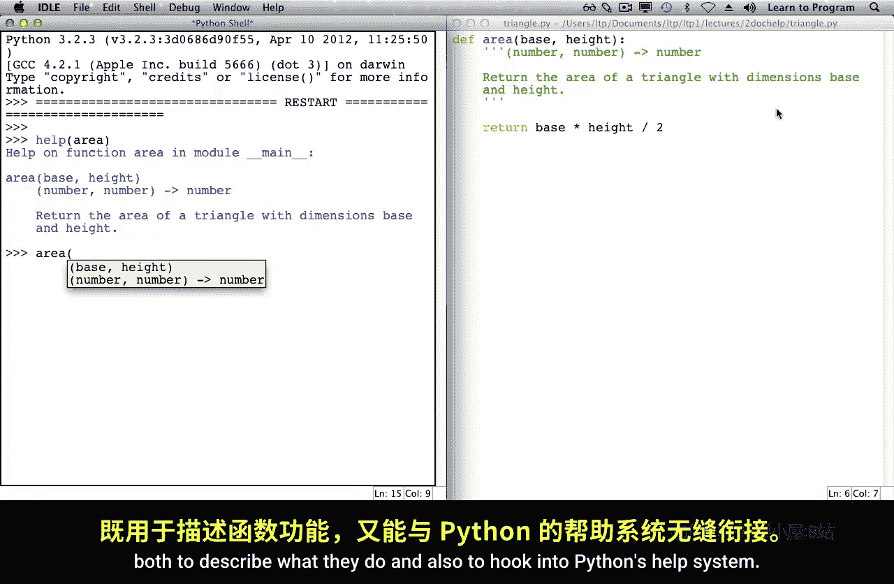

# 特伦托大学【中英⚡学习编程：基础知识｜Learn to Program： The Fundamentals】 p11 P11 05_文档字符串与函数帮助 -BV1kQ11B5EWa_p11-

As you've seen， Python has a built in function called help that will show you information about a function。

Idle will also provide information when you start to type a call on that function， for example。

When you call function help on the absolute value function。

 you get a nice description of what it does。Also， when you start to write a call on that function。

 a pops a little yellow box and idle showing you the type of the parameters and the return type。

You can provide the same kind of information for your own functions by writing documentation in a particular format called a Doc string。

We have written documentation for the area of a triangle function that we wrote last week。

Notice that we you are using a triple quoted string because our description spans multiple lines。

We will now run this module in order to have area available to us in the Python shellll。

 And when I ask for help on area。We now see what we have inside the dockstream。Furthermore。

 this first line of the dock string is what will show up when I start to type a call on area。

From now on， we will always provide doctrines for our functions。

 both to describe what they do and also to hook into Python's help system。

