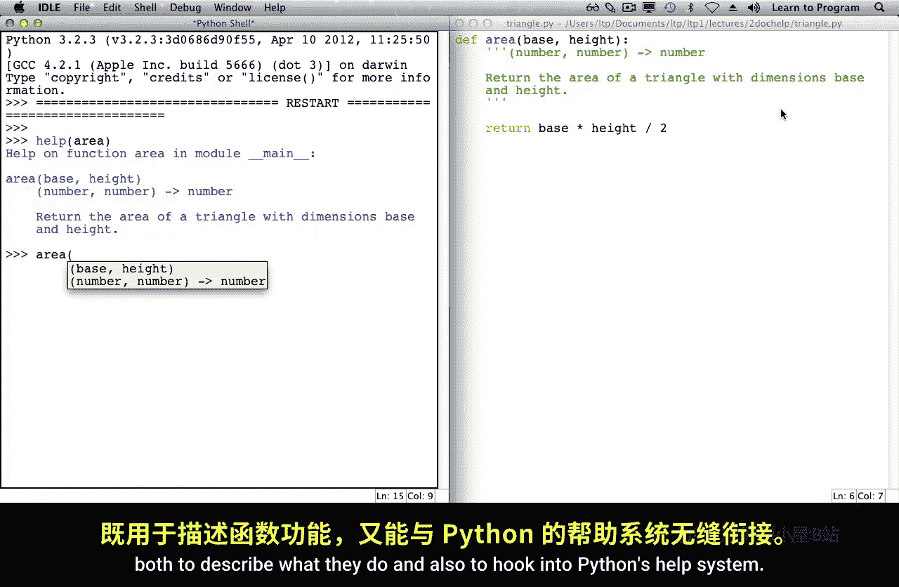

# 学习编程：基础知识：05_文档字符串与函数帮助


在本节课中，我们将要学习如何为自定义函数编写文档字符串，以及如何利用Python内置的`help`系统来查看函数信息。

## 查看内置函数的帮助信息

上一节我们介绍了函数的基本概念，本节中我们来看看如何获取函数的说明信息。Python内置了一个名为`help`的函数，它可以显示关于某个函数的信息。


例如，当你调用`help`函数并传入绝对值函数`abs`时，你会得到一个关于其功能的清晰描述。

```python
help(abs)
```

此外，在IDLE等集成开发环境中，当你开始输入一个函数调用时，它也会自动提供信息。例如，开始输入`abs(`时，会弹出一个黄色小框，显示参数类型和返回值类型。

## 为自定义函数编写文档字符串

你可以通过编写一种特定格式的文档，称为**文档字符串**，来为你自己的函数提供同样的信息。

以下是我们为上节课编写的三角形面积函数`area`所写的文档字符串。注意，我们使用了三引号字符串，因为描述内容跨越多行。

```python
def area(base, height):
    """
    返回以给定底边和高度计算的三角形面积。

    参数:
        base (float): 三角形的底边长度。
        height (float): 三角形的高度。

    返回:
        float: 计算出的三角形面积。
    """
    return base * height / 2
```

现在，我们运行包含此函数的模块，使其在Python Shell中可用。当我调用`help(area)`时，就能看到我们在文档字符串中编写的内容。

```python
help(area)
```

此外，文档字符串的第一行内容，会在我开始输入`area(`调用时显示出来，就像内置函数一样。

## 文档字符串的重要性与规范

以下是编写和使用文档字符串的几个要点：
*   **描述功能**：清晰说明函数的作用。
*   **说明参数**：列出每个参数的名称、预期类型和作用。
*   **说明返回值**：明确函数返回什么类型的值。
*   **接入帮助系统**：使你自定义的函数能完美接入Python的`help`系统。

从今以后，我们将始终为我们的函数提供文档字符串，这既能描述函数的功能，也能接入Python的帮助系统，使代码更易读、更易维护。

## 总结



本节课中我们一起学习了文档字符串。我们了解了如何使用`help()`函数查看内置函数的说明，更重要的是，我们学会了如何通过编写三引号格式的文档字符串，为我们自己创建的函数添加详细的说明文档，并使其能够集成到Python的交互式帮助系统中。这是编写清晰、专业代码的重要一步。