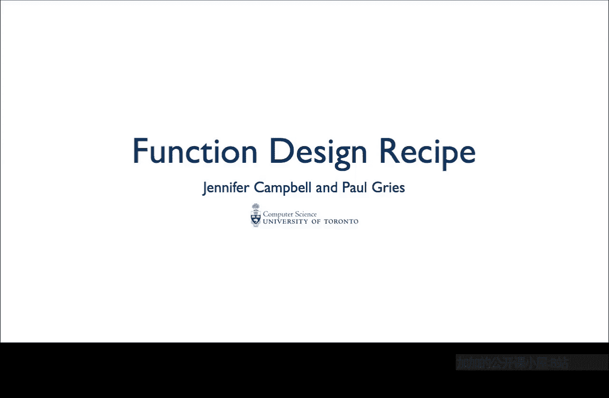
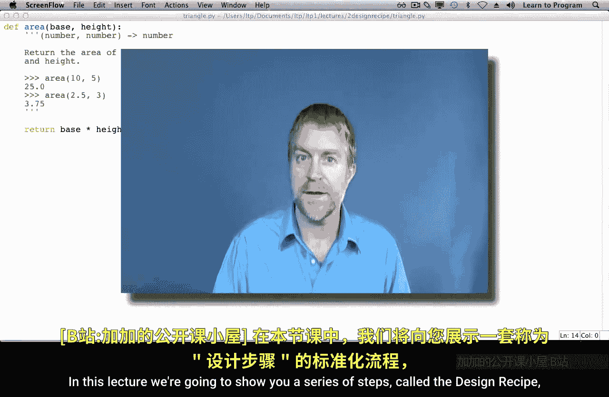
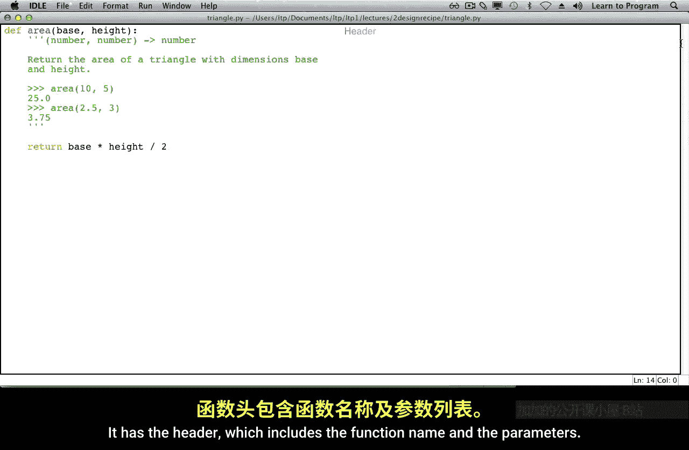
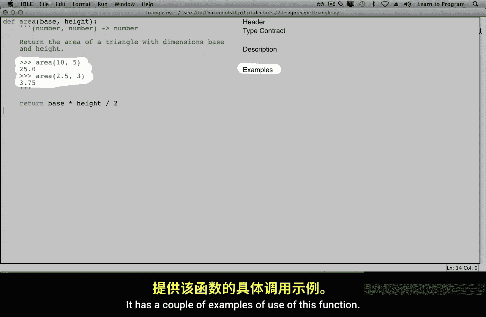
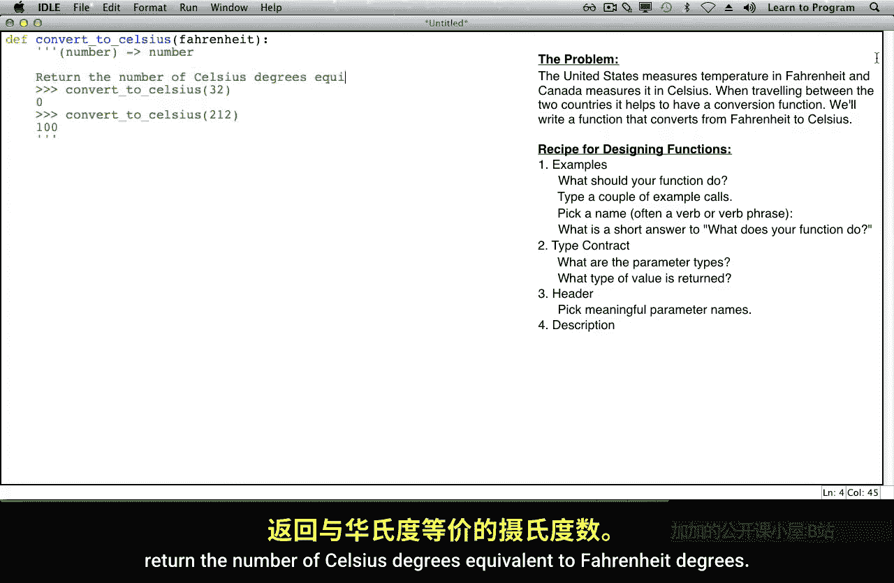
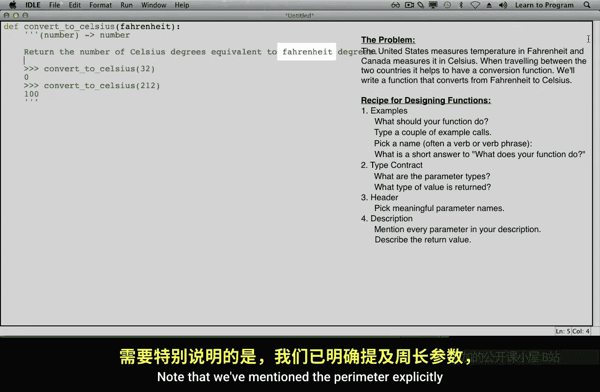
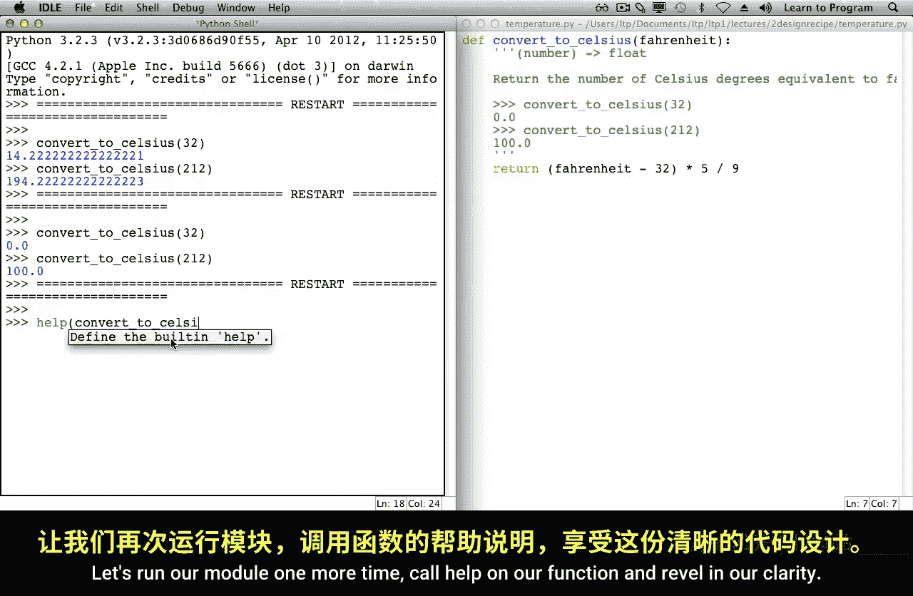

# 特伦托大学【中英⚡学习编程：基础知识｜Learn to Program： The Fundamentals】 p12 P12 01_函数设计方法 -BV1kQ11B5EWa_p12-

In this lecture， we're going to show you a series of steps called the design recipe that you can use to write your own functions。

Here is our triang areaia function。 We have added one part to the do string。

 examples of use and expected return values。 This function definition has five parts。

 It has the header， which includes the function name and the parameters。 It has the type contract。

 the types of values that are expected to be passed to the parameters。

 as well as the return type of the function。

It has the description。It has a couple of examples of use of this function。 and last。

 it has the body of the function。

Our design recipe helps you develop those five parts。

 plus one more where we test that our function works once we've written it。

We'll explain the design recipe as we develop another function。Here is the problem we'll work on。

 The United States measures temperature in Fahrenheit， and Canada measures it in Celsius。

 When travelling between the two countries， it helps to have a conversion function While write a function that converts from Fahrenheit to Celsius。

The first step we will do is to come up with some examples of using your function that you're about to write。

Think about what you want your function to do and type one or two examples of calls on the function you want to write。

You'll need to think of a name for your function。 You can always change it later。

 Function names are often verbs or verb phrases because they do things。

 So if you're stuck and to the question， what does the function do。

 Our answer here is convert from Fahrenheit to Celsius。 but that's pretty long。 So will it use。

 convert to Celsius。 You can always improve the name later。

What do we want to happen when we call convert to Celsius on 32 degrees Fahren。

 We hope we get back 0。We're going to add the angle brackets so that it looks like it was typed in the Python shell。

Let's add one more example to convert at the boiling point。

The next step is to figure out the type contract。 What types are the parameters and what type is the value that gets returned。

It looks like we want convert to Celsius， too。Work with integers。

 but we can imagine that it should work with floats as well。

 We're going to use the word number to indicate that it can handle either and presumably。

 it will return a number as well。Now that you've written some calls and you have a guess as to what the types should be。

 it's time to write the header of the function。 Pick meaningful parameter names so that other programmers and you have an easier time understanding your function。

 You can also modify your function name here， if you like。Let's fill in what we know for the header。

We know that the function name is convert to Celsius。

And we know that our parameter is the number of degrees Fahrenheit。 So we'll use Fahrenheit。

That's our parameter。Yeah。Everything below is supposed to be in a do string。

 So let's take care of that now。By now， you should have a very good idea of what you want your function to do。

 It's time to write a description。Does our function do return the number of Celsius degrees equivalent to Fahrenheit degrees。

 Note that we've mentioned the parameter explicitly， and we've also described the return value。

 This is very important in all documentation。

Now that you have a strong idea of what your function should do。

 and you've decided on the function and parameter names， you can write the code for the function。

 This will be much easier to do if you've spent time thinking about the examples， contract。

 header and description。As we learned in school， we subtract 32 fromFahrenheit。

And then we multipied by five kns。We haven't saved this yet， and we really should。

We're going to call this one。Temperature got pi。It's time to test our function on the examples。

 Since you've already figured out what the return value should be。

 you can tell right away if your code or perhaps the examples are incorrect。We will run this module。

Set up the windows so we can see both of them at once。 And then。

We can just copy and paste our examples。And we see that we are expecting 0， but that we got back 14。

2 repeating。What about the other one？嗯。No， that's not right either。

You may have already seen the problem。Subtraction has lower precedence than either multiplication or division。

 And so the subtraction is happening last after we're calculating 32 times 5 divided by 9。

We fix this by。Adding parentheses， saving。Rerunning。And then， trying our examples again。

We almost have what we expected in our examples， except for' getting back afloat instead of an int。

This is because division always produces a float。And the various operators produce a float if either opera end ist a buffaloat。

The problem is not with our calculation。 It's in our examples and in our contract。

 number is too general of a turn type。We'll fix proof。Let's run our module one more time。

 call help on our function and revel in our clarity。

