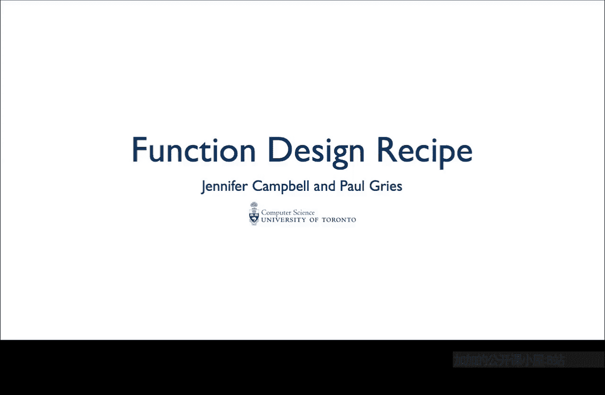
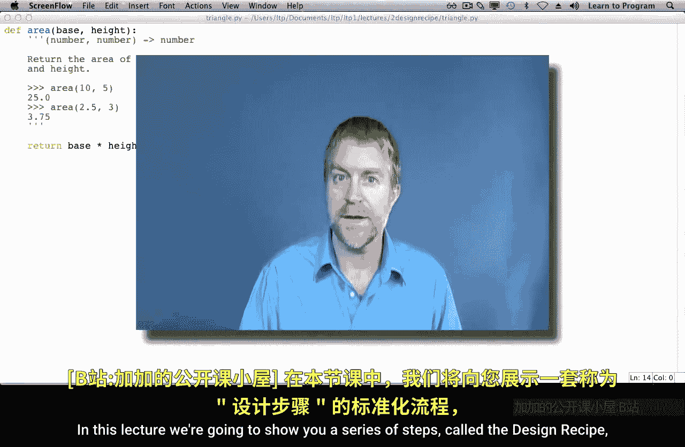
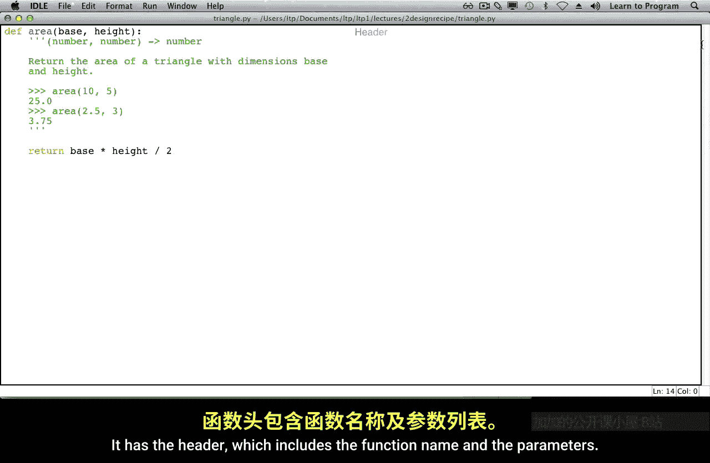
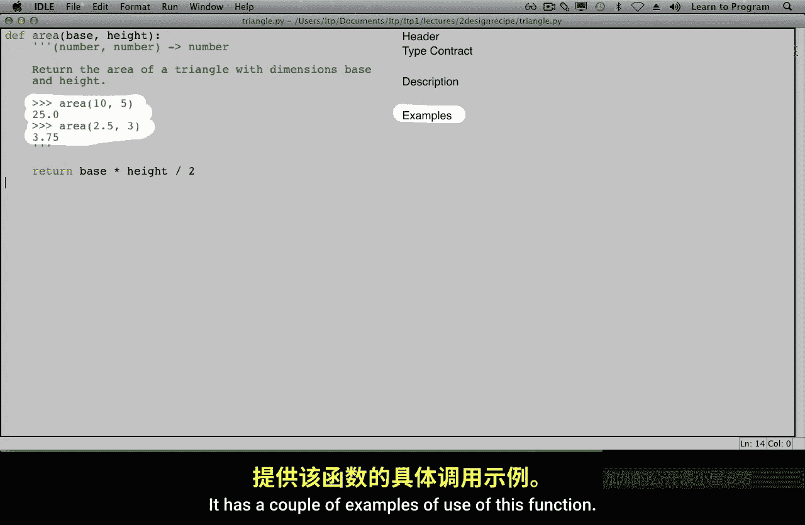
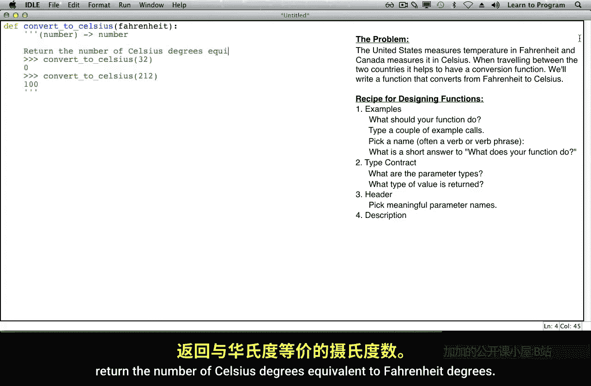
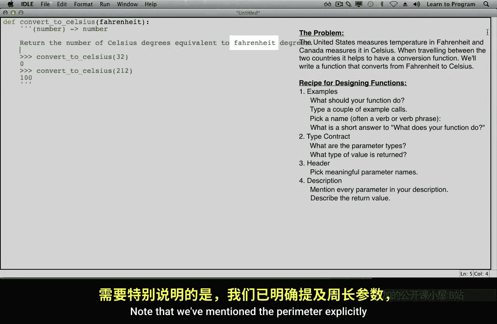
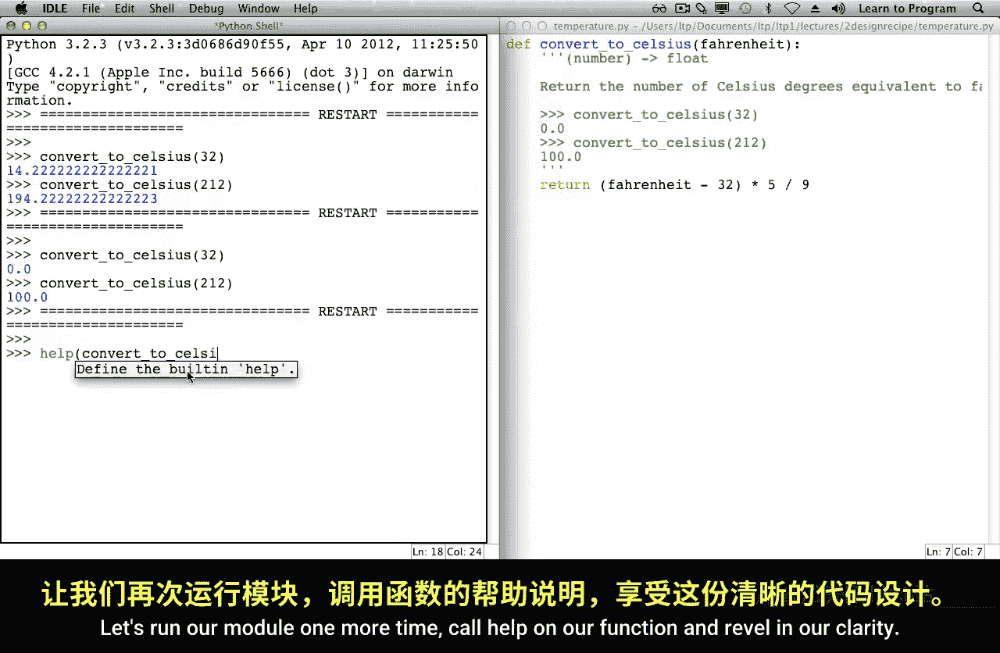

# 学习编程：基础知识：P12：函数设计方法 🧩





在本节课中，我们将学习一个名为“设计配方”的系列步骤。你可以使用这个方法来编写自己的函数。

## 概述

我们将通过开发一个将华氏温度转换为摄氏温度的函数，来详细解释设计配方的每个步骤。这个方法将帮助你系统地构建一个包含五个部分（加上测试部分）的完整函数定义。



## 设计配方详解



上一节我们介绍了设计配方的概念，本节中我们来看看它的具体组成部分。一个完整的函数定义通常包含以下五个部分：

1.  **函数头**：包含函数名和参数。
2.  **类型契约**：描述参数和返回值的预期类型。
3.  **描述**：用文字说明函数的功能。
4.  **使用示例**：展示函数调用示例及预期返回值。
5.  **函数体**：实现函数功能的实际代码。

我们的设计配方将指导你完成这五个部分的开发，并额外增加一个步骤：在编写完成后测试函数。

## 实践：创建温度转换函数

现在，让我们应用设计配方来解决一个具体问题：美国使用华氏度，加拿大使用摄氏度。我们需要编写一个在这两种温度单位之间进行转换的函数。

### 第一步：构思使用示例

首先，思考你希望函数做什么，并为你将要编写的函数构思一两个调用示例。你需要为函数想一个名字（后续可以修改）。函数名通常是动词或动词短语。

以下是构思的示例：
*   调用 `convert_to_celsius(32)`，我们希望返回 `0`。
*   调用 `convert_to_celsius(212)`，我们希望返回 `100`。

### 第二步：确定类型契约

接下来，确定参数的类型和返回值的类型。从示例看，参数和返回值都应该是数字（整数或浮点数）。

因此，类型契约可以写为：`(number) -> number`

### 第三步：编写函数头

在有了调用示例和对类型的猜测后，可以编写函数头。选择有意义的参数名，以便于理解。

根据以上信息，我们的函数头是：
```python
def convert_to_celsius(fahrenheit):
```

### 第四步：编写函数描述

现在，你应该对函数的功能有了清晰的认识，是时候用文字描述它了。描述中应明确提及参数并说明返回值。

我们的函数描述是：
`返回与华氏度数值相等的摄氏度数值。`





### 第五步：编写函数体代码

在仔细思考了示例、契约、函数头和描述之后，编写函数代码会容易得多。根据公式，摄氏温度 = (华氏温度 - 32) * 5 / 9。

因此，函数体代码为：
```python
    return (fahrenheit - 32) * 5 / 9
```

### 第六步：测试函数

最后，也是最关键的一步，是用你之前构思的示例来测试函数。由于你已经知道了预期的返回值，可以立即判断代码或示例是否正确。

我们运行模块并进行测试：
*   调用 `convert_to_celsius(32)`，预期得到 `0`，但实际得到了 `14.222...`。
*   调用 `convert_to_celsius(212)`，预期得到 `100`，但实际得到了 `100.0`。

第一个结果明显错误。问题在于运算优先级：减法的优先级低于乘法和除法。因此，代码实际计算的是 `32 * 5 / 9`，最后才减去32。我们需要用括号来修正运算顺序。

修正后的函数体应为：
```python
    return (fahrenheit - 32) * 5 / 9
```

保存并重新运行测试：
*   `convert_to_celsius(32)` 现在返回 `0.0`。
*   `convert_to_celsius(212)` 返回 `100.0`。

结果与示例基本一致，只是返回的是浮点数而非整数。这是因为在Python中，除法运算总是产生浮点数。这并非计算错误，而是我们的示例和类型契约不够精确。我们可以将契约中的 `number` 具体化为 `float`。

## 总结



本节课中，我们一起学习了函数设计的“配方”。我们逐步完成了从构思示例、确定类型、编写函数头与描述，到最终实现代码和进行测试的全过程。通过为华氏度转摄氏度编写函数这个具体例子，你掌握了创建可靠、文档清晰的自定义函数的系统方法。记住这个配方，它将成为你编程工具箱中的重要工具。