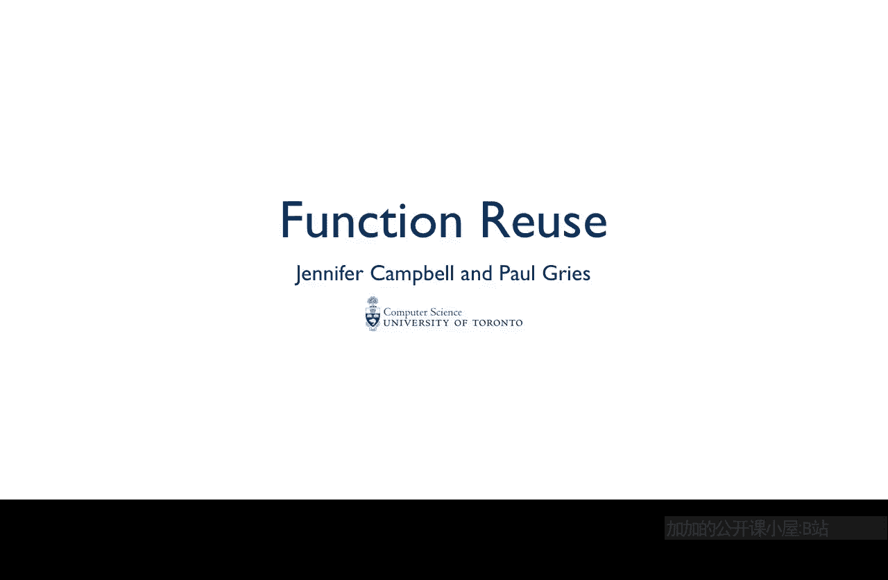
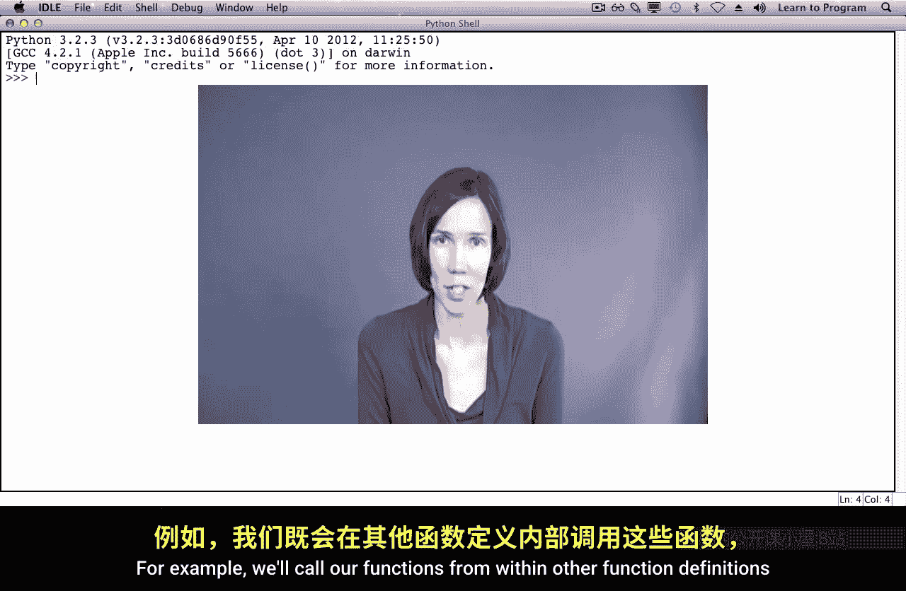
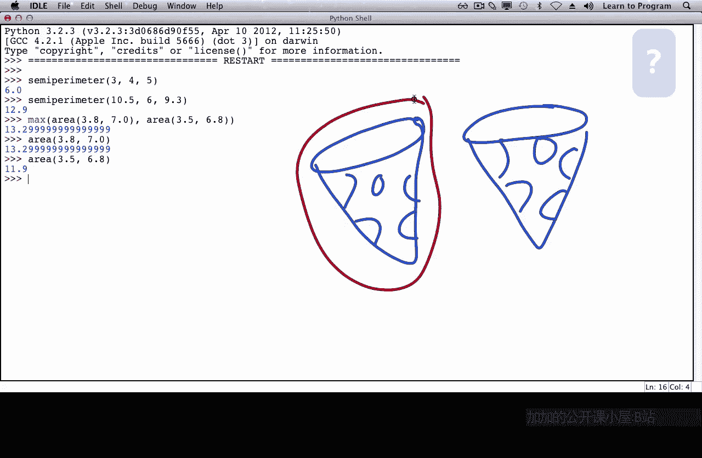

# 特伦托大学【中英⚡学习编程：基础知识｜Learn to Program： The Fundamentals】 p13 P13 03_功能复用 -BV1kQ11B5EWa_p13-

Once a function is defined， we can call it over and over again。In this lecture。

 we're going to focus on reusing functions by calling them in other places when appropriate。

 for example， we'll call our functions from within other function definitions and also within other function calls。

In the lecture on defining functions， we wrote Triangled up Pi， which contained two functions。

This code is a revised version that I produced following the steps of the design recipe。

To recap the design recipe， we begin with an example or two。Followed by the type contract。

 the function header。A description of the function。We then code the body and test the function。

We now add another function to triangle that pi。 This function will calculate the semi perimeter of a triangle。

The semi perimeter is simply half of the perimeter。Following the design recipe。

 the first step is coming up in an example。We will call the function semiparmeter。

The function will need the lengths of the three sides in order to perform the calculation。

So in the function call， we'll imagine passing in three lengths。

And then the result we get back will be half of the perimeter。Let's do one more function call。

 this time passing floats instead of N arguments。And the result that we expect to get back would be 12。

9。The next step of the design recipe is the type contract。For the semi perimeter function。

 the types will be numbers because we may have ins or floats。And this function will return afloat。

Next， we provide the function header。 We begin with the keyword dev。

Fawed by the function name that we already decided on in our example calls。

And we pass in three parameters in this case， I will call them side one。Side2 and side three。

Next is the function description。We need to say what the function will return and explain how the parameters are used。

So we're going to return the semiparmeter。Or a triangle。That has size of the length given。

 but in the parameters。We're now ready to write the body of the function。

This function is going to return the semi perimeter。

Which means that we will calculate the parametermeter by summing the three sides。

And divide that result by two。Notice the part of the body of the semiparmeter function is exactly the same as part of the body of perimeter。

Rather than duplicating the code to calculate the parameter。

 we can call the perimeter function from within the semi parametermeter function。

By reusing the perimeter function， we reduce the risk of making an error when calculating the perimeter。

 since that function has already been tested。Now it's time to test the semi periimeter function。

We'll begin by running the module。And then we will execute that function by calling it within the shell。

I'm going to use the same example that I used in the function dock string。And we get back six。

And then if I call it with the floats from the dock string， we'll mix of floats and ints。

We get back 12。9。So the function performs as we expect it to。

Here's another problem for us to consider。For this problem。

 we are going to make use of the area function that we wrote earlier。

 recall that area has two parameters， the base and the height。

 and then it returns the area of the triangle。This problem involves two slices of pizza。At a party。

 there are these two slices of pizza left。A hungry person is trying to figure out which slice is the largest。

Since the slices are the shape of triangles， this person measures the base and the height of each slice。

Now that we know the base and the height of each size of pizza。

 we can use our program to help determine which is biggest。

We'll also use one of Python's built in functions， the max function， to help us out。

So we'll start by calling Max， and the first argument that will pass to Max will be the area of the first slice of pizza。

A slice that has base 3。8。And height 7。0。And then the second argument to the function。

 min maxari will be the area of the second slice of pizza。A triangle with base 3。5 and height 6。8。

When we execute this function， we find out which of those two areas is bigger。

And now we can check to see which slice of pizza that value， 13。29 repeating。Corsponds with。

So we can see from that function call。The area of the first slice matches the maximum area。

And that means that the winning。Pizza slices is this one。

So what this example shows is that not only can we call functions from within function definitions。

 as we did in the semiparameter example， but we can also pass function calls as arguments to functions。

 since function calls are themselves expressions。

