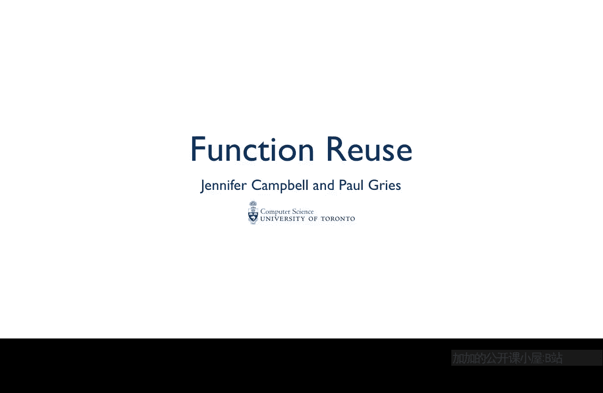
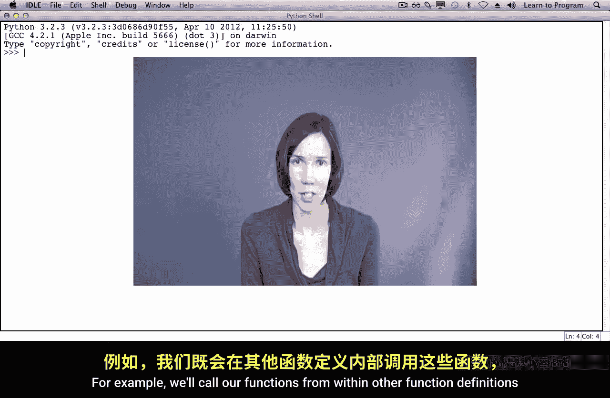
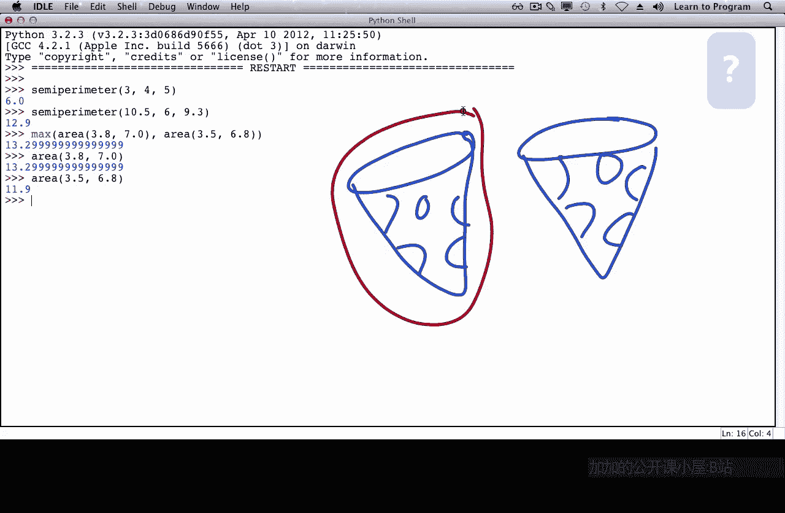

# 编程基础：P13：函数复用

在本节课中，我们将学习如何复用函数。一旦定义了一个函数，我们就可以在合适的地方反复调用它。我们将重点探讨如何在其他函数定义内部，以及在其他函数调用内部调用我们已定义的函数，从而实现代码的复用。

## 设计方法回顾

在之前的课程中，我们编写了包含两个函数的 `triangle.py` 程序。这段代码是根据设计方法的步骤修改后的版本。

回顾一下设计方法，我们首先需要一两个示例，接着是类型契约、函数头、函数描述。然后我们编写函数体并测试函数。

## 添加新函数：计算半周长

现在，我们为 `triangle.py` 添加一个新函数，用于计算三角形的半周长。半周长就是周长的一半。

遵循设计方法，第一步是构思示例。我们将调用函数 `semiperimeter`。该函数需要三条边的长度来进行计算。因此，在函数调用中，我们想象传入三个长度值，返回的结果应该是周长的一半。

让我们再构思一个函数调用示例，这次传入浮点数参数。我们期望返回的结果是 12.9。

设计方法的下一步是类型契约。对于 `semiperimeter` 函数，参数类型是数字（可能是整数或浮点数），函数返回一个浮点数。

接下来，我们提供函数头。以关键字 `def` 开头，后跟我们已在示例调用中确定的函数名，并传入三个参数，这里我们称它们为 `side1`、`side2` 和 `side3`。

然后是函数描述。我们需要说明函数将返回什么，并解释参数的用途。所以，我们将返回一个三角形的半周长，该三角形的边长由参数给出。

现在，我们准备编写函数体。这个函数将返回半周长，这意味着我们需要计算三条边的和，然后将结果除以 2。

请注意，`semiperimeter` 函数体的一部分与 `perimeter` 函数体的一部分完全相同。与其重复计算周长的代码，我们可以在 `semiperimeter` 函数内部调用 `perimeter` 函数。通过复用 `perimeter` 函数，我们降低了在计算周长时出错的风险，因为该函数已经过测试。

现在该测试 `semiperimeter` 函数了。我们首先运行模块，然后在交互式环境中通过调用该函数来执行它。我将使用函数文档字符串中相同的示例，我们得到了返回值 6。然后，如果我使用文档字符串中的浮点数（整数和浮点数的混合）调用它，我们得到返回值 12.9。因此，该函数的表现符合我们的预期。

## 函数调用作为参数

让我们考虑另一个问题。对于这个问题，我们将利用之前编写的 `area` 函数。回想一下，`area` 函数有两个参数：底和高，然后返回三角形的面积。

这个问题涉及两块披萨。派对上剩下这两块披萨片。一个饥饿的人试图找出哪一块更大。由于披萨片是三角形，这个人测量了每块披萨片的底和高。

既然我们知道了每块披萨片的底和高，就可以用我们的程序来帮助确定哪一块更大。我们还将使用 Python 的一个内置函数 `max` 来帮助我们。

因此，我们首先调用 `max`，传递给 `max` 的第一个参数将是第一块披萨片的面积（底为 3.8，高为 7.0）。`max` 函数的第二个参数将是第二块披萨片的面积（底为 3.5，高为 6.8）。当我们执行这个函数时，我们就能找出这两个面积中哪个更大。

现在我们可以检查返回值 13.29（循环小数）对应哪块披萨片。从那个函数调用中我们可以看到，第一块披萨片的面积与最大面积匹配。这意味着获胜的披萨片是这一块。

这个例子表明，我们不仅可以在函数定义内部调用函数（就像在 `semiperimeter` 例子中那样），还可以将函数调用作为参数传递给其他函数，因为函数调用本身也是表达式。

## 总结

本节课中，我们一起学习了函数复用的核心概念。我们回顾了设计方法，并实践了通过在其他函数定义内部调用现有函数来构建新函数（如 `semiperimeter`）。更重要的是，我们了解到函数调用可以作为表达式，直接作为参数传递给其他函数（如 `max` 函数），这极大地增强了代码的灵活性和复用性。掌握这些技巧，能帮助你编写出更简洁、更健壮的程序。