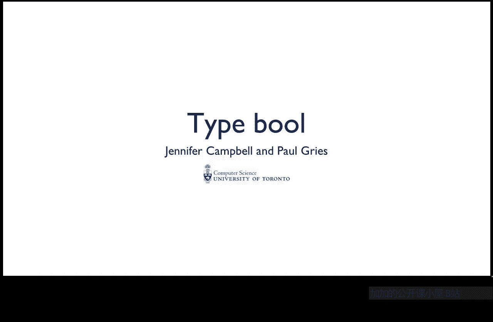
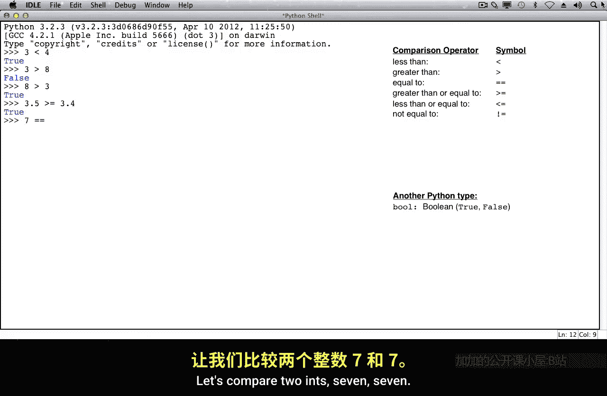
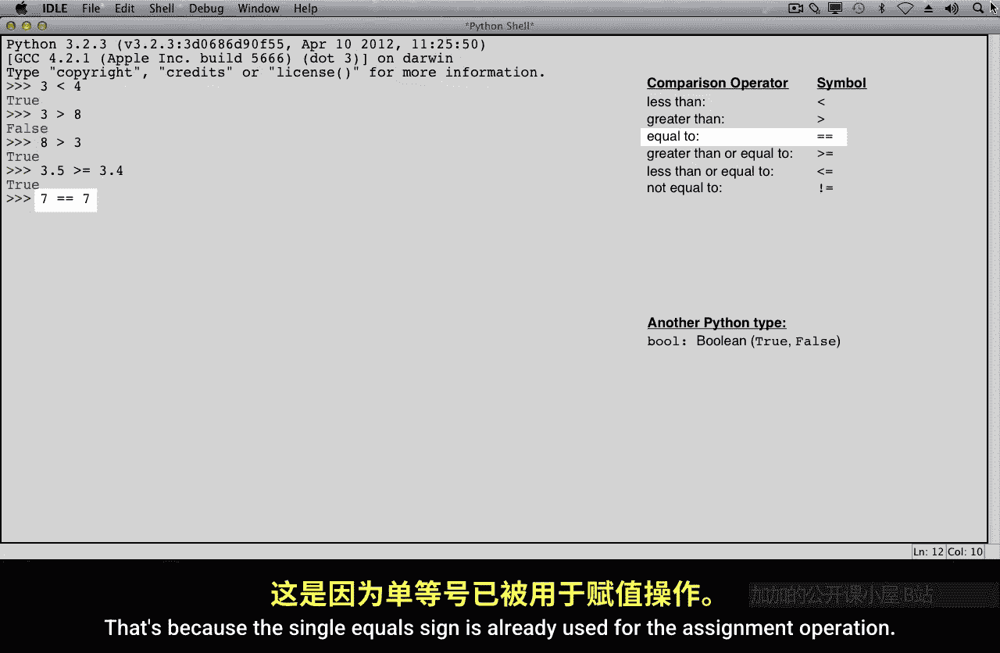
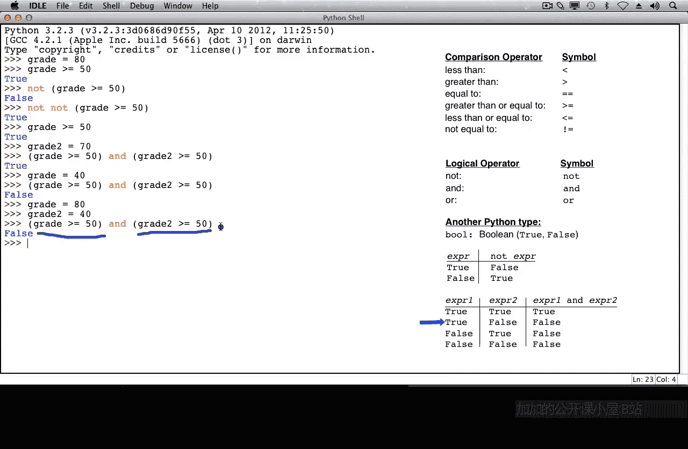
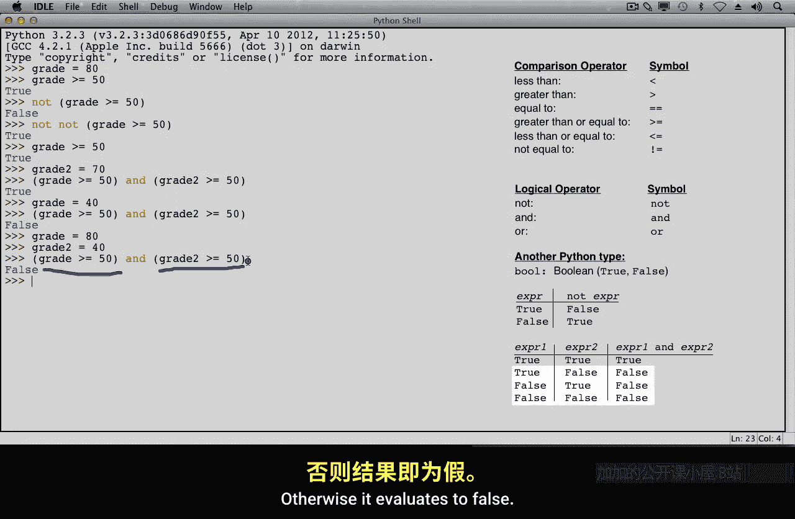
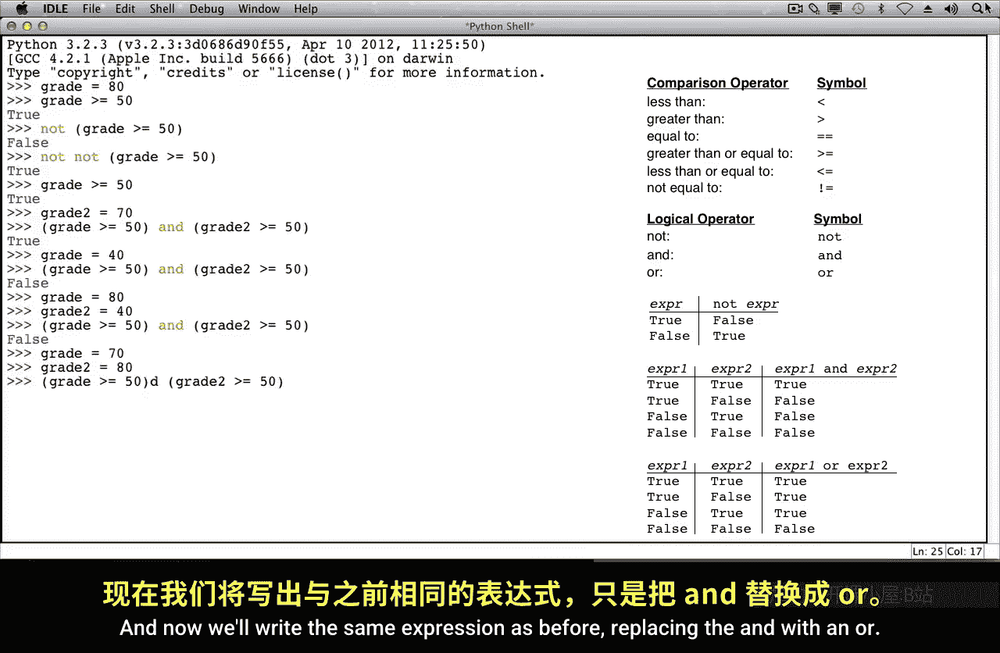
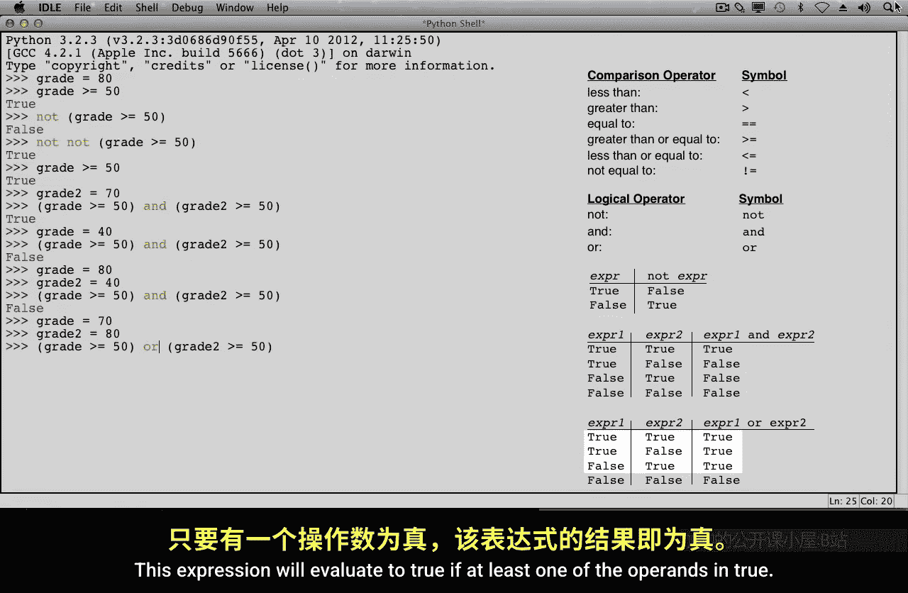
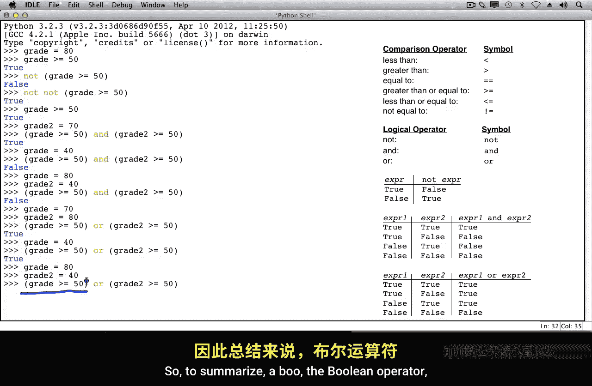
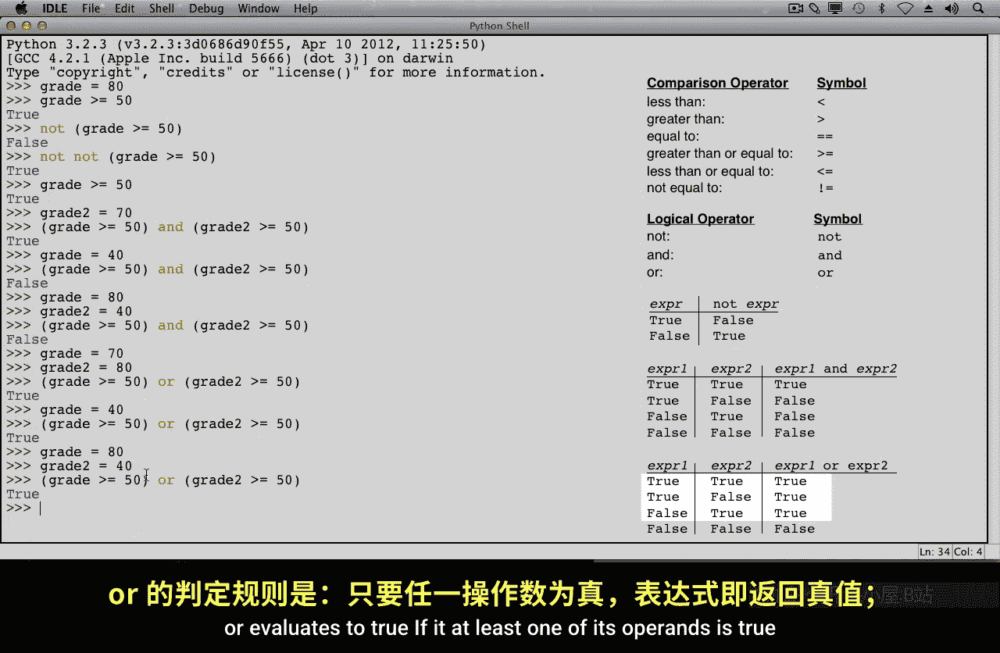
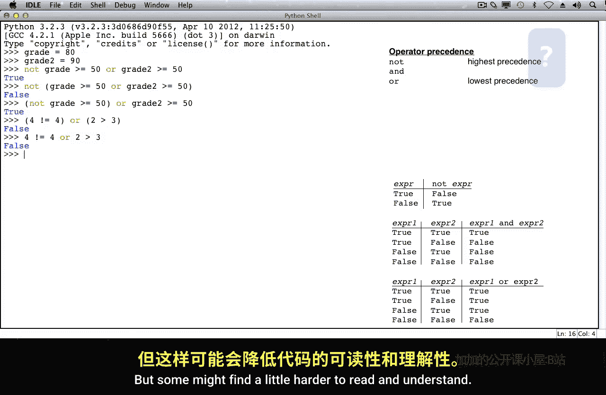

# 特伦托大学【中英⚡学习编程：基础知识｜Learn to Program： The Fundamentals】 p16 P16 03_类型-布尔 -BV1kQ11B5EWa_p16-

系。This lecture is all about true and false values， also known as Boolean values。In this lecture。

 we'll explore the Python's type bo and the operators that we can apply to Boolean values。

Earlier， we used Python's athmetic operators like multiplication and subtraction。

And now we're going to use some of Python's comparison operators。For example。

 let's compare values3 and four using the less than operator when this expression is evaluated。

 we're going to get a true value or false value back。The type of value that we get is type O。

Let's compare three with eight， asking if three is greater than eight and it's not。

 so the value that the expression evaluates to is false。When we evaluate8 greater than three。

 we get true， and if we were to evaluate 3。5 greater than or equal to 3。4， it's also true。

Let's compare two ints， seven with seven。

Notice that the operation that we're performing now is the equality operation。

 and we need to use two equal signs， not one to signify equality。

 that's because the single equal sign is already used for the assignment operation。

7even is equal to 7。 How about 7 and 7。0？A type int up around with a type float up around。

This is also true。Let's assign a couple of variable values， x gets7。Y gets eight。

And now we can apply the same equality operator to two variable opera。First。

We look up the value that x refers to， which is seven。And y refers to eight。

 and then seven is compared with eight。Another operator is the inequality operator。

 we can check whether three is not equal to four and that's true。

Python also has three logical operators， which are operators that are applied to Boolean values and yield Boolean results。

The first logical operator that we'll use is the not operator。

And we'll begin by creating a variable grade and assigning it the value 80， so grade refers to 80。

Now， let's write of an expression that checks to see whether the grade is a passing grade is grade greater than or equal to 50。

And that's true。We'll apply the not operator to that expression now。

 so we're going to check to see whether grade is not greater than or equal to 50。

The order that this expression evaluated works from inside out。

 so the grade greater than or equal to 50 part of the expression is evaluated first。

 and that gives the value true。And then the not operator is applied to true。

Something that is not true is false。 and that's the result that we get back。

We can apply this not operator two times in a row。Saying that this is asking whether this is not。

 not true。Which is equivalent to just saying is grade greater than or equal to 50？Next。

 let's use the and operator。First we'll make another variable named grade 2 that refers to the value 70。

 and now we'll write an expression involving both variables grade and grade 2。

This expression will check to see whether both of these are passing grade。

 so is grade greater than or equal to 50 and is grade 2， also greater than or equal to 5。

And evaluates to true if both operaans are true。So first， this expression is evaluated。

 and it is true。 So then this expression is evaluated， and it is also true。

 making this entire result a true result。Let's change the value of the variable grade for a moment and set it to 40。

We'll rerun this fully an expression involving the and and check to see what we get。

Because this first upand is false， the Boolean expression is false。

 and we don't even go on to check the second operaand value。

Now let's set grade back to 80 and this time change grade 2 to be a failing grade。

When this expression is evaluated first， this part of the expression is evaluated and that's true。

 so we move on to evaluating this part of the expression which is false。

 and so the expression evaluates to false。

To summarize and again， only evaluates to true if both of its operarans are true。Otherwise。

 it evaluates to false。

Finally， let's use the logical operator or， which also applies to two operas。

We'll start by assigning to grade and grade two。Two passing grades。

And now we'll write the same expression as before， replacing the and with an oar。

This expression will evaluate to true if at least one of the operarans is true。

So in this case， we got true。Now， let's assign to grade a failing grade and reevaluate the expression。

 Python will first evaluate the first part of this expression and determine that it is false。

 so it will go on to evaluate the second part of the expression， which is true。

 And because at least one opera is true。 The expression evaluates to true。

If we set grade to a passing grade and grade two to a failing grade。

 then when the expression is evaluated， it works as follows。Because grade is a passing grade。

 the expression is evaluated to true at this point without even having to go on to look at the second operaaround。

So to summarize。Of the Boolean operator， or evaluates to true。

 If at least one of its operarans is true， and it evaluates to false otherwise。

Now let's combine the operators into single expressions I've assigned grade and grade2。

 passing in grades of 80 and 90， and I'd like to evaluate this expression。

We're going to apply not to grade greater than equal to 50 or grade2 greater than are equal to 5。

And there are a couple of different ways that we can interpret this expression。

 depending on order of precedence。 The first would be to have the ore operator apply first。

 and I'll use parentheses to signal that followed by the not operator。

 The second would be to actually have the not operator apply first to the first part of the expression。

And then the or operator apply second。 So not first， followed by ore。Or or first followed by not。

Let's evaluate the expression and see what happens。

The value that the expression evaluates to is true。

let's use the parentheses to see which of the two operators applied first。

We'll begin by putting the parentheses around the or part of the expression。

 ensuring that or applies before not。And when we do that， the result is false。

 So that's not what happened when we left out the parentheses。

 And that means that that's not the order of precedence。 Instead。

 the order of precedence is that n is applied first， as I can show here。Follow by or。

The order of precede for logical operators is not。And， and then， or。

And when we're working with multiple logical operators within an expression。

 we can use parentheses to ensure that the operations apply in the order we'd like without having to worry about what the order of precedeence is。

 so use parentheses to make the order of operations occur in the order that you want。

Sometimes he'll use parentheses to make an expression more readable。For example， in this expression。

 the arithmetic operators have higher precedentnce than the boolean operators or logical operators。

 so these parentheses are unnecessary。But we include them for readability。Instead。

 we could have left off the parentheses and had the following。

Or some I find a little harder to read and understand。

