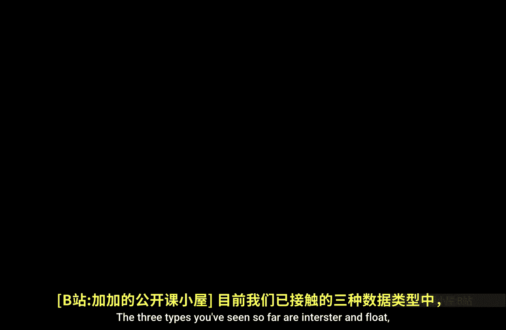
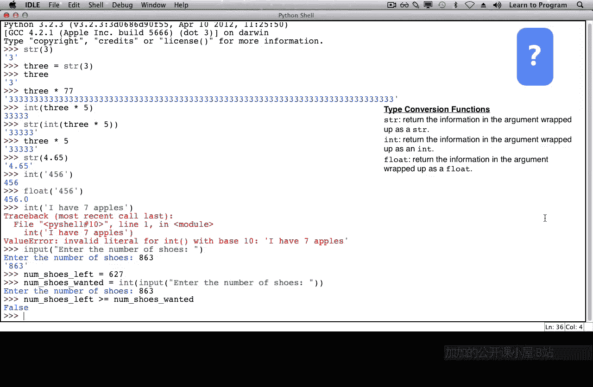

# 特伦托大学【中英⚡学习编程：基础知识｜Learn to Program： The Fundamentals】 p17 P17 05_整数、字符串与浮点数之间的转换 -BV1kQ11B5EWa_p17-

The three types you've seen so far are int， stir and float。

Turns out that you can convert between them， as follows。Yeah。I'm going to take the number 3。

 and I'm going to call something called Stir。That gives me back a string of length 1。

 containing the letter 3。I can assign this to a variable。Is the string containing the letter 3。

Since it's a string。I can multiply it by whatever I like， let's make 773s just for the fun of it。

As you might guess， I can go the other direction。If I have five copies of this string 3。

 in other words， a string of length 5 containing。5 letter3s。 Then I can take that。

 and I can turn it into an int。There we go，33333。I can even use the result of that and convert it back to a string。

Giving me what I would have gotten。If I had just multiplied three by five。I can also convert floats。

To strings。If I use int on a string containing several digits， then I can get back that integer。

By extracting that value from the string。I can also。Do the same thing with the float。

Notice that I gave flow to string containing letters that form an int。

And it turned that into a floating point number。I have to be a little bit careful。

 if I call int on a string that has things other than digits in it。

I'm actually going to get an error。Here， though ever I'm going to get is a value ever in literal for int with base 10。

 I have 7 apples。 That's just announcing that Python was unable to do the conversion。

A motivation for wanting as this is that if I call input。Say， tell me the number of shoes。

And the user types say863 shoes is the number they want。I get back a string。

 if my shoe store has only。627 shoes left。 Then I can't right now compare the string 863 to the number 627。

 the solution here。Is to take the result of what the user types and turn it into an end。Yeah。

Save it in a variable。And now， I can do my comparison。

Are there enough shoes left in order to satisfy my customer。And the answer is no。

