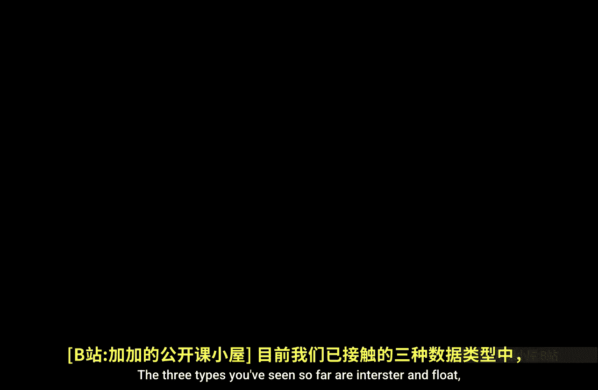
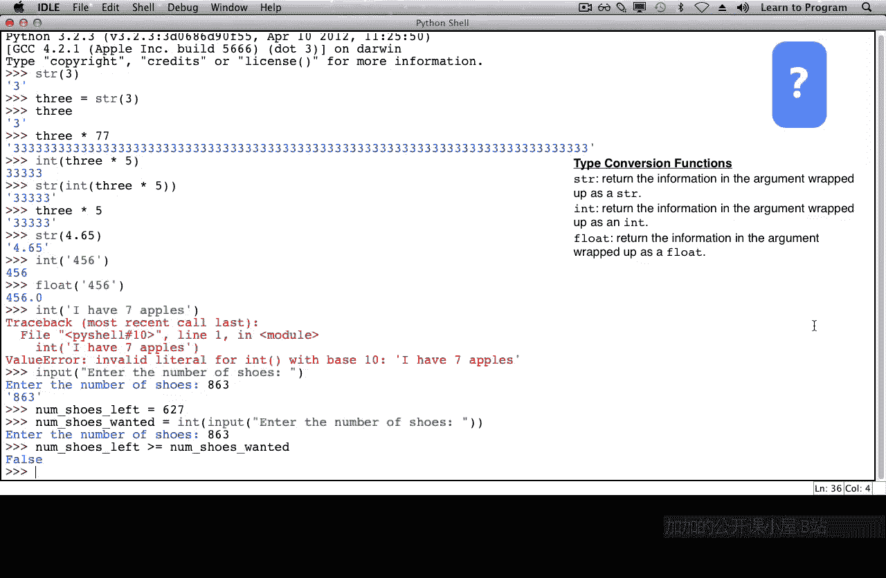

# 学习编程：基础知识：P17：整数、字符串与浮点数之间的转换 🔄

在本节课中，我们将学习如何在Python的三种基本数据类型——整数（`int`）、字符串（`str`）和浮点数（`float`）——之间进行转换。掌握类型转换是处理用户输入和进行数据计算的关键步骤。



## 类型转换的基本方法

到目前为止，我们已经学习了三种数据类型：`int`、`str`和`float`。它们之间可以相互转换。

以下是转换的基本方法：

*   **`int()`**：将其他类型转换为整数。
*   **`str()`**：将其他类型转换为字符串。
*   **`float()`**：将其他类型转换为浮点数。

## 从整数到字符串

我们可以将整数转换为字符串。例如，取数字`3`，然后调用`str()`函数。

```python
str(3)
```

这将返回一个长度为1的字符串，内容是字符`‘3’`。我们可以将这个结果赋值给一个变量。

```python
my_string = str(3)
```

既然`my_string`是一个字符串，我们就可以对它进行字符串操作，比如乘以一个数字。

```python
my_string * 5
```

这会产生字符串`‘33333’`。

## 从字符串到整数

上一节我们介绍了如何将整数转为字符串，本节中我们来看看反向操作。如果我们有一个由数字字符组成的字符串，可以将其转换为整数。

例如，有一个包含5个字符`‘3’`的字符串。

```python
int(‘33333’)
```

这将得到整数`33333`。我们甚至可以将转换后的结果再次转换回字符串。

```python
str(int(‘33333’))
```

这得到的结果，与直接将整数`33333`转换为字符串是一样的。

## 涉及浮点数的转换

浮点数也可以转换为字符串。

```python
str(3.14159)
```

如果对一个由数字组成的字符串使用`int()`函数，Python会从字符串中提取出数值并返回对应的整数。

```python
int(‘42’)
```

同样，我们可以对字符串使用`float()`函数。

```python
float(‘3.14’)
```

需要注意的是，即使给`float()`函数一个表示整数的字符串，它也会将其转换为浮点数。

```python
float(‘7’)
```

## 转换时的注意事项

进行类型转换时必须小心。如果对一个包含非数字字符的字符串调用`int()`函数，程序将会报错。

例如：

```python
int(‘7 apples’)
```

这会引发一个`ValueError`错误，提示信息类似于“以10为基数的int()的无效文字：‘7 apples’”。这表明Python无法完成这次转换。

## 类型转换的实际应用

一个常见的应用场景是处理用户输入。当我们使用`input()`函数获取用户输入时，无论用户键入什么，返回的都是字符串类型。

假设我们编写一个程序询问用户需要多少双鞋：

```python
user_input = input(‘请告诉我鞋子的数量：’)
```

如果用户输入`‘863’`，我们得到的是一个字符串`‘863’`。假设我们的库存只有`627`双鞋，目前我们无法直接比较字符串`‘863’`和整数`627`。

解决方案就是将用户输入的结果转换为整数。

```python
shoes_requested = int(user_input)
shoes_in_stock = 627
```

现在，我们就可以进行比较了：

```python
if shoes_requested <= shoes_in_stock:
    print(‘库存充足。’)
else:
    print(‘库存不足。’)
```

在这个例子中，答案是“库存不足”。



---

本节课中我们一起学习了Python中`int`、`str`和`float`三种基本数据类型之间的转换。我们了解了如何使用`int()`、`str()`和`float()`函数进行转换，并特别注意了转换可能引发的错误。最后，我们通过一个处理用户输入的实际例子，看到了类型转换在编程中的重要作用。掌握这些知识，能让你更灵活地处理和操作不同类型的数据。