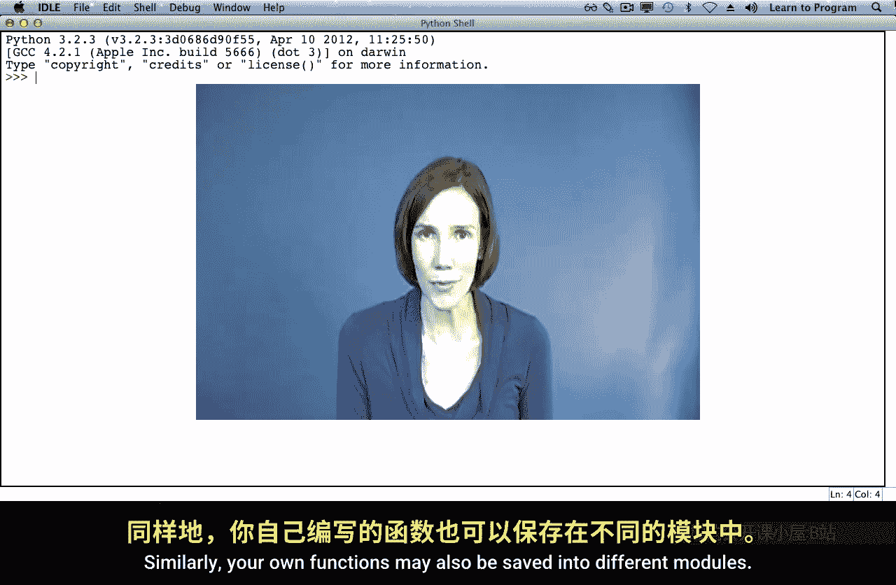
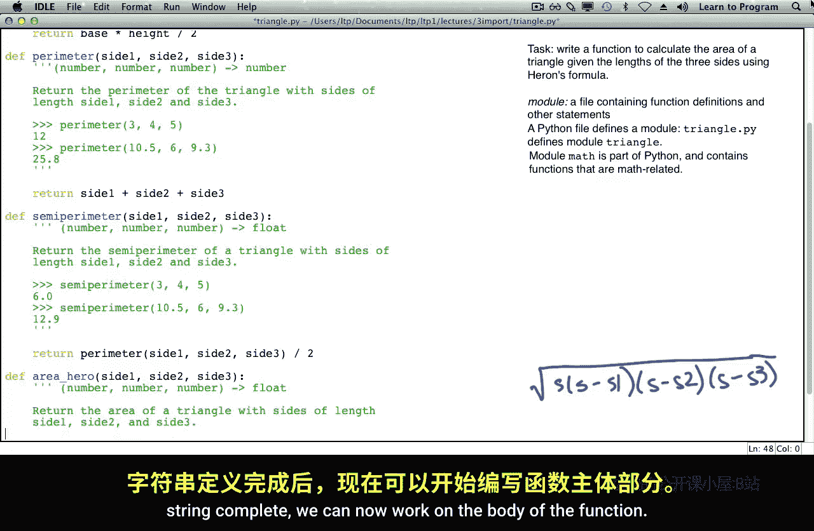
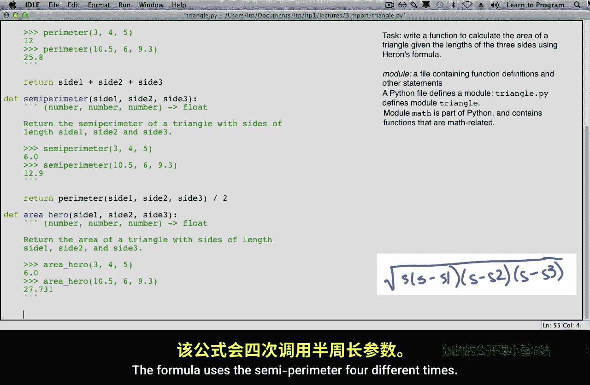
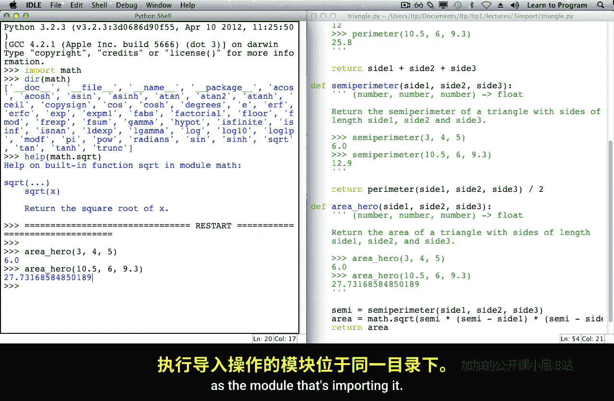

# 特伦托大学【中英⚡学习编程：基础知识｜Learn to Program： The Fundamentals】 p18 P18 07_使用非内置函数导入 -BV1kQ11B5EWa_p18-

Python has hundreds and hundreds of functions， most are not immediately available as built in。

Instead， the functions are saved into different modules。

 and you need to tell Python that you'd like to use them。Similarly。

 your own functions may also be saved into different modules。

We will demonstrate this using our triangle dot pi example。

 We will define a second function to calculate the area of a triangle for when we know the lengths of the three sides。

 but not the basin height。 This time， we'll calculate the area of a triangle using Herron's formula。

 also known as hero's formula。The formula involves this。

 both the semi perimeter and the length of the three sides。S is the semi perimeter， S1。

 S2 and S3 are the lengths of the three sides of the triangle。In order to write this code。

 we need to calculate the semi parametermeter， and we already have a function to do this defined in triangle that pi。

We also need a function to calculate the square root， and such a function exists。

 but it isn't a built in function。 Instead， it is defined in another file named math that Pi。

 Ma is a module， as is triangle。As its name implies。

 the math module contains several functions related to math。To see the listing of functions。

 let's import the module to gain access to it。And then we'll call the built in function D on it。

We see that our function named square root is amongst the available functions。

 and we can now run help on square root to find out more about it。

When we ask for information about square root， we need to specify that it is in the math module。

We do that using the module name followed by a dot， followed by the function name。

And this tells us information about the square root function。Now we're ready to write the function。

The first step is going to be to write a couple of example function calls。And in order to do that。

 we need to decide on a meaningful function name。I'll use the word area along with heroro to indicate that word using heroro's formula。

This function takes three sides， and in this case I would expect it to return 6。0。

We'll add a second function call， second example， and in this case。

 using my calculator I figured out that it we should be getting back something like this 27。

731 there will be a few more digits and I don't know exactly what because Python uses floating point arithmetic。

 but this will give me a sense of whether the function that we're writing is correct or not。

Now we'll provide the type contract。For this function， we'll pass in three numbers。Either ins floats。

 and it will return alo。We're ready now to add the function header， beginning with the word deaf。

And the function name， along with the three parameters， which I'm going to name side one。

 side two and side three。And at this stage， we can add the description。

This function will return the area。I have a triangle with sides of length， side， one side， two。

 and side three。With the dox string complete， we can now work on the body of the function。

The formula uses the semi parametermeter four different times。

 and rather than call semi parametermeter four times with the same arguments。

 we can call it once and store the results in a variable。

I'll name that variable semi， and then we'll call semi for a minute once to calculate it。

Withside one， side two and side three as arguments。Then we can move on to calculating the area。

When we calculate the area， we'll use the square root function and square root is in the math module。

 So to access square root， we need to import the math module。 I'll do that at the top of my file。

And then I will be able to gain access to the square root function。Let's calculate the area。

 we'll call square root from math using the module name， dot， and the function name。

 and we'll pass in the following。S明。Times 70 minussi1 times 70。マさ。Two times7 minus side three。

And that area is what this function will return。Finally。

 we need to test the function by calling it a couple of times。So I'm going to resize this window。

And run the module， then we'll just resize this and we will copy and paste these function calls so the first function call should result in 6。

0。And it does。And the second example should give something like what we had there。And in fact。

 it's giving us more digits， I'm going to use that result here instead。

 so that's what we expect to get。It's not only Python's modules that we can import。

 we can also import a module that we wrote。 For example。

 if we wanted to use one of our triangle functions in another module， we could import triangle。

 The module being imported should be in the same directory as the module that's importing it。

