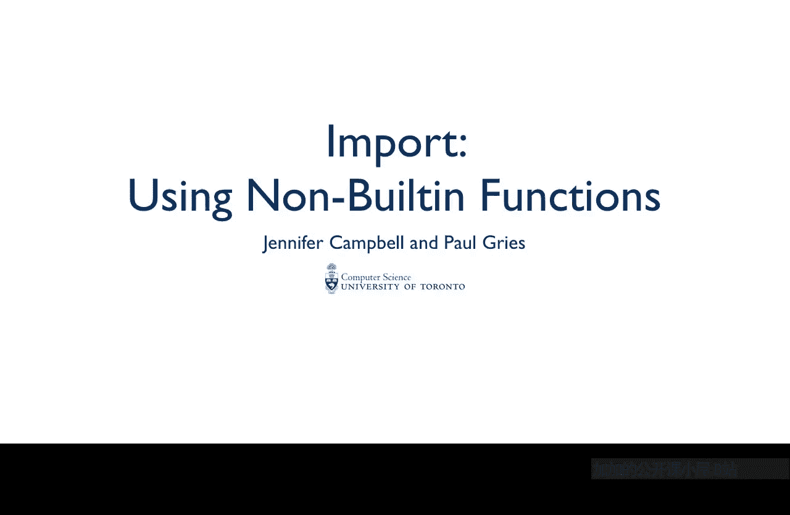
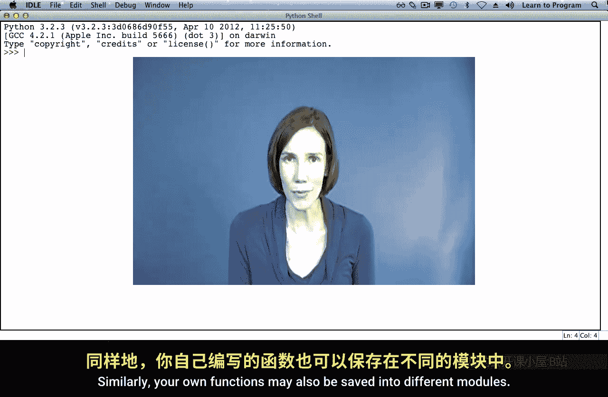
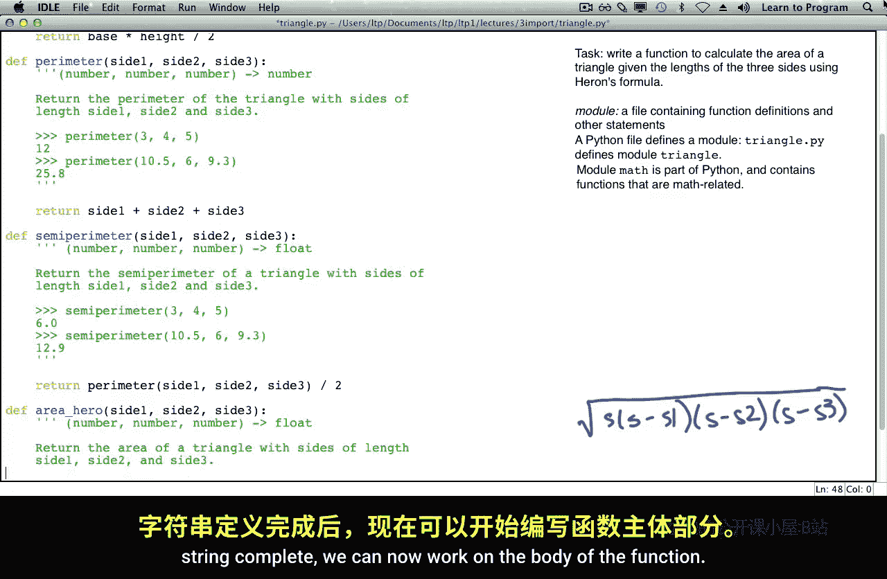
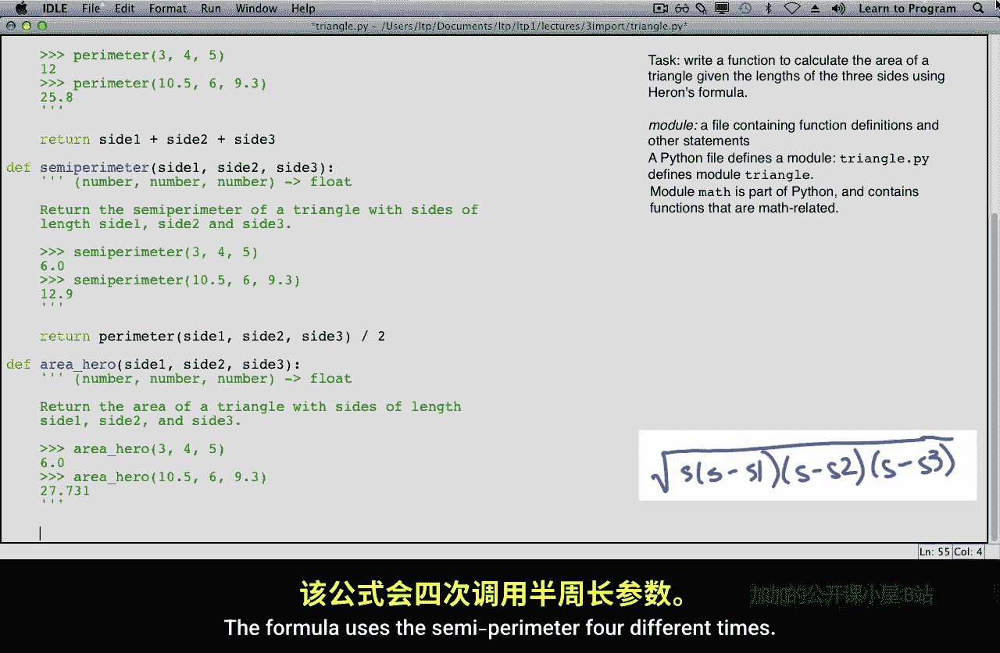
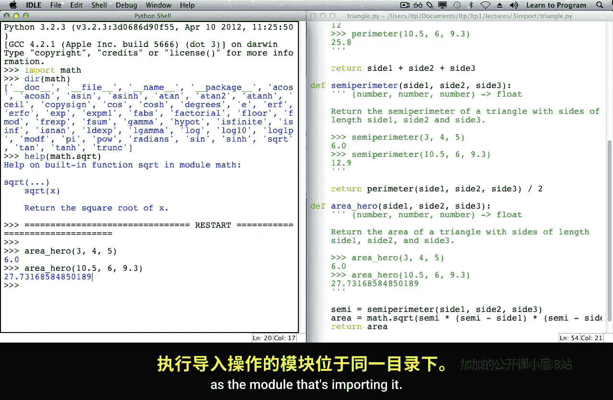

# 学习编程：基础知识：P18：使用非内置函数导入

在本节课中，我们将学习如何导入和使用Python中非内置的函数。Python拥有大量函数，但大多数并不直接作为内置函数提供，而是被组织在不同的模块中。我们将通过一个计算三角形面积的例子，演示如何导入和使用这些模块中的函数，以及如何导入我们自己编写的模块。

## 导入模块的概念

上一节我们介绍了内置函数。本节中我们来看看如何访问那些非内置的函数。

Python拥有成百上千的函数，其中大多数并非作为内置函数立即可用。这些函数被保存在不同的模块中。因此，你需要告诉Python你希望使用它们。同样地，你自己编写的函数也可以保存在不同的模块中。

## 示例：使用海伦公式计算三角形面积

我们将通过一个三角形面积计算的例子来演示这一点。我们将定义第二个函数，用于在已知三角形三边长（但不知道底和高）的情况下计算面积。这次，我们将使用海伦公式（也称为希罗公式）来计算面积。

该公式涉及半周长和三边长度。其中，`s` 是半周长，`s1`、`s2` 和 `s3` 是三角形三边的长度。

为了编写这段代码，我们需要计算半周长。我们已经在 `triangle.py` 文件中定义了一个计算半周长的函数。此外，我们还需要一个计算平方根的函数，这样的函数是存在的，但它不是内置函数，而是定义在另一个名为 `math.py` 的文件中。

`math` 是一个模块，`triangle` 也是一个模块。顾名思义，`math` 模块包含多个与数学相关的函数。

以下是查看模块中函数列表的步骤：
1.  导入模块以获取访问权限。
2.  调用内置函数 `dir()` 查看模块内容。

我们可以看到名为 `sqrt` 的函数在可用函数列表中。现在我们可以运行 `help` 来获取关于 `sqrt` 的更多信息。

当我们询问关于 `sqrt` 的信息时，需要指定它在 `math` 模块中。我们使用模块名后跟一个点，然后是函数名来实现这一点。这会告诉我们关于 `sqrt` 函数的信息。

## 编写函数

现在我们已经准备好编写函数了。

第一步是编写几个函数调用示例。为此，我们需要决定一个有意义的函数名。我将使用 `area_hero` 来表示使用海伦公式计算面积。

这个函数接收三个边长作为参数。例如，对于边长为3、4、5的三角形，我期望它返回 `6.0`。

我们将添加第二个函数调用示例。通过计算器，我算出对于边长为5、12、13的三角形，结果应该大约是 `27.731`（由于Python使用浮点运算，可能会有更多小数位）。这能让我们判断编写的函数是否正确。

接下来，我们提供类型契约。对于这个函数，我们将传入三个数字（整数或浮点数），并返回一个浮点数。

现在我们可以添加函数头，以 `def` 开头，然后是函数名和三个参数，我将其命名为 `side_one`、`side_two` 和 `side_three`。在此阶段，我们可以添加描述。

这个函数将返回一个边长为 `side_one`、`side_two` 和 `side_three` 的三角形的面积。

完成文档字符串后，我们现在可以编写函数体。

## 实现函数体

公式中四次使用了半周长。与其用相同的参数调用四次 `semi_perimeter` 函数，不如调用一次并将结果存储在一个变量中。

我将这个变量命名为 `semi`，然后我们调用 `semi_perimeter` 函数一次来计算它，传入 `side_one`、`side_two` 和 `side_three` 作为参数。

接着，我们可以继续计算面积。计算面积时，我们将使用 `sqrt` 函数，而 `sqrt` 在 `math` 模块中。因此，要访问 `sqrt`，我们需要导入 `math` 模块。我将在文件顶部进行导入，然后就能访问 `sqrt` 函数。

让我们来计算面积。我们将使用 `math.sqrt(...)` 的格式调用 `sqrt` 函数，并传入以下表达式：
`semi * (semi - side_one) * (semi - side_two) * (semi - side_three)`
这个计算出的面积就是函数将要返回的值。

最后，我们需要通过调用函数几次来测试它。运行模块后，复制并粘贴这些函数调用。第一个函数调用应该得到 `6.0`，确实如此。第二个示例应该得到类似我们之前计算的结果，实际上它给出了更多小数位，我将用这个结果来验证。

## 导入自定义模块

我们不仅可以导入Python的模块，还可以导入我们自己编写的模块。例如，如果我们想在另一个模块中使用我们的三角形函数，我们可以导入 `triangle` 模块。被导入的模块应该与导入它的模块位于同一目录中。

本节课中我们一起学习了如何导入和使用Python模块中的非内置函数。我们通过一个具体例子，演示了从 `math` 模块导入 `sqrt` 函数，并利用它和自定义函数来实现海伦公式计算三角形面积。我们还了解了如何导入自己编写的模块。掌握模块导入是组织和管理更复杂代码的关键一步。