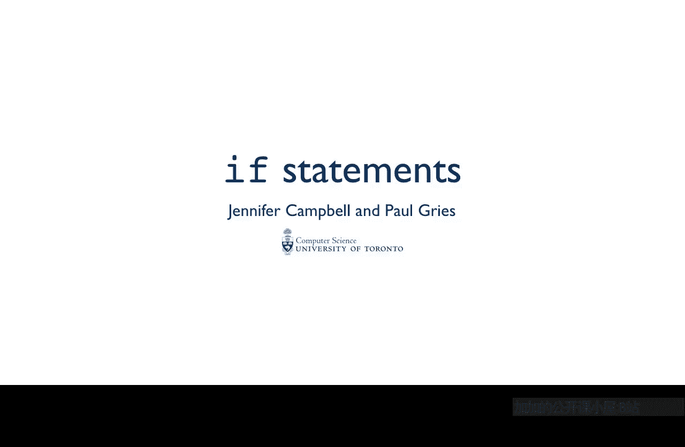
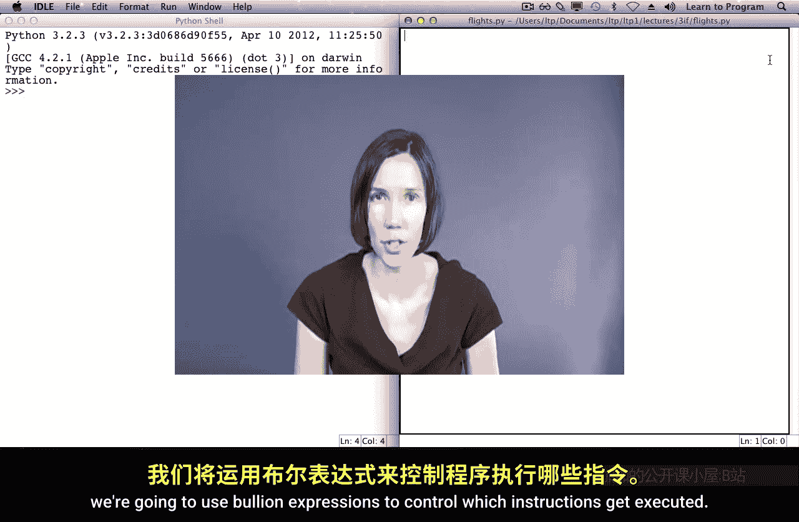
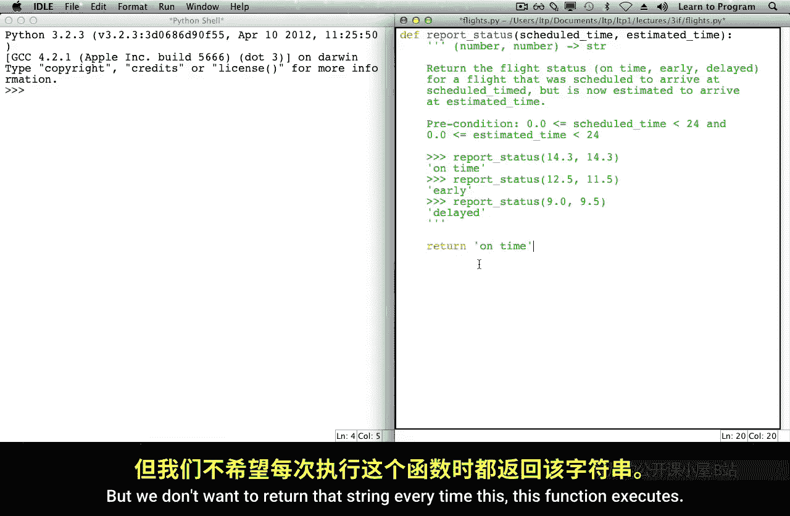
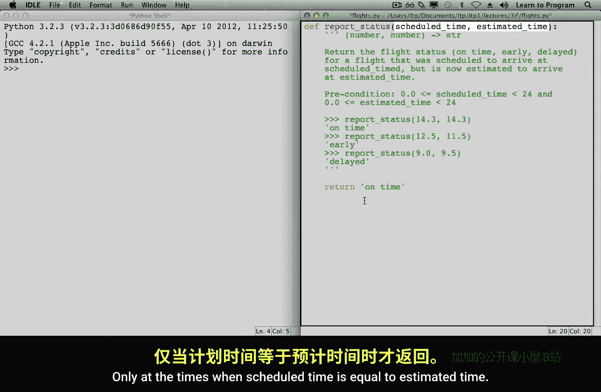
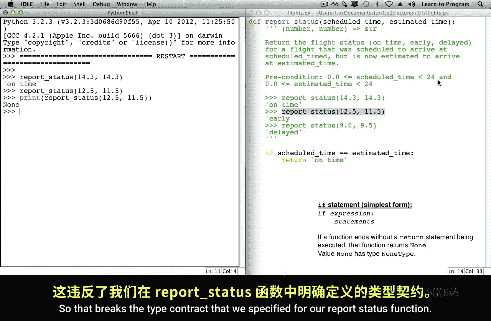
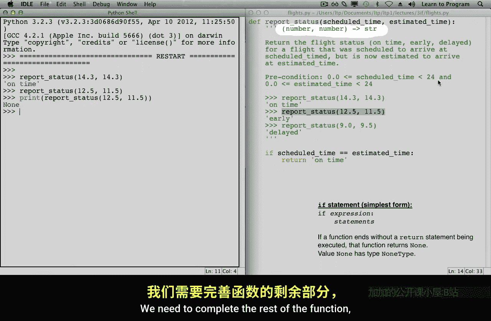
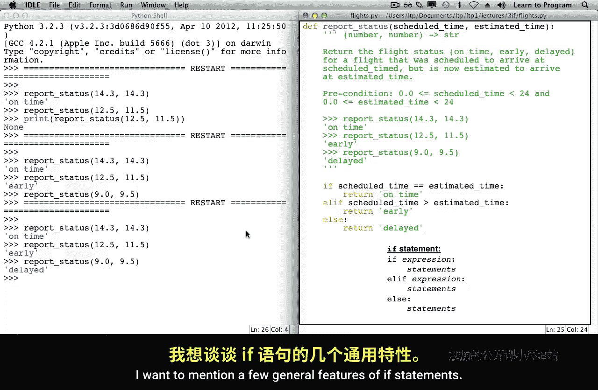
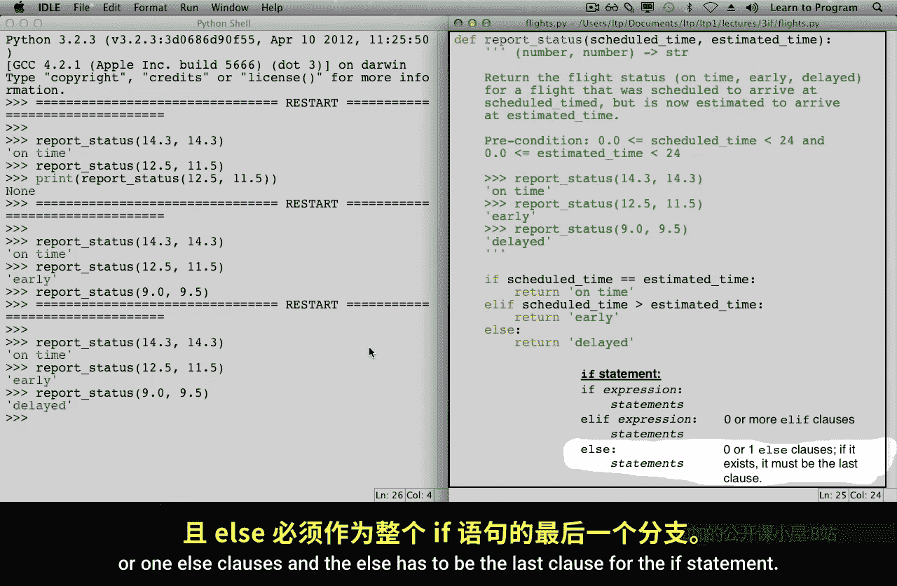
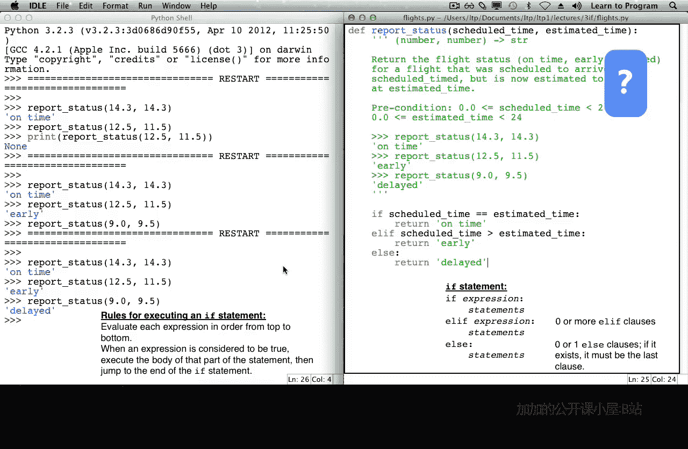

# 特伦托大学【中英⚡学习编程：基础知识｜Learn to Program： The Fundamentals】 p19 P19 01_如果语句 -BV1kQ11B5EWa_p19-

The programs that we've written so far execute the same sequence of instructions each time that they run。

In this lecture， we're going to use Boolean expressions to control which instructions get executed。

Let's consider this problem。A flight was scheduled to arrive at a particular time。

 and it is now estimated to arrive at another time。

Write a function that given the two times returns the flight status， either on time。

 early or delayed。For this function， a time will be represented using a float。For example。

 the time 3 a will be represented by 3。0。And the time 2，30 PM，1430 will be represented by 14。5。

Therefore， each of the times we're working with is going to be between 0。0。And 24。0。

0 inclusive and 24 exclusive。This is called a precondition。When writing our function。

 we expect that the times provided will be within this range。Let's begin to define the function。

 We'll start with some example， function calls。I'm going to name this function report status。

And it will have two arguments， take two arguments， the first will be the scheduled time of arrival。

 and the second will be the new estimated time of arrival。When those two values are the same。

 it will return the message on time。When the scheduled time is 12。

5 and the new estimated time of arrival is 11。5 or earlier， this function will return early。

And finally， the last possible situation。Is that when the time is 9。0， the scheduled time。

And the new estimated time comes later， this function should return a message saying that the flight is delayed。

Now， let's write the type head。The function has two parameters， both numbers。

 and in all of the cases here I've passed in floats。

 but we could have easily passed in integer values so we can use number for those two parameters。

And it is going to return something of type string。Time for the header。

We know that we've named the function report status。

And now we need to decide on two good names for the parameters。

 The first parameter I can call scheduled time。The second I will call estimated time。

The last part of the dock string that needs to be added is the functions description。

This function will return a flight status， and that will be one of three strings on time。

 early or delayed。It's returning that status for a flight that was scheduled to arrive and scheduled time。

 the first parameter， but is now estimated to arrive at estimated time。

 which is the second parameter。One additional piece of information that needs to be added to this dock string is that the precondition that the scheduled time be between 0。

0。And 24。The same is true of the estimated time， it also needs to fall within that range。Yeah。

It's now time to write the body of the function。 We're going to write this function body in a couple of different steps。

 And by the end， we'll have the entire thing working。To start with。

 we need to figure out how to execute some statements sometimes， but not others。For example。

 we want to return a string on time， but we don't want to return that string every time this function executes only at the times when scheduled time is equal to estimated time。

We're going to use an if statement to express this。This if statement will have a Boolean condition。

 which is that the scheduled time be equal to the estimated time。

And we are going to place this return statement within the body of the if。

 So notice that it is indented， indicating that that falls within the if statement。

The way that we read this code is that if this scheduled time is equal to the estimated time。

 if that Boolean expression is true， then the return on time statement is executed。Otherwise。

 it is not executed， and we would continue down with any code that follows this， if。

Let's save this and run it。So when I call this function in the shell with equal times。

 it reports the status on time。 If I were to call this function at the moment with one of the pairs of times that are not equal。

 then nothing is returned。To be more precise， I should actually say that it looks like nothing is returned because something is returned by this function。

 even though no return statement was executed。Let's print this function call。

 so the function is called whatever value is returned， it's returned。

 and that value is about to be printed。And we can see that none is printed。

When a function call executes and no return statement is executed。

The value none is returned by the function。The type of none is none type， not string。

 so that breaks the type contract that we specified for our report status function we need to complete the rest of the function。

 ensuring that that type contract is abded by。

Let's go back to defining the function。Right now we have a single if statement。

 and when this bullolean condition is true， on time is returned。When it's false。

 we want to do something else。 So we check to see if this is true。

 and then we're going to use L standing for else L if to check for our second condition。Yeah。

This time we're going to check to see whether the scheduled time is bigger or greater than。

Estimated time。And when it is， we will return early。And it needs to be spelled as scheduled。

So at this stage， let's run it。And when we call this。Function with。Equal times。

It says on time when we recall when we call it with。Earlier times， it reports early。But still。

 at this point， when we call this with later time。None is returned， So we're not quite done yet。

We're going to add a third part to the ifF statement， which is an else clause。E says。

 if none of the preceding conditions or expressions are true， then do this。

 So we've checked whether they're equal， greater than。

 and the only thing left is that schedule time is less than estimated time。In that situation。

 this function will return delayed。So we can run it again。

Checking all of our conditions when they're equal。When it's earlier and when the estimated time is later。

 we now have the appropriate reports。I want to mention a few general features of if statements。

We can have zero or more L if clauses associated with an if。And we can have zero or1 else clauses。

 and the else has to be the last clause for the if statement。

When we have an if statement with these various expressions， we evaluate each expression in order。

 and for the first one that evaluates to true， the body of that part of the if statement is executed。

After that body is executed， the if statement is terminated。

 so it exits and continues on to a code that comes below it。Without checking any further conditions。

