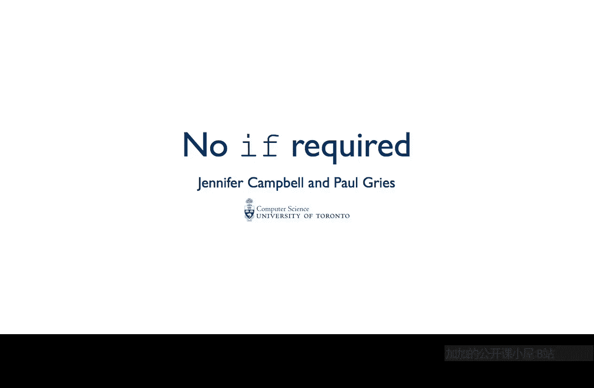
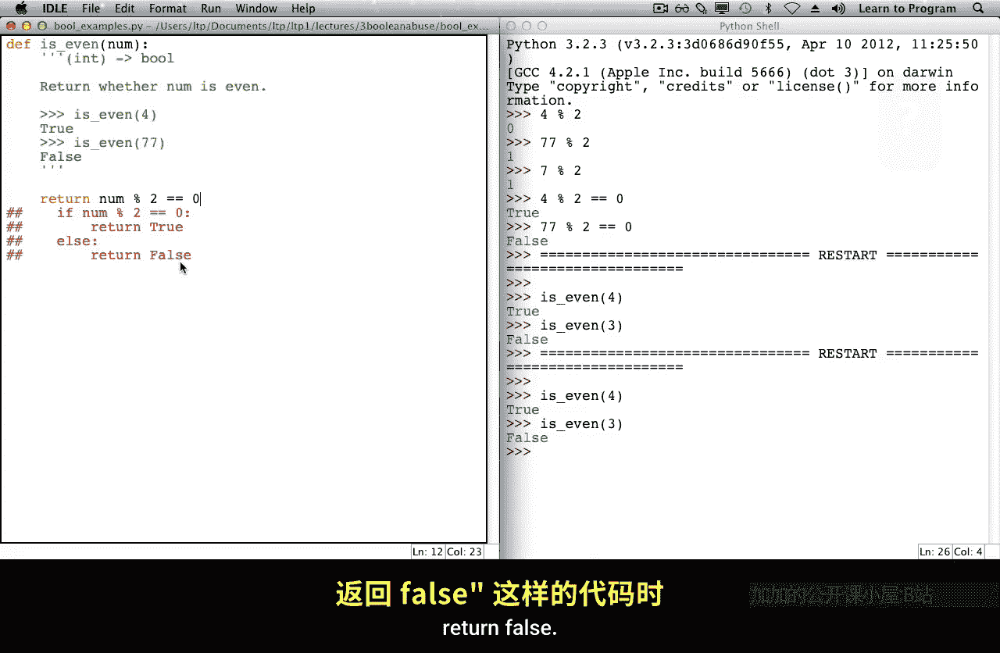

# 特伦托大学【中英⚡学习编程：基础知识｜Learn to Program： The Fundamentals】 p20 P20 03_无若需 -BV1kQ11B5EWa_p20-

You've seen Boolean's functions and if statements。 We're going to investigate a style issue now that can happen when you combine all three。

We're going to start by writing a function that returns true if the parameter is even and false otherwise。

As an example。If I call is。Even with value 4， I'm hoping that I get that true。Niccal is even 77。

 then hopefully I'll get back false。We can tell that we're sending in an in and that we hope to get back a bull。

Our header。Is we're going to call the function is even。 And let's call the parameter nu。

 because that's a number and。What we're going to do here is。Turn。Whether none is even。

Now that I know the the details of my function， it's time to figure out some code that will let me know whether a number is even or odd。

I'm going to investigate this in the Python shell and notice that if I divide 4 by 2。

 there is no remainder， But if I divide 3 or 5 or 7 by 2， there is a remainder。

So we're going to try out mod for mod2 is 0。77 mob2 is one and so on。

 So any number I pick that is odd。Is going to have a remainder of one when I divide it by two。

Continuing this thought， for mod to。Equals0 is true。But something like 77 mod to equals 0 is false。

 So this expression。The number mod 2 equals 0 is going to give me the result that I want。

We might decide to write something like， if none， mod2。Is0 then returned true。

 Otherwise return false。This will certainly work。Let's explore that。

 I will run this so we can have it。Now I can access my is even function and say， hey， is even for。

 Yes， it is。 How about 3。No， that's false。 Sore function works， however。

The function body here is three lines too long。 I don't actually need to use an if statement。

The issue here is that nu modd 2 equals 0 is already a boolean expression。As we saw over here。

4 mod2 equals 0 produced the value true。I don't need to say if something is true than return true。

Otherwise， if it wasn't true， return false。I can， actually。

Comment this out and replace it with a single line。I want to return Ba booleion。

Nummad 2 equals 0 produces a boolean。 So I can just do return num modd 2。Equals 0。

Let's try this new version out in the shell。Yeah。I still get true。I still get false。

So my new version works just as well as the old one。 It's shorter。 And after a while。

 you were going to find it preferable to the longer version with the if and the else。

Working with Boolean expressions is new to many of you。

 And so this may make you a little uncomfortable。 It might seem a little fancy， or even confusing。

Play with it for a while。 See what you can come up with in the shell when you need a boolean expression and see if you can simplify some of your return statements。

 if you ever find yourself doing， if something returned true， otherwise， return false。

