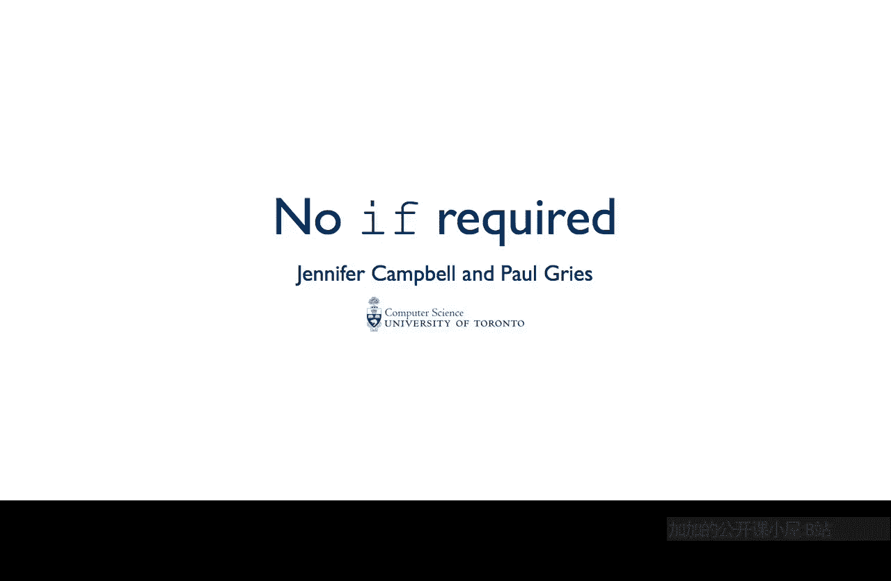
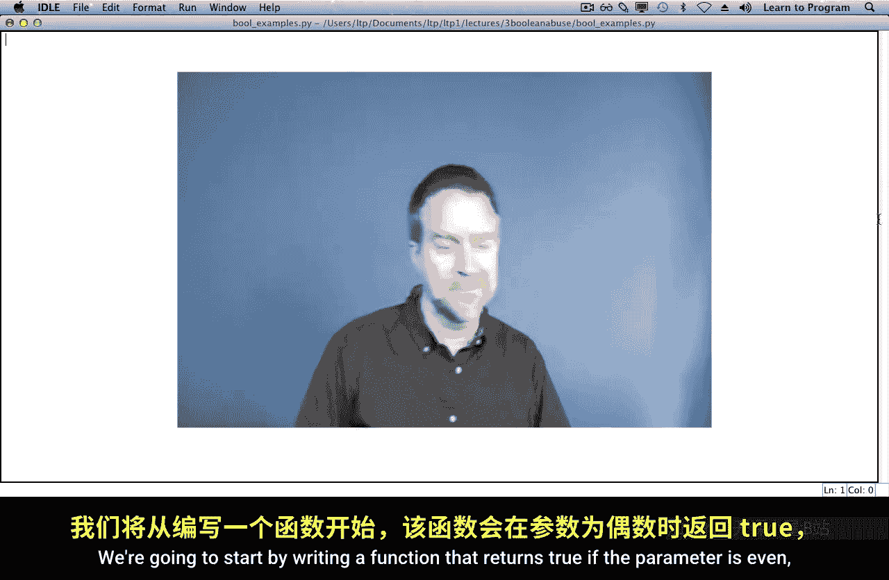
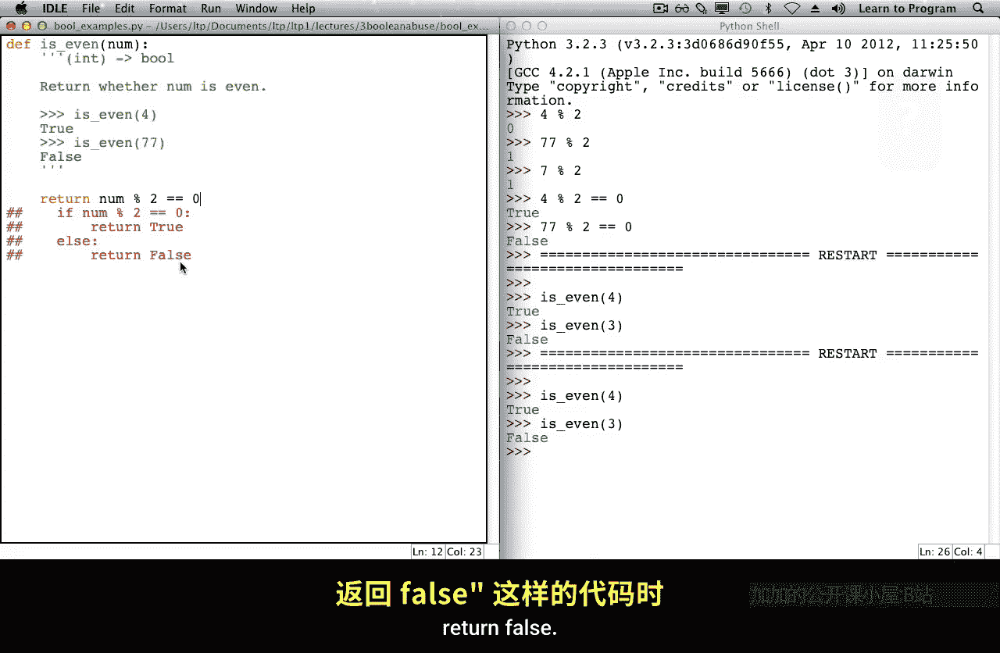

# 学习编程：基础知识：P20：布尔函数与条件语句的简洁写法



在本节课中，我们将探讨一个编程风格问题，它出现在你将布尔函数、布尔表达式和条件语句三者结合使用时。我们将学习如何编写更简洁、更高效的代码。

## 概述



你已经学习了布尔函数和 `if` 语句。现在，我们将研究一种编程风格问题，它在你将布尔函数、布尔表达式和 `if` 语句三者结合使用时可能出现。我们将通过编写一个判断数字奇偶性的函数来演示这个问题，并学习如何简化代码。

## 编写判断奇偶性的函数

我们将从一个具体例子开始：编写一个函数，如果参数是偶数则返回 `True`，否则返回 `False`。

例如，调用 `is_even(4)` 应返回 `True`，而调用 `is_even(77)` 应返回 `False`。这个函数的输入是一个整数，输出是一个布尔值。

函数头可以这样定义：函数名为 `is_even`，参数名为 `num`（代表数字）。函数的目标是判断 `num` 是否为偶数。

## 探索判断逻辑

在编写具体代码前，我们需要找到判断一个数字是奇数还是偶数的方法。我们可以在 Python 交互式环境中进行探索。

请注意，如果将 4 除以 2，余数为 0；而将 3、5 或 7 除以 2，则有余数。因此，我们可以使用取模运算符 `%`。

```python
4 % 2 == 0  # 结果为 True
77 % 2 == 0 # 结果为 False
```

任何奇数除以 2 的余数都是 1。因此，表达式 `num % 2 == 0` 就能给出我们想要的结果：如果为 `True`，则 `num` 是偶数；如果为 `False`，则 `num` 是奇数。

## 初始实现方式

基于以上逻辑，我们可能会写出如下代码：

```python
def is_even(num):
    if num % 2 == 0:
        return True
    else:
        return False
```

这个函数确实可以工作。我们来测试一下：

```python
is_even(4)  # 返回 True
is_even(3)  # 返回 False
```

函数运行正常。然而，这个函数体有三行，太长了。我们实际上并不需要使用 `if` 语句。

## 简化代码

问题的关键在于，`num % 2 == 0` 本身就是一个布尔表达式。正如我们之前看到的，`4 % 2 == 0` 直接产生了值 `True`。

我们不需要说“如果某条件为真，则返回真；否则返回假”。我们可以直接返回这个布尔表达式的结果。

因此，我们可以将函数体简化成一行：

```python
def is_even(num):
    return num % 2 == 0
```

让我们在交互式环境中测试这个新版本：

```python
is_even(4)  # 仍然返回 True
is_even(3)  # 仍然返回 False
```

新版本和旧版本一样有效，但更简短。经过一段时间，你会发现这种写法比带有 `if` 和 `else` 的长版本更可取。

## 适应简洁写法

对于许多初学者来说，直接使用布尔表达式可能有些陌生，甚至让人感到不自在或困惑。这很正常。

以下是一些建议帮助你适应：

*   多在 Python 交互式环境中练习，尝试各种能产生布尔值的表达式。
*   检查你自己的代码，如果你发现类似“如果某条件成立则返回 `True`，否则返回 `False`”的模式，看看是否能将其简化为直接返回该条件表达式。

## 总结



本节课中，我们一起学习了如何简化结合了布尔表达式和条件语句的代码。核心要点是：当函数需要根据一个条件返回 `True` 或 `False` 时，通常可以直接返回该条件表达式本身，而无需使用完整的 `if-else` 结构。这能使代码更简洁、更易读。记住这个模式，它在你未来的编程实践中会非常有用。