# 特伦托大学【中英⚡学习编程：基础知识｜Learn to Program： The Fundamentals】 p21 P21 05_结构化-if语句 -BV1kQ11B5EWa_p21-

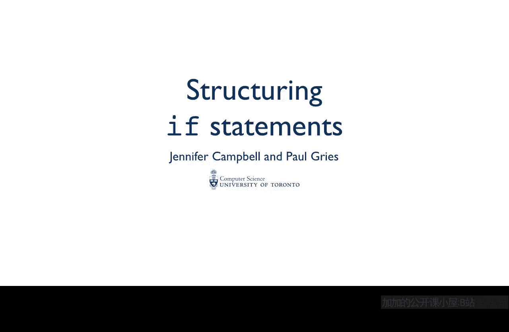

When working with if statements， we are going to have some decisions to make about how to structure our code In this lecture。

 we will examine two problems and explore alternative solutions involving if for each of the problems。

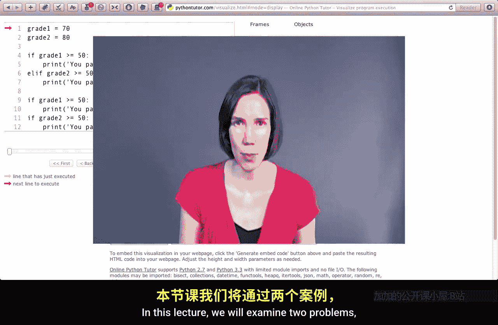

This example problem involves two grades， grade 1 and grade2。We'll give grade1 the value of 70。

 and grade 2 gets 80。Now there's an ifLF statement on liness 4 through7。

There's a Boolean expression associated with the if and another Boolean expression associated with the LF。

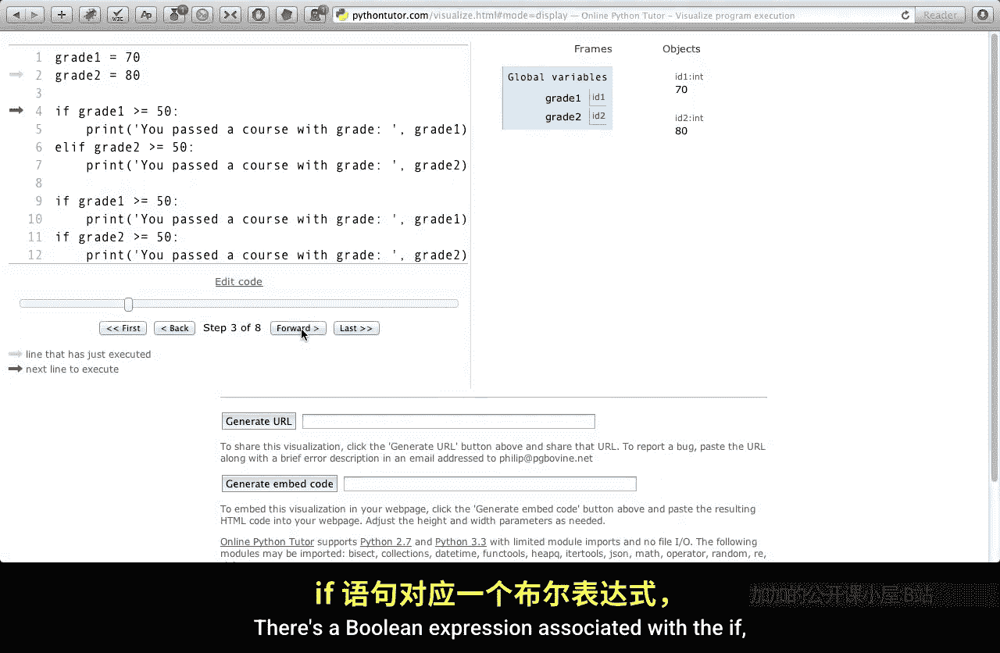

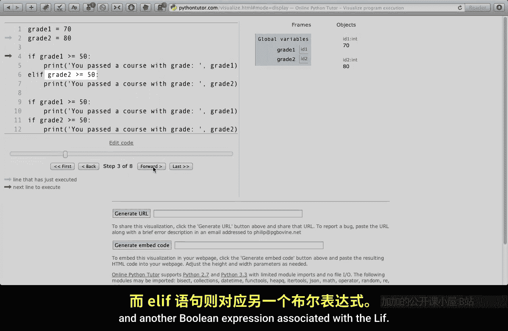

These expressions are evaluated from top to bottom。 And when one of the expressions is true。

 the body associated with it gets executed。And the if statement exits at that point without continuing on to evaluate the subsequent expressions。

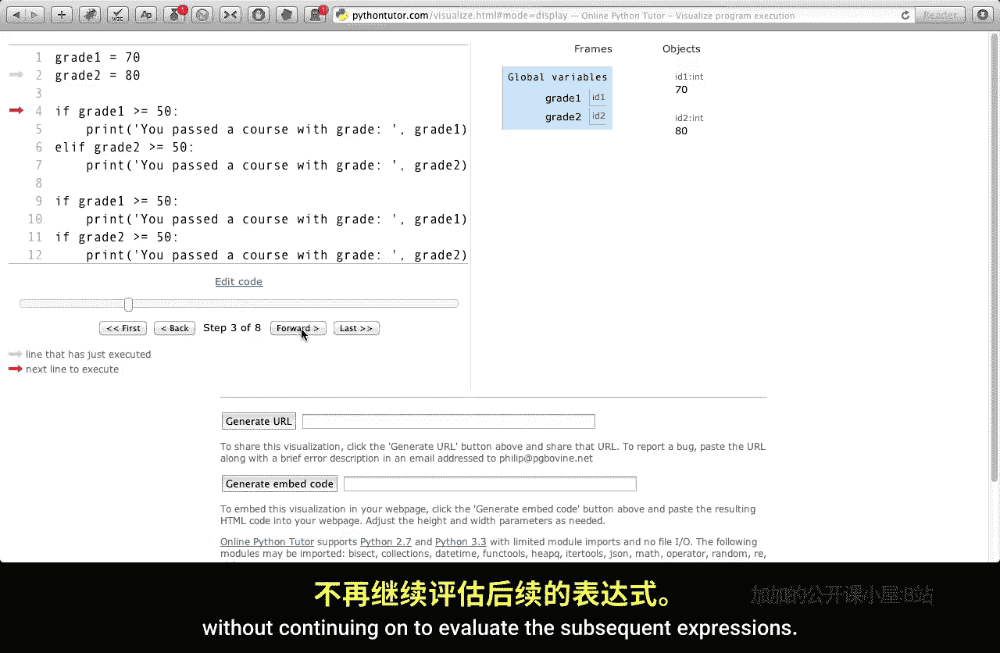

Because of that， at most one of the two print statements will get executed in this case。

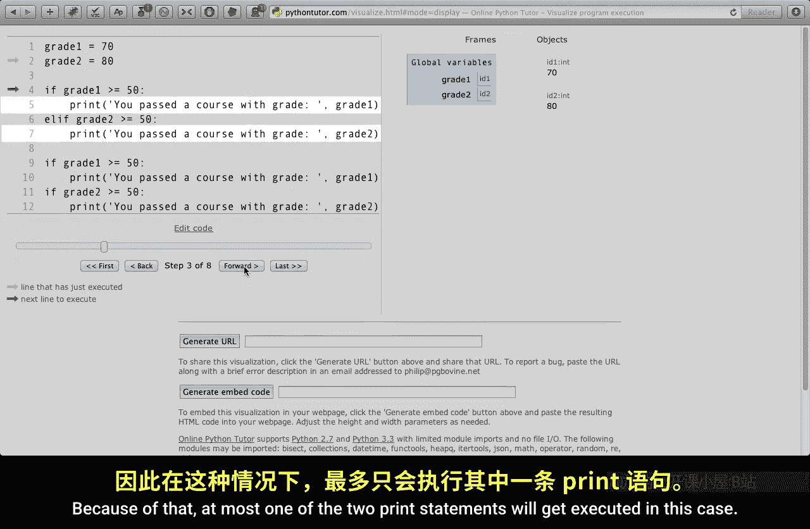

So let's look at this code。 If the grape1 is greater than 50 and it is。

 we enter into the body of the if。

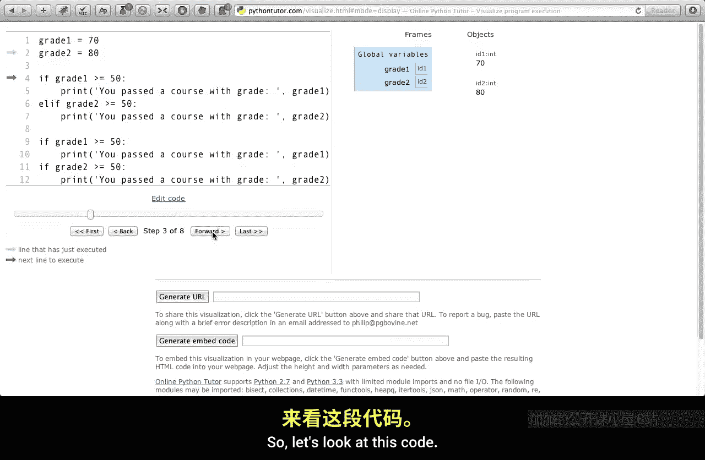

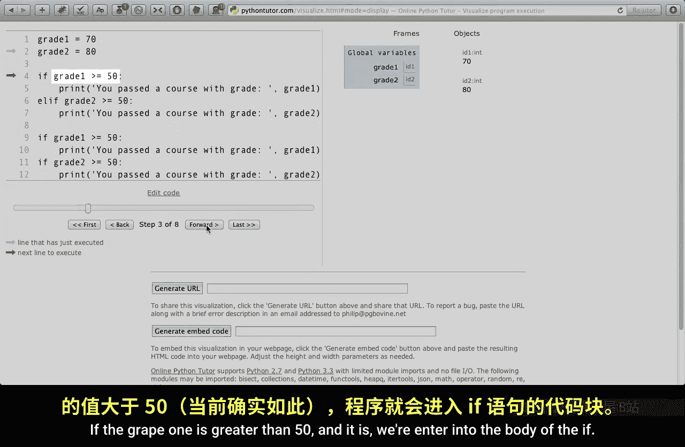

And at this point， because one of the expressions associated with the if was true。

 the if statement will exit after executing this body。 So we jump down to line 9。

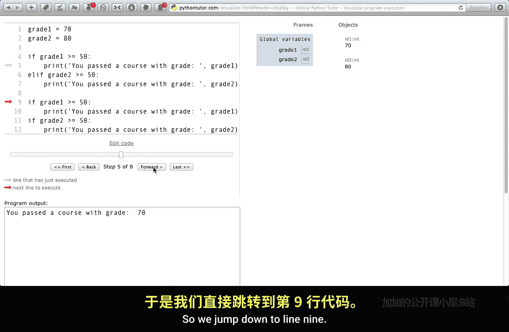

On line 9， there is another if statement。 and on line 11， there is a third if statement。

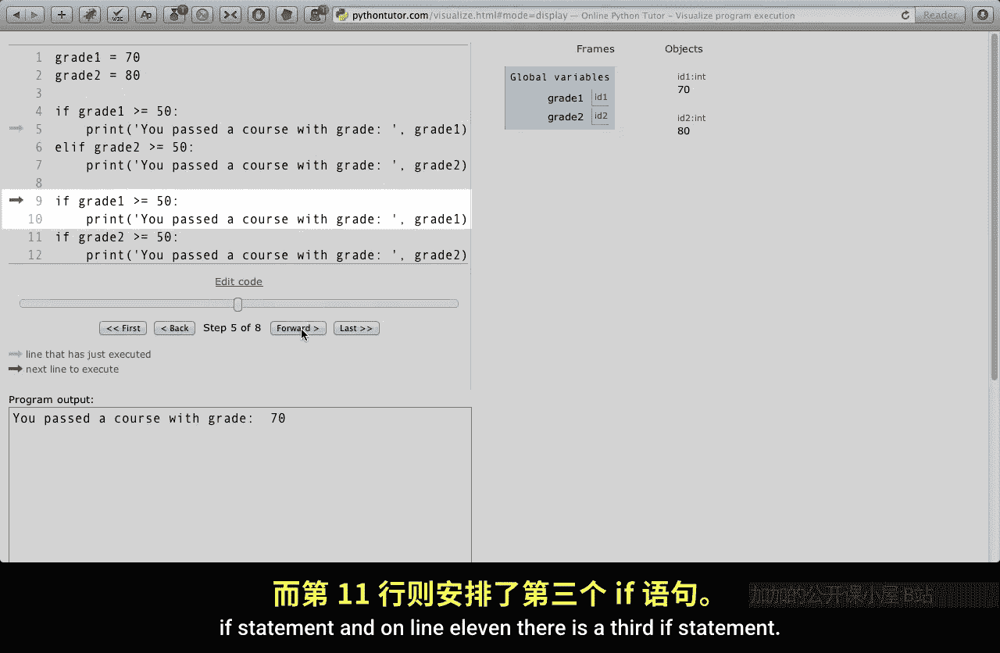

The condition associated with the if On line 9 is the same as the one on line 4。

 and the condition associated with the if On line 11 is the same as that associated with the L if on line 6。

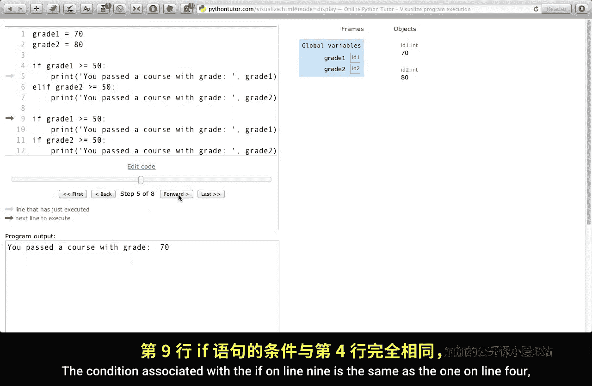

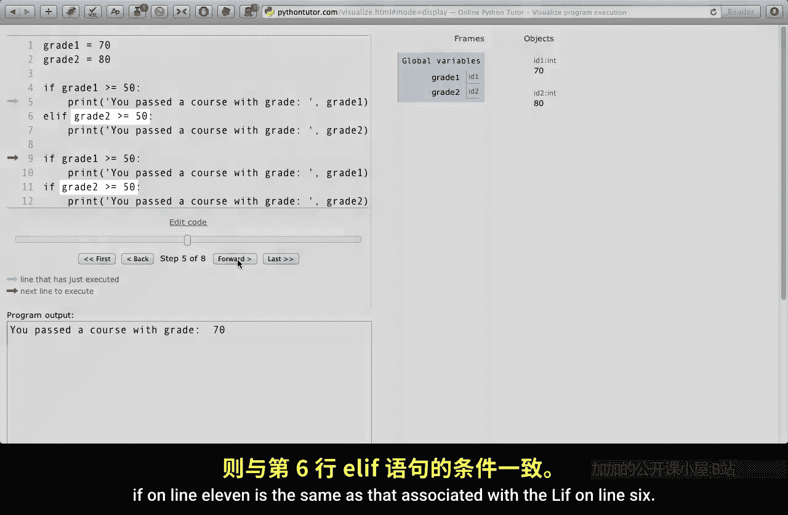

However， because this code from lines 9 through 12 is two separate if statements。

 as opposed to the if LF that would exist on lines 4 through 7。It behaves differently。

 We first evaluate the expression associated with the if on line 9， and it's true。

 So we enter into its body and print a message。 And at this point。

 we will exit that if statement moving on to the subsequent code and that code is line 11。

 where there's a separate if statement。

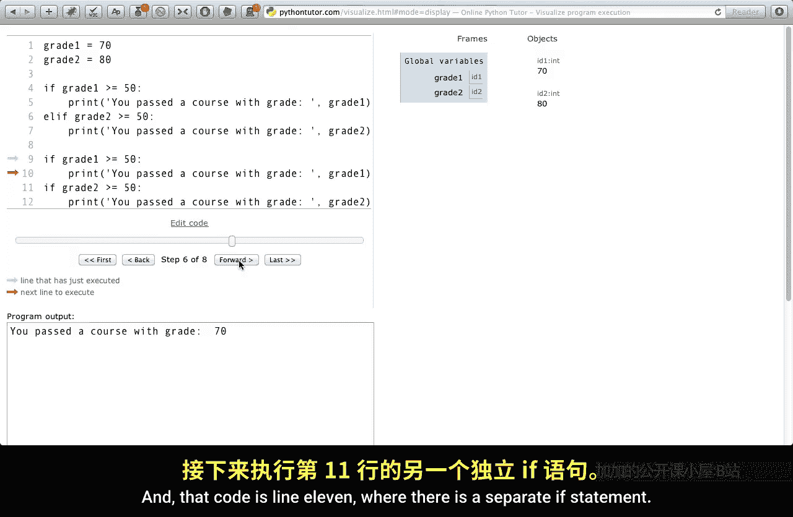

This bulloleyan expression is also true。 So in this case， its body is executed as well。

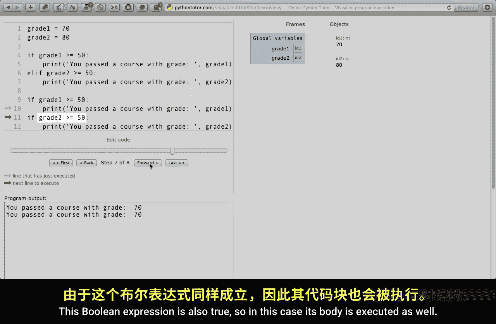

So the if L if is not equivalent to two if statements。

 and we need to take that into account when we're writing our code and take care to use the appropriate structure in each situation。

Let's consider another problem。 This problem involves predicting whether we should bring an umbrella or not。

So we'll take into consideration whether precipitation is expected using a true or false value。

And what the temperature is for today， temperature in this case is plus8 degrees Celsius。

This if statement first checks the condition to see whether precipitation is expected。

 and that is true。 So we enter into the body of the if。And in the body。

 there is actually another if statement。 One if statement is nested inside the other。

We can then check that Boolean condition and find that it is true。

 so we print the message from your umbrella。I want to modify this code so that we write a second version without the nesting。

Notice that when precipitation is true， the condition associated with the first if。

 and the condition is associated with the second if is also true。

 That's when we print from your umbrella。 So they both need to be true。

We'll use the Boolean operator to state that， and that way we can structure this as a single if statement。

Let's visualize the execution。In the first case， the variables have values that cause us to print from your umbrella。

And in the second case， we evaluate this Boolean condition。 Precipitation refers to the value true。

 temperatureer refers to the value plus 8。 So this expression is also true。

 and the message bring your umbrella is displayed。Now， let's expand on this example。

 I'm going to add an else to the if statement on line 5。

This else describes the statement to print when temperature is not greater than zero。

I'm going to now edit the code on line 10 to make that if statement equivalent to the one on line for。

Let's look at the conditions under which the El code executes。The precipitation。

The conditiondition needs to be true。The temperature greater than zero condition must be false。

 and then the else is executed。So we can express this using an LF。

We want to make sure that the first condition is true。

And we don't need to check the second condition because we'll only reach the LF when that is false。

In that case， we'll print the same message。As above。Yeah。Let's visualize the execution now。In fact。

 there's one more thing to do。 Let's make this a negative。

Three so that it's below freezing and we print those messages。So if precipitation is true。

 we enter into the body of the if。Checking this condition。

 because I just changed what temperature refers to， it's false。

And we print the statement from the El。In the second if statement， we check the first condition。

 which is false because temperature is not greater than zero。Now we must check the L if clause。

 and this condition is true， so we enter into the body of that LF and we print the same message。

 so these two pieces of code are equivalent。

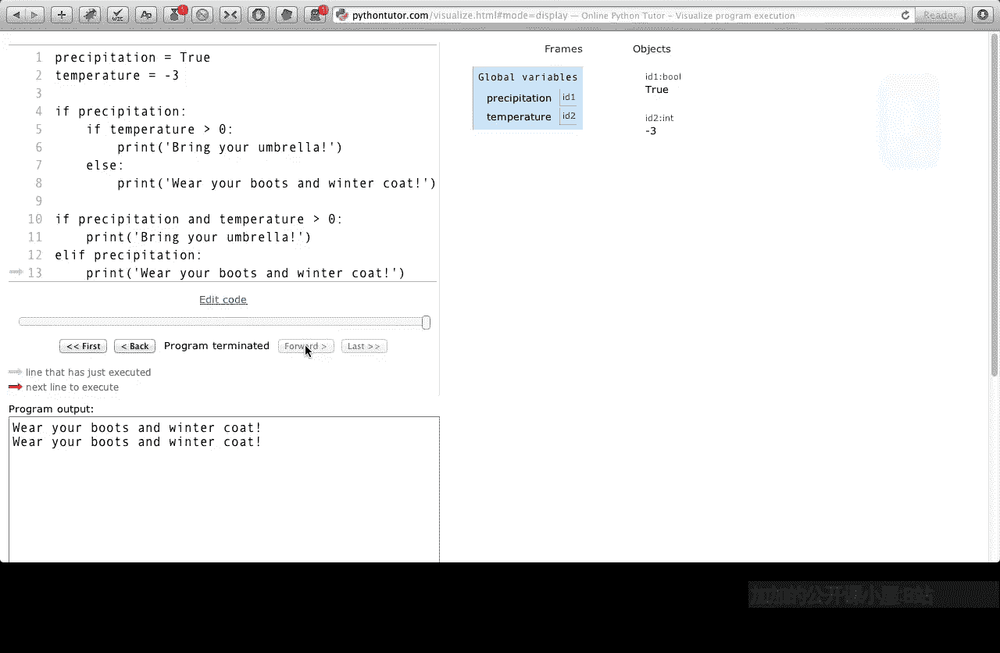