# 学习编程：基础知识：05：结构化-if语句 🧠

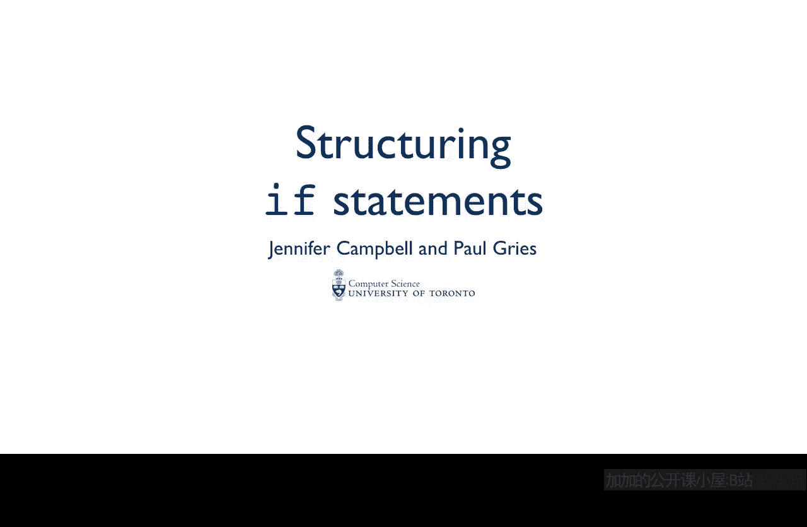

在本节课中，我们将学习如何结构化 `if` 语句。我们将通过分析两个具体问题，探讨针对每个问题使用 `if` 语句的不同解决方案，并理解不同结构之间的区别。

---

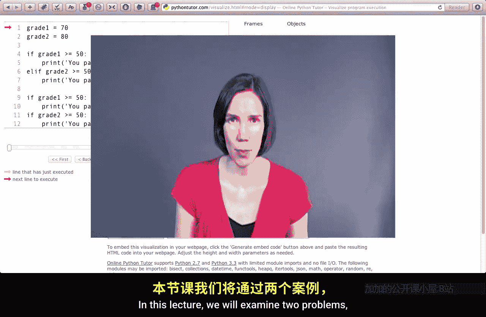

## 问题一：成绩判断

我们来看第一个例子。这个问题涉及两个成绩：`grade1` 和 `grade2`。我们给 `grade1` 赋值为 `70`，给 `grade2` 赋值为 `80`。

以下是使用 `if-elif` 结构的代码：

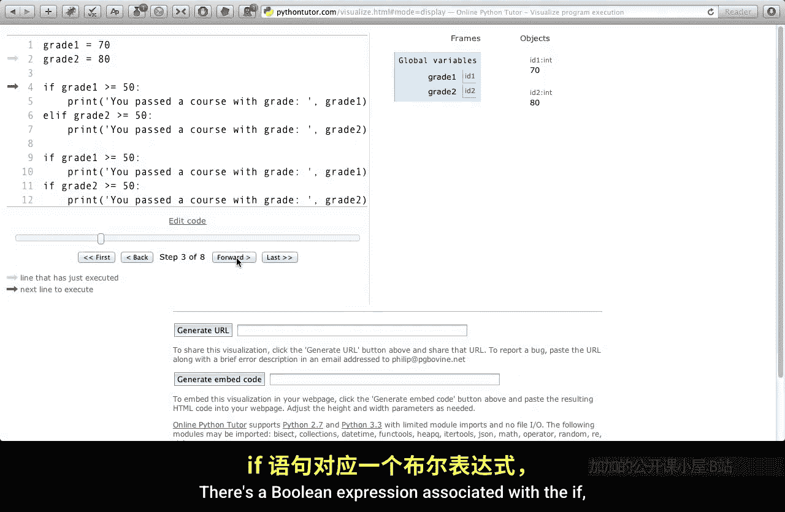

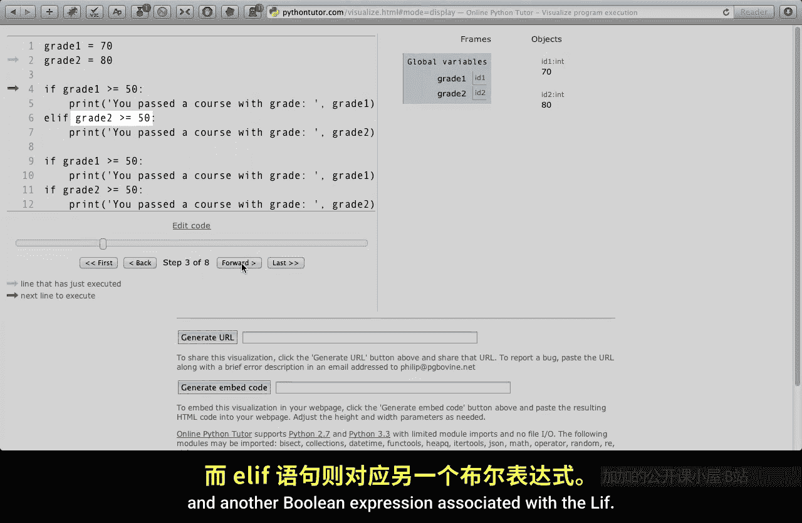

```python
grade1 = 70
grade2 = 80

if grade1 > 50:
    print("Grade 1 is greater than 50.")
elif grade2 > 50:
    print("Grade 2 is greater than 50.")
```

这些布尔表达式会从上到下依次求值。当其中一个表达式为真时，其关联的代码块就会被执行，并且 `if` 语句会在此处退出，不再继续评估后续的表达式。

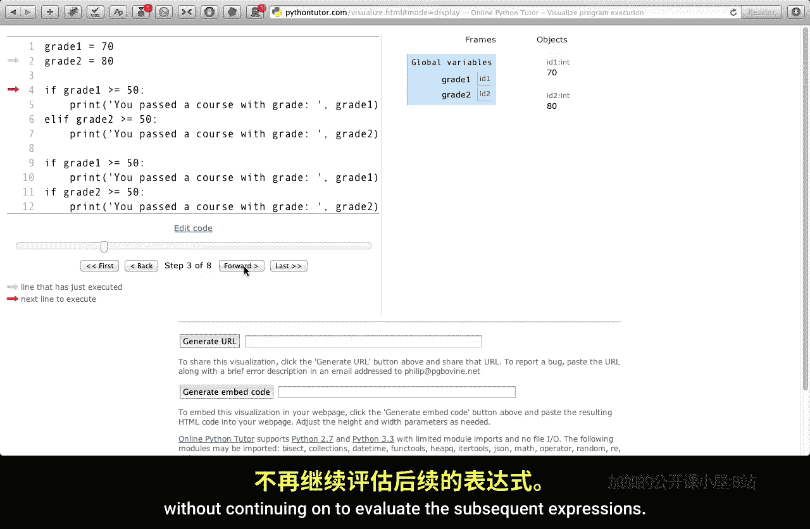

因此，在这种情况下，最多只会执行两个 `print` 语句中的一个。

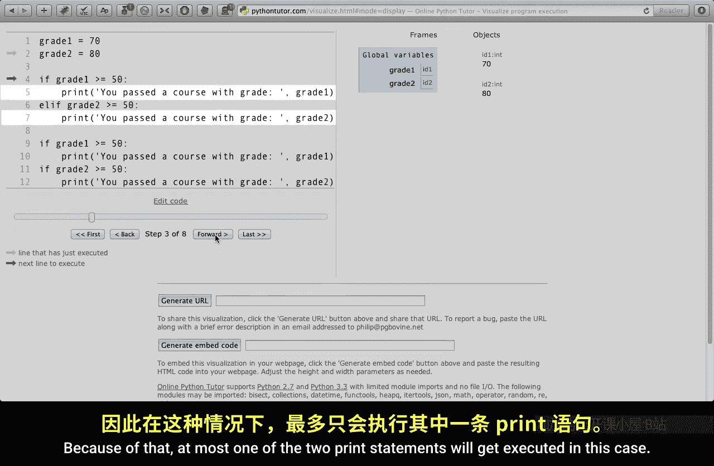

让我们分析这段代码。因为 `grade1` 大于 50，条件为真，我们进入 `if` 的代码块。由于与 `if` 关联的表达式之一为真，在执行完此代码块后，`if` 语句将退出，程序会跳转到第 9 行。

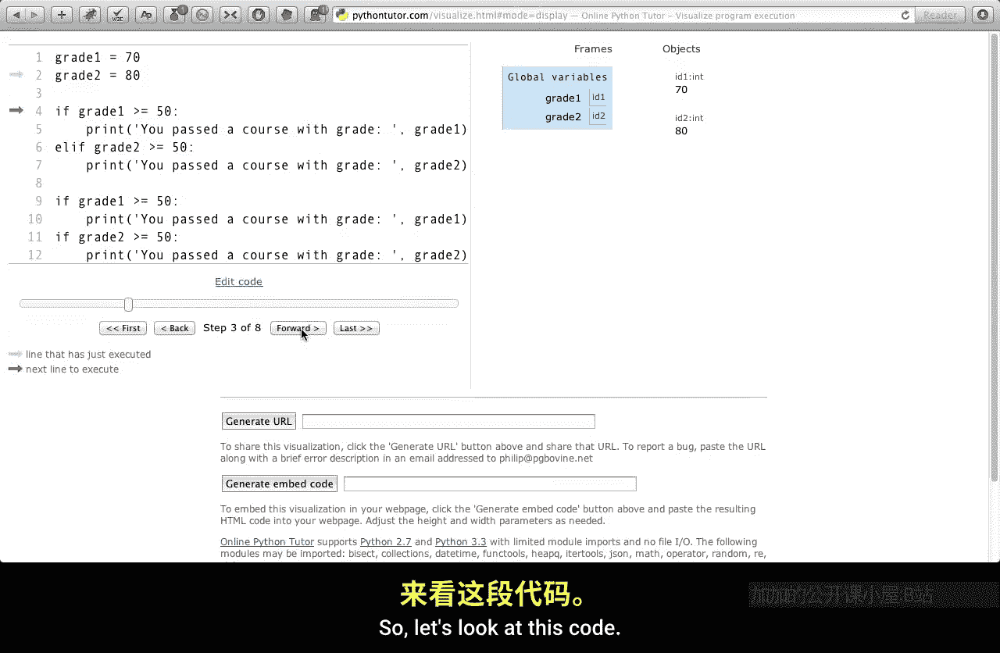

---

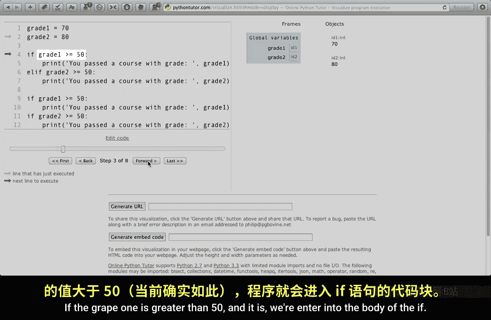

## 对比：两个独立的 `if` 语句

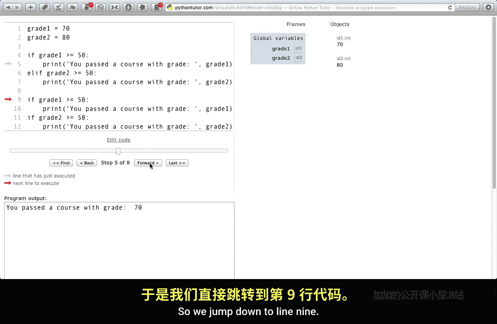

现在，我们来看另一种写法。在第 9 行有另一个 `if` 语句，在第 11 行有第三个 `if` 语句。

```python
if grade1 > 50:
    print("Grade 1 is greater than 50.")

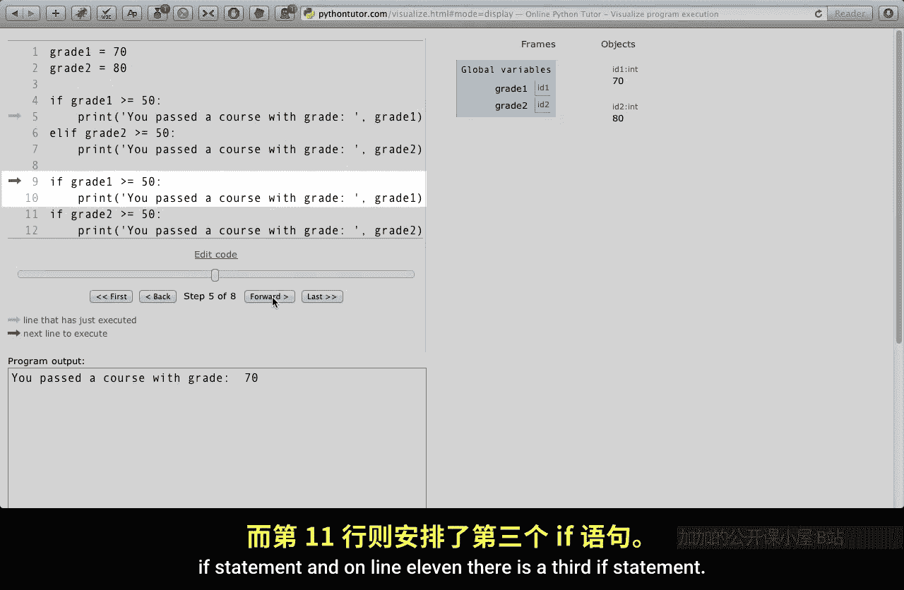

if grade2 > 50:
    print("Grade 2 is greater than 50.")
```

第 9 行 `if` 的条件与第 4 行相同，第 11 行 `if` 的条件与第 6 行 `elif` 的条件相同。

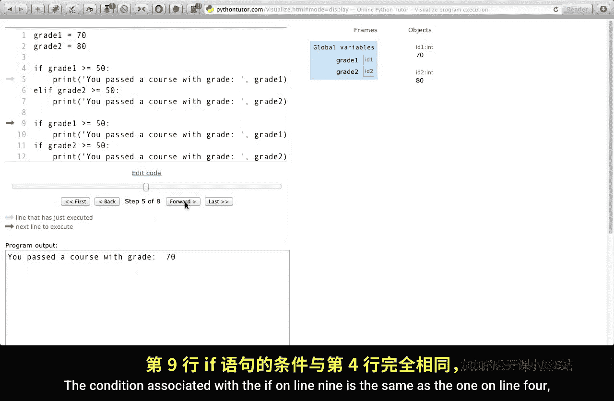

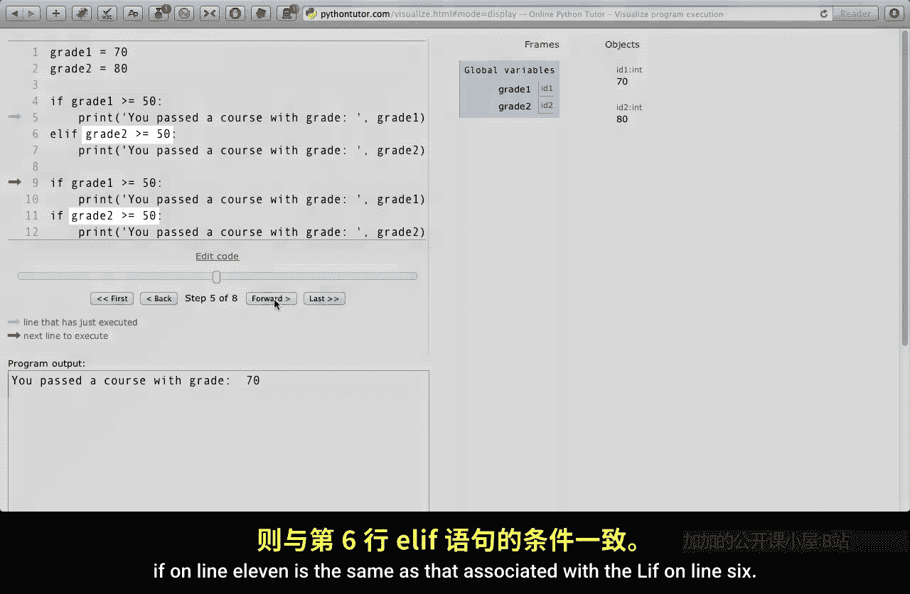

然而，因为第 9 行到第 12 行的代码是两个独立的 `if` 语句，而不是第 4 行到第 7 行那样的 `if-elif` 结构，所以它的行为是不同的。

我们首先评估第 9 行 `if` 关联的表达式，它为真，因此我们进入其代码块并打印消息。此时，我们会退出那个 `if` 语句，继续执行后续代码，即第 11 行的另一个独立的 `if` 语句。

这个布尔表达式也为真。因此，在这种情况下，它的代码块也会被执行。

所以，`if-elif` 并不等同于两个 `if` 语句。我们在编写代码时需要考虑到这一点，并在每种情况下注意使用合适的结构。

---

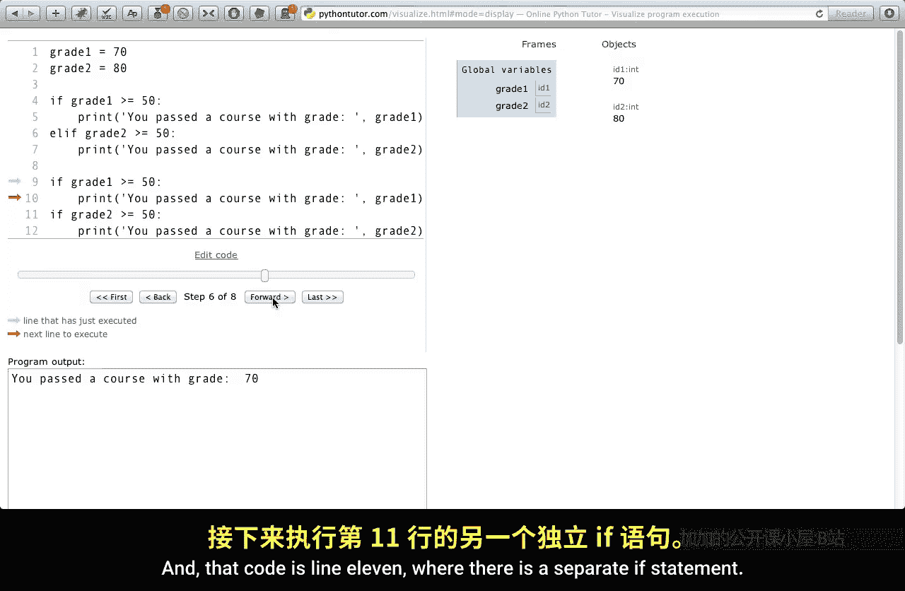

## 问题二：是否带伞

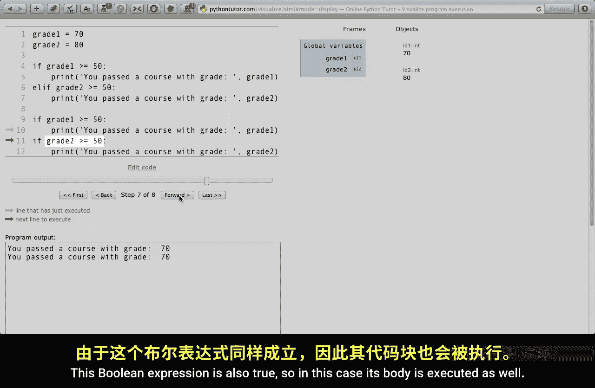

让我们考虑另一个问题。这个问题涉及预测我们是否应该带伞。我们将考虑两个因素：是否预计有降水（使用布尔值 `True` 或 `False`）以及今天的温度（本例中为 `+8` 摄氏度）。

以下是使用嵌套 `if` 语句的初始代码：

```python
precipitation = True
temperature = 8

if precipitation:
    if temperature > 0:
        print("Bring your umbrella.")
```

这个 `if` 语句首先检查是否预计有降水，条件为真，因此我们进入 `if` 的代码块。在代码块中，实际上有另一个 `if` 语句，一个 `if` 语句嵌套在另一个里面。

然后我们检查那个布尔条件，发现它为真，因此我们打印消息“Bring your umbrella”。

---

## 简化：使用逻辑运算符

我想修改这段代码，写出一个没有嵌套的第二个版本。注意，当 `precipitation` 为真，并且与第二个 `if` 关联的条件也为真时，我们才打印“Bring your umbrella”。所以两个条件都需要为真。

我们可以使用布尔运算符 `and` 来表达这一点，这样我们就可以将其结构化为一个单一的 `if` 语句：

```python
if precipitation and temperature > 0:
    print("Bring your umbrella.")
```

让我们可视化执行过程。在第一种情况下，变量的值导致我们打印“Bring your umbrella”。在第二种情况下，我们评估这个布尔条件。`precipitation` 的值为 `True`，`temperature` 的值为 `8`，所以这个表达式也为真，消息“Bring your umbrella”被显示出来。

---

## 扩展：添加 `else` 分支

现在，让我们扩展这个例子。我将在第 5 行的 `if` 语句中添加一个 `else`。这个 `else` 描述了当温度不大于零时要打印的语句。

```python
if precipitation:
    if temperature > 0:
        print("Bring your umbrella.")
    else:
        print("It's freezing, but bring your umbrella anyway.")
```

现在，我将编辑第 10 行的代码，使那个 `if` 语句与第 4 行的等价。让我们看看 `else` 代码执行的条件：`precipitation` 条件需要为真，`temperature > 0` 条件必须为假，然后 `else` 才会被执行。

所以我们可以使用一个 `elif` 来表达这一点。我们需要确保第一个条件为真，并且我们不需要检查第二个条件，因为只有当它为假时我们才会到达 `elif`。在这种情况下，我们将打印与上面相同的消息。

让我们再次可视化执行过程。实际上，还有一件事要做。让我们把温度改为 `-3`，这样就在冰点以下，我们会打印那些消息。

```python
temperature = -3

# 版本 A: 嵌套 if-else
if precipitation:
    if temperature > 0:
        print("Bring your umbrella.")
    else:
        print("It's freezing, but bring your umbrella anyway.")

# 版本 B: 使用 if-elif
if precipitation and temperature > 0:
    print("Bring your umbrella.")
elif precipitation:
    print("It's freezing, but bring your umbrella anyway.")
```

所以，如果 `precipitation` 为真，我们进入 `if` 的代码块。检查这个条件，因为我刚刚改变了 `temperature` 的值，它为假，所以我们打印 `else` 中的语句。

在第二个 `if` 语句中，我们检查第一个条件，因为温度不大于零，所以为假。现在我们必须检查 `elif` 子句，这个条件为真，因此我们进入那个 `elif` 的代码块并打印相同的消息。所以这两段代码是等价的。

---

## 总结

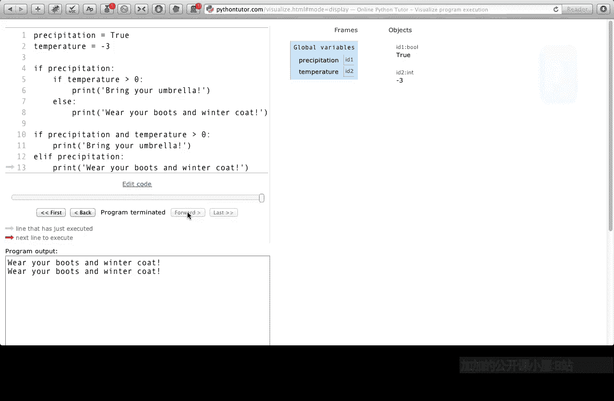

本节课中，我们一起学习了如何结构化 `if` 语句。我们通过两个例子探讨了 `if-elif` 结构与多个独立 `if` 语句的区别，并学习了如何使用逻辑运算符 `and` 来简化嵌套的 `if` 语句，以及如何将嵌套的 `if-else` 结构转换为等价的 `if-elif` 结构。理解这些不同结构的执行流程对于编写清晰、正确的条件判断代码至关重要。