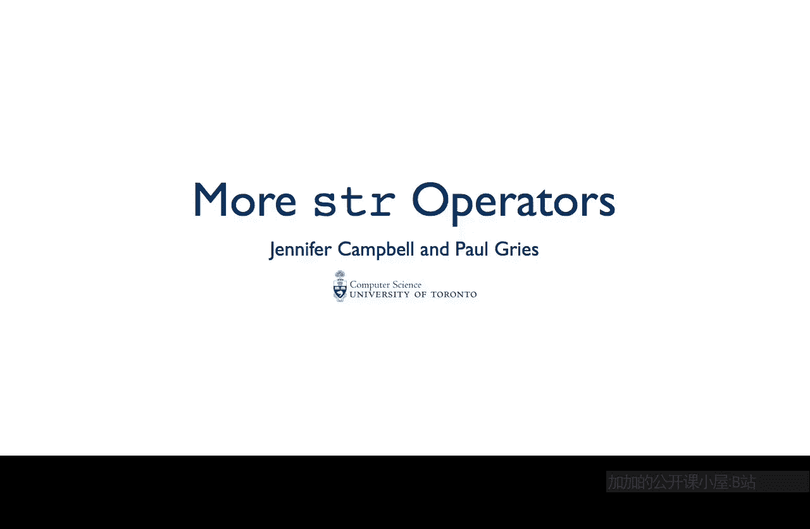
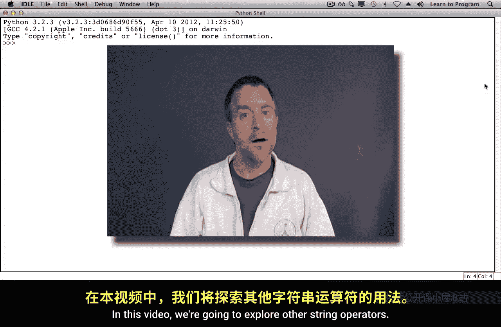
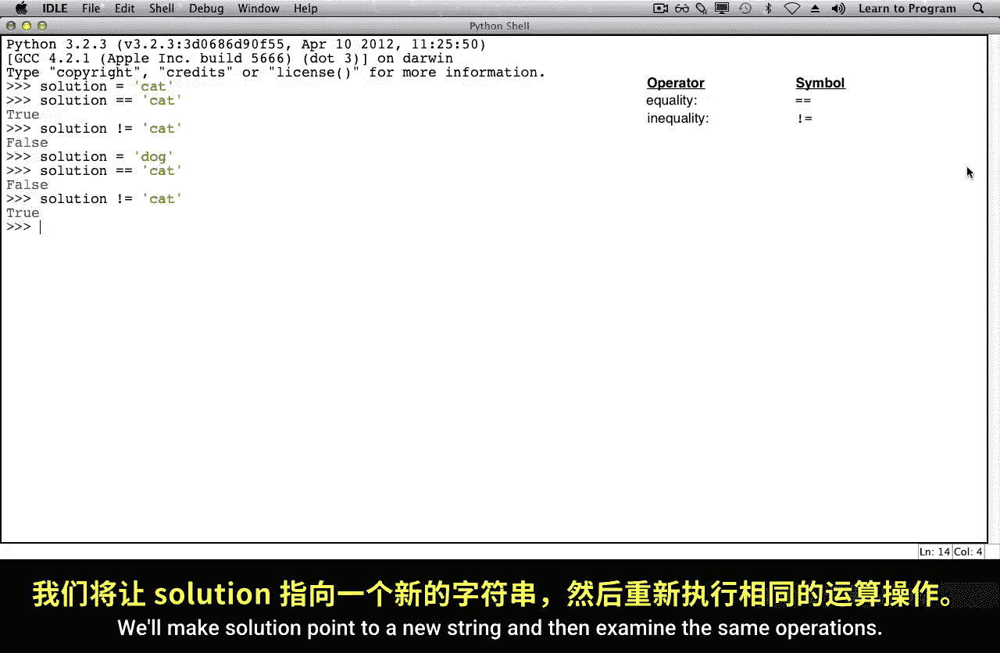
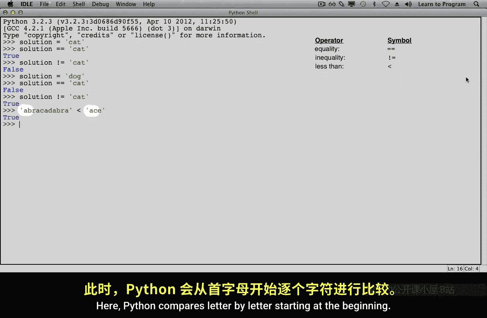
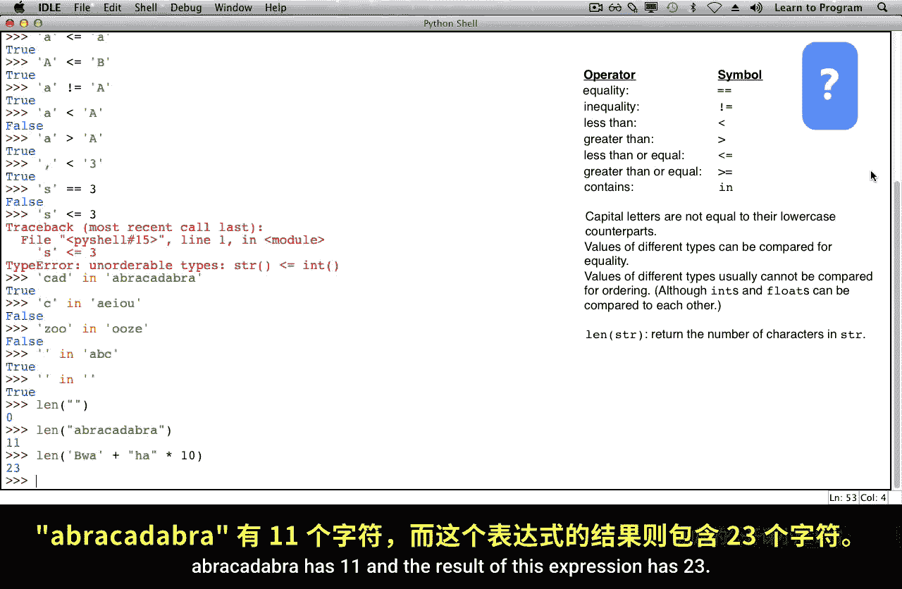

# 特伦托大学【中英⚡学习编程：基础知识｜Learn to Program： The Fundamentals】 p22 P22 01_更多字符串运算符 -BV1kQ11B5EWa_p22-

You've seen how to add two strings and how you can multiply a string by an int to repeat the string。

In this video， we're going to explore other string operators。

We assign CA to variable solution。Now， we use the two equal symbols to compare to see if solution refers to cat。

There is also a not equal operator that looks like this with an exclamation mark and the equal symbol。

Well make solution point to a new string and then examine the same operations。

We can compare two strings for their dictionary order。

Here， Python compares letter by letter， starting at the beginning。

That was the less than operator。 We also have a greater than operator。

We have operators less than a equal to and greater than a equal to as well。

 and we can compare capital letters。In fact， capitalization matters and capital letters are less than lower case letters。

Any letter that you can type can be compared。We can always compare two values of different types for equality and inequality。

 but we usually can't compare items of two different types for ordering。

Here is a new string operator。We can see if one string is inside another string， using in。Using this。

 we can check to see if C is a vowel。The order of the letters is important。 Zoo is not in woos。

We can ask if the empty string is in another string， and the answer is yes。 And also。

 the empty string is in itself。The last thing we'll discuss in this lecture is a function。

 not an operator。 Len takes in a string and tells you how many letters there are in it。

The empty string has0 characters。 Abercaddabra has 11， and the result of this expression has 23。

