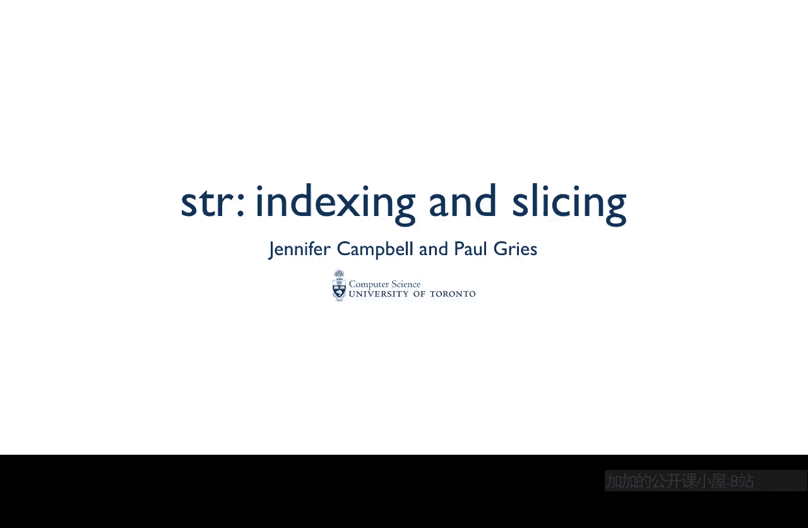
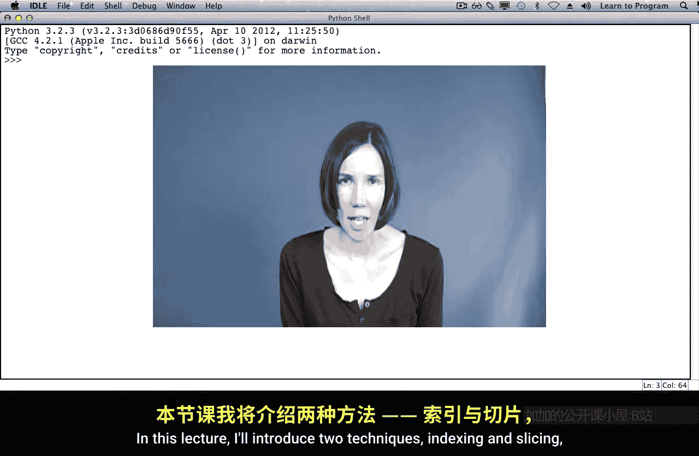
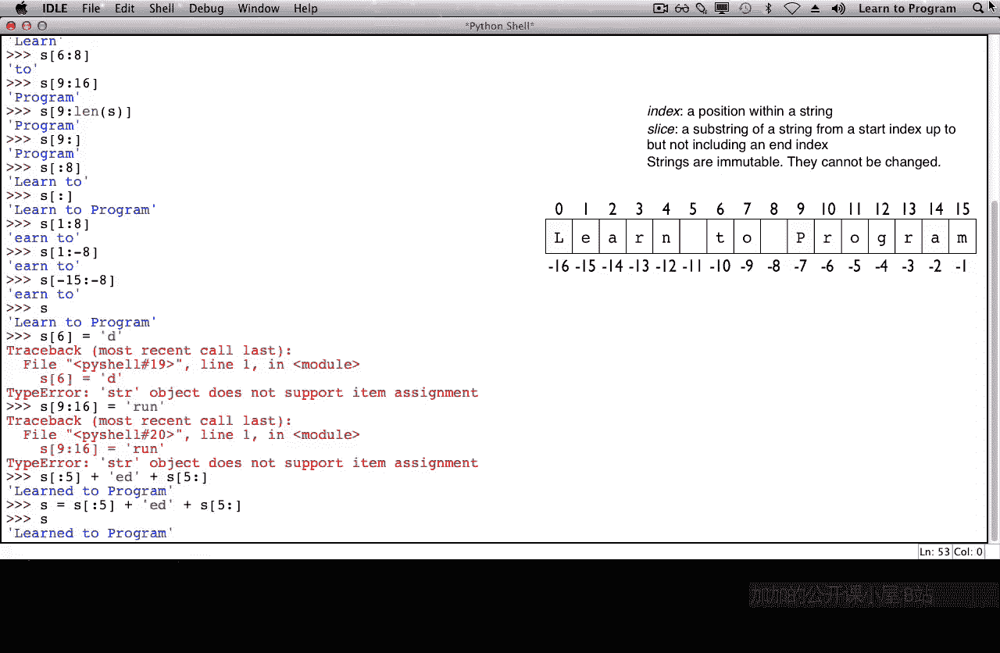

# 特伦托大学【中英⚡学习编程：基础知识｜Learn to Program： The Fundamentals】 p23 P23 03_字符串索引与切片 -BV1kQ11B5EWa_p23-

When working with strings， we often need to extract subs， for example。

 if a string contains a phone number， we may want to extract the area code。In this lecture。

 I'll introduce two techniques， indexing and slicing。

 and we'll use those to extract sub strings of the strings we're working with。

In this lecture， we'll use the string Learn to program as our running example。

Each character of a string has an index with which is its position in the string。

So the string at index0 indicated using this bracket notation is the L。At index one of the string。

We have an E。At index 2 is the first a。Notice that zero is the first position， not one。

 we start counting from zero。We can also use negative indices to count from the end or from the right hand side of the string。

 So the string at negative one is the M。At negative。2 is the last a。At negative3 is the R。

 the last R。So with we've seen using an index， we can extract parts of the string one character at a time。

But we can extract more than one character using another approach called slicing。With slicing。

 we provide a starting index， followed by a colon， followed by an end index。

 and that gives us a substr from the start index up to， but not including the ending index。

 For example， we can get the string from position 0， index 0， up to， but not including index 5。

 and that gives us a string learn。From index 6 up to， but not including8。Is the two。

And from index 9 up to 16 is the word program string program。16 is equal to the length of the string。

 so an alternative would be to start at index 9， but go up to L of s。

 L is a built in function that returns the length of the string。

 so this expression is equivalent to the one above。Another alternative would be to go from 9。

 put the colon and omit the ending index， in which case the default is to go to the end of the string。

 So this is also equivalent to the two expressions above。The starting index can also be omitted。

 so for example， we can include colon and go up to index 8。

We can also o both the starting and ending indices， and that gives the entire string。

We've seen that negative indices can be used for indexing and they can be used for slicing as well。

Let's get the substring from index 1 up to， but not including8。

An equivalent expression is to get it from one up to， but not including negative8。

Or to go from negative 15 up to， but not including negative 8。

 So those three expressions are all equivalent。The slicing and indexing operations do not modify the string that they act on。

 So the value that S refers to is unchanged by the operations above。In fact。

 we cannot change the value of a string。Operations like the following result in errors。

 If I take the string at index 6 and try and set it to D。I get an error Similarlyly。

 if I try to modify string from index 9 up to 16， and have it referred to。Run。An error also occurs。

But imagine that we'd like to change string S to refer to learned to program。

Here's one approach that we can take。We can use the current value of S and get the wordL。

Concatenate that with ED to make it learned。And concatenate that with the rest of the string。

Which is to program。That evaluates to give learn to program。

And now that we have this new string learned to program。

 we can have S refer to that instead of its old value。

Notice that we didn't modify the string that as originally referred to。 We can't modify it。 Instead。

 we created a new string and have as referred to that new string。

