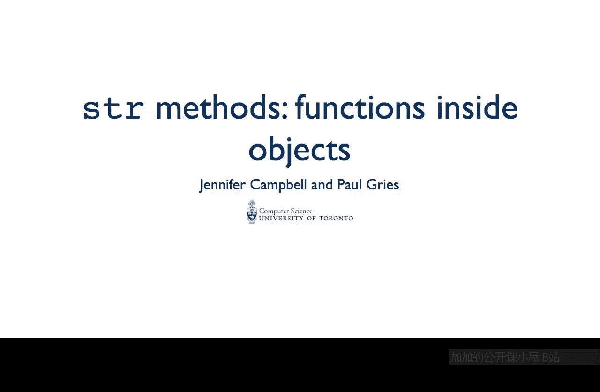
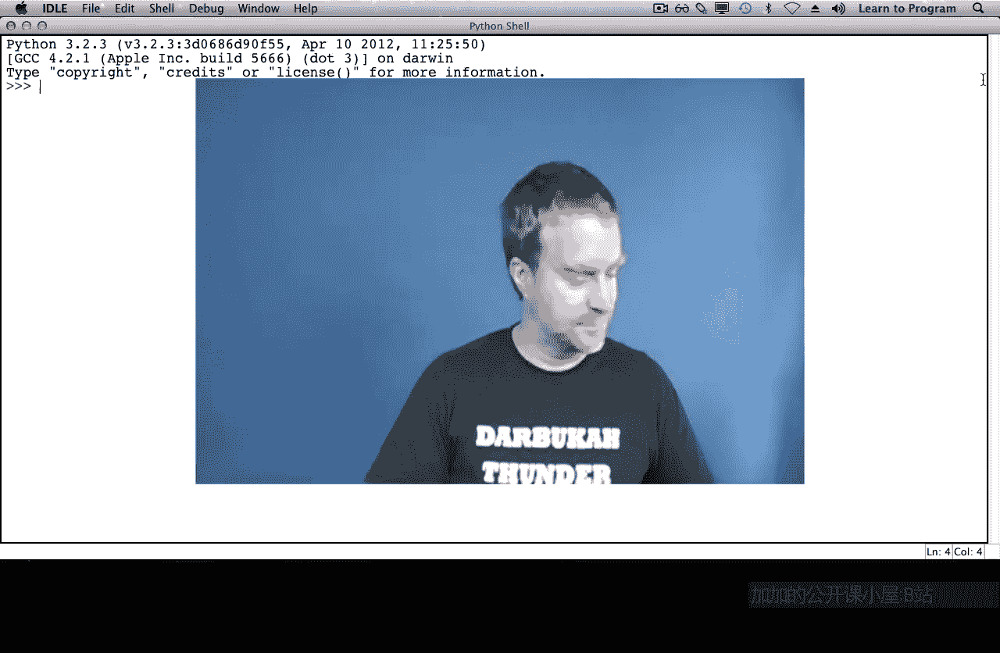
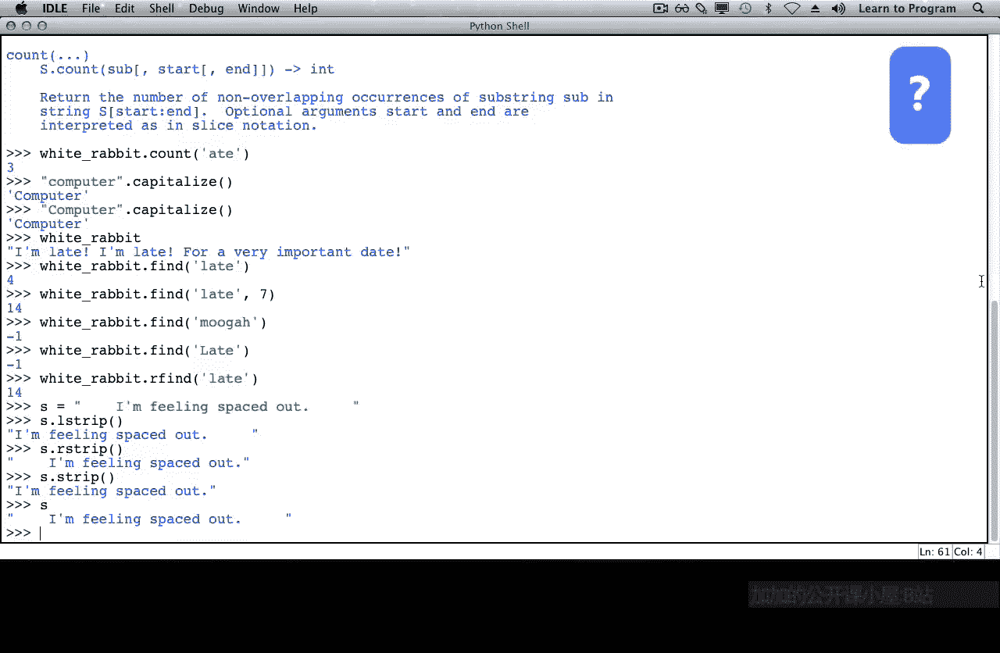

# 特伦托大学【中英⚡学习编程：基础知识｜Learn to Program： The Fundamentals】 p24 P24 05_字符串方法：对象内部的函数 -BV1kQ11B5EWa_p24-

So far， we have defined and used functions from within modules。 For example。

 module math contains functions that are related to math such as square root and factorial。

 It turns out that values， also known as objects can contain functions as well。

 Funs inside of objects are called methods。In this lecture， we'll explore string methods。

As a quick review to use a function that has been defined inside module math， we first import math。

 which creates a variable called math that refers to the module object that contains the various math functions。

 And then to call one of these functions， we use that math variable。

We will do the same kind of thing to call string methods。 Here is a quote from Louis Carroll's。

 Alice in Wonderland。We can get a new string that has all the uppercase letters replaced with their lower case equivalents by calling the lower method inside the white rabbit object。

This doesn't change the string that white rabbit refers to。 It produces a new string。

 So white rabbit still refers to the original string。

In order to find out which methods are available， we can endure。

We can get the same answer if we use type stir instead of variable white rabbit。

We can ask for help on any of them。Return a copy of the string S converted to lower case。

 Let's look at the help for string method， count。Returned the number of non overlapping occurrences of sub string sub in string S。

 starting an index start and going to index end。These square brackets indicate optional parameters。

 If I just say string do count with one argument。Then it'll just look everywhere in the string。

 Otherwise， it'll start an index start and go to index end。

We will use this to find out how many times the substring 8， A T E appears in the white rabbit。

We can get a copy of a string， with the first letter capitalized。

And if the string is already capitalized， we just get back a copy of it。

There is a method to find the index of the first occurrence of a string inside another string。

We can specify a starting index。 This asks for the first index of late that starts at or after index 7。

If the substr doesn't appear inside the string。-1 is returned。F is case sensitive。

There is an R find method that searches for the last occurrence。 Rfine stands for right find。Often。

 we want to remove spaces at the beginning or end of a string。Method L strip， or left strip。

Returns a new string， but with the white space at the beginning removed。

Method R strip operates at the right hand。If we would like to remove white space from both ends。

 we use the strip method。None of these modify the string the desk refers to。

 They all produce new strings。This is the end of our whirlwind tour of strings and string methods。

 We won't introduce every string method to you。 You can and should use dur and help to find out what other string methods exist。

