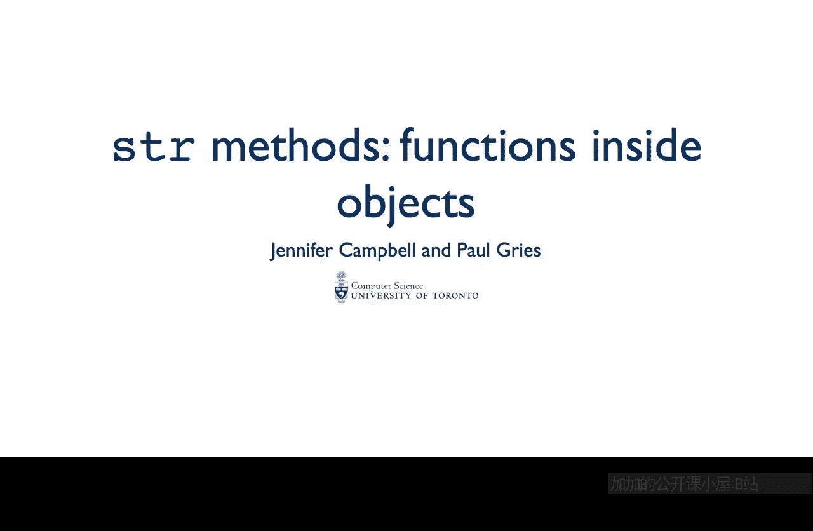
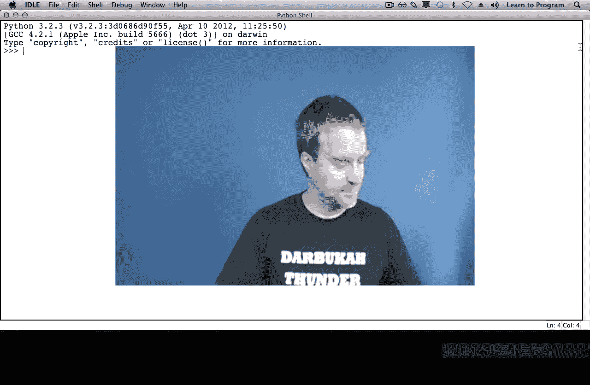
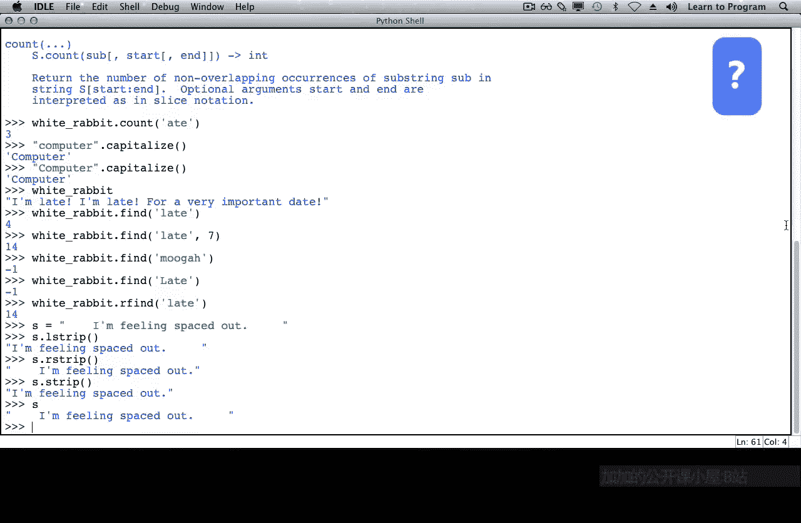

# 学习编程：基础知识：05_字符串方法：对象内部的函数 🧵



在本节课中，我们将要学习字符串方法。我们将了解什么是方法，它与之前学过的模块函数有何不同，并探索几个常用的字符串方法。

---

到目前为止，我们定义和使用的函数都来自模块。例如，`math`模块包含了与数学相关的函数，如平方根和阶乘。



实际上，值（也称为对象）内部也可以包含函数。对象内部的函数被称为**方法**。在本讲中，我们将探索字符串方法。

---

## 回顾模块函数

作为快速回顾，要使用定义在`math`模块中的函数，我们首先需要导入`math`。这会创建一个名为`math`的变量，它引用包含各种数学函数的模块对象。然后，我们使用这个`math`变量来调用其中的函数。

我们将使用类似的方式来调用字符串方法。

---

## 什么是字符串方法？

以下是一个来自路易斯·卡罗尔《爱丽丝梦游仙境》的引文：
```python
white_rabbit = 'I’m late, I’m late, I’m late!'
```

我们可以通过调用`white_rabbit`对象内部的`lower`方法，获得一个新字符串，其中所有大写字母都被替换为对应的小写字母。
```python
lowercase_rabbit = white_rabbit.lower()
```
这并不会改变`white_rabbit`所引用的字符串，而是**产生一个新的字符串**。因此，`white_rabbit`仍然指向原始字符串。

---

## 如何探索可用的方法？

为了找出有哪些方法可用，我们可以使用`dir()`函数。
```python
dir(white_rabbit)
```
如果我们使用`type(str)`而不是变量`white_rabbit`，也能得到相同的答案。

我们可以使用`help()`函数来获取任何方法的帮助信息。例如，查看`lower`方法的帮助：
```python
help(str.lower)
```
返回信息：“Return a copy of the string S converted to lower case.”

---

## 常用字符串方法示例

以下是几个核心字符串方法的介绍和使用示例。

### 1. `count` 方法
`count`方法返回子字符串在指定范围内出现的次数。
```python
help(str.count)
```
返回信息：“Return the number of non-overlapping occurrences of substring sub in string S, starting at index start and going to index end.”
方括号`[]`表示可选参数。如果只提供一个参数，它将在整个字符串中搜索。否则，它将从`start`索引开始，搜索到`end`索引。

我们可以用它来查找子字符串`'late'`在`white_rabbit`中出现了多少次。
```python
count_late = white_rabbit.count('late')
```

### 2. `capitalize` 方法
`capitalize`方法返回字符串的副本，并将首字母大写。
```python
capitalized = white_rabbit.capitalize()
```
如果字符串已经首字母大写，则直接返回其副本。

### 3. `find` 方法
`find`方法用于查找一个字符串在另一个字符串中**第一次**出现的索引。
```python
index = white_rabbit.find('late')
```
我们可以指定起始索引。下面的代码要求查找从索引7开始（或之后）的`'late'`的第一次出现位置。
```python
index = white_rabbit.find('late', 7)
```
如果子字符串不存在，则返回`-1`。`find`方法是**区分大小写**的。

### 4. `rfind` 方法
`rfind`方法用于搜索**最后一次**出现的位置。`rfind`代表“right find”。
```python
last_index = white_rabbit.rfind('late')
```

### 5. 去除空格的方法
通常，我们想要去除字符串开头或结尾的空格。
*   `lstrip`（左去除）方法返回一个新字符串，并移除开头的空白字符。
    ```python
    left_stripped = '   hello'.lstrip()
    ```
*   `rstrip`（右去除）方法在字符串的右端进行操作。
    ```python
    right_stripped = 'hello   '.rstrip()
    ```
*   如果想同时去除两端的空白字符，可以使用`strip`方法。
    ```python
    stripped = '   hello   '.strip()
    ```
**重要提示**：以上所有方法都不会修改原始字符串，它们都会**产生新的字符串**。

---

## 总结



本节课中，我们一起学习了字符串方法。我们了解到方法是对象内部的函数，并探索了`lower`、`count`、`capitalize`、`find`、`rfind`以及去除空格系列方法的使用。我们不会向你介绍每一个字符串方法，你可以并且应该使用`dir()`和`help()`来探索其他存在的字符串方法。这是我们对字符串和字符串方法的快速导览的结束。