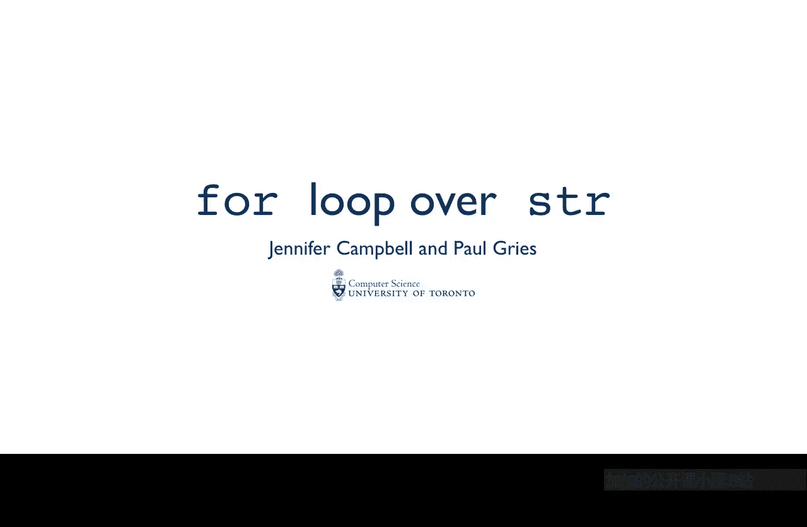
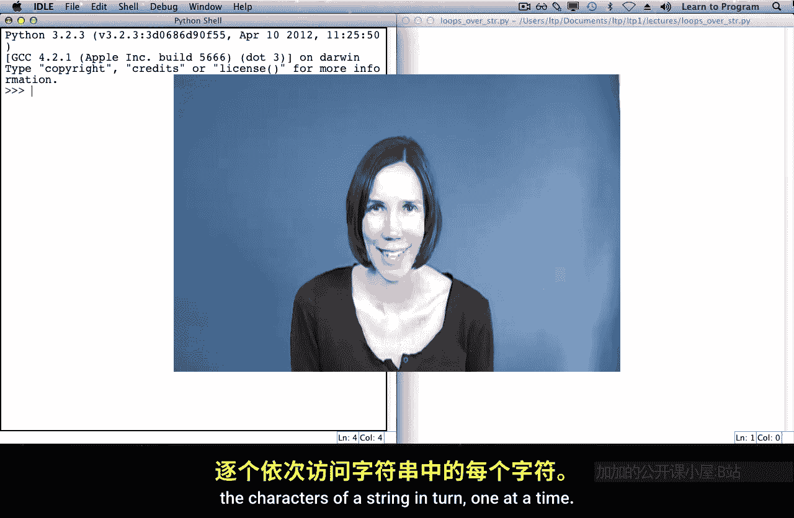
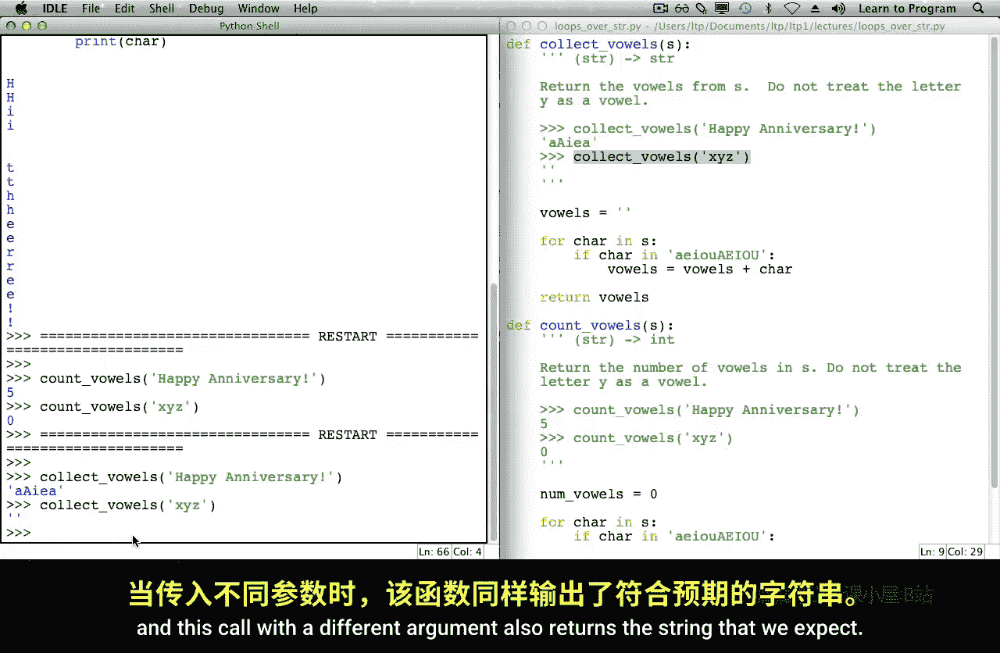
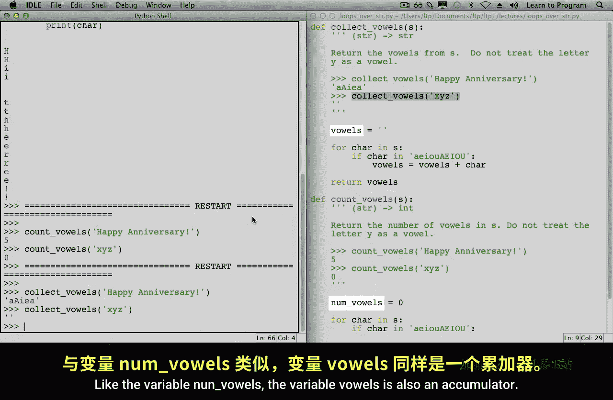
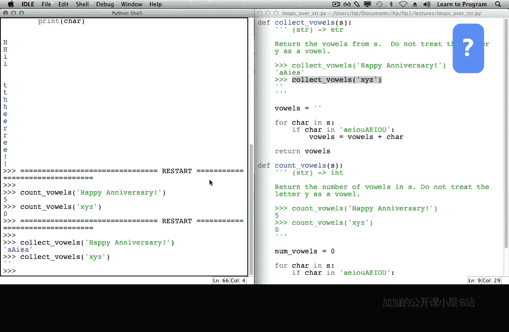

# 特伦托大学【中英⚡学习编程：基础知识｜Learn to Program： The Fundamentals】 p25 P25 07_遍历字符串的循环 -BV1kQ11B5EWa_p25-

Earlier， we saw that each character of a string has an index associated with it。

 and we learned how to access each character using its index。 In this lecture。

 we will use something called a for loop to access the characters of a string in turn， one at a time。

😊。

To begin， I'm going to make an example string hi there。

And we'll use this string in our first four loop where we're going to print each character of it one at a time。

Care， that variable CAR is short for character。And it's just a variable name。

The value of care will change as the loop executes。In the first iteration of the loop。

Care gets the value of S at position 0， which is H。And then H is printed。

Through the next iteration of the loop。Care's value changes。

 so care refers now to the characterposition one of S， which is I。And I is printed。

Through the third iteration of the loop。Care gets the value at position2 of S， which is a space。

 And so that space is printed。And this pattern continues until the end of the string is reached。

So each character of S is printed one at a time。Care is a variable name。

 We could have easily chosen something else。 For example， this is equivalent。Or banana in S。

Frennk banana。Of course， it's best to pick a meaningful variable name that indicates what it is that the variable represents。

Here's another for loop。In this loop， there are two print statements。

So the variable care is printed two times initially， through the first iteration of the loop。

 care gets the value H， and H is printed twice， Then care gets I。

 and I is printed twice and so on until the end of the stringing S is reached。

We will now use our for loop to solve a problem。 The first problem that we'll tackle is to count the number of vowels in a string。

I'm going to start by writing a couple of example function calls。

I'm going to name the function count vowels， and it will take a single string argument。

The first example uses happyappy anniversary as the argument， and in that case。

 count vowl should return five。The next string XY z doesn't contain any vowels。

 so this function should return zero。Let's add the type contract。There's one string parameter。

And the function returns an int。And now， let's write the function header。

The name of the function is count vowels。And it has one parameter。

 I'm going to name that parameter as。And the job of this function is to return the number of vowels in us。

You may have noticed from the example function calls that we are not including Y。

 so I need to add that to my description， do not treat the letter Y。按这个好了。

Now we can write the body of the function。Before we write this code。

 I want to start by thinking about how we determined what the response of the example function call should be。

What I did was examine each character of the string one at a time， beginning with the H。

 So I looked at the H and decided it was not a vowel， but that A is。 So I kept track of that。

Then I looked at P， PY space and encountered another vowel。And， N I is another one， V E。

And R S then another A， that's5 R， Y exclamation mark。

So looking character by character at the string， we see that there are five vowels。

We will model our program after the approach that we just took。

So we want to keep track of the number of vowels that we've seen so far。And initially。

 we've seen zero vowels。So I'm going to use numb vowels to keep track。We pass over the string。

 examining one character at a time， and we can do this using a for loop。 So for each character in S。

 we want to check to see whether that character is a vowel or not。

I can use an if statement to check that condition。So if the character appears in the string AEIOU lowercase。

 and AEIOU uppercase， then it is a vowel。And in that case。

 we want to increment the value of nu vowels。So none vowels will get its current value。Plus， one。

After this loop has finished executing， and we've passed over each character of the string。

Numb vowels will contain the total number of vowels in us， and that is the value that we will return。

Let's stop for a moment and think about this assignment statement。

Notice on the right hand side of the assignment statement。

 the expression involves the variable nu vowels。Imagine that the nun vowel's assignment statement that occurred outside the loop was not there。

When we hit this assignment statement and look up the value of non vowels， a name error would occur。

So that assignment statement that we used initially to initialize nubels to zero is crucially important。

Okay。Now let's run this code， checking our example calls。So we will first。

Run the module and then in the shell， call count vowels with H anniversary， we get five。And with X。

 Y， Z， we get zero。The variable nu vowels is an accumulator because it accumulates information。

 It has an initial value of 0， and its value goes up by one whenever a vowel is found。

The loop ends after every letter in S has been examined， and all vowels have been counted。

Accumulators are not necessarily numeric， as we'll see in the next problem。

Our next task is to return a string containing all of the vowels in a given string。

I'm going to start with example calls again。And we can use the same examples as we did in our previous function。

So this function's name will be collect vowels because we are going to accumulate them in a string。

And given the string happy anniversary。This should return a string with the letters， lowercase A。

 uppercase A， Ie， lowercase A again。In the case where there are no vowels in the string。

 it should return the empty string。 So it's just an open quotation mark， closed quotation mark。

The type contract， this takes a string parameter and returns a string。And the name of the function。

 as we've seen， is collect vowels。The name of the parameter again， I will use the name S。

And the job of this function is to return the vowels from S。

Why isn't treated as a vowel in this case either。Like we did with count vowels。

 I want to start by considering how we solve this problem when we were determining what the example function call should return。

I examined each character of the string one at a time。 So looking first at the H and then the A。

 and whenever I encountered a vowel， I kept track of that。 So I have an A。P， PY space。

 and then another A。So I want it。Keep track that I've got those two。N， N， I。And so on。

So I look through the string character by character， and when I find that an aval。

 I add it to the set of characters that I've seen so far。Let's implement this function now。

Like before we need to accumulate some information。 before it was an integer。 This time。

 we want to accumulate some information in a string。

 So I'll use the variable vowels to refer to a string。 and that string will initially be empty。

 We haven't seen any vowels so far。We're going to examine the string as character by character。

 using a for loop。And we want to check to see whether that character is a owl using the exact same approach that we did the first time。

If the character is a vowel， I want to add it to the set of vowels that I've seen so far。

 So my vowel's variable will refer to its original value。 plus the character that we've just seen。

 I'm using this concatenation operator to add the character to the current string of vowels。

At the end of the function， once the for loop is finished executing and each character from the string has been examined。

Vowels will refer to a string containing each of the vowels from S。

 and that is what will be returned。We need to test the function， so we will run the module。

And then call the example function calls in the shell。

Collect vowels returns this string that we expect。And this call with a different argument。

Also returns the string that we expect。

Like the variable nu vowels， the variable vowels is also an accumulator。

 as it is accumulating a string over the course of the functions execution。

 like nu vowels that started at 0 and grew， vowels starts out as empty and also grows。

