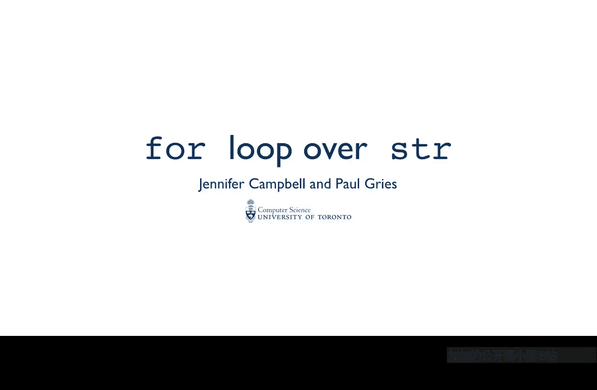
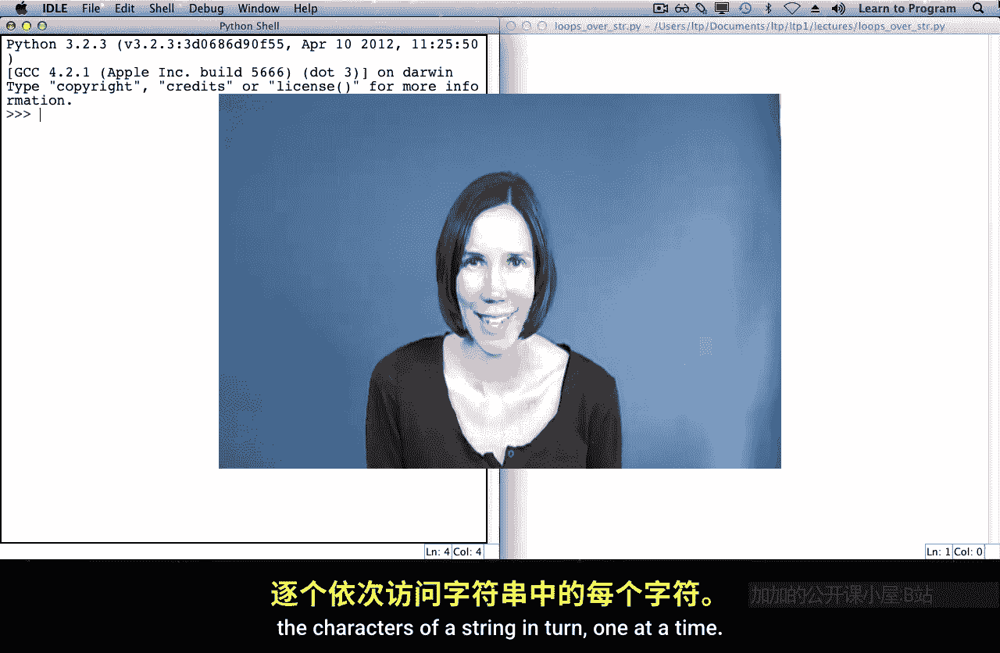
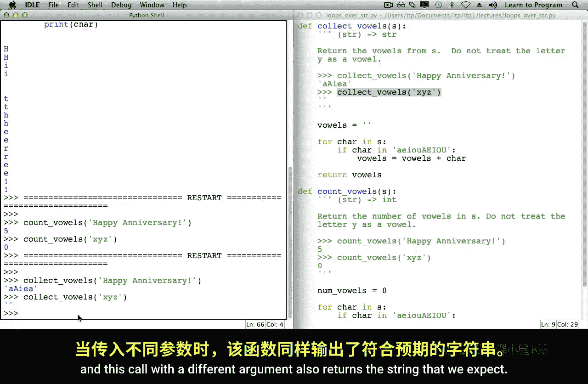
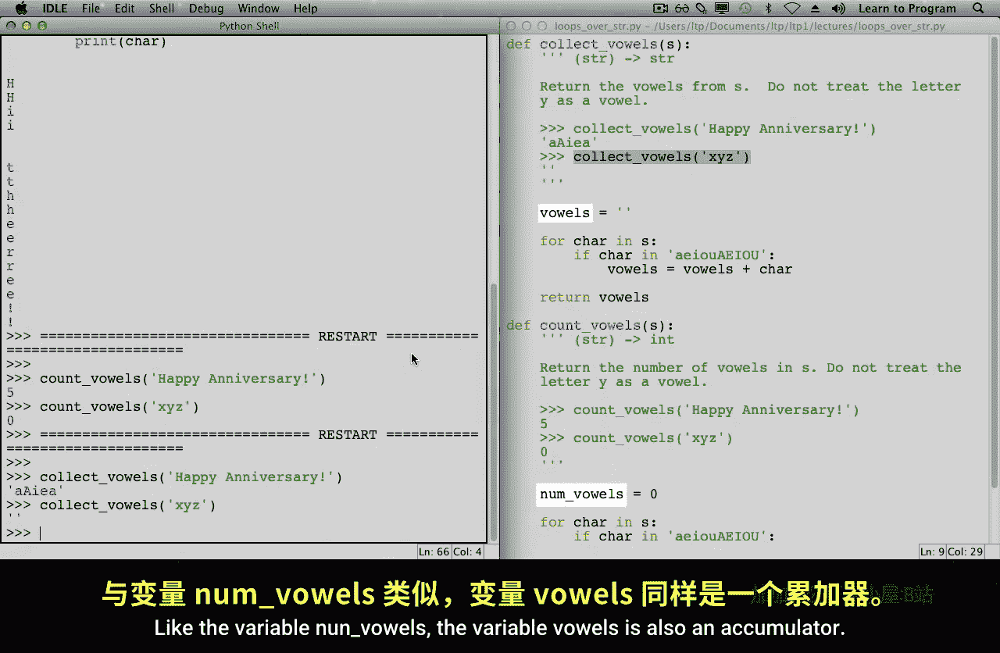
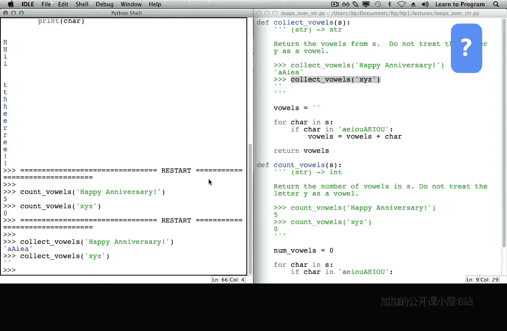

# 编程基础：07：遍历字符串的循环 🔄



在本节课中，我们将要学习如何使用 `for` 循环来遍历字符串中的每一个字符。我们将通过两个具体的编程问题——统计字符串中的元音字母数量以及收集字符串中的所有元音字母——来深入理解循环和累加器的概念。



---

## 字符串索引回顾 📍

之前我们了解到，字符串中的每个字符都有一个与之关联的索引，并且我们学习了如何使用索引来访问每个字符。

在本节中，我们将使用一种叫做 `for` 循环的结构，来依次访问字符串中的每一个字符。

---

## `for` 循环基础

首先，我们创建一个示例字符串 `hi there`。我们将使用这个字符串来编写第一个 `for` 循环，该循环将逐个打印字符串中的每个字符。

```python
s = "hi there"
for char in s:
    print(char)
```

变量 `char` 是 `character` 的缩写，它只是一个变量名。随着循环的执行，`char` 的值会改变。

在循环的第一次迭代中，`char` 获得 `s` 在位置 0 的值，即 `H`，然后打印 `H`。
在循环的下一次迭代中，`char` 的值变为 `s` 在位置 1 的字符，即 `I`，然后打印 `I`。
在第三次迭代中，`char` 获得 `s` 在位置 2 的值，即一个空格，然后打印该空格。
这个模式会持续进行，直到到达字符串的末尾。因此，`s` 中的每个字符都会被逐个打印出来。

`char` 是一个变量名，我们可以轻松地选择其他名称。例如，下面的代码是等效的：

```python
for banana in s:
    print(banana)
```

当然，最好选择一个有意义的变量名，以表明该变量所代表的内容。

---

## 循环内的多个操作

下面是另一个 `for` 循环的例子。在这个循环中，有两个 `print` 语句。

```python
for char in s:
    print(char)
    print(char)
```

在循环的第一次迭代中，`char` 获得值 `H`，然后 `H` 被打印两次。接着 `char` 获得 `I`，`I` 被打印两次，依此类推，直到到达字符串 `s` 的末尾。

---

## 应用：统计元音字母数量 🧮

现在，我们将使用 `for` 循环来解决一个问题。我们要解决的第一个问题是统计字符串中元音字母的数量。

首先，我们编写几个示例函数调用。我们将函数命名为 `count_vowels`，它接受一个字符串参数。

```python
# 示例调用
count_vowels("Happy Anniversary!")  # 应返回 5
count_vowels("xyz")                 # 应返回 0
```

接下来，我们添加类型约定：函数接受一个字符串参数，并返回一个整数。

```python
def count_vowels(s: str) -> int:
    """返回字符串 s 中的元音字母数量。不将字母 Y 视为元音。"""
```

在编写函数体之前，我们先思考一下如何确定示例调用的结果。我们逐个检查字符串中的每个字符，从 `H` 开始，判断它是否是元音，并记录结果。

我们将按照这个思路来编写程序。我们需要一个变量来跟踪到目前为止看到的元音数量。初始时，我们看到了 0 个元音。

```python
def count_vowels(s: str) -> int:
    """返回字符串 s 中的元音字母数量。不将字母 Y 视为元音。"""
    num_vowels = 0  # 初始化累加器
    for char in s:
        if char in "aeiouAEIOU":
            num_vowels = num_vowels + 1  # 发现元音，累加器加一
    return num_vowels
```

让我们暂停一下，思考这个赋值语句。注意，赋值语句右侧的表达式涉及变量 `num_vowels`。如果循环外没有初始化 `num_vowels = 0` 的语句，当执行到这个赋值语句并查找 `num_vowels` 的值时，就会发生名称错误。因此，这个初始化语句至关重要。

现在，让我们运行这段代码来检查我们的示例调用。

```python
# 测试
print(count_vowels("Happy Anniversary!"))  # 输出: 5
print(count_vowels("xyz"))                 # 输出: 0
```

变量 `num_vowels` 是一个**累加器**，因为它累积信息。它的初始值为 0，每当发现一个元音时，它的值就增加 1。循环在检查完 `s` 中的每个字母并统计完所有元音后结束。

---

## 应用：收集元音字母 📝

我们的下一个任务是返回一个包含给定字符串中所有元音字母的字符串。

我们再次从示例调用开始。可以使用与上一个函数相同的例子。

```python
# 示例调用
collect_vowels("Happy Anniversary!")  # 应返回 "aAiea"
collect_vowels("xyz")                 # 应返回 ""
```

类型约定：该函数接受一个字符串参数，并返回一个字符串。

```python
def collect_vowels(s: str) -> str:
    """返回字符串 s 中的所有元音字母。不将字母 Y 视为元音。"""
```

与 `count_vowels` 类似，我们通过逐个检查字符串中的字符来解决这个问题。每当我们遇到一个元音，就将其记录下来。

这次，我们需要在一个字符串中累积信息。因此，我将使用变量 `vowels` 来引用一个字符串，该字符串初始为空，因为我们还没有看到任何元音。

```python
def collect_vowels(s: str) -> str:
    """返回字符串 s 中的所有元音字母。不将字母 Y 视为元音。"""
    vowels = ""  # 初始化字符串累加器
    for char in s:
        if char in "aeiouAEIOU":
            vowels = vowels + char  # 发现元音，将其连接到累加字符串
    return vowels
```

在函数结束时，一旦 `for` 循环执行完毕，并且检查了字符串中的每个字符，`vowels` 将引用一个包含 `s` 中所有元音字母的字符串，这就是要返回的值。

现在，我们来测试这个函数。

```python
# 测试
print(collect_vowels("Happy Anniversary!"))  # 输出: "aAiea"
print(collect_vowels("xyz"))                 # 输出: ""
```

与变量 `num_vowels` 一样，变量 `vowels` 也是一个**累加器**，它在函数执行过程中累积一个字符串。就像 `num_vowels` 从 0 开始增长一样，`vowels` 从空字符串开始，也在不断增长。

---



## 总结 📚

本节课中，我们一起学习了如何使用 `for` 循环来遍历字符串中的每个字符。我们通过两个实例深入理解了循环的工作原理：
1.  **统计元音数量**：我们使用一个整数累加器 `num_vowels`，在循环中遇到元音时将其值加一。
2.  **收集元音字母**：我们使用一个字符串累加器 `vowels`，在循环中将遇到的每个元音字符连接到字符串末尾。





关键概念在于**累加器**模式：初始化一个变量（如 `0` 或 `""`），在循环中根据条件更新它，最后返回其值。这是编程中处理序列数据（如字符串）的常用且强大的技术。