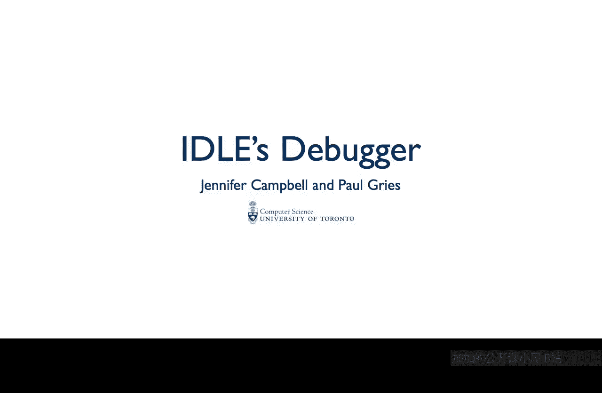
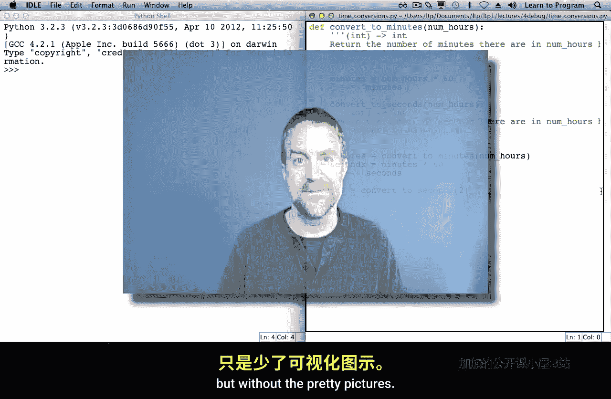
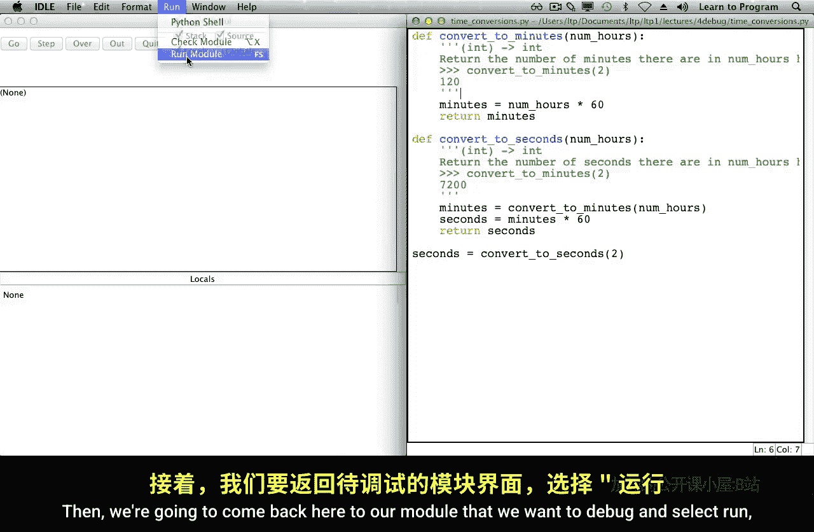
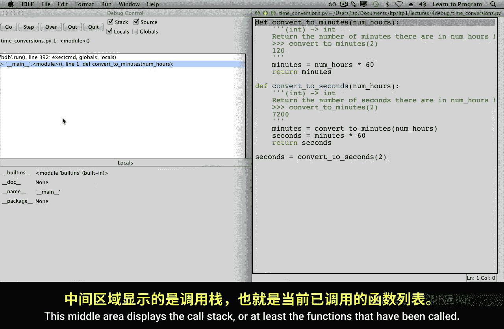
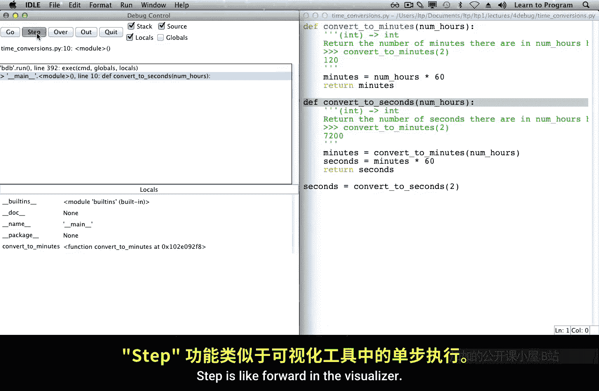
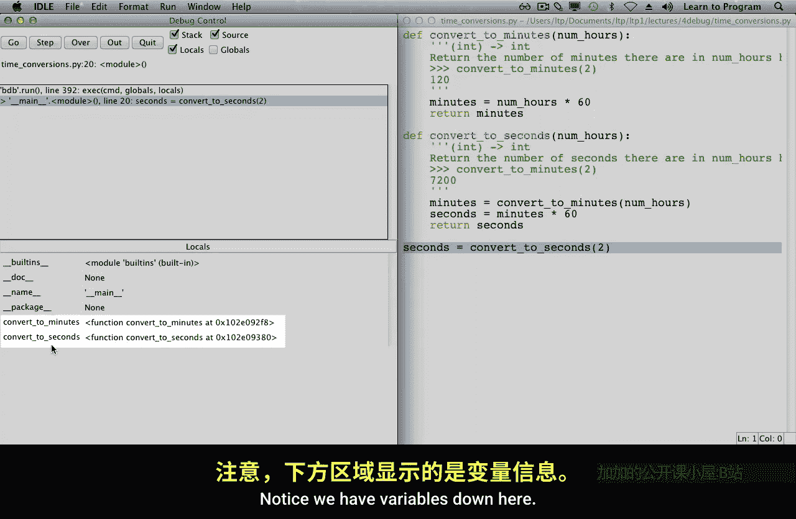
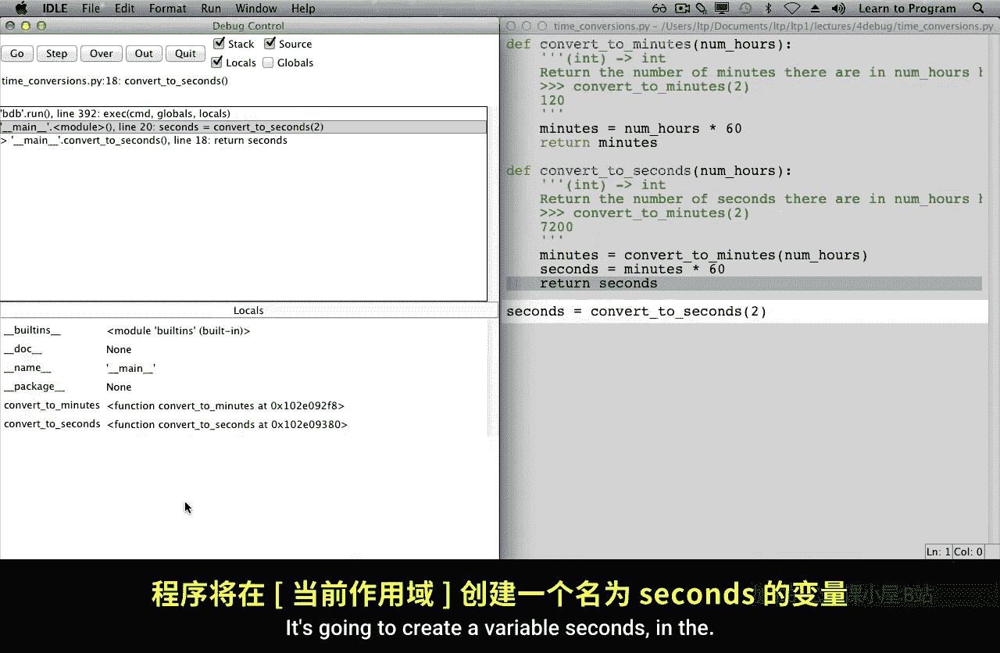
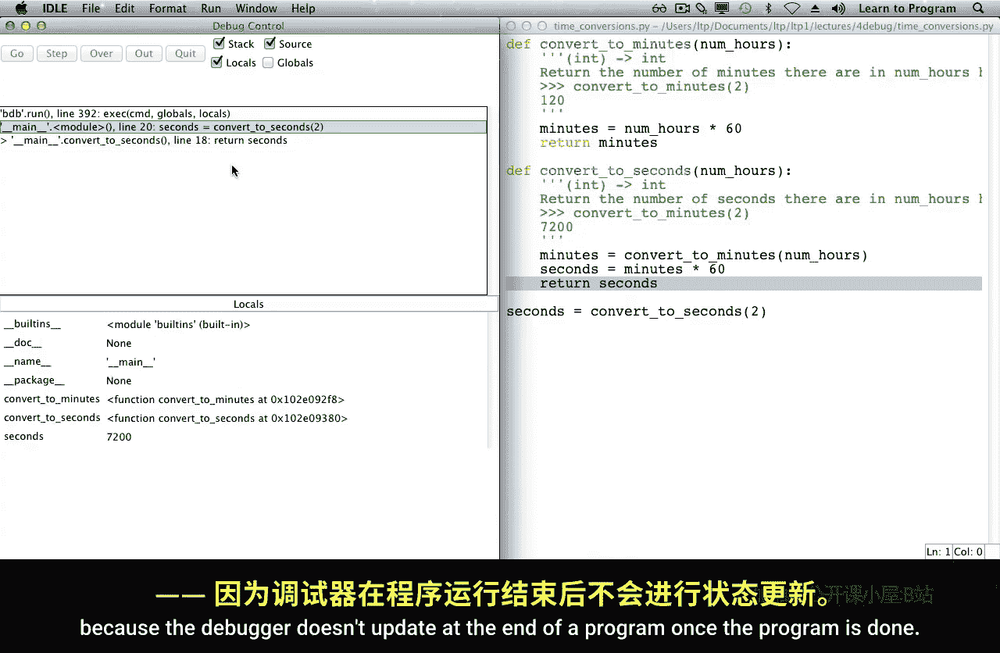

# 特伦托大学【中英⚡学习编程：基础知识｜Learn to Program： The Fundamentals】 p26 P26 01_闲置调试器 -BV1kQ11B5EWa_p26-

The Python visualizer has limitations。 It does not allow import statements。

 and it stops tracing after 500 steps。Idle comes with a debugger。

 which is a tool much like the visualizer， but without the pretty pictures。

Here we see functions convert to minutes and convert to seconds。

 which we explored in last week's lectures。To run this in idle's debugger。

 we're going to make sure that the Python shell window is on top and then select debug debugger。

This opens a window called debug control。I am now going to to resize this so that we can see everything as we execute。

We're going to check the checkbox for source。Then we're going to come back here to our module that we want to debug and select run。

乱麻做。This middle area displays the call stack， or at least the functions that have been called。

And here are the variables inside the current call。Notice that the variable for built ins is there。

 as are three other variables that we haven't discussed yet in this course。

Step is like forward in the visualizer。

Well definer two functions， notice we have variables down here for them， referring to functions。

 this right there， that's a memory address。

You'll notice it has letters in it， that's because it's base 16。

 which uses in a lot of programming the numbers 0 through 9， plus the letters A，B，C， D， E。

 and F for a total of 16 characters。Over here， we see there's a gray highlight on the current line。

And line 20 happens to be that line。 So we' are told here which line is being executed When we step。

 we're going to do the function call to convert to seconds。

We only have parameter nu hours available so far inside convert to seconds。

 If we want to see the variables in the module， we can just click there and that switches the view for the locals pane。

 the local variables。We'll go back to convert to seconds and step into the call to convert to minutes。

We now have three items on the call stack involved in our program。

Let's step one more line to define our variable Min。 Minutes is now 120。Just to check。

 we're going to go back to the frame for convert to seconds and notice that it only has one variable numb hours。

 The reason is， we haven't finished this call to convert to minutes。

 And so this variable minutes has not yet been created。

I'm going to switch the view back to the top frame。 And when I step。

 it's actually just going to execute the return statement all at once。

 including popping the frame from the stack。We don't get to see the return value before the return happens。

So we're back and convert to seconds， we're about to evaluate 120 times 60 and assign the result to seconds。

There we go，7200， and we're going to return 7200。Back to。This call to convert to seconds。

 and it's going to create a variable seconds in the stack frame for the main module。

 Swing our view back and clicking step causes our programme to end because。

This was the last statement in the program。 Let's switch back to there and notice that we do have a variable seconds that's been created。

So it's a little confusing at the end of a program。

 because if I'm on a return statement and that return statement is inside a function that is on the last instruction that gets executed。

 the program will end and this stack frame won't be removed because the debugger doesn't update at the end of a program once the program is done。

