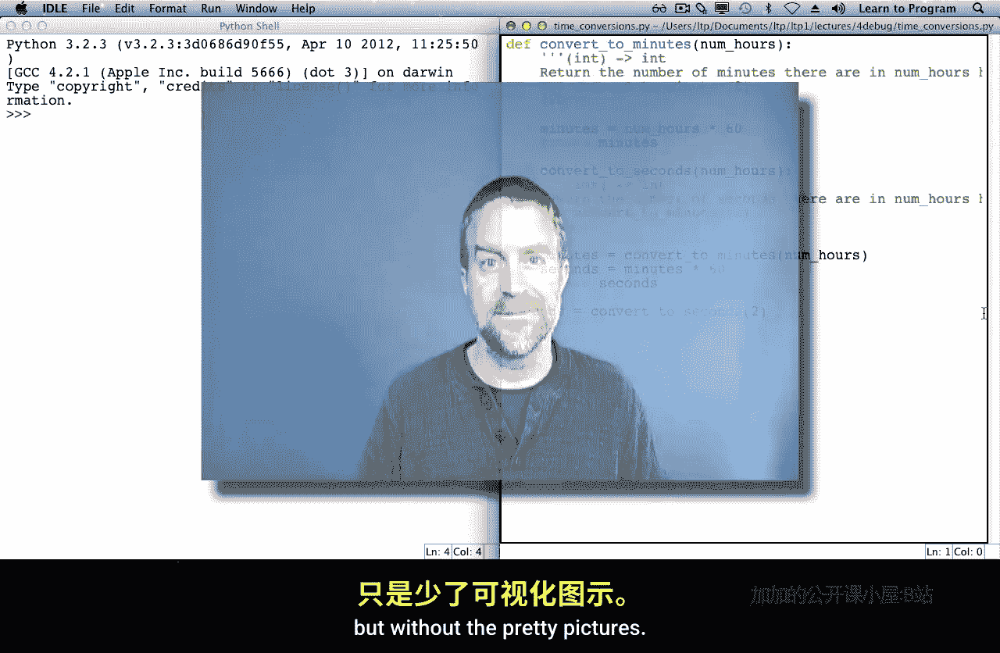
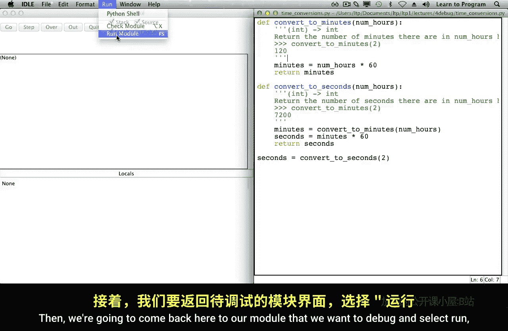
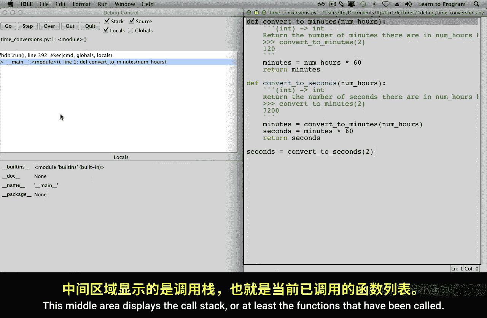
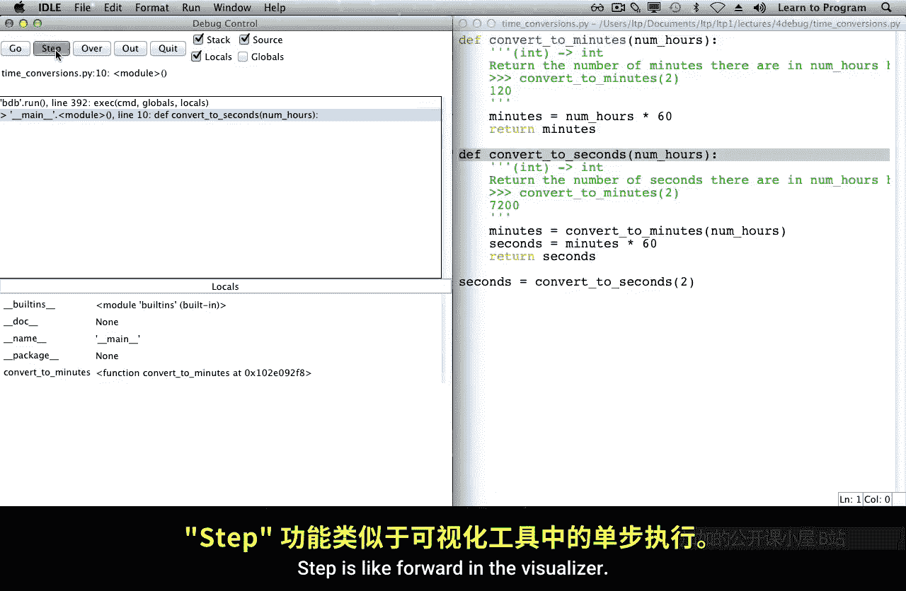
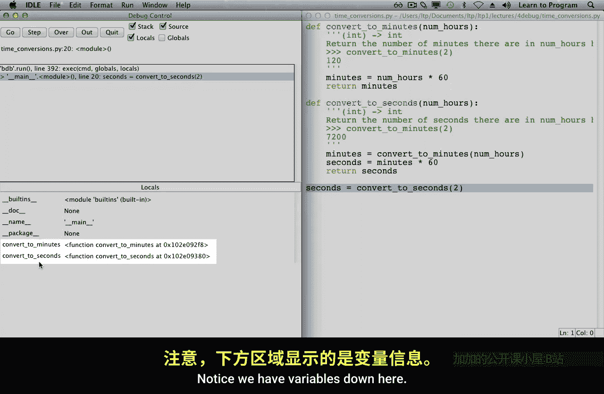
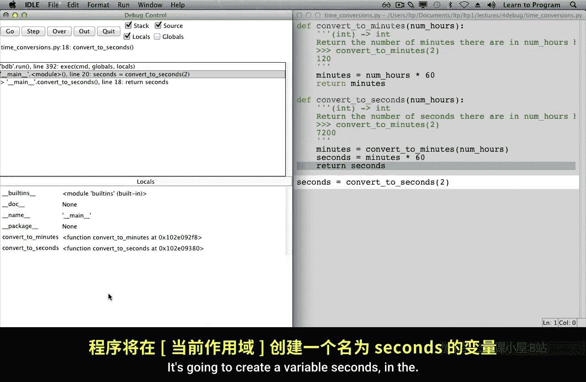
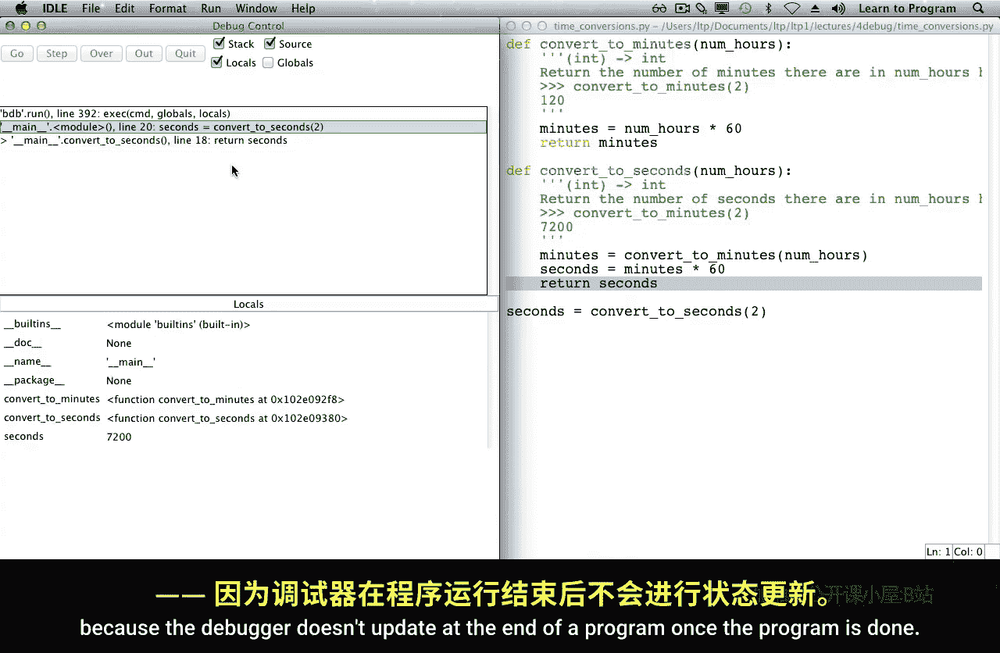

# 学习编程：基础知识：P26：IDLE调试器使用指南 🔧

在本节课中，我们将学习如何使用Python IDLE自带的调试器。调试器是一个类似于Python可视化工具的程序执行跟踪工具，但它不依赖图形界面，功能更强大，尤其适合处理更复杂的代码或当可视化工具无法使用时。

上一节我们介绍了Python可视化工具的局限性。本节中我们来看看IDLE内置的调试器如何帮助我们理解和跟踪代码的执行过程。

## Python可视化工具的局限性

Python可视化工具存在一些限制。
它不允许使用`import`语句。
并且它在执行500步后会停止跟踪。

## 启动IDLE调试器

IDLE自带一个调试器。
这是一个非常类似可视化工具的工具，但没有漂亮的图形界面。

这里我们看到两个函数：`convert_to_minutes`和`convert_to_seconds`，我们在上周的课程中探讨过它们。
要在IDLE的调试器中运行此代码，我们需要确保Python Shell窗口在最前面，然后选择 **Debug** -> **Debugger**。

这会打开一个名为“Debug Control”的窗口。
我现在将调整这个窗口的大小，以便在执行时能看到所有内容。

我们将勾选 **Source** 复选框。
然后我们将回到要调试的模块，并选择 **Run** -> **Run Module**。

## 理解调试器界面

调试器启动后，程序会暂停在第一条可执行语句前。

以下是调试器“Debug Control”窗口的主要区域介绍：

中间区域显示调用堆栈，或者至少是已被调用的函数。

这里是当前调用内部的变量。
注意，`__builtins__`变量在那里，还有三个我们在本课程中尚未讨论的其他变量。

**Step**按钮类似于可视化工具中的“Forward”（前进）按钮。

## 逐步执行代码

我们定义了两个函数，注意下方有对应的变量指向这些函数对象。
这个值（例如`0x000001F1D6C12F70`）是一个内存地址。

你会注意到地址中包含字母，这是因为它是十六进制（base 16）。
在编程中广泛使用十六进制，它使用数字0到9，加上字母A、B、C、D、E和F，总共16个字符。

在代码编辑器中，当前要执行的行会有一个灰色高亮显示。
第20行恰好就是那一行。因此，调试器在这里告诉我们哪一行即将被执行。

当我们点击 **Step** 时，我们将执行对`convert_to_seconds`的函数调用。

## 跟踪函数调用与变量

目前，在`convert_to_seconds`函数内部，我们只有参数`num_hours`可用。
如果我们想查看模块级别的变量，只需在“Debug Control”窗口的堆栈区域点击“__main__”，这将切换“Locals”窗格（局部变量）的视图。

我们回到`convert_to_seconds`的帧，然后**Step Into**进入对`convert_to_minutes`的调用。

现在，调用堆栈上有三个与我们的程序相关的项目。

让我们再执行一行来定义变量`mins`。现在`minutes`的值是120。
为了验证，我们回到`convert_to_seconds`的帧，注意它只有一个变量`numb_hours`。
原因是，我们还没有完成这次对`convert_to_minutes`的调用，因此变量`minutes`尚未被创建。

我将视图切换回最顶层的帧（`convert_to_minutes`）。当我点击 **Step** 时，它将一次性执行`return`语句，包括从堆栈中弹出该函数的帧。在返回发生之前，我们看不到返回值。

## 完成计算并返回

所以我们回到了`convert_to_seconds`中，我们即将计算`120 * 60`并将结果赋值给`seconds`。
执行完毕，`seconds`的值是7200，然后我们将返回7200。

回到主模块中对`convert_to_seconds`的调用，它将在主模块的堆栈帧中创建一个变量`seconds`。
将视图切换回主模块帧，点击 **Step** 会导致我们的程序结束。

因为这是程序中的最后一条语句。
让我们切换回那里，注意我们确实有一个变量`seconds`被创建了。

## 关于程序结束时的注意事项

在程序结束时可能会有点令人困惑。
因为如果我位于一个`return`语句上，并且该`return`语句位于一个函数内部，而这个函数执行的是最后一条指令，那么程序将会结束。
并且这个堆栈帧不会被移除，因为一旦程序执行完毕，调试器在程序结束时不会更新显示。

## 核心操作与概念

以下是调试过程中的核心操作：

*   **Step**：执行当前行，并前进到下一行。如果当前行包含函数调用，**Step**会进入该函数。
*   **Step Over**：执行当前行。如果当前行是函数调用，则一次性执行完整个函数，不会进入函数内部。
*   **Go**：继续执行程序，直到遇到断点或程序结束。
*   **Quit**：停止调试并终止程序。

以下是调试器界面中显示的关键信息：

*   **调用堆栈 (Call Stack)**：显示当前正在执行的函数及其调用链。
*   **局部变量 (Locals)**：显示当前函数帧中的所有局部变量及其值。
*   **全局变量 (Globals)**：显示模块级别的全局变量。
*   **源代码高亮**：在编辑器中高亮显示即将执行的代码行。

## 总结

本节课中我们一起学习了如何使用IDLE内置的调试器。我们了解了如何启动调试器，逐步执行代码，观察调用堆栈的变化，以及查看不同作用域下的变量值。调试器是一个强大的工具，可以帮助你深入理解程序执行流程，定位逻辑错误。记住，**调试的核心思想是让程序“慢下来”，让你能够仔细观察每一步的状态变化**。多加练习，你就能熟练运用它来分析和修复代码。