# 特伦托大学【中英⚡学习编程：基础知识｜Learn to Program： The Fundamentals】 p27 P27 01_While循环 -BV1kQ11B5EWa_p27-

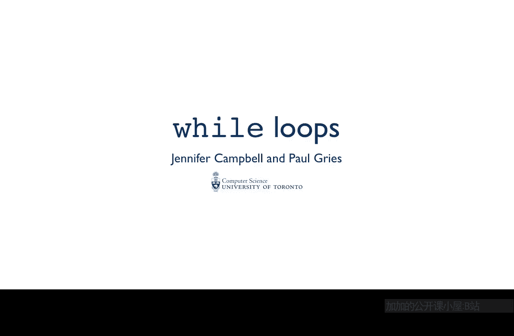

In an earlier lecture， we used a for loop to loop over each character of a string。

But what if we don't want to loop over every character？

Perhaps we only want to loop until a vowel is encountered。

Or maybe we don't want to work with strings at all。 For example。

 we may want to repeat a task until the user enters a particular value。In this lecture。

 we're going to use while loops to accomplish these tasks。

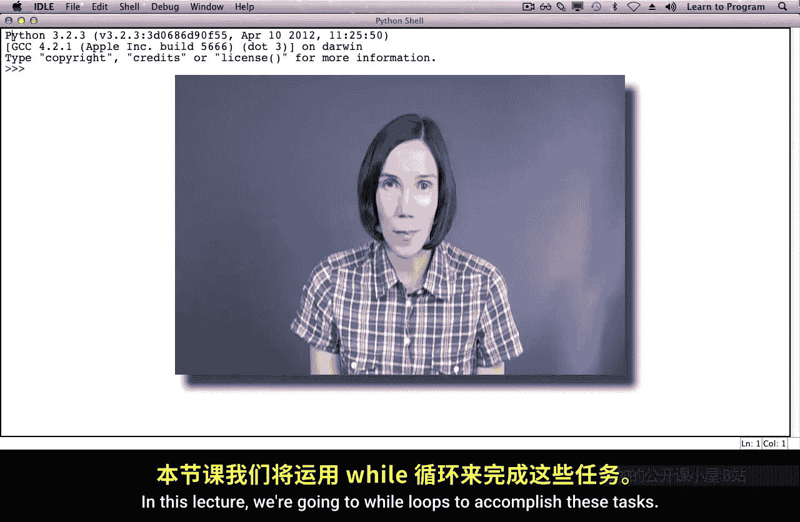

To begin， let's recall the general form of an if statement。

An if statement relies on a brilliant expression。 When that expression is true。

 the body of the if statement is executed。If the bullolean expression is false。

 then the program proceeds on to statements that follow the if without executing its body。Yeah。

A while loop has a similar form to an if statement。 It also relies on a Boolean expression。

 And if the Boolean expression is true， the while loop body is executed。However， unlike the if。

 the while loop continues at this point and will check the bullolean expression another time。

 If the loop condition is true， then the body of the while loop is executed again。

 and this process repeats until the loop condition becomes false。

The first example of a while loop involves a variable nuum。 Num gets the value， too。

The while loop will continue to execute as long as numb is less than 100。In the body of the loop。

 numb is doubled。And none is printed。With numb having an initial value of two。

 this while loop executes six times。 nuum gets 4，8，1632，64， and eventually 1，28。 At that point。

 the while loop condition is false。Now， if none gets valued 10 and we rerun this while loop。

It only takes four iterations for the while loop condition to become false。So by four iterations。

 I mean the body of the loop executes four times。At that point。

 nu refers to the value 160 and the loop condition is false。

If at this point we rerun this while loop。The body never is executed because the loop condition is false from the beginning。

Now， let's address up the problem that I mentioned earlier。

 which is to loop over the characters of a string until a vowel is encountered。First。

 let's recall how we looped over string using a for loop。

We use the for loop with for character in string S。And I'm just going to print that character。

When we wrote this loop。The character had the initial value of the string S at position 0。

 then S at 1， and so on until the end of the string was reached。When we write our while loop。

 we need to specify those indices。 So I will begin by creating a variable I that gets the value 0。

 and that will represent the first index of the string over which we'd like to loop。Now。

 the while loop condition， we want to keep going until we encounter a vowel。

 So as long as the string at position I is not a vowel。

So as long as it isn't in this set of lowercase AEIOU and uppercase AE IOU。

Then we will enter into the body of the loop and execute the loop body。In the loop。

 I will print that character， the string at position I。Before we can exit the while loop。

 we need to advance the index， so Is value must increase。I will get the value of I plus 1。

 So we move on to the next character of the string。In this case。

 the while loop executes once because the character at 0 is not a vowel。

 And then the second time the while loop condition is checked。

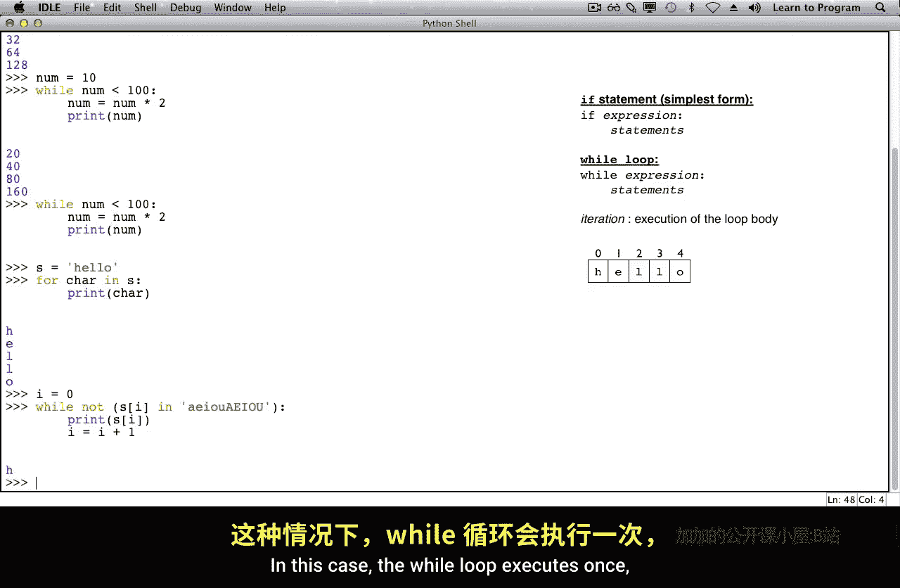

Set 1 refers to E， which is a substring of the string of vowels。

 So the while loop condition is false， and the while loop exits。

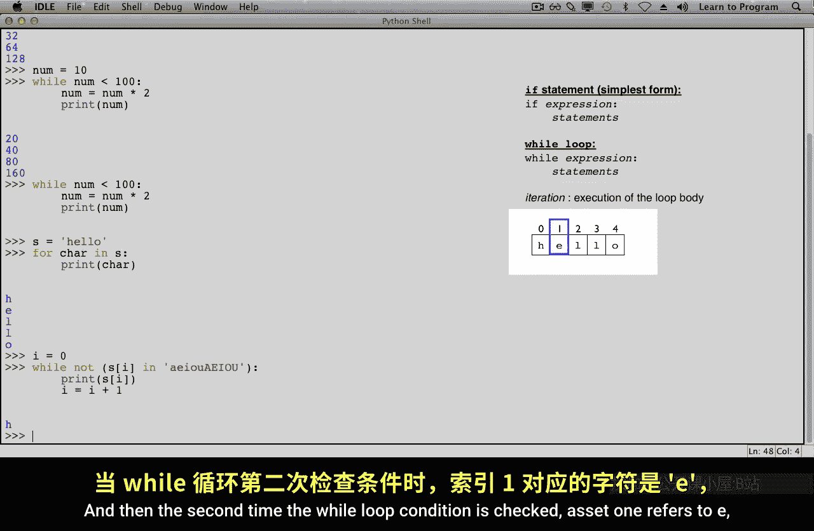

Let's execute the same loop this time using the string there。

Setting I to 0 once again and now executing the wild loop。This time。

 the while loop body executes twice。

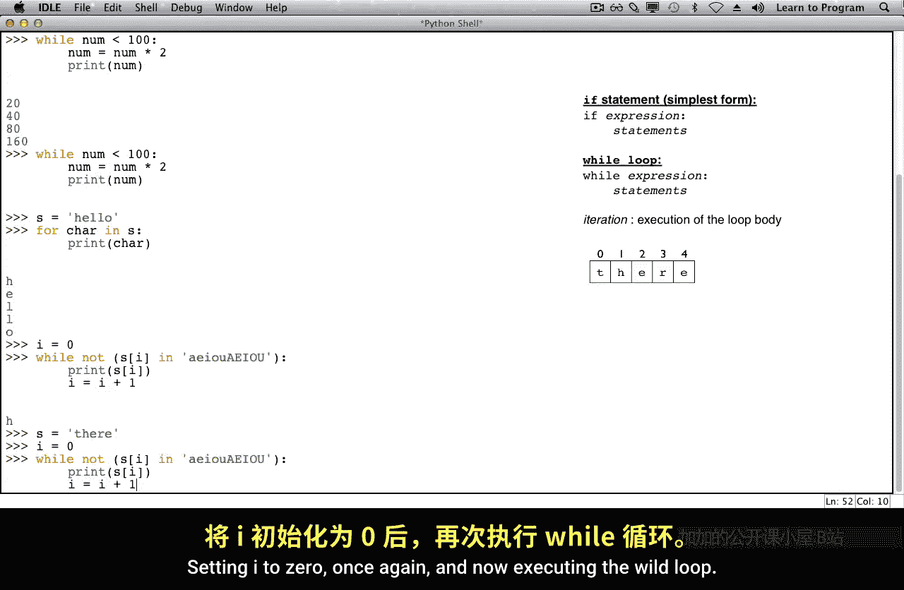

Once for the consonant T， a second time for the consonant H， and then the E is encountered。

 So the while loop condition is false， and the loop exits。

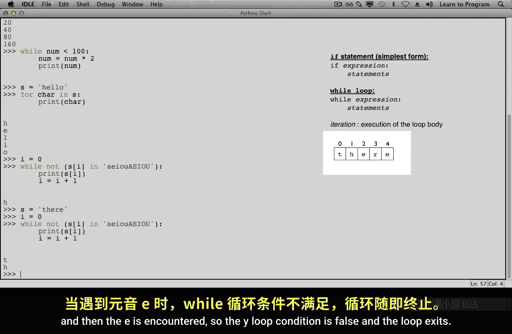

What happens if there are only consonants in our string？Okay。

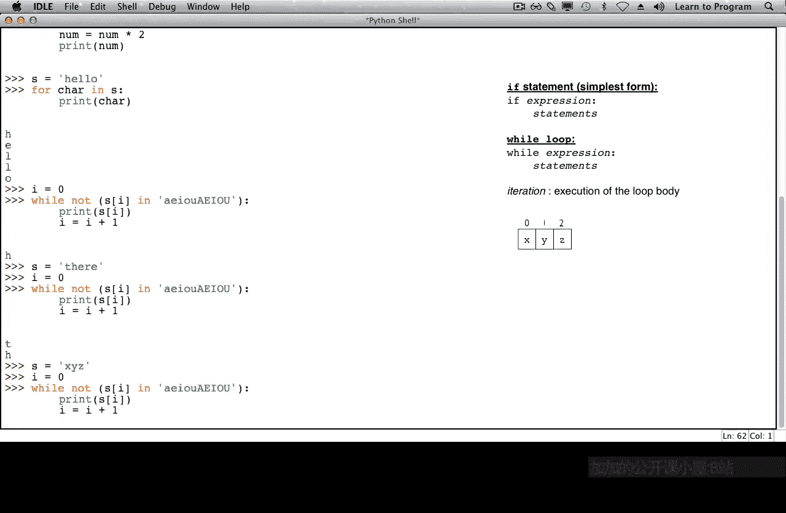

In this case， the three continents are displayed， and then an index error occurs。

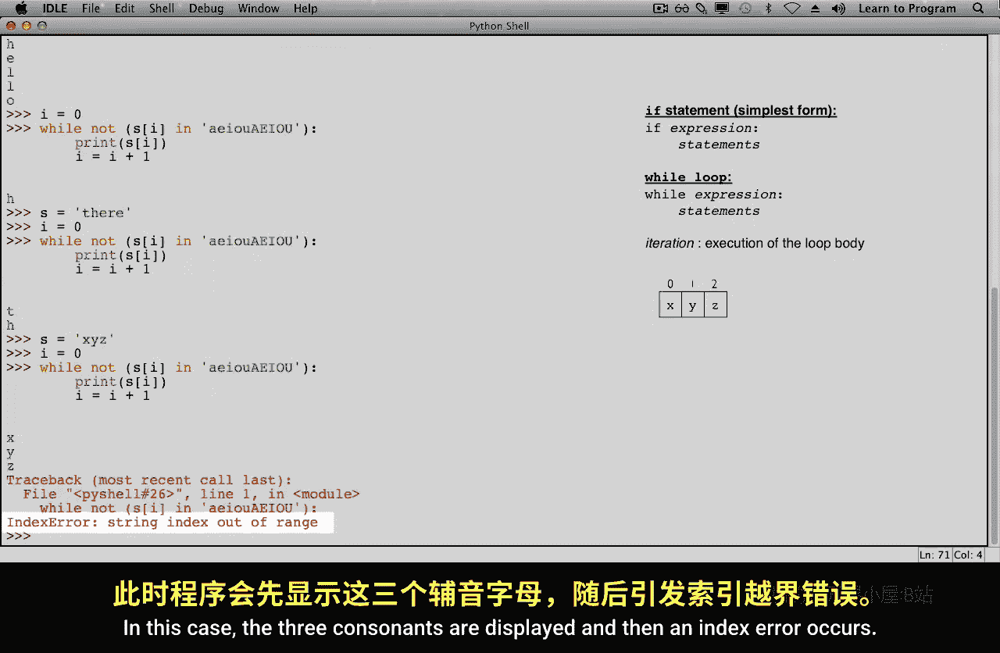

S of 0 refers to the x。 S of1 refers to the Y， and S of 2 refers to the Z。

But the current value of I is 3， and S at 3 is not a legal position。

 It's not a valid index for stringing S。 So an index error occurs。

 We haven't specified when to stop examining the characters of S。

 And so we've hit the end of the string and have tried to access an index that does not exist。

To prevent this， we need to add a second part to our brilliantan condition。

 which is to check that I is within the bounds of the string to make sure that it is less than the length。

Let's do that。 Now。 We will give I the value 0。 S gets string X， Y， Z。

 and now we execute the while loop before we execute it， though。

 we're going to first check to make sure that I is less than the length of the string。

 and then we will check to see whether S and I is a substr of the string of vowels。

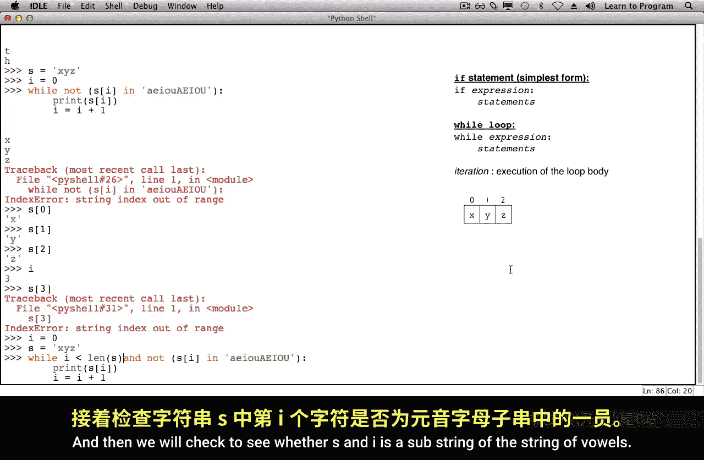

Notice that I put this condition first， we want to make sure that we check whether eye is less than the length before trying to access the string at position I。

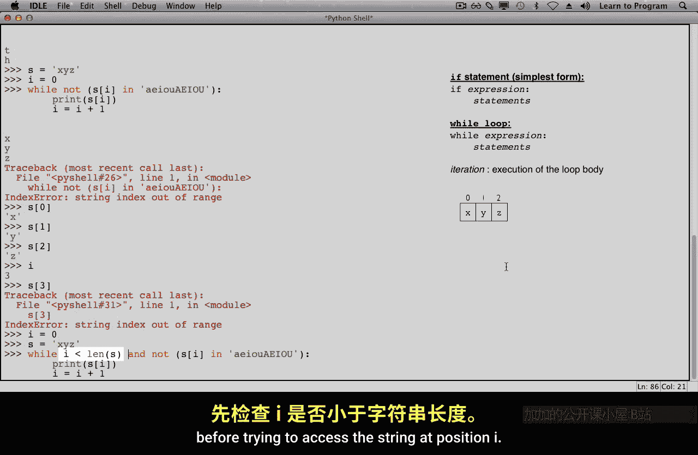

Python performs lazy evaluation of its and operation。 So if the first operaand to an and is false。

 the second is not evaluated。 That means that if I is not less than the length of the string。

 then this and is bound to be false at that point， and we won't try to access the string at position I。

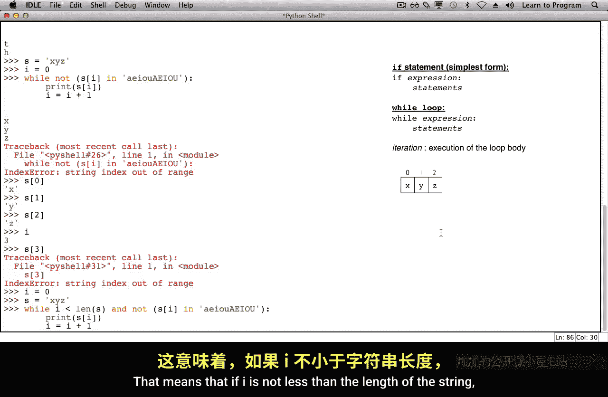

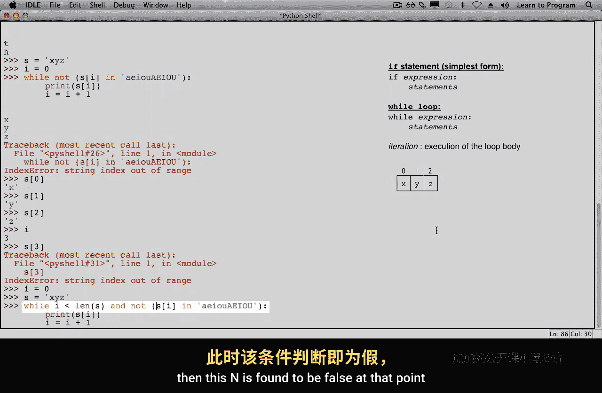

So in this case， the three consonants are displayed。

 and at that point the condition that I is less than the length of the string is false and the loop exits。

Let's use some of the ideas from this while loop for another problem。

The function up to vowel is what we will implement。 It has one string parameter。

 and it will return a string。It's going to return a substr of the string parameter S from index 0 up to。

 but not including the first vowel。So rather than print the way we did in our example in the shell。

 we want to accumulate the substr and return it。We'll use the accumulator pattern that we saw earlier to solve this problem。

The variable before vowel will initially refer to an empty string。

 and we will accumulate the string to be returned。In before vowel。

The wild loop that we are going to use is the exact same one that we wrote earlier。

 We want to loop over the characters of the string。

 starting at position 0 until we encounter a oel or until the end of the string is reached。

Inside the body of the loop， we want to add to the before vowel accumulator。

 So before vowel will get its current value。 plus the character。

 which is the character position I of string S。We need to increment the index。

 adding one to it so that we can then move on to the next character。And at the end of this function。

 the sub stringing is returned。So before vowel will be returned。Let's run this code， now。

And call the function from the shell。For the first function call， we expect to get H。

For the second one， where there is the argument， T， H should be returned。And in the third example。

 which contains only character， only consonants， not no vowels， the entire string is returned。

Let's implement one more function。The name of this function is get answer。

And this function will prompt the user with a question， asking for a yes or no answer。

The user will provide the answer， and we want to continue prompting them until the answer they enter is yes or no。

 So it may take one try or 10 or 100 tries before the user enters the right answer。At the end。

 we will return the answer that the user entered。Let's implement this function beginning with the prompt。

 So we want to call input。Using the prompt past as an argument to get answer。

And store the result in the answer variable。Let's specify the condition now under which we want to repro the user。

 So the body of the while loop is going to be a duplicate of the code from above。 is a single。

 the single line of code that prompts the user with that question。

We would like to keep prompting them when the answer is not the one we're looking for。

 So if the answer。Is yes or no， we would stop。And when the answer is not yes or no。

The loop needs to continue。At the end of the while Lou， once it has finished executing。

 the answer is returned。You may have noticed that I didn't include any example calls in the do string。

That's because the execution of this function is reliant upon the user input。

 And I can't predict what the function will return because it depends on what the user enters。

 Let's run this。 though。 now to check to see its perform that it's performing as expected。

Call and get answer， I'll pass a prompt。And were prompted with the question。If I answer maybe。

 where we prompted， say it's late。 we get prompted again。Not really。We get prompted again oops。

Finally， if I enter， yes， yes， is returned by the function。😊，Let's try that。 one more time。嗯。

This time， I'm going to answer no right away。 So the body of the while loop won't be executed because the while loop condition will be false the very first time that it is checked。

No is returned by the function in this case。

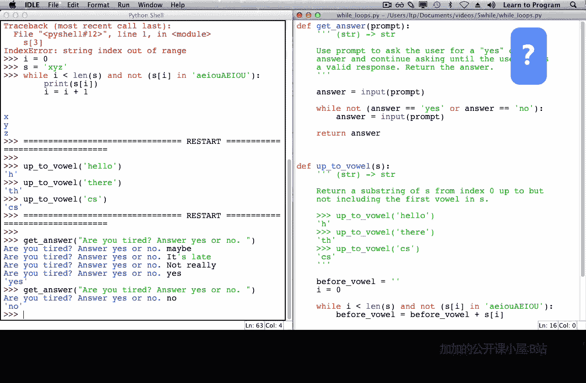