# 学习编程：基础知识：P27：While循环 🌀

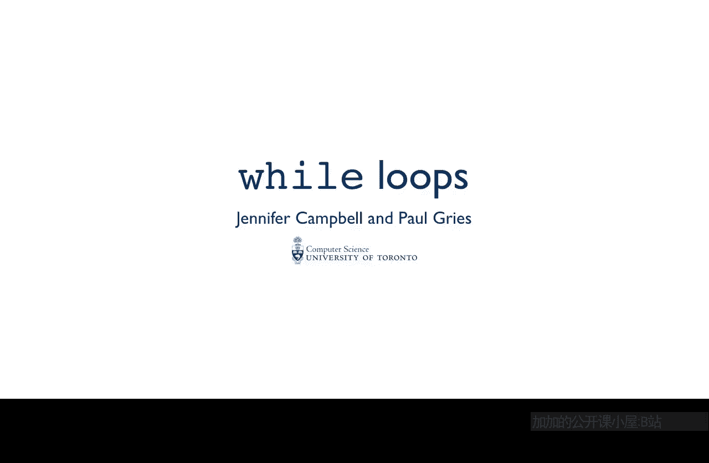

在本节课中，我们将要学习一种新的循环结构——`while`循环。与之前学过的`for`循环不同，`while`循环允许我们根据一个条件来重复执行代码块，而不是遍历一个固定的序列。这使得它在处理不确定次数的循环时非常有用。

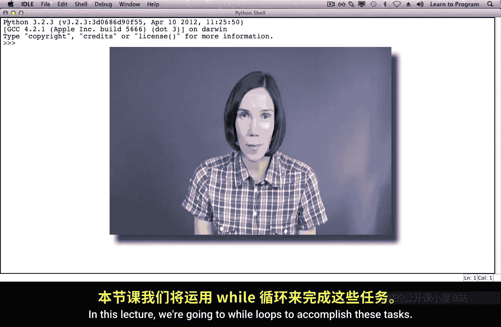

## 从`if`语句到`while`循环

上一节我们介绍了`for`循环，本节中我们来看看`while`循环。首先，让我们回顾一下`if`语句的一般形式。

一个`if`语句依赖于一个布尔表达式。当该表达式为真时，`if`语句的主体被执行。如果布尔表达式为假，则程序跳过`if`语句的主体，继续执行后面的语句。

`while`循环的形式与`if`语句相似。它同样依赖于一个布尔表达式。如果布尔表达式为真，`while`循环的主体就会被执行。然而，与`if`不同的是，`while`循环在执行完主体后，会再次检查布尔表达式。如果循环条件仍然为真，那么`while`循环的主体将再次执行。这个过程会一直重复，直到循环条件变为假。

## `while`循环的基本示例

让我们通过一个简单的例子来理解`while`循环的工作原理。

```python
num = 2
while num < 100:
    num = num * 2
    print(num)
```

在这个例子中，变量`num`的初始值是2。只要`num`小于100，`while`循环就会继续执行。在循环体内，`num`的值会翻倍并被打印出来。因此，这个循环会执行六次，`num`的值依次变为4、8、16、32、64，最终变为128。此时，`num < 100`的条件变为假，循环停止。

如果`num`的初始值是10，那么循环体只会执行四次（`num`变为20、40、80、160），循环条件就会变为假。

如果`num`的初始值大于或等于100，那么循环条件从一开始就是假的，循环体一次也不会执行。

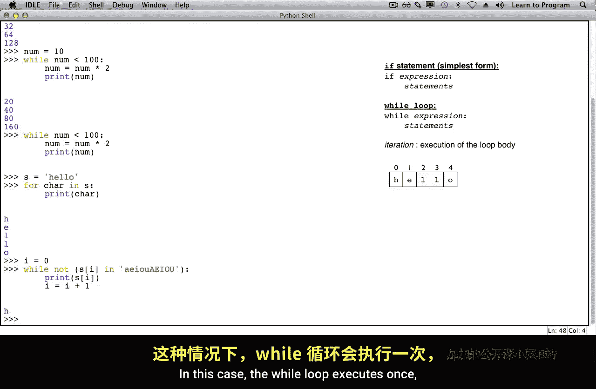

## 使用`while`循环处理字符串

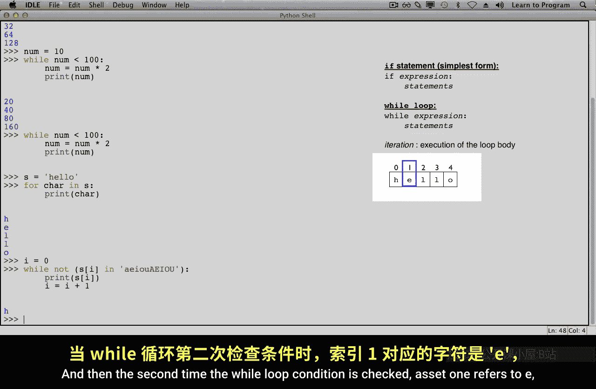

现在，让我们来解决课程开始时提到的问题：遍历一个字符串，直到遇到一个元音字母为止。

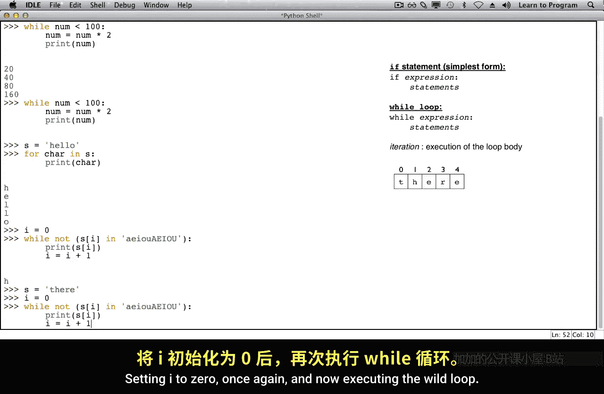

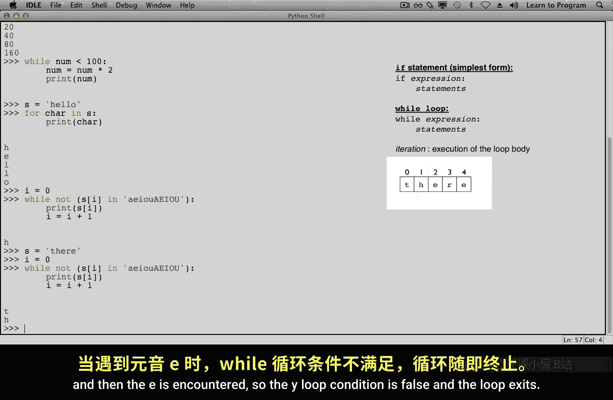

首先，回忆一下我们如何使用`for`循环来遍历字符串：

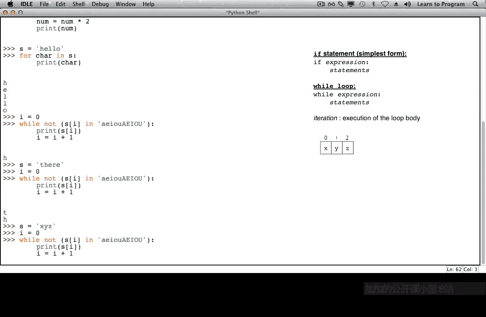

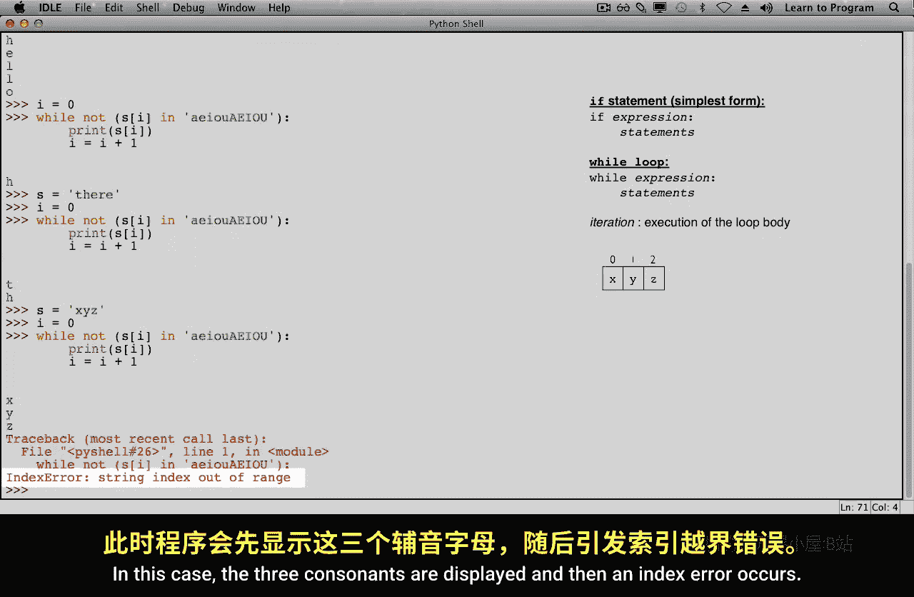

```python
s = "Hello"
for character in s:
    print(character)
```

这个`for`循环会依次打印出字符串`s`中的每一个字符。

当我们想用`while`循环实现类似功能，但只遍历到第一个元音字母时，我们需要手动管理索引。以下是实现步骤：

1.  创建一个变量`i`，初始值为0，代表我们要检查的字符串的第一个索引。
2.  循环条件是：当前索引`i`处的字符**不是**元音字母。
3.  在循环体内，我们打印当前字符，然后将索引`i`加1，以移动到下一个字符。

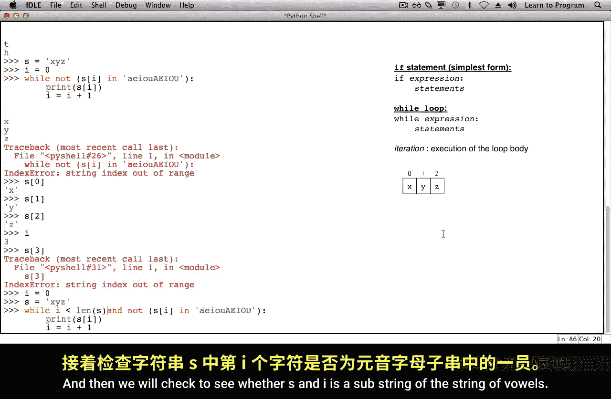

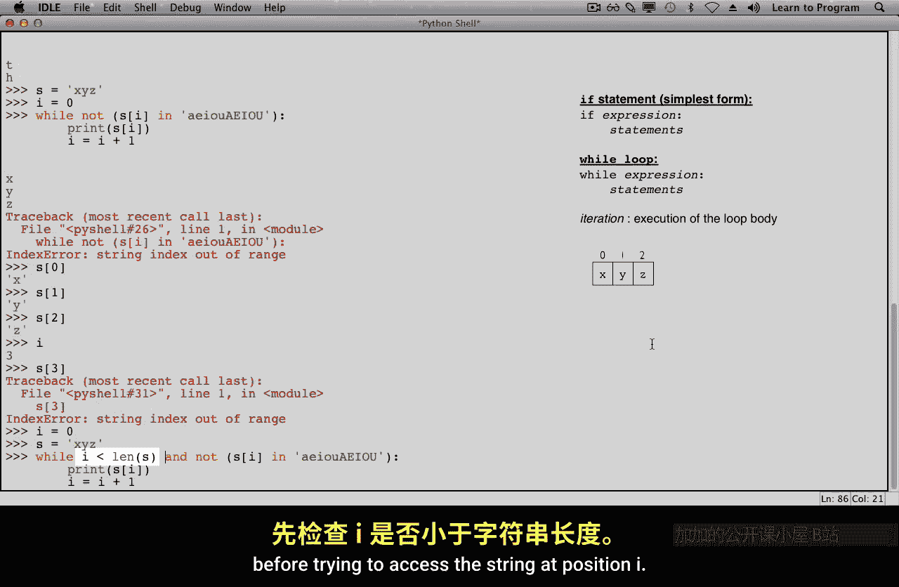

以下是代码实现：

```python
s = "Hello"
i = 0
vowels = "aeiouAEIOU"
while i < len(s) and s[i] not in vowels:
    print(s[i])
    i = i + 1
```

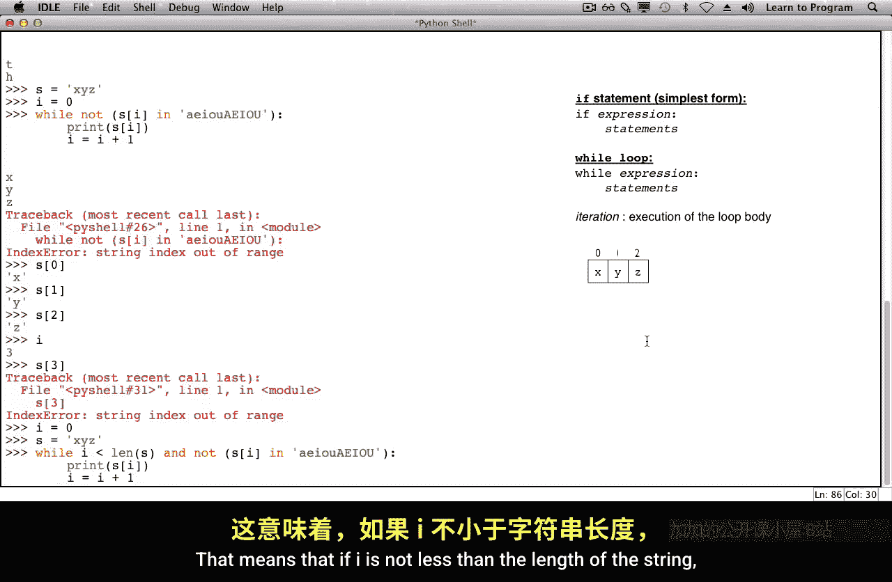

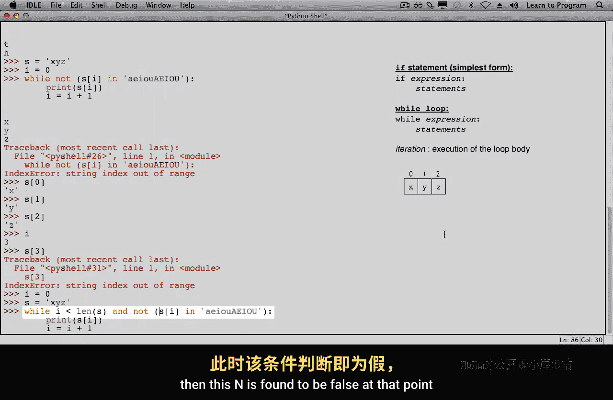

请注意，我们在循环条件中增加了`i < len(s)`。这是为了防止当字符串中没有元音字母时，索引`i`会超出字符串的范围，导致“索引错误”。Python对`and`操作进行“惰性求值”，如果第一个操作数（`i < len(s)`）为假，就不会计算第二个操作数，从而避免了访问无效索引。

对于字符串`"Hello"`，循环会打印出`'H'`，然后在遇到`'e'`时停止。对于字符串`"There"`，循环会打印出`'T'`和`'h'`，然后在遇到`'e'`时停止。对于字符串`"xyz"`（全是辅音），循环会打印出所有三个字符，然后因为`i`不再小于字符串长度而正常退出。

## 函数应用：`up_to_vowel`

基于上面的思路，我们可以编写一个函数`up_to_vowel(s)`，它接收一个字符串参数`s`，并返回从开头到（但不包括）第一个元音字母的子字符串。

我们使用“累加器模式”来解决这个问题：

```python
def up_to_vowel(s):
    """返回字符串s中从开头到第一个元音字母（不含）的子字符串。
    """
    before_vowel = ''
    i = 0
    vowels = "aeiouAEIOU"
    while i < len(s) and s[i] not in vowels:
        before_vowel = before_vowel + s[i]
        i = i + 1
    return before_vowel
```

让我们测试这个函数：
*   `up_to_vowel("Hello")` 返回 `"H"`
*   `up_to_vowel("There")` 返回 `"Th"`
*   `up_to_vowel("xyz")` 返回 `"xyz"`

## 函数应用：`get_answer`

`while`循环的另一个常见用途是反复提示用户输入，直到获得有效响应。我们将实现一个函数`get_answer(prompt)`，它向用户显示提示信息`prompt`，要求输入“是”或“否”，并持续提示直到用户输入这两个有效答案之一。

以下是实现思路：
1.  首先，使用`input(prompt)`获取用户的初始答案。
2.  只要用户的答案**不是**“yes”也**不是**“no”，就继续用相同的提示信息要求用户输入。
3.  当用户最终输入“yes”或“no”时，退出循环并返回该答案。

```python
def get_answer(prompt):
    """提示用户输入，直到用户输入‘yes’或‘no’为止，然后返回该答案。
    """
    answer = input(prompt)
    while answer != "yes" and answer != "no":
        answer = input(prompt)
    return answer
```

这个函数的执行依赖于用户输入。如果用户第一次就输入“yes”或“no”，循环体不会执行，函数直接返回答案。如果用户输入了其他内容（如“maybe”），循环条件为真，程序会再次提示用户，直到获得有效输入。

## 总结

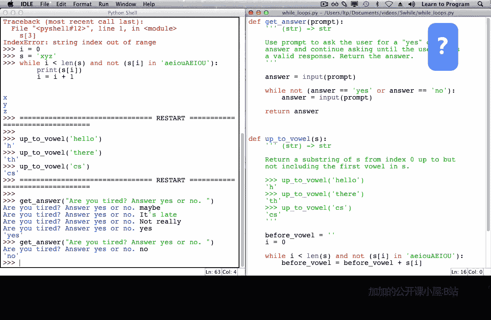

本节课中我们一起学习了`while`循环。我们了解到：
*   `while`循环基于一个布尔条件重复执行代码块。
*   它与`for`循环的关键区别在于，`while`循环的次数在编写代码时可能是不确定的。
*   我们学习了如何用`while`循环遍历字符串直到满足特定条件（如遇到元音字母），并注意了防止索引越界的技巧。
*   我们应用`while`循环实现了两个函数：`up_to_vowel`用于提取子字符串，`get_answer`用于获取有效的用户输入。
*   掌握`while`循环是控制程序流程的重要一步，它让你能处理更多需要根据动态条件进行重复的任务。