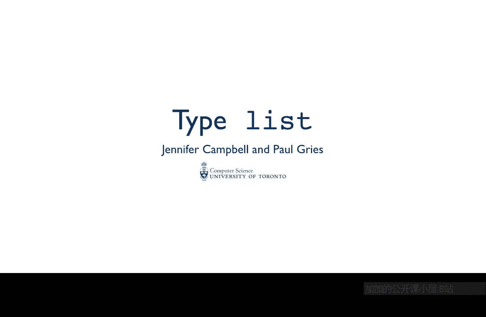
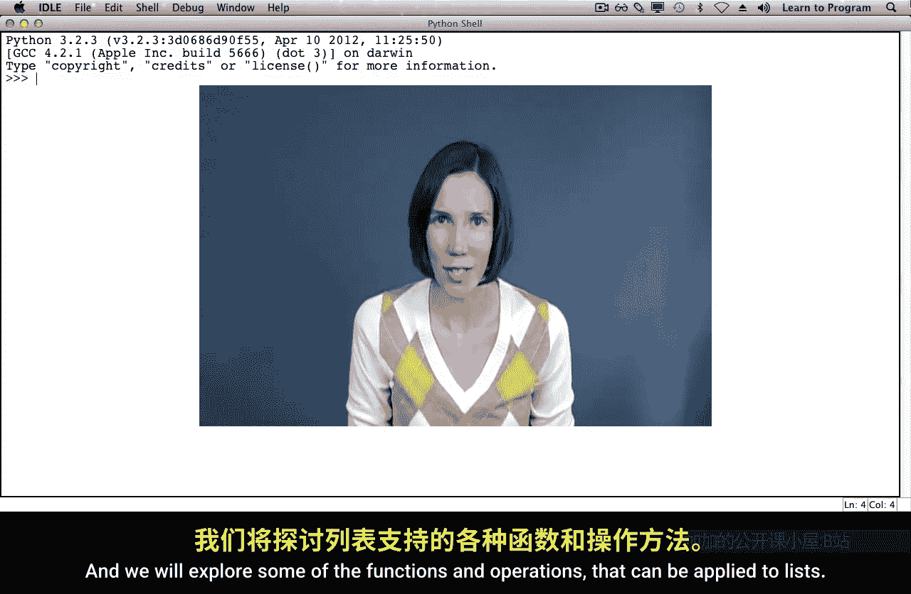
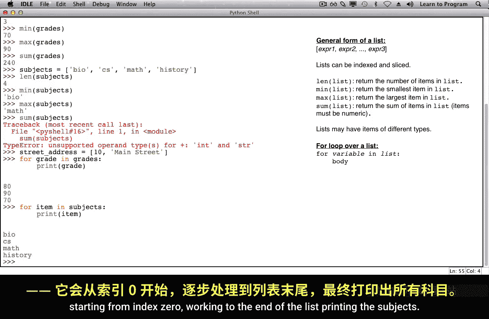

# 特伦托大学【中英⚡学习编程：基础知识｜Learn to Program： The Fundamentals】 p29 P29 01_类型列表 -BV1kQ11B5EWa_p29-

In our programs， we often work with collections of data， for example。

 we may work with student grades or with the titles of books。In this lecture。

 I will introduce you to the Python list type， and we will explore some of the functions and operations that can be applied to lists。

To begin， I'm going to create variable grades that refers to a three element list of integers。

The notation for our list is an opening square bracket， PMa separated values。

 and a closing square bracket。Grades is a three element list when we say that grades has three items。

The first item is at index 0 and grades at index 0 refers to the int 80。

Grades at 1 refers to int 90 and grades at index 2 refers to int 70。

We can also take slices of a list like we can with a string， beginning with a start index。

 in this case， I'll start at index1。And an ending index。Going up to two。

 this gives me a slice of the list。Which contains a single int，90。If I go from grades at zero。

Up to two， then a two element slice is given with 80 and 90。

So the same rules for slicing apply to lists as for strings。

The in operator that we used for strings can also be used with lists。

 So this asks whether 80 is an element of the list grades， which it is。

The expression 60 in grades evaluates to false， since 60 is not an element of the list grades。

Some of Python's built in functions that we used earlier with other types can also be applied to type list。

For example， we can find the length of a list in this case，3。Because the list has three elements。

We can also find the smallest value in a list by passing the list as an argument to the function min。

And when we call the function Max on a list， it returns the largest element。

There's another function called sum that will sum the elements of the list。So in this case。

 it sums 80， 90 and 70， returning  to 40。Grades is a list of ints。

 but we can have lists of other types as well。This subject variable will refer to a list of strings。

Some of the same functions that we applied to the list of ins can also be applied to the list of strengths。

 for example， we can find out its length。And we can find out the minimum value in the list。

For strings， dictionary ordering is what is compared， and the minimum in this case is bio。The max。

Is going to be the thing that comes latest in the alphabet or latest in the dictionary。

 which is math。And the sum function cannot be applied to strings。

 A type error occurs when sum is applied to the list of strings。

Data of different types may be contained in the same list， for example。

 let's make a street address list。It will have an int for the street number and a string for the name of the street。

 So we've got an int and a string in the same list。

The final thing to show you in this introduction to lists is the for loop over lists。

So let's look at our grade example for each grade in the grades list。

We will loop over it and display it。Graade is a variable name I could have used something like item or element here。

So we'll print those three grades， Similarlyly， we might loop over subjects。

 and I'm changing the variable name just to emphasize that that is just a variable referring to each element of the list in turn。

 starting from index 0， working to the end of the list。Printing the subjects。

