# 特伦托大学【中英⚡学习编程：基础知识｜Learn to Program： The Fundamentals】 p30 P30 03_列表方法 -BV1kQ11B5EWa_p30-

In this lecture， we'll explore list methods。As a reminder。

 a method is a function that is inside an object。Here are the methods in type list。

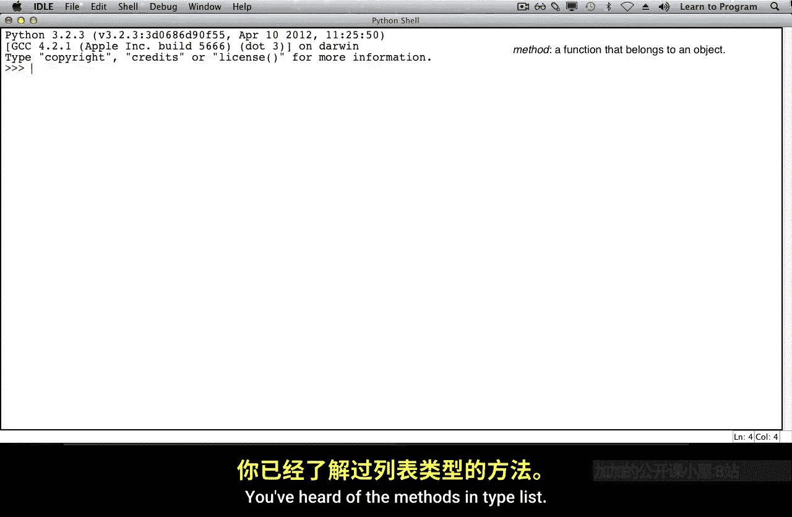

Ignoring the methods with underscores， we see append， count， extend， index， insert， pop， remove。

 reverse and sort。

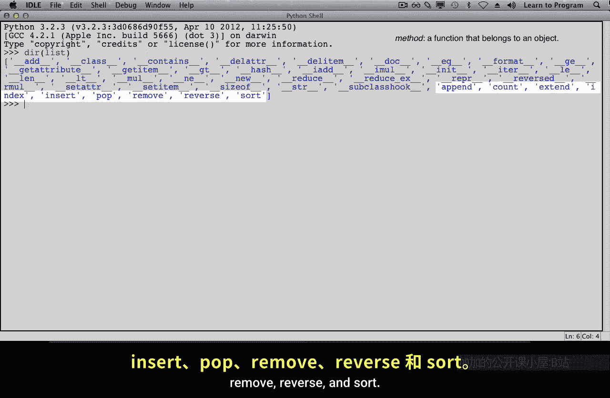

Some of these methods modify the list， and some just return information。

We will now give examples of using each of them。We will keep track of someone's favorite colors。

Here's a prompt that we will use to gather the information。

We are going to use a loop in order to gather all the person's favorite colors。

 but we need to start by asking them for their first。So far， then。

 variable colors is assigned an empty list and variable prompt is assigned。

 enter another one of your favorite colors。 type return to end。

We ask the user to enter their first favorite color by calling function input and passing in variable prompt。

Let's say the user types blue。 So color now refers to blue。

Variable colors still refers to an empty list。We are accumulating the information that the user types。

 So what we're going to do is use a while loop and say that while color is not the empty string。

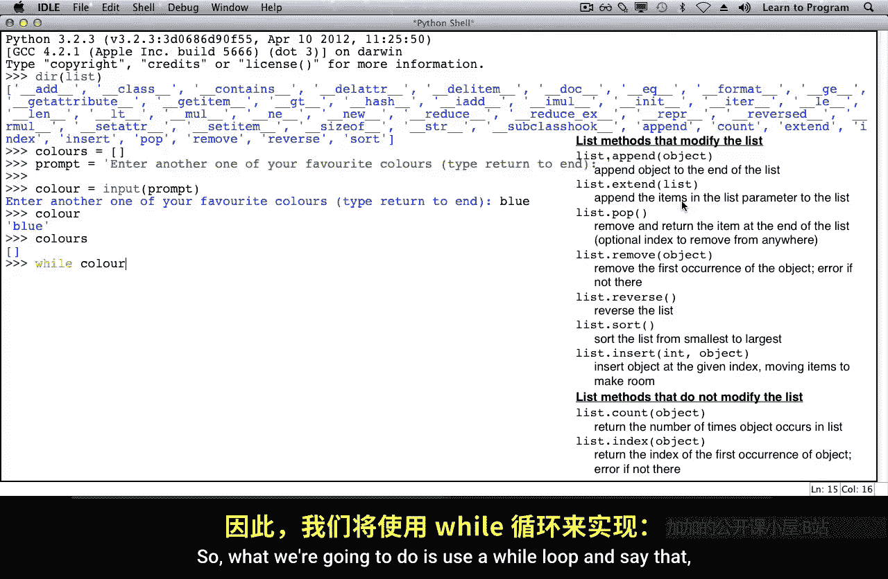

We will dependend the color to the colors variable colors。The人。Co。

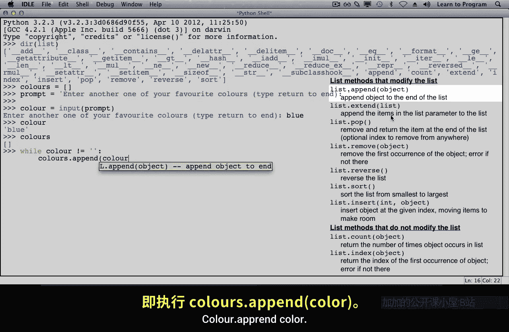

Now， we have appended the color the user just typed。

 And so we need to get ready for the next iteration of the loop by asking the user for another color。

 So color is assigned。Input。What's argument prompt。嗯。We will now enter the colors， yellow。And brown。

 And let's say that that's our whole list of favorite colors。

 So we're going follow the instructions and type return to end this while。

When we examine the colors variable， we see that it contains strings， blue， yellow and brown。

But we forgot some。 So we are going to use method extend to extend the list of colors by sending in the list of colors that we forgot。

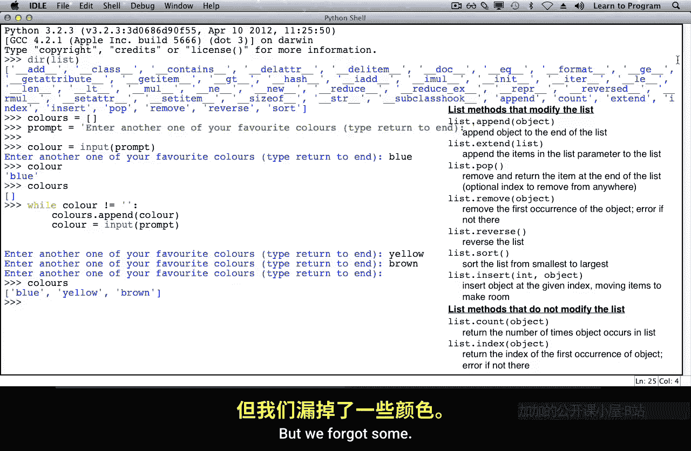

We will call colors dot extend and pass in the list with the strings hot pink and neon green。Now。

 when we examine colors， we see blue， yellow， brown， hot pink and neon green。As it turns out。

 we don't particularly like neon green。 So let's call colors thought pop to remove it。

When we examine colors， we see the list blue， yellow， brown and hot pink。

 Nen green is no longer there。One other。Point to make is that when you call colors do pop。

 not only does it remove the last item， but it also returns it。

So you can use it in an assignment statement。A function that both returns information and does something to data such as colors do pop is a function that is said to have side effects。

We are not enamored of brown either， so we will use pop with its optional argument in order to remove it。

嗯。Brown is at index too。 So if I call colors the pop pop 2， it will remove brown from the list。

 as well as return it。Examining colors， we see we're down to blue， yellow， and hot pink。

Colors thought P will remove the last item in the list。

 and colors thought pop with an index will remove the item at the given index。

Method remove takes an object to remove， not an index。

 and it will remove the first occurrence of that object from the list。Let's try to use it。

To remove black。Which isn't in the list？And we see we get a value ever。

 It won't work if we call remove with an item that is not in the list。

So before calling a method or function that might raise an error。

 we want to check that that won't actually happen。We can count the number。

Of occurrences of a particular value in in a list and。

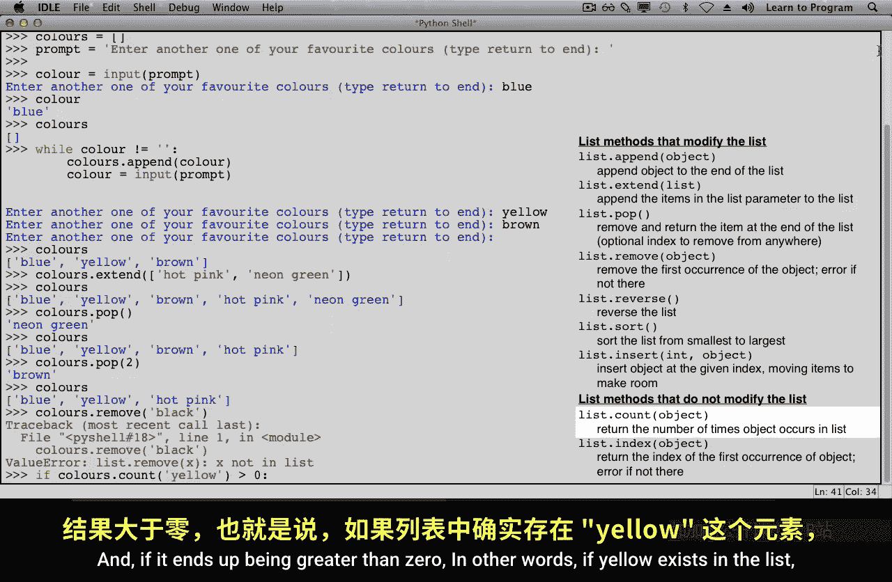

If it ends up being greater than 0。 In other words， if yellow exists in the list， then。

We can call them。Examining colors， we end up with just blue and hot pink。Rather than counting。

 we could just say if yellow in colors。Then colors stop remove yellow。

This is more standard than calling colors dot count and counting the number of items。

 Just say if it's in there， then call colors dot remove。Of course， yellow wasn't there。

And so the if statement condition evaluated to false。

 and we didn't call colors not removed because we had previously removed it。

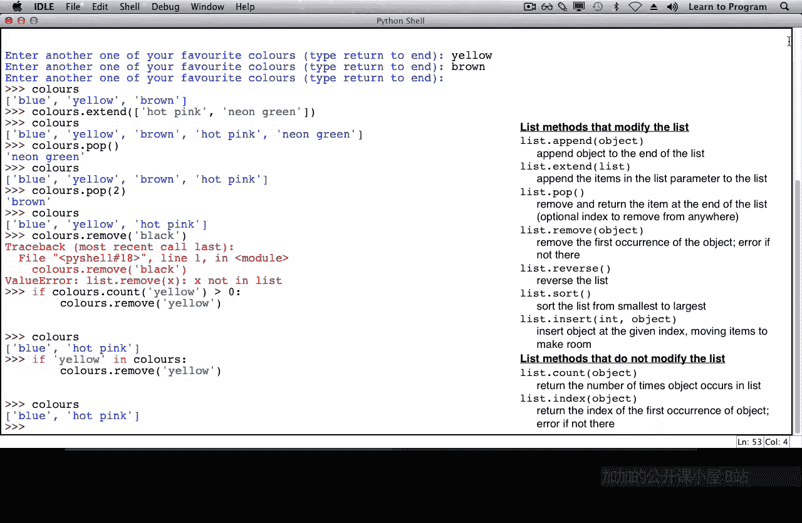

We will now call colors dot extend with arguments auburn， to and magenta。 But we get a type error。

 Extend takes exactly one argument，3 given。The problem is that we need to put auburn to and magenta into a list because extend is expecting a list。

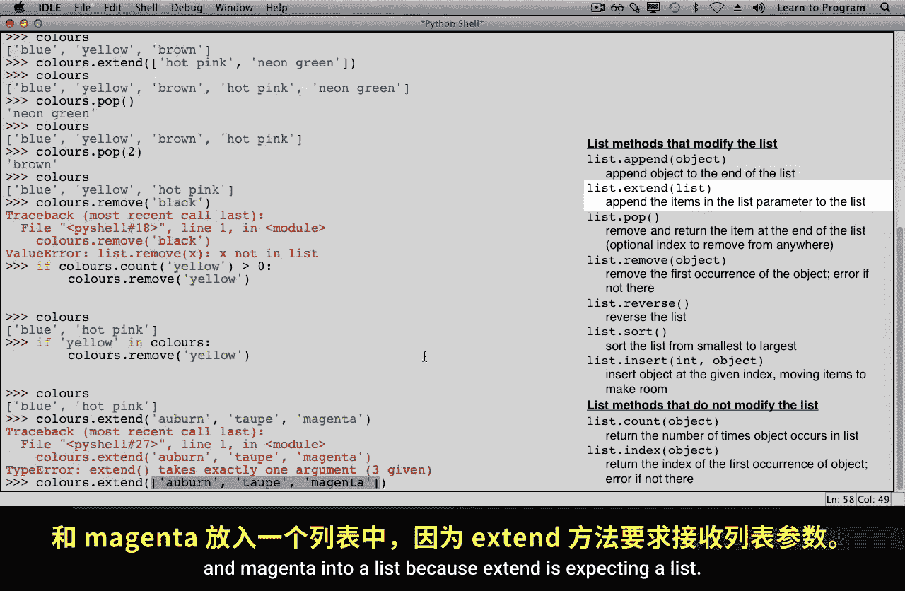

Now， colors refers to the list with strings， blue， hot pink， auburn， top and magenta。

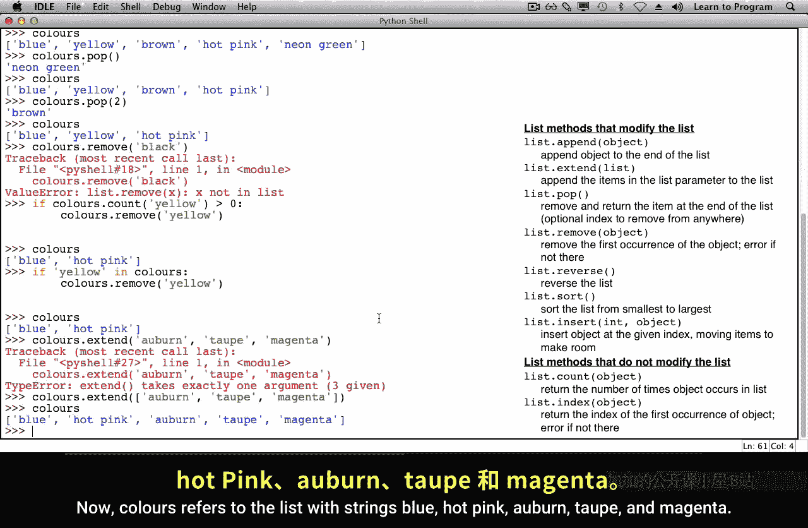

We can sort it。

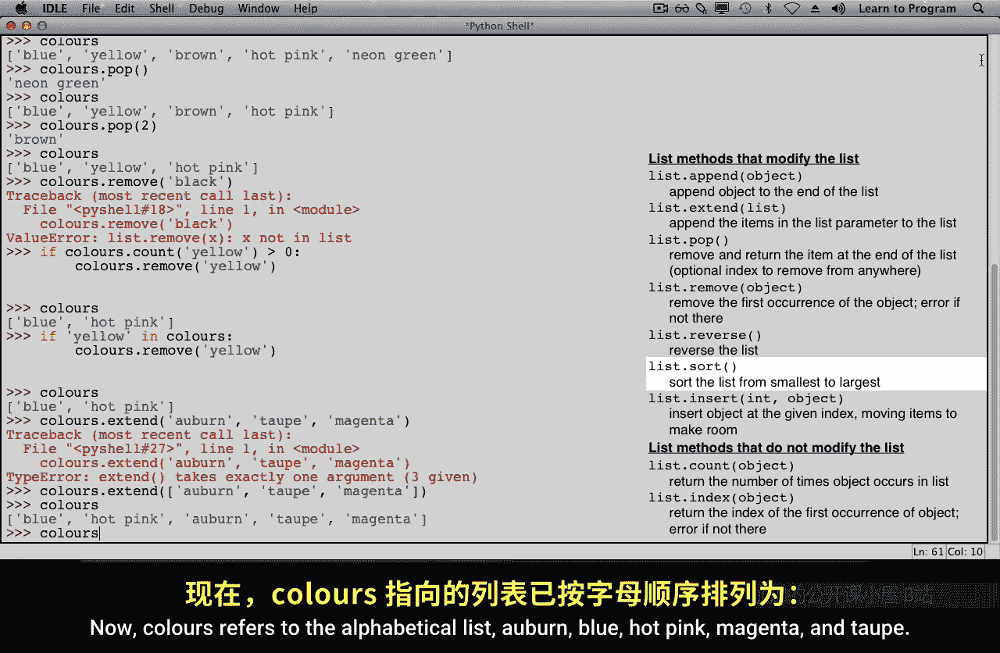

Now， colors refers to the alphabetical list， Auburn， blue， hot pink， magenta and toque。

We can reverse this。 We call colors dot reverse， and now colors refers to top， magenta， hot， pink。

 blue and often。

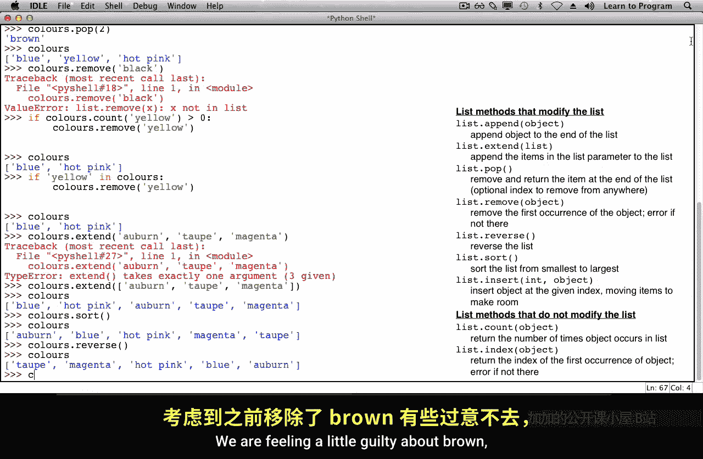

We're feeling a little guilty about brown。 We will call colors dot insert in order to put it back in the list where it belongs。

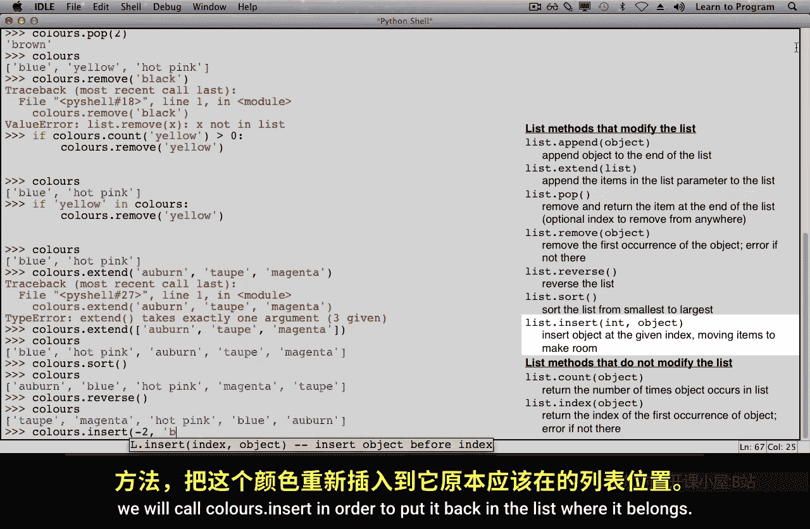

We used arguments  -2 and brown to say， insert brown at index -2 into our colors。

We have not replaced the item that was at index -2。 Instead。

 blue and Auburn have been shifted over to make room for brown。

 So insert does not get rid of anything that's in the list。 It moves things over to make room。Last。

 let's get rid of hot pink because that's just a little bit bright for our aged selves。

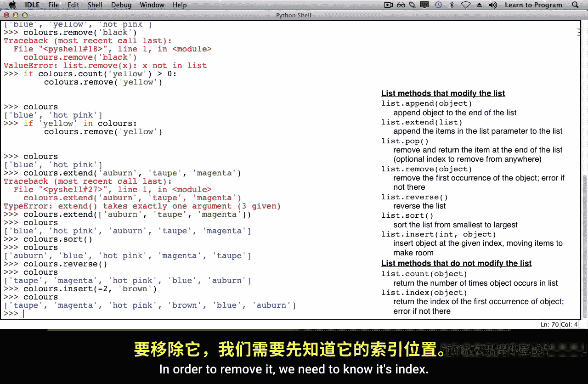

In order to remove it， we need to know its index。 we can call the list index method in order to find this out。

 But again， index might crash if the item is not in the list。 for example， colors that index of。

 remember， we don't have neon green any more。Gives us a value ever， Nen Green is not enlist。

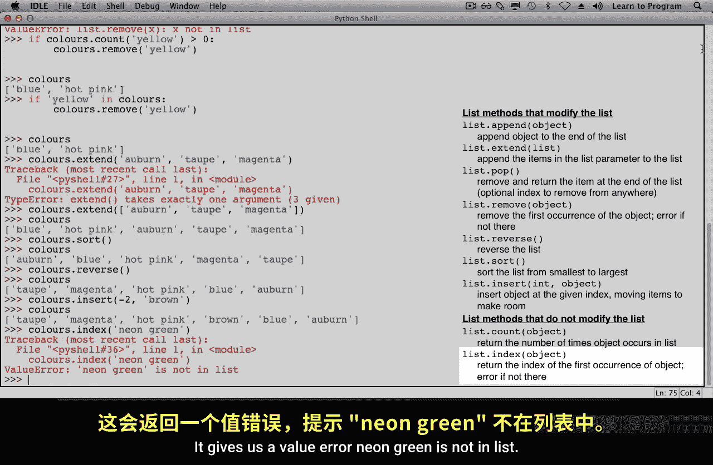

We want to prevent errors from happening。 So here we will use an if statement of hot， pink in colors。

To check to see whether we can call index without crashing。So if hot pink is in colors。

 we will then assign to variable where the result of calling colors dot index hot pink。

And then we can use that index where to call colors dot pop to remove hot pink。

And now we are left with to， magenta， brown， blue and Auburn。

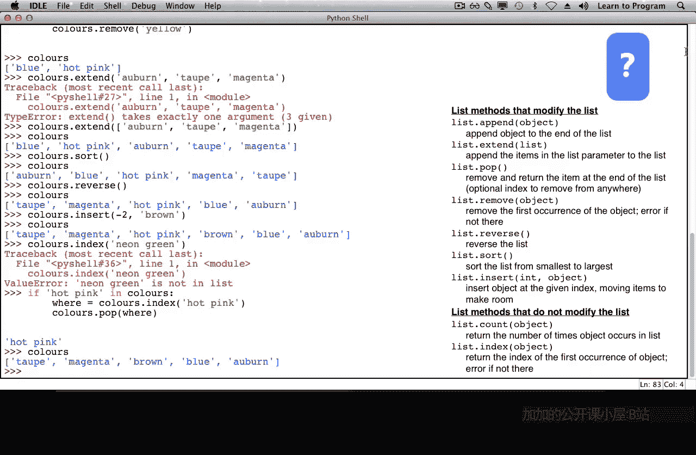