# 特伦托大学【中英⚡学习编程：基础知识｜Learn to Program： The Fundamentals】 p31 P31 05_可变性与别名 -BV1kQ11B5EWa_p31-

Those memory addresses that we've been using are about to become really useful。

It turns out that you can modify the contents of some objects， and without memory addresses。

 it would be really hard to explain what is happening。

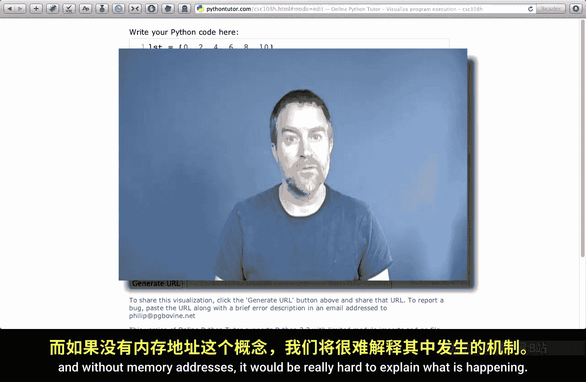

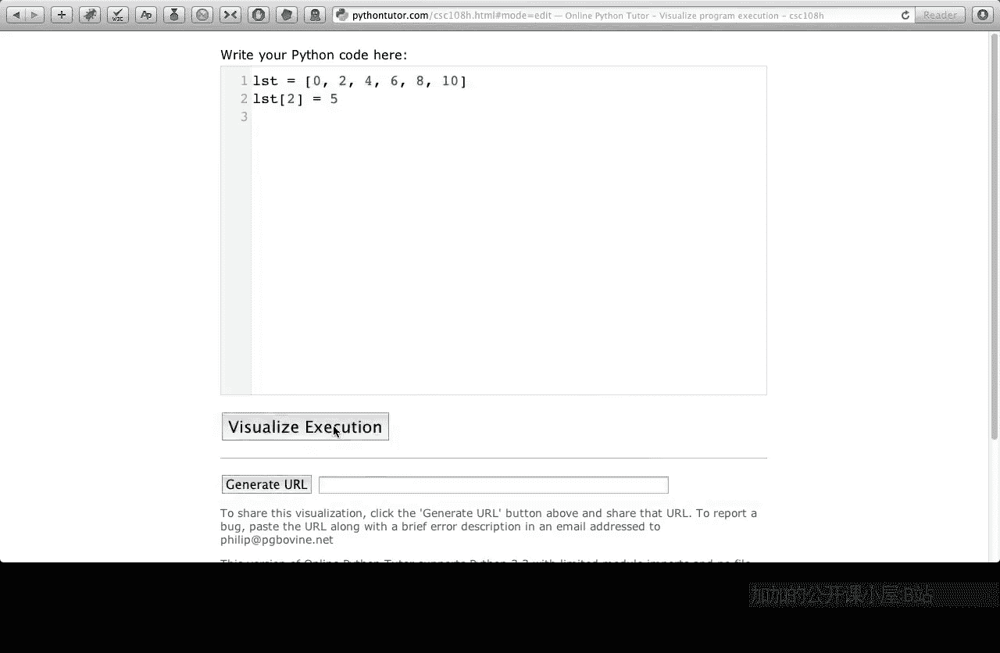

We'll start by showing that list objects can be modified On line one is an assignment statement。

 we evaluate the expression on the right hand side and that creates a list object as well as the six integers 0。

2，4，6，8 and 10。Once we have created that list structure， we're going to assign to variable LST。

 the memory address of the list object。

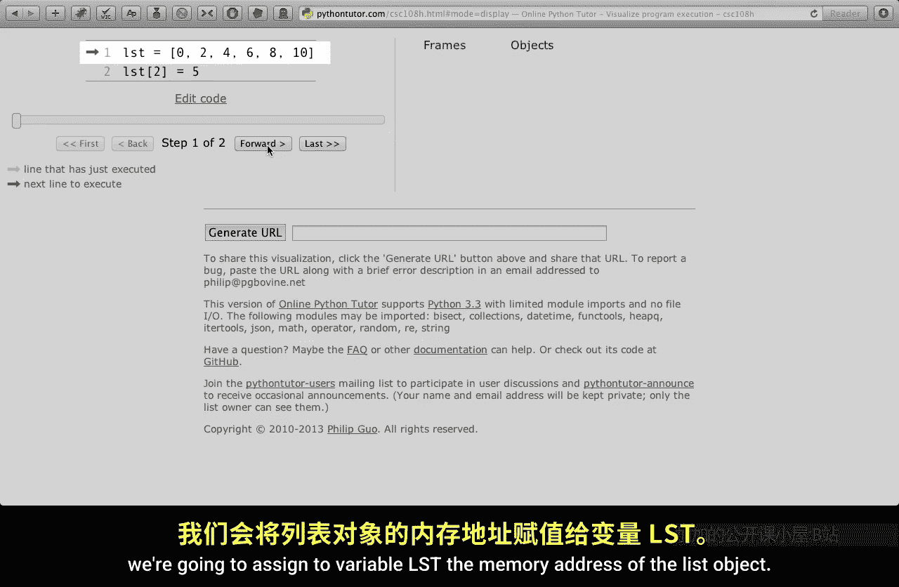

So L LST contains memory address ID1， which refers to the list object。At index0。Is。

Memory address I D 2。 And that refers to the0 object at index 1。We refer to the two at index two。

 we refer to the four and so on。

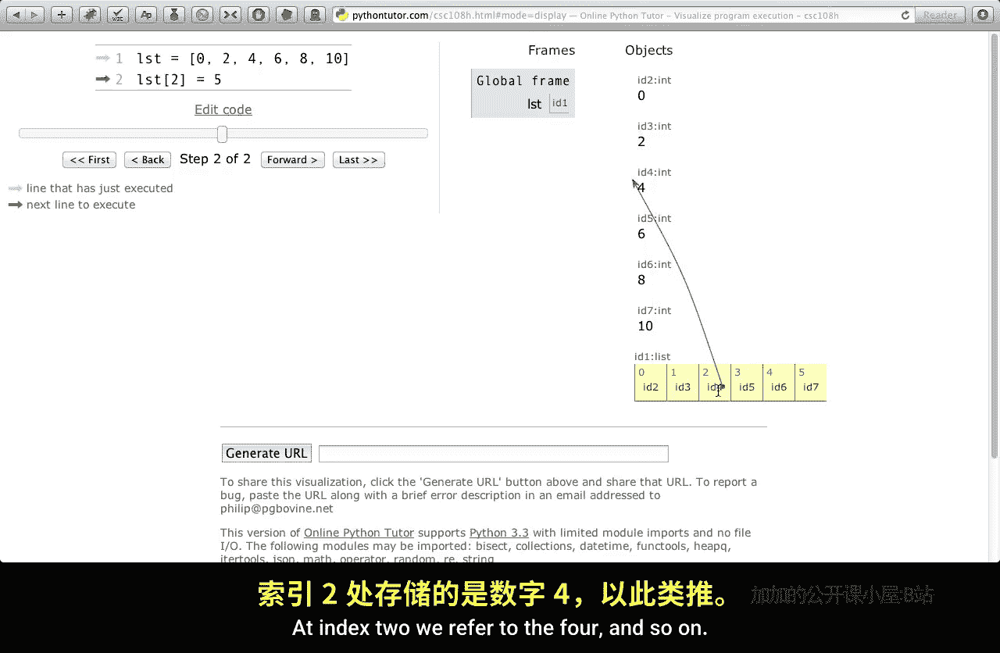

Online2 was another assignment statement。On the left hand side， we don't just have a variable。

 We have something a little more complex。 We have listed at index 2。

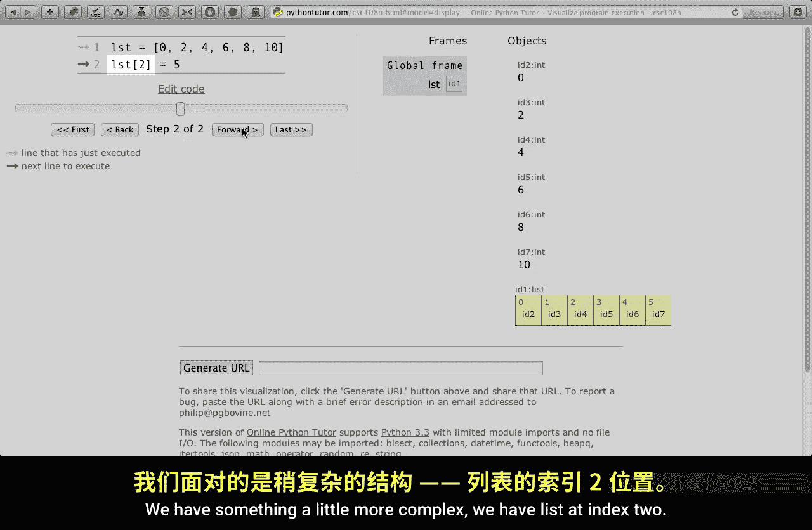

We're actually going to be modifying that memory location right there。Listed index2。

 after we execute that assignment statement is no longer going to refer to the integer 4。

 instead it's going to refer to integer 5， we are going to be modifying an object in the heap。

When I click forward。We see that we have a new object at memoryory address ID8。

 and that listed index 2 refers to that new object。Let's go edit the code and do something else。

I'm going to replace this code with some other code。Let's visualize the execution。Line one。

We know what to expect。List1 refers to a list。That listed index 0 refers to 0。

 listed index 1 refers to2。 Li index 2 refers to 4 and so on。On line  too。

 I'm doing something rather curious。 I am taking the memory address that's in variable list 1。

 and I am placing it in variable list 2。 The only thing that's going to change is the contents of module Ma。

😊。

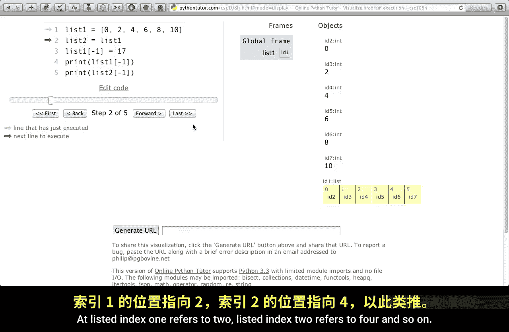

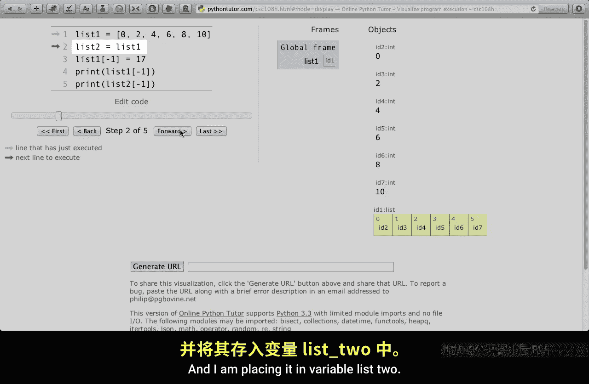

There we go now both list one and list two refer to the list object。

This is called aliasing when two variables both contain the same memory address aliasing happens。

So far so good。What we're going to do now is we're going to assign to the last item in list one or the object that list one refers to the value17 so。

The item at index 5 is going to change in the list。We're going to lose the reference to 10。

 And instead， we're going to have the item in index 5 refer to the integer 17。And there we have it。

The interesting thing now is that list 2 got to watch that change happen。

 List 2 contains the memory address of the list object。We changed that object by using listist1。

But list 2 changed as well。 So when we print list 1 at index-1 And the last item， we get a 17。

And we're going to see exactly the same result when we print list2 at index minus1。

We will do one more example of aliasing。Here we have a function。

 double even indices that takes a list of ints as a parameter and doesn't return anything or rather returns none。

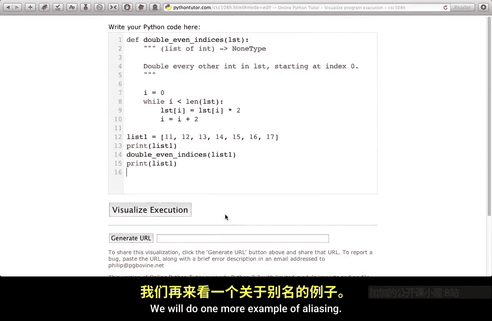

The Docing says double every other int in list starting at indexex 0， so the int values at indices 0。

2，4，6，8， and so on are going to be doubled。We will start I off at zero， in other words。

 I is going to be the index of the next item to double as long as there's any remaining。

We're going to keep going as long as I is less than the length of the list。 and other words。

 we will stop when I is equal to or greater than the length of the list。Within the loop。

We are going to look at the I of it index I， and double it。And。

Store the reference to that new value in the listed index I。

Then we're going to add2 to I because we want to skip to the next even index。

Our main program is going to create a list。Assigned to variable list 1， that list。 print that list。

 Do the integers at even indices in that list。

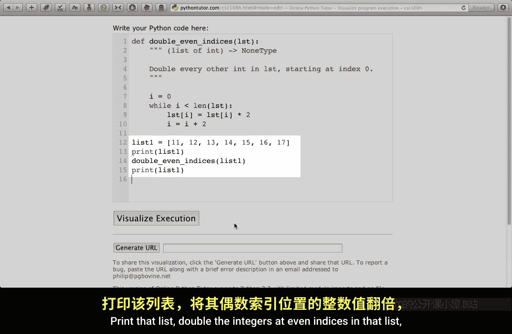

And then， print a list again。We define our function。We create our list structure。We print that list。

And now， notice that variable list1。Contains memory address ID D2。

 and that ID D2 is the memory address of our list object。 We are going to create an alias for this。

 but we won't use an assignment statement。 Instead， we're going to do a function call。

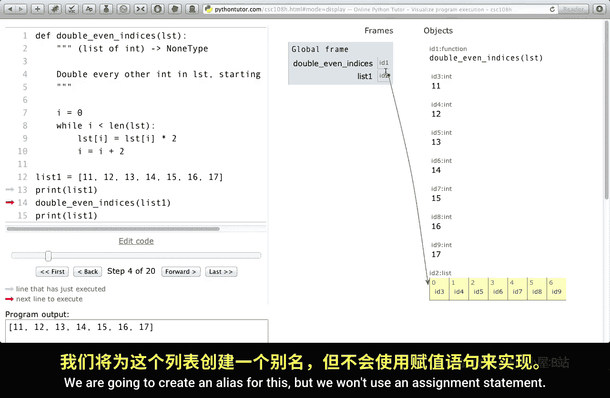

We will evaluate。The arguments， we get memory address I D to。

 which we're going to put in variable lists in the frame that is going to be created for function。

 double even indices。

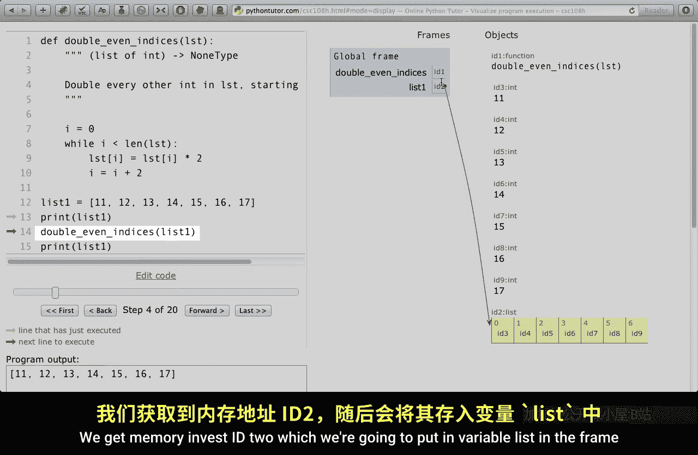

Now， in function W even indices， variable list refers to that list object。

Variable list 1 also refers to that list object。This means that any change we make to that list object is going to be seen by both variables。

We start eye off at index 0。 Notice that I refers to 0。 The length of the list is。1，2，3，4，5，6，7。

So zero is less than seven， I'm going to look at the value at index zero and multiply it by two。

Value at index0 is 11， multiplying that by 2 I get 22 and we are going to take that 22 and have listed index0 refer to it。

Now we're going to add2 to I。 and so I now refers to2。2 is less than 7。

 So I'm going to do the same thing。 But this time with list hit index 2。Listed index 2 is the 13。

 We're going to take that 13 double at giving us 26。

And then we're going to store in list at index to the memory address of that new integer that we are about to get。

Adding 2 to I。We end up with four， of course， I now refers to four， four is less than7。

 So we're going to do this again this time changing the item in index 4 replace that 15 with a 30。

Additude to I 6 is less than 7。The listed index 6 is 17， doubling that we get 34。

 so listed index6 is now going to refer to 34。Adding 2 to I， I is now 8。

That makes our loop condition here false。As soon as we have false in a loop condition。

 the loop terminate， so we are going to exit this loop。

There are no statements at the end of double even indices， and so。We're about to return none。

Remember， if there is no return statement in a function。

 then a function will return value None of type none type。Where were we， Well。

 we were in the main module down here。 We just called double even indices。 that's about to be done。

 So we're going to move on to line 15。

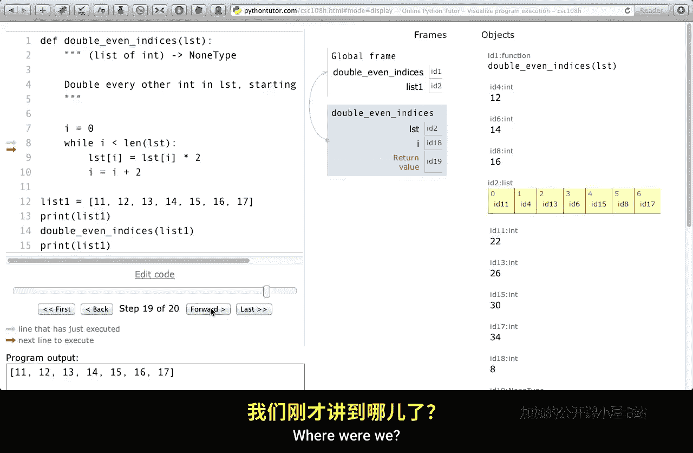

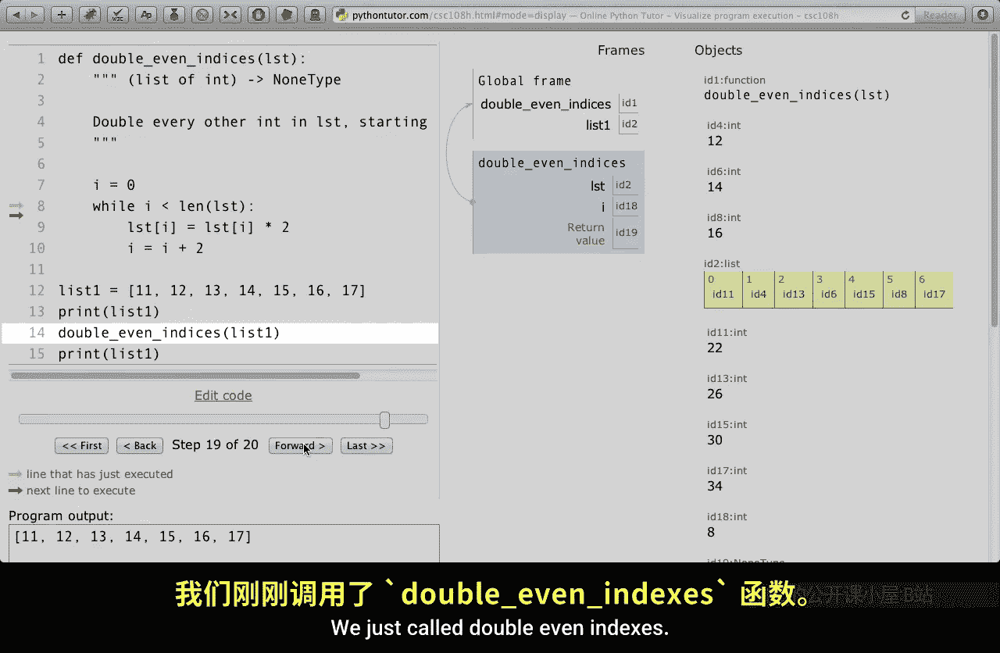

List 1 now refers to the list object that has 22 at index 0， then 12 and 26，14，3016 and 34。

 So even though we never mentioned list 1 inside this function body。

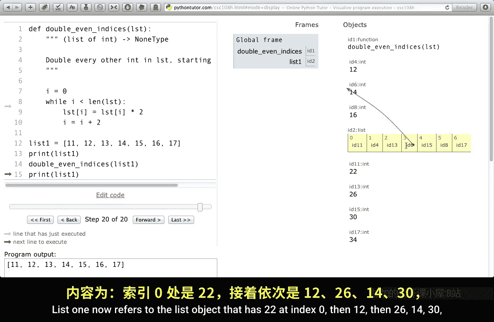

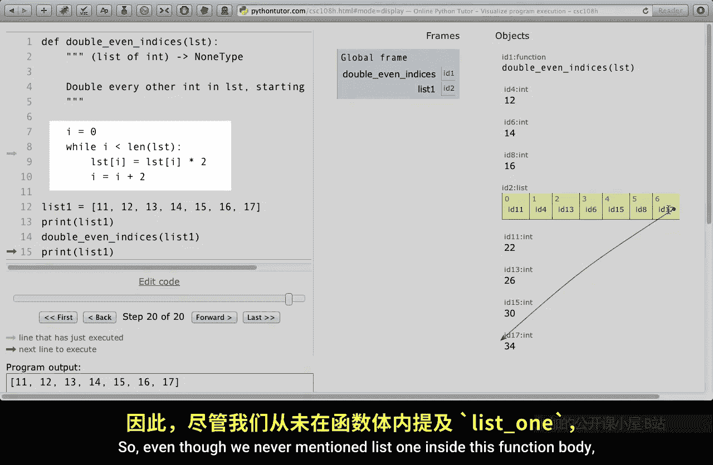

List one now refers to an object that has been modified。 So our output。Contains the new values。

Because of aliasing， you need to remember which types are mutable and which types are not。So far。

 L is the only type that is mutable。 All the others are immutable。Also。

You need to be quite careful when writing doc strings for mutable types。

 you need to be clear about whether the parameter is being modified by the code inside the function。

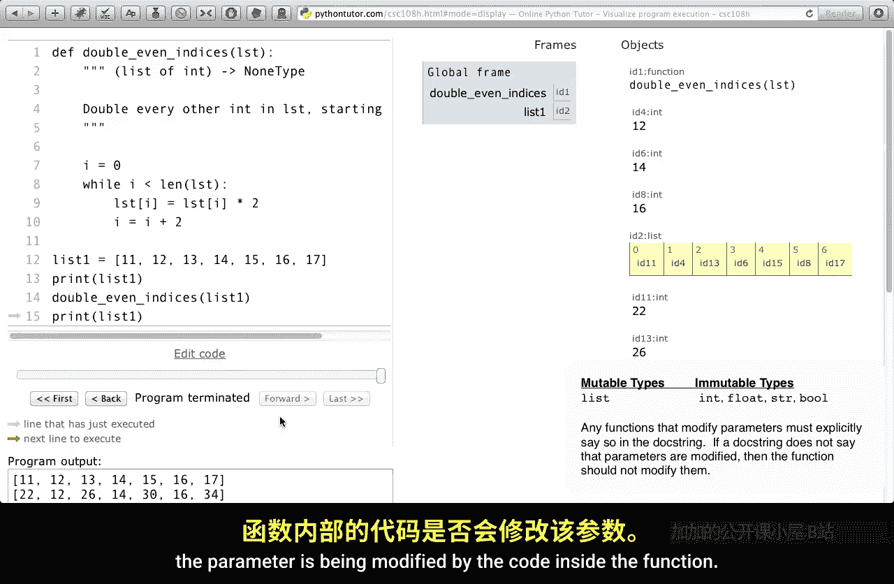