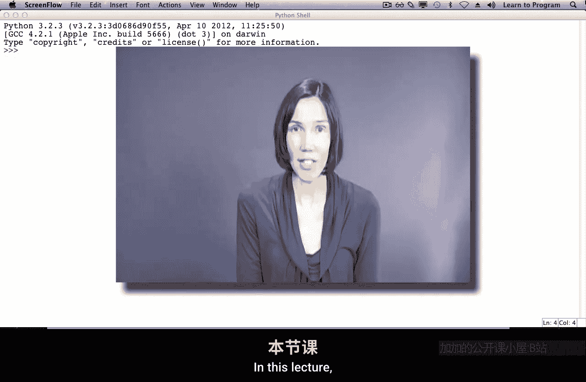
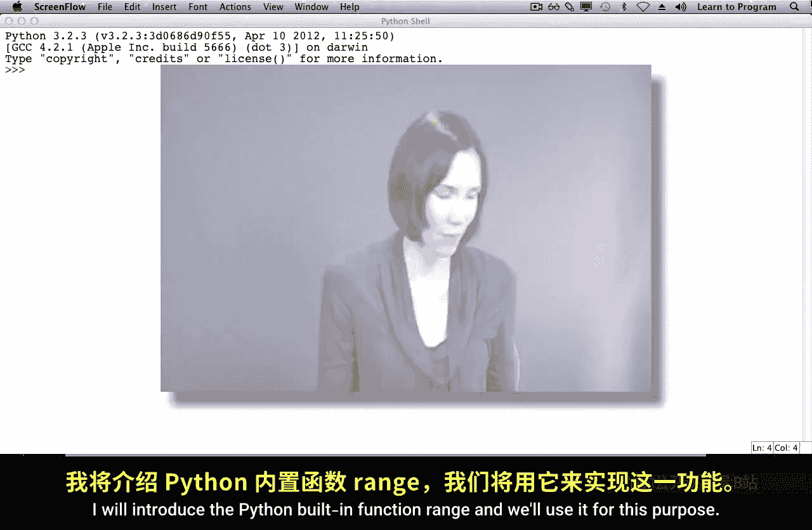
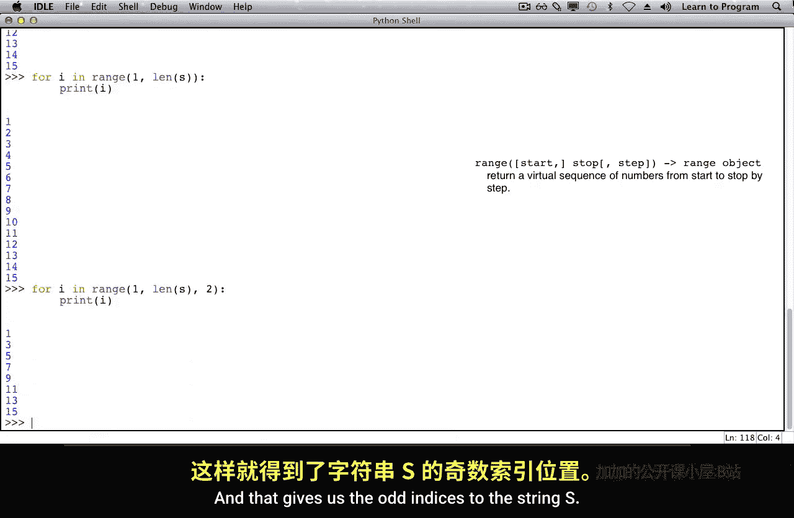

# 特伦托大学【中英⚡学习编程：基础知识｜Learn to Program： The Fundamentals】 p32 P32 07_范围 -BV1kQ11B5EWa_p32-

As we'll see in upcoming lectures， it can be very useful to have sequences of numbers that represent the indices of strings or lists In this lecture。

 I will introduce the Python built in function range and we'll use it for this purpose。😊。

In this first example， we will use a for loop in conjunction with range to generate and display a sequence of integers from zero up to and including nine。

So for each number in and this is where we use range， range will generate that sequence of numbers。

I'm going to pass in the value 10， this is the value of the sequence that we are going up to。

I'll print each number in the sequence。The numbers we see on the screen are integer values from0 through9。

 the starting value produced is by default0， the ending value is up to 10， so 9 is our ending value。

And the step or the difference between any two values in the sequence is by default 1。

Let's look at the help for range。The help is rather lengthy， but I want to focus on the header。

 We can see from this header that there are up to three arguments that we can provide to the function。

The one that we provided in our example was the stop and the stopping value。

We can optionally provide a starting value for which the default is 0。

 and we can optionally provide a step。 If we omit that， then the default。

 as I mentioned and showed in the example， is a step of one。

One of the ways that we'll use range is to generate a sequence of numbers that represent the indices of a string or a list。

So for the string computer science， we'll use range to generate its indices。

Computer science has 16 characters， so the indices are values 01，2， up to 15。Using range。

 we can generate those values。I could pass 16 as the argument to arrange， But to be more general。

 I can say， go up to the length of the string。Notice that I'm using I to represent the index of S。

 so I is short for index。And the values 0 through 15 are printed。

But perhaps we only want the indices starting from index1。

We can use the optional parameter start to indicate this。So I can pass in one for the start index。

And then go up to the length of the string。And when we print the values， this time。

 we see that we go from one up to and including 15。Now， let's say that we only want odd indices。

To do this， we can use all three of the parameters。So the first is the start parameter。

 starting at one。The end are the stop value。 And now the step by default， the step is one。

 So we go from values 1 to 2 to 3。I'm going to increase the step 2， getting values 1，3，5，7。

 and so on。Yeah。And that gives us the odd indices for the string S。

