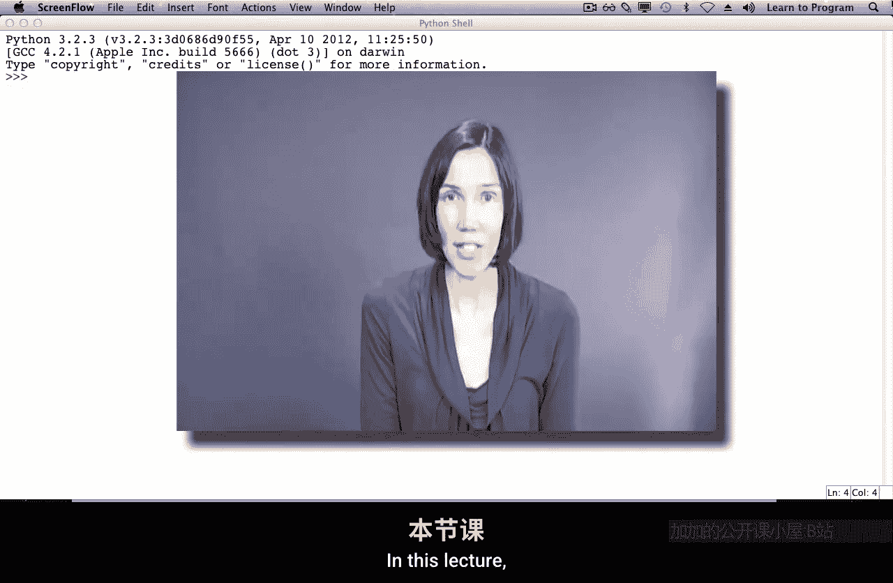
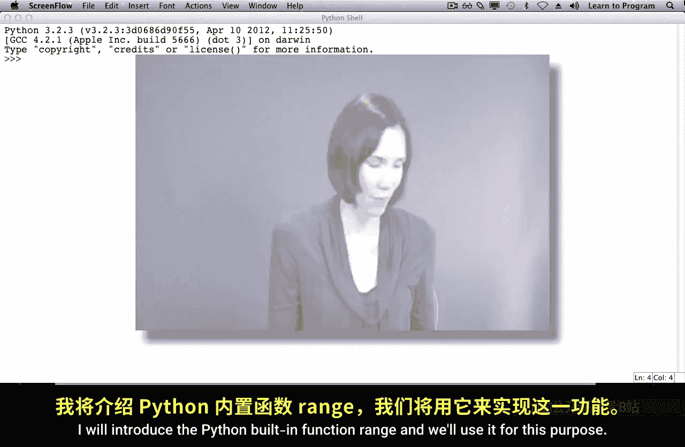
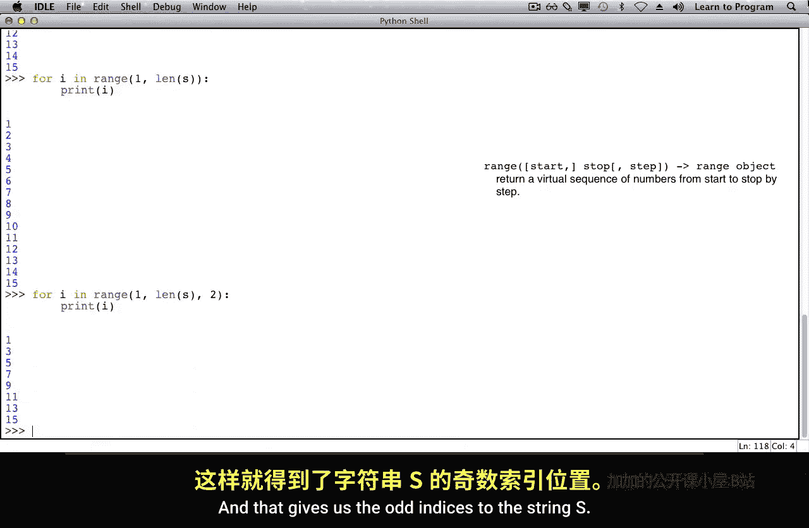

# 学习编程：基础知识：07：范围


在本节课中，我们将学习Python内置函数`range`。`range`函数用于生成一个数字序列，这个序列在表示字符串或列表的索引时非常有用。我们将通过几个例子来了解`range`的基本用法及其参数。

## 使用`range`生成数字序列



在第一个例子中，我们将结合`for`循环和`range`函数来生成并显示从0到9（包括9）的整数序列。



以下是具体步骤：

```python
for number in range(10):
    print(number)
```

屏幕上显示的数字是从0到9的整数值。默认情况下，`range`生成的序列起始值是0，结束值是传入的参数值（但不包括该值），步长默认为1。

## 探索`range`函数的参数

让我们查看`range`函数的帮助文档。虽然帮助文档内容较多，但我们可以关注其函数签名。

从函数签名可以看出，`range`最多可以接受三个参数。在我们之前的例子中，我们只提供了一个参数，即`stop`（停止值）。我们还可以选择性地提供`start`（起始值，默认为0）和`step`（步长，默认为1）参数。

## 使用`range`生成字符串索引

`range`函数的一个常见用途是生成代表字符串或列表索引的数字序列。

以字符串“computer science”为例，它有16个字符，因此索引值从0到15。使用`range`，我们可以生成这些值。

以下是具体步骤：

```python
s = "computer science"
for i in range(len(s)):
    print(i)
```

这里，`i`代表字符串`s`的索引。打印出的值是0到15。

## 调整起始索引

如果我们只想从索引1开始，可以使用`start`参数。

以下是具体步骤：

```python
s = "computer science"
for i in range(1, len(s)):
    print(i)
```

这次打印出的值是从1到15（包括15）。

## 生成奇数索引

如果我们只想要奇数索引，可以使用所有三个参数。

以下是具体步骤：

```python
s = "computer science"
for i in range(1, len(s), 2):
    print(i)
```

这里，起始值为1，步长为2，因此生成的序列是1、3、5、7等，即字符串`s`的奇数索引。

## 总结



在本节课中，我们一起学习了Python的`range`函数。我们了解了如何使用`range`生成数字序列，如何通过调整`start`、`stop`和`step`参数来控制序列的起始值、结束值和步长。我们还探讨了如何使用`range`生成字符串的索引序列，这在处理字符串和列表时非常有用。