# 特伦托大学【中英⚡学习编程：基础知识｜Learn to Program： The Fundamentals】 p34 P34 03_平行列表与字符串 -BV1kQ11B5EWa_p34-

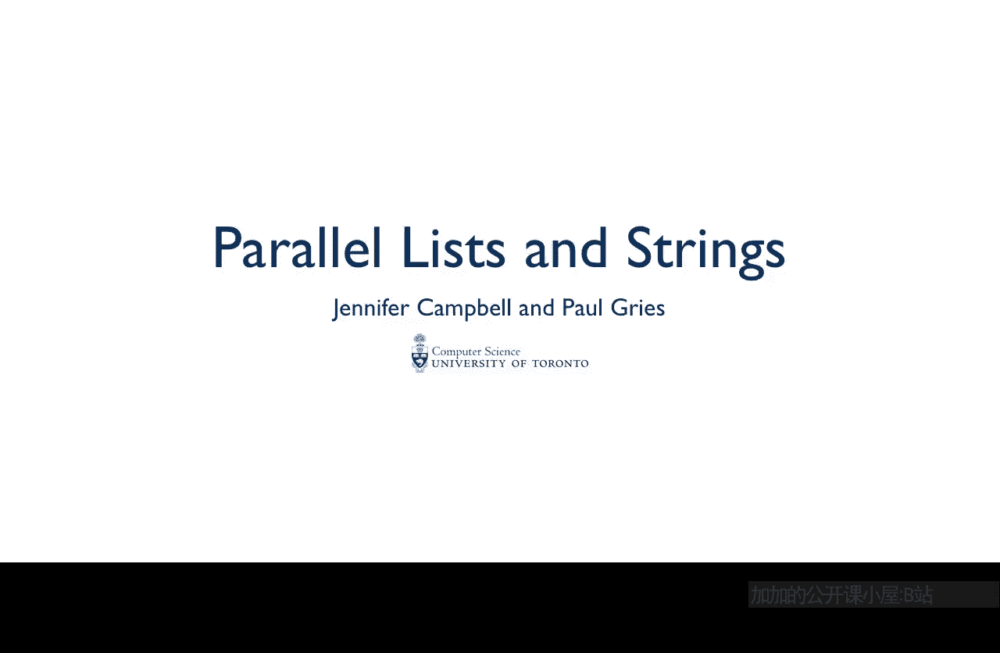

We've already used loops over indices when working with a single string or a single list。

In this lecture， we're going to use loops over indices to access the items at corresponding positions of two different lists and the characters at corresponding positions of two different strings。

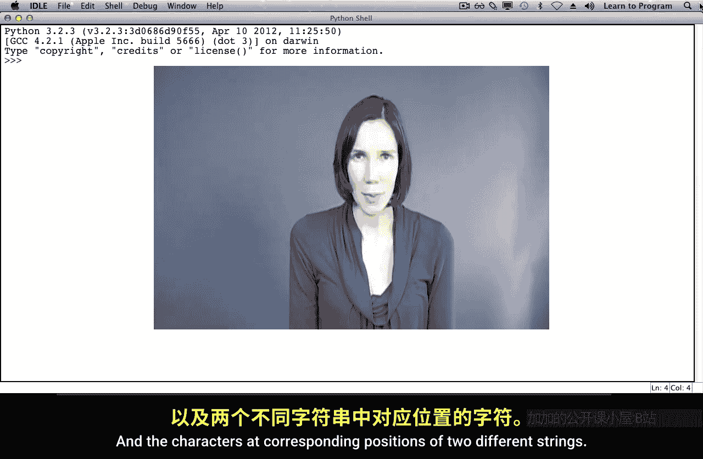

We will begin by implementing this function named some items。

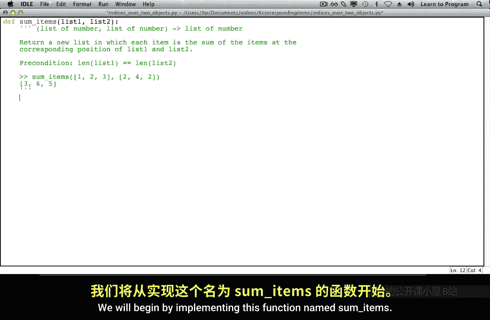

It takes two parameters， list 1 and list 2， which are both lists of numbers。

 and it returns a list of numbers。

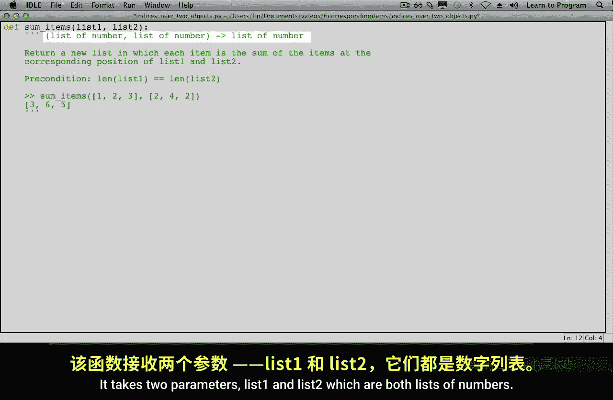

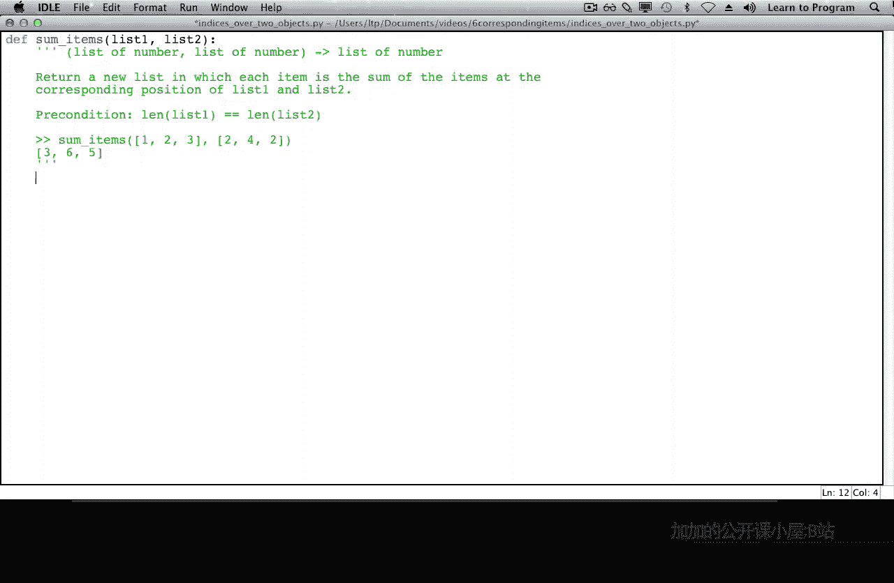

The job of the function is to return a new list in which each item is the sum of the items at the corresponding position of listist 1 and list2。

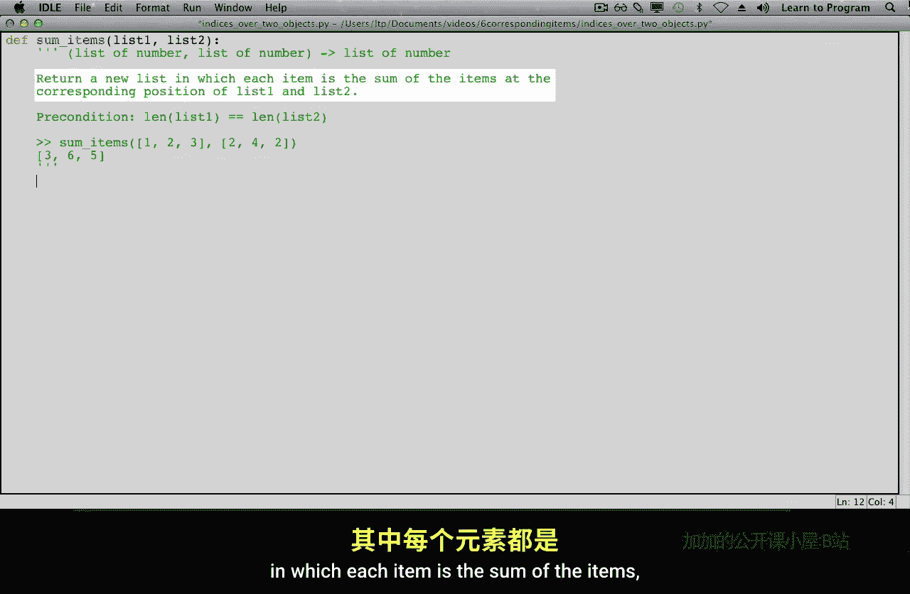

Let's explore what is meant by the phrase corresponding position。

If list1 refers to a list with three elements， values 1，2 and 3。

And list 2 refers to a three element list with values 2，4， and 2。

Then there are three elements in each list with indices 0，1 and 2。

When we say that we want to consider the corresponding elements of list1 and list 2。

 we're referring to the elements or the items which are at the same index。 For example， at index 0。

 there are values 1 and 2， and those are summed to get 3。At index 1， there are values 2 and 4。

 which are summed to get 6。 And at index 2， there are values 3 and 2， which when summed， yield 5。

This makes up the new list， which is returned by this function。Now， let's write this code。

We're going to return a new list， and so we'll create a variable sum list that will initially refer to an empty list。

This list will be built up one element at a time through the course of the function。

We saw when we were looking at the example that we use ind to access the elements of list1 and listist2。

So we want to loop over the indices for I in range of length of。

And now we can pass one of the two lists in here as an argument。

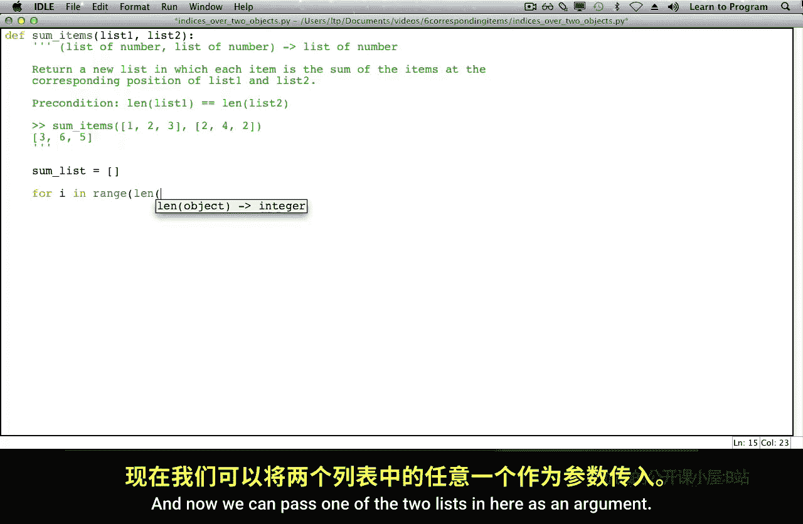

List 1 and list 2 will have the same length because of the precondition to this function shown above。

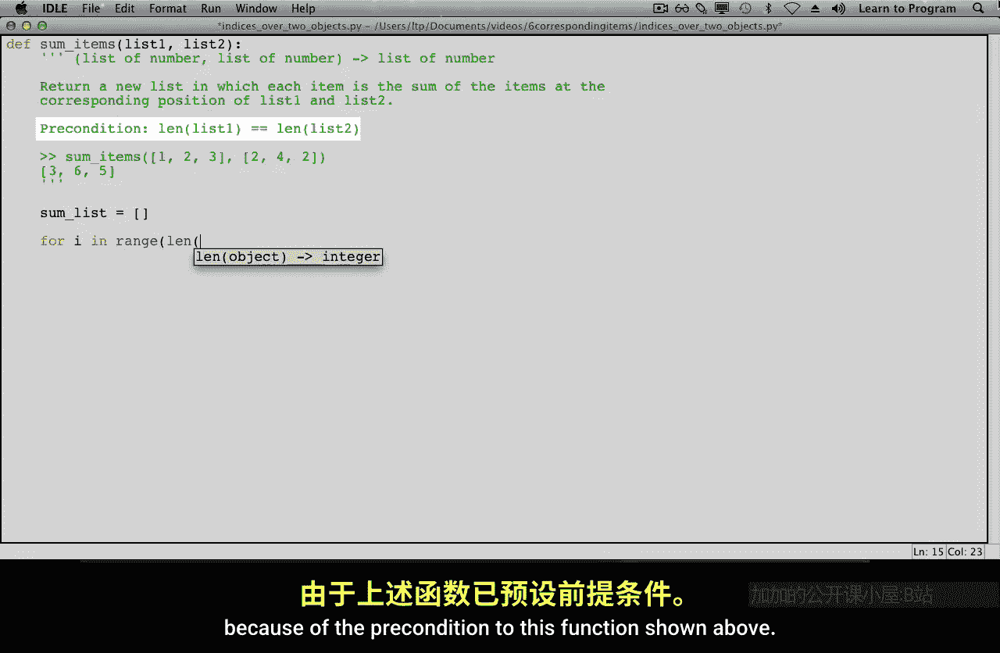

Therefore， I can pick either of the two lists， and I'll choose list  one。

To choose the length of list1， that means that range will generate values 01 up to。

 but not including the length of the list。In the body of the loop。

 we want to access list 1 at position I and list 2 at position I and sum them。

Once we've calculated the sum， we want to add that to the sum list。Yeah。

The list append method can be used to add that sum to the end of the sum list。

That's the only thing we need to do in the body of the for loop。

 Once the for loop has finished executing and exits， then we can return the sum list。

Now let's run the example function call。First， from the module and then in the shell。

 call the function， and we can see that it returns a list with values 3，6 and 5。

Let's implement one more function。The name of this function is count matches。

 and it involves two strings。 It has two string parameters。 S1 and S 2， and returns an int。

 which is the number of positions in string S 1 that contain the same character at the corresponding position of S 2。

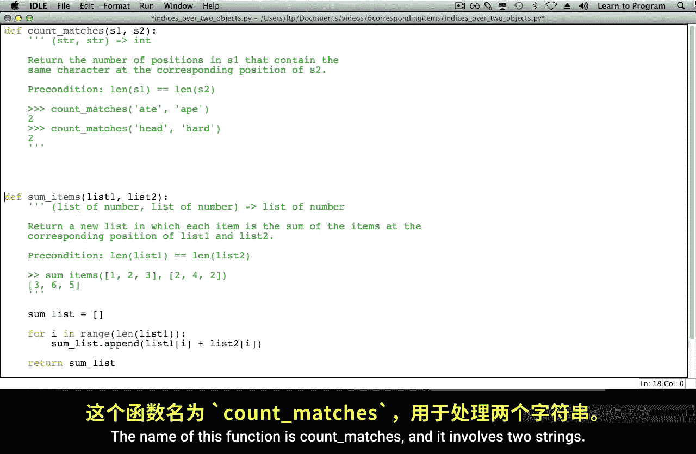

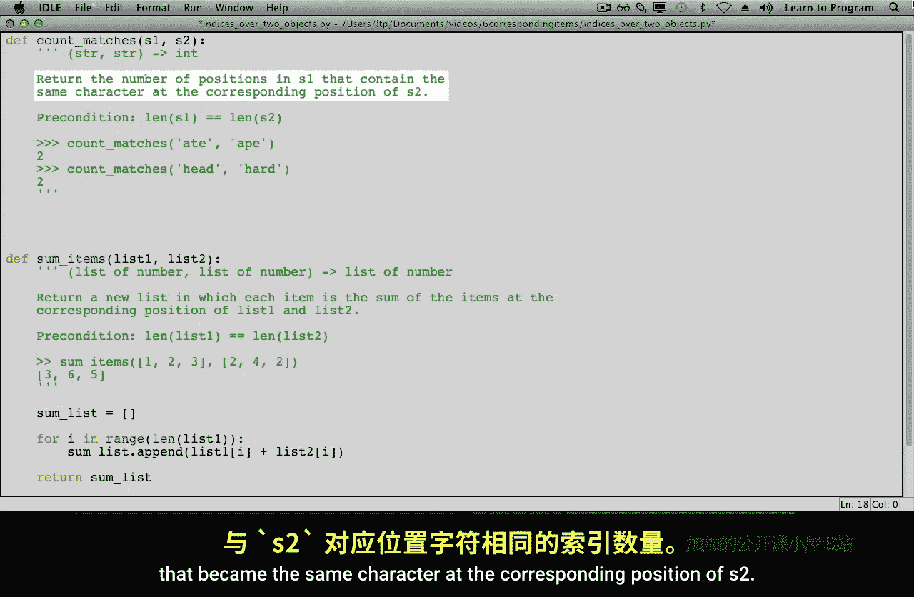

For example， for string ape。And string 8。There are two characters in common at index 0。

 there are A's， and at index。2， there are ease。For the string's head。And hard。

There are also two characters in common。The H is at index 0 and the D's at index 3。

The first step for implementing this function is to create an accumulator。I'll name it numb matches。

 and it will initially refer to the value 0。 That variable will accumulate the number of matches。

We saw that when we looked at the example， we were comparing the string characters at the same index。

That means we are going to write our loop over the indices of the strings。

So we use range starting from position0 or value0， up to the length of the string S1。

And what we'd like to do is compare the character of the string at S1。

 So if S1 at index I is equal to the string S2 at index I。Then， we found a match。

And we can increment that in the matches variable， adding one to it。

Once the loop has finished executing and we've passed over every character in the strings。

 then none matches is returned。Let's run the example function calls。First， the8 and ape example。

Returns to。And then， the head and hard example。Also it returns to。

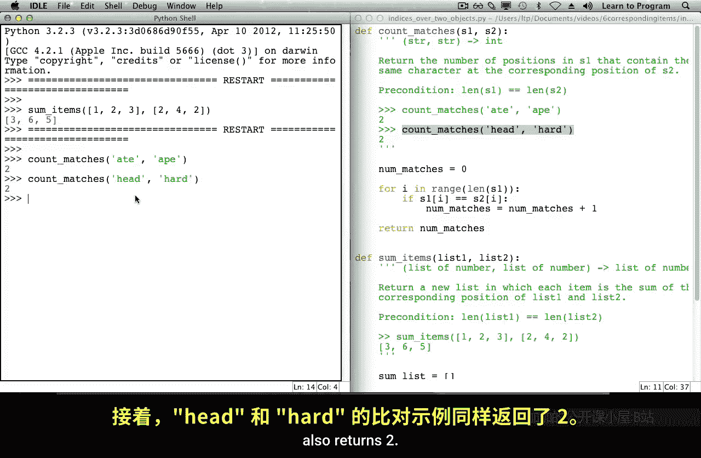